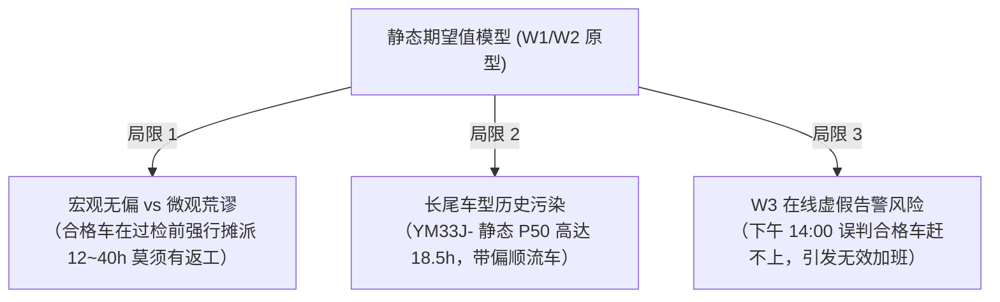

# 涂装车间 DSS 预测模型未来演进方向：双通关状态机与确定性预测架构

> **版本**：v1.0 (Draft)  
> **归档位置**：`docs/09-未来演进方向_双通关状态机与确定性预测.md`  
> **前置依赖**：W1 单车回放（已关账）、W2.1 排班接入（8.08% 达标关账）、W3 在线预测系统  
> **核心主题**：从“全局概率期望值均摊”迈向“制造拓扑与双通关离散状态机”

---

## 一、演进背景与现存痛点剖析

涂装车间决策支持系统（DSS）在 W1（单车 ETA 回放）与 W2/W2.1（班次级第 5 小时达成预测）阶段，构建了基于历史事件流的静态分布模型与排班日历映射，取得了关键成果：
- **W1**：验证了状态机切环与前决策补偿机制，量化了车间固有离散地板；
- **W2.1**：接入极简排班日历后，KW36/37 完备排班周全厂预测中位误差降至 **8.08% ✅（成功跨过 $\le 10\%$ 验收门）**，中班中位误差仅 **3.38%**。

然而，在针对最新 9月24日 数据进行单车深入解剖（如车身号 `78202664007604`）时，暴露出了**“静态大数定律期望值模型”在微观制造场景下的结构性痛点**：



1. **宏观无偏 vs 微观荒谬的矛盾**：
   - 现行直接估计器公式：$\text{ETA} = P50(\text{主}) + p_1 \cdot L_1 + p_2 \cdot L_2$；
   - 期望值 $p \times L$ 在全厂 600 台车求和时宏观无偏，但在单车物理现实中，**不存在“返工了 12 小时的车”**——车身要么一次性合格（+0h），要么返工进环（+40h）；
   - 这导致只要处于质检前夕的顺流合格车，单车预测下线时间会被集体推后半天甚至一天。
2. **长尾车型历史驻留的“株连”效应**：
   - 稀有长尾车型（如 `YM33J-`、`DM34%` 等）在历史数据中经常在清漆后的精饰面、特定配件装配区长时驻留，导致其干净主分布 $P50$ 本身虚高（达 18.5h）；
   - 一旦该车型出现一台无排队、无返工的“极限流速直通车”（实测 2.45h 下线），静态模型预测严重偏晚整整 **+28 小时**。
3. **对 W3 在线预警与调度的信任危机**：
   - 在 W3 在线每 5 分钟滚动预测中，若在制车被误判滞后，系统会在班次中后段（下午 14:00~15:00）频繁发出**“狼来了”式的虚假缺口告警**，调度员误以为无法达成目标而组织加班，严重损害系统的可信度。

---

## 二、实测物理拓扑依据：高度收敛的“决策门”

通过对数据库 `ods.carbody_history` 全量 630 余万条事件流的全面挖掘，实测发现了车间制造流转中的两条关键刚性规律：

### 1. 返工决策门（Quality Gate）：三大并行站覆盖 97.11%
全厂 259 个站点中，返工事件（`flag='1'`）的首次打标并非随机散布，而是**高度集中于清漆出炉后的三条平行质检分流工位**：

| 工位编码 | 工艺角色 | 历史首次打标量 | 占全厂返工比重 | 累计覆盖率 |
|---|---|:---:|:---:|:---:|
| **`15IS065`** | Line 15 质检与返修入口门 | 6,709 台 | 48.77% | 48.77% |
| **`13IS065`** | Line 13 质检与返修入口门 | 3,677 台 | 26.73% | 75.50% |
| **`14IS065`** | Line 14 质检分流门 | 2,972 台 | 21.61% | **97.11%** |
| *其余站点* | *终饰灯光质检（24IS185, 23IS170 等）* | *397 台* | *2.89%* | *100.0%* |

### 2. 黑顶二喷决策门（Process Gate）：两大主力站覆盖 72.72%
黑顶双色车（`flag='2'`，占全厂 12.2%）的二喷打标，同样高度收敛于两大分流工位：

| 工位编码 | 工艺角色 | 历史首次打标量 | 占黑顶总量比重 | 累计覆盖率 |
|---|---|:---:|:---:|:---:|
| **`14IS260`** | 色漆烘烤出炉后黑顶分流门 | 4,846 台 | 47.23% | 47.23% |
| **`24IS185`** | 清漆出炉后二次遮蔽分流门 | 2,615 台 | 25.49% | **72.72%** |
| *前 5 站合计* | *含 14IS065, 24IS115, 22IS170* | *8,703 台* | *84.83%* | *84.83%* |

> **关键物理洞察（制造状态的确定性坍缩）**：  
> 一旦车身顺利通过了上述物理分流门，并且保持 `flag='0'`：  
> 1. **黑顶风险出清**：过 `14IS260/24IS185` 且未分流 $\rightarrow$ 确定为单色车，后续返黑顶概率归零；  
> 2. **质量风险出清**：过 `13/14/15IS065` 且未分流 $\rightarrow$ 确定为一检合格品，后续返修概率从 30% 断崖式跌至 < 2.9%；  
> 3. **状态坍缩**：车身剩余工段只剩下终饰、灯光检测和交接连廊，**变身成没有任何概率干扰的纯物理流水线车**！

---

## 三、演进架构核心：工艺与质量「双通关状态机」

建议后续演进正式确立**「双通关状态机（Dual-Gate Cleared State Machine）」**，将车间在制车规范为清晰的三态物理模型：

```mermaid
stateDiagram-v2
    [*] --> PRE_GATE: 上线 (01IS205 / 1L360RB)
    
    state PRE_GATE {
        [*] --> 泳涂电泳中涂
        泳涂电泳中涂 --> 色漆清漆喷涂
        色漆清漆喷涂 --> 质检前夕 (L3ACC21IS02)
        note right of 质检前夕
            【未检概率盘】
            • 保留前决策期望值补偿
            • 增加补偿时长上限截断 (Capping ≤ 4h)
            • 调度预警权重: 中
        end note
    }

    PRE_GATE --> DUAL_CLEARED: 越过 065质检门 & 260/185黑顶门 且 flag='0' (80%+)
    PRE_GATE --> REWORK_LOOP: 打上 flag='1' (15%~18%)
    PRE_GATE --> BLACKTOP_LOOP: 打上 flag='2' (10%~12%)

    state DUAL_CLEARED {
        [*] --> 终饰修饰与灯光
        终饰修饰与灯光 --> 交接连廊冲刺下线
        note right of DUAL_CLEARED
            【确定性冲刺基本盘】
            • p1=0, p2=0 强制归零，补偿彻底清退
            • 解绑车型长尾滞留 P50 表
            • 直切物理工段累加节拍 (Sum Median)
            • 预测置信度 > 95%
            • 调度预警权重: 最高保底盘
        end note
    }

    state REWORK_LOOP {
        [*] --> 返工打磨重喷环线
        note right of REWORK_LOOP
            【返工隔离盘】
            • 切入 dim_loop_remaining
            • 标记长耗时 (10~40h)，脱离本班
        end note
    }

    state BLACKTOP_LOOP {
        [*] --> 遮蔽二喷专线
        note right of BLACKTOP_LOOP
            【双色工艺盘】
            • 切入黑顶环耗时 (5~11h)
        end note
    }

    DUAL_CLEARED --> [*]: 下线点 (K3IS140 等)
    REWORK_LOOP --> DUAL_CLEARED: 修复返线通关
    BLACKTOP_LOOP --> DUAL_CLEARED: 二喷完成通关
```

### 核心判定逻辑伪代码（Python 规格）

```python
# 核心通关判定集合
REWORK_GATE_STATIONS = {"13IS065", "14IS065", "15IS065"}
BLACKTOP_GATE_STATIONS = {"14IS260", "24IS185"}

def resolve_vehicle_state(events: list[Event], current_model: str) -> VehiclePredictionState:
    stations_passed = {e.station for e in events}
    latest_flag = events[-1].flag
    
    # 1. 进环态
    if latest_flag == '1':
        return VehiclePredictionState(mode="LOOP_REWORK", p1=0.0, p2=0.0, use_takt_sum=False)
    if latest_flag == '2':
        return VehiclePredictionState(mode="LOOP_BLACKTOP", p1=0.0, p2=0.0, use_takt_sum=False)
    
    # 2. 通关检查
    rework_cleared = bool(stations_passed & REWORK_GATE_STATIONS)
    blacktop_cleared = bool(stations_passed & BLACKTOP_GATE_STATIONS)
    
    if rework_cleared and blacktop_cleared:
        # 双通关：确定性冲刺基本盘
        return VehiclePredictionState(
            mode="DUAL_CLEARED",
            p1=0.0, 
            p2=0.0, 
            use_takt_sum=True,      # 直切流水线累加节拍 (Sum Median)
            exclude_dwell=True      # 脱离历史驻留长尾
        )
    else:
        # 未通关：概率盘（保留补偿，但限制单车补偿上限防暴雷）
        return VehiclePredictionState(
            mode="PRE_GATE",
            p1=resolve_p1(current_model, events[-1].station),
            p2=resolve_p2(current_model, events[-1].station),
            use_takt_sum=False,
            max_comp_cap_sec=14400  # 最大补偿截断 ≤ 4 小时
        )
```

---

## 四、W3 在线层的高阶红利：BOM 计划直通

黑顶（双色车身）与返工最大的不同在于：**它是生产订单决定的确定性属性**。

在未来演进中，结合 W3 接入周生产计划（或车身主数据 MDS 的车型配置代码），系统可实现**“免猜黑顶的降维打击”**：

1. **单色车身（占 88%）**：
   - 进厂上线（`01IS205`）第 1 秒起，配置系统直接注入 `is_two_tone = False`；
   - 算法直接将 $p_2 \equiv 0$ 永久置零，**全生命周期不再预扣一秒钟黑顶补偿**，彻底消灭全厂 88% 车辆在色漆段前的黑顶方差！
2. **双色车身（占 12%）**：
   - 上线起直接指定走“双色车专用工艺路线”，按固定包含二喷的流水线节拍推演，无需等待 `14IS260` 触发打标。

---

## 五、与 W3 核心业务功能的深度集成

双通关状态机的引入，将直接赋能 W3 决策支持系统的两大核心业务场景：

### 1. 赋能「突发故障停线推演（What-If 双轨制）」
- **场景**：色漆/清漆喷房突发故障停线 2 小时，调度员下钻推演班次达成影响；
- **状态机赋能**：
  - 系统根据工位位置秒级划分：
    - `DUAL_CLEARED`（已通关车）：处于喷房下游（终饰、质检、连廊），**完全不受喷房停线影响，继续按原节拍下线**；
    - `PRE_GATE`（未通关车）：处于喷房内及上游，下线时刻整体平移 $+2\text{h}$；
  - 自动输出精准的受损报告：*“停线 2 小时导致 22 台未通关车跨班，已通关的 35 台车仍可准时下线，建议仅需加班追赶 45 分钟”*。

### 2. 赋能「梯度分级预警（Tiered Deficit Alerting）」
将班次缺口告警从单一的“总数预测”升级为**分级高可靠度指标**：
- **刚性保底达成数**：$N_{\text{已下线}} + N_{\text{双通关冲刺车}} \quad (\text{置信度 } >98\%)$；
- **弹性预期达成数**：$N_{\text{刚性保底}} + \sum_{\text{未通关}} \mathbb{P}(\text{下线}) \quad (\text{置信度 } \approx 85\%)$；
- 只有当班次目标连“刚性保底 + 弹性预期”都无法覆盖时，才触发 P1 强提醒弹窗，从机制上根除误报。

---

## 六、工程实施路线图（四步走）

为了兼顾现有基线的稳定性（W2.1 8.08% 验收成果）与新机制的高效落地，建议采用以下分阶段演进路线：

| 阶段 | 核心任务 | 交付物 | 对现有系统的影响 |
|---|---|---|:---:|
| **Phase 1**<br/>(当前) | **知识与设计固化** | 归档 BM 单线程笔记与本规范文档（`docs/09-未来演进方向...`） | 纯文档，零风险 |
| **Phase 2**<br/>(W3 Spike) | **离线对比验证脚本** | 编写独立脚本 `spike_w1/04_replay_dual_gate.py`，输出 10 台样本车及全量回放窗的新旧估计器对打白皮书 | 增量脚本，不修改原有 W1/W2 表 |
| **Phase 3**<br/>(W3 部署) | **在线预测引擎集成** | 在 W3 在制车 5 分钟轮询服务中落地 `resolve_vehicle_state()` 路由器 | W3 生产级上线，直接收获高精度预警 |
| **Phase 4**<br/>(全面融合) | **BOM 计划与实时流速** | 接入周计划双色标识，将 Sum Median 升级为当前班次实时动态流速 | 完成 DSS 终极形态闭环 |

---

> **结语**：  
> 双通关状态机使涂装车间 DSS 模型摆脱了对静态概率期望值的过度依赖，真正扎根于车间的工艺拓扑与质检物理现实中，是实现从“离线数据验证”迈向“生产级高置信度决策”的必由之路。
