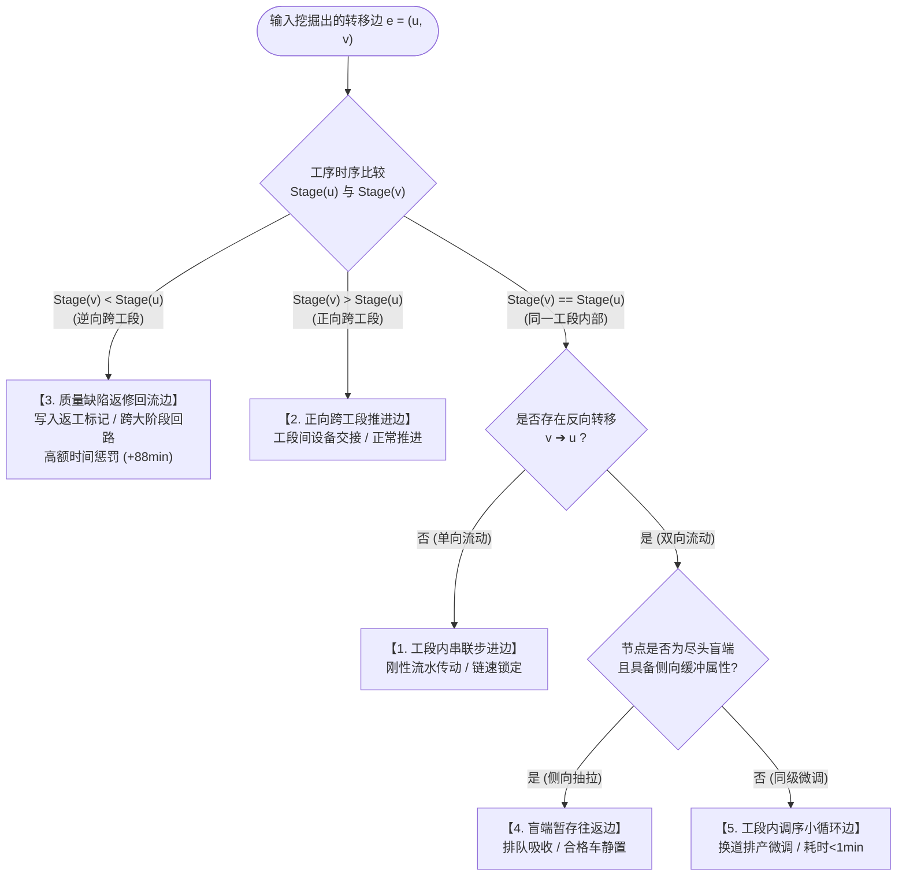

# 涂装车间读写站拓扑网络五种边的定义与判别规范

> **版本**：v1.0 (正式版)  
> **编制日期**：2026-09-27  
> **数据事实源**：PostgreSQL `analytics_db.ods.carbody_history`（84,274 辆真实产品车，633.9 万条过站流水）  
> **拓扑模型基准**：NetworkX 有向图（184 个活跃车身站点，306 条主要转移边）  
> **适用模块**：DSS 模块②（单车 ETA 动态预测 W1 + 班次产量达成预测与缺口预警 W2）  
> **关联资产**：[`topology/stations_catalog.json`](file:///F:/000_dev/Python/workplace/paint-dss/topology/stations_catalog.json) · [`topology/major_transitions.csv`](file:///F:/000_dev/Python/workplace/paint-dss/topology/major_transitions.csv) · [`output/full_shop_topology.png`](file:///F:/000_dev/Python/workplace/paint-dss/output/full_shop_topology.png)

---

## 一、 背景与定义哲学

在涂装车间的数字孪生与决策支持系统（DSS）中，有向边 $e = (u, v)$ **绝非人工在 AutoCAD 工艺布局图上主观绘制的几何线条**，而是**由 84,274 辆真实产品车在离散时间轴上的连续过站轨迹差分，经验马尔可夫挖掘生成的物理转移边**。

在车间生产现场，车身流动受输送链拖拽、机械道岔换向、升降移载、质检剔除及侧向缓冲等多重机械与管理机制控制。如果将所有边“一视同仁”作为普通连线，会导致预测算法出现严重失真（例如误将长达 1.5 小时的缺陷返修当成正常直通、或将侧向缓存排队误判为工序故障）。

因此，必须对车间全厂网络中的边建立严格的**物理工艺语义与算法数学分类规范**。

---

## 二、 五种边的分类总览矩阵

通过对全厂 306 条核心活跃边（独立车身数 $\ge 50$ 辆）的流向、耗时、标志位及机械动作分析，定义五大类转移边：

| 边的分类 | 边数量 | 转移次数覆盖 | 转移量占比 | 中位耗时 | P90耗时 | 核心物理功能与业务本质 |
| :--- | :---: | :---: | :---: | :---: | :---: | :--- |
| **1. 工段内串联步进边** *(Intra-stage Sequential)* | **166 条** | 3,564,899 次 | **65.1%** | **5.3 min** | **17.3 min** | **主干刚性流水**：同一工艺设备/线体内部传感器顺序传递，链速锁定，无分支决策。 |
| **2. 正向跨工段推进边** *(Forward Inter-stage)* | **65 条** | 1,013,459 次 | **18.5%** | **9.4 min** | **22.2 min** | **大工段交接**：上一工段向下一工段推进，跨越升降机、转运滚床或工序连廊。 |
| **3. 质量缺陷返修回流边** *(Quality Rework Feedback)* | **53 条** | 749,466 次 | **13.7%** | **7.3 min** | **31.1 min** | **质量缺陷逆流**：质检不合格车反向退回前序打磨或喷房重做，具有极高的闭环时间惩罚。 |
| **4. 盲端暂存往返边** *(Buffering Reversible)* | **14 条** | 131,277 次 | **2.4%** | **4.1 min** | **21.9 min** | **线平衡侧向抽拉**：车身垂直驶入尽头式缓存道暂存，随后原路退回主线，不改变工艺配方。 |
| **5. 工段内调序小循环边** *(Intra-stage Reorder Loop)* | **8 条** | 18,286 次 | **0.3%** | **0.9 min** | **3.0 min** | **排产调序换道**：多轨并联工序间的微型换向调整（如电泳出槽同色合批），秒级极速切换。 |

---

## 三、 五类边的逐项深度技术规范

### 1. 工段内串联步进边 (Intra-stage Sequential Edge)

- **物理本质**：车身在封闭的单个物理设备（如长烘房、喷房喷涂段、电泳槽体、直列强冷段）内部依次经过前后相邻的传感器。
- **判别条件**：
  1. $\text{Stage}(u) = \text{Stage}(v)$ 且同属一个工段区域；
  2. 源点与汇点之间为**单向流动**，反向边不存在（即无 $v \to u$）；
  3. 车身生命周期内重复过站比 $\text{Revisit Ratio} = \frac{\text{transition\_count}}{\text{car\_count}} \approx 1.0$；
  4. 耗时方差极小，$\text{P90} / \text{Median} \le 1.8$。
- **典型现场实例**：
  - `14IS065` (打磨2) $\to$ `14IS075` (准备2) $\to$ `14IS260` (喷房前)：中位耗时仅 0.60 ~ 2.22 分钟；
  - `17IS270` $\to$ `17IS285` (面漆2烘房内部连续测温段)：中位耗时 1.34 分钟，P90 仅 1.35 分钟（链速刚性锁定）。
- **DSS 算法处理**：
  - 在 W1（单车 ETA）中作为**确定性刚性延迟累加**，直接加上固定的中位物理输送时长。

---

### 2. 正向跨工段推进边 (Forward Inter-stage Edge)

- **物理本质**：车身从上一个主要工艺大阶段向下一个主要工艺大阶段物理交接（如预处理 $\to$ 电泳，电泳 $\to$ PVC密封，面漆烘房 $\to$ 终检报交）。
- **判别条件**：
  1. $\text{Stage}(v) > \text{Stage}(u)$（工序时序等级严格单向增加）；
  2. 往往伴随设备移载机、穿梭台车（Shuttle）或垂直升降机（Lifter）动作；
  3. 耗时中位数通常略大于工段内步进边（中位 9.4 分钟），包含工段间的等待与输送。
- **典型现场实例**：
  - `01IS205` (预处理2线) $\to$ `02IS125` (电泳1线主槽)：大工段交接；
  - `06IS105` (雪橇交接线) $\to$ `10IS255` (粗密封/PVC入口枢纽)：跨工段主干转移；
  - `20IS225` (面漆缓存2出口) $\to$ `23IS005` (报交2.1线出口)：中位耗时 2.55 分钟。
- **DSS 算法处理**：
  - 属于生产线主节拍控制点。若存在 1-to-N 分流，需根据历史分流矩阵计算前向转移概率 $P(v \mid u)$。

---

### 3. 质量缺陷返修回流边 (Quality Rework Feedback Edge)

- **物理本质**：终检或检查工位发现车身漆面质量缺陷（颗粒、流挂、橘皮、色差），机械道岔换向将车身送上返修回送轨道，退回前面工段重新打磨、重新喷涂或局部修补。
- **判别条件**：
  1. **逆工序跨度**：$\text{Stage}(v) < \text{Stage}(u)$（在拓扑图上表现为红色大逆流弧线）；
  2. **分流概率对应缺陷率**：在起点质检站的分流概率 $P(u \to v) \le 15\%$（绝大多数车合格直通下线，少数缺陷车回流）；
  3. **返工标志位写入**：回流车身在进入打磨站（如 `13IS065 / 14IS065 / 15IS065`）后，滑橇芯片写入 **`MDS_DATA[139] = '1'`（返工标记）**；
  4. **时间惩罚极大**：虽然返工回送边本身的转运很快（如 30 秒 ~ 1 分钟），但由于必须重跑整套喷涂、烘干、强冷流程，导致**闭环全流程重跑时间惩罚高达 80 ~ 120 分钟**。
- **典型现场实例**：
  - `23IS340` (终检/修补出口) $\to$ `14IS120` (L3F10 返修准备线2)：7,412 辆车，回送耗时仅 34 秒，随后重跑面漆打磨与喷涂，总重跑时间 88.7 分钟；
  - `23IS340` $\to$ `22IS340` (点修补1线出口)：3,440 辆车，转入局部点修补。
- **DSS 算法处理**：
  - 在状态转移矩阵中构建瞬态回流子矩阵 $Q$；
  - 运用**吸收马尔可夫链（Absorbing Markov Chain）**求解基础矩阵 $N = (I - Q)^{-1}$，计算返修对班次总产量的工位占用损耗与单车 ETA 期望延迟。

---

### 4. 盲端暂存往返边 (Buffering Reversible Edge)

- **物理本质**：车身因主线停线、喷房换色或积放控流，被侧向平移拉入尽头式暂存轨道（Pocket Track / Spur Line），待空档产生后再原路退回主线。车身本身完全合格。
- **判别条件**：
  1. **严格双向对偶**：节点对之间存在完全对称的双向流动（$u \to v$ 与 $v \to u$ 频次相当）；
  2. **盲端拓扑拓扑角**：暂存节点 $v$ 的出入度均受限于该主线节点，不通向下游其他工艺段；
  3. **车身标志位不变**：车身始终保持合格品状态（`MDS_DATA[139] == '0'`），不产生返工标记；
  4. **纯排队等待**：流转耗时等于车身在侧轨上的静态停留时间（Queueing Time，10 ~ 40 分钟），不产生任何物理重复加工。
- **典型现场实例**：
  - `14IS330` (面漆打磨出口) $\to$ `14IS400` (面漆控制缓存道，47,274 辆车，等待 7.5 分钟) $\to$ `14IS260` (原路退回主线进入喷房入口，47,195 辆车，等待 18.3 分钟)。
- **DSS 算法处理**：
  - 建模为**工序内缓冲器（Buffer Queue）**。在实时预测中，通过读取暂存道内的实时在制品（WIP）数量，动态折算为主线车流的通过等待延迟。

---

### 5. 工段内调序小循环边 (Intra-stage Reorder Loop Edge)

- **物理本质**：在同一工段局部的多轨道并联区或转盘处，为了实现同颜色批量排产、出车批次对齐或急件插队，车身通过局部移载滑道微调出车顺序。
- **判别条件**：
  1. $\text{Stage}(u) = \text{Stage}(v)$（完全处于同一大工段内部）；
  2. 环路极其短小（Cycle Length = 2 或 3）；
  3. **耗时极微小**：中位耗时通常 $< 1.0$ 分钟（仅为机械滑道换向动作耗时）；
  4. 车身完全合格，无返工标记，仅出车时间序列（Sequence Index）被重组。
- **典型现场实例**：
  - `05IS163` (电泳缓存2出口) $\leftrightarrow$ `28IS050` (前处理电泳缓存出口)：双向换向调序（2,310 辆车，中位耗时仅 46 秒，用于微调进入密封线的车型顺序）。
- **DSS 算法处理**：
  - 在宏观拓扑中，此类极小微环在算法上可采用**强连通块收缩（SCC Contraction）**合并为单一宏观等价节点（Macro Node），消除代数环冗余，大幅提升 ETA 矩阵求解效率。

---

## 四、 判别算法流程图（Decision Flowchart）

对于从数据库中挖掘出的任意一条转移边 $e = (u, v)$，按以下标准化逻辑进行严格判定：

---

## 五、 特殊工段实测核验结论备忘

### 面漆缓存线2（20IS）核验定论（2026-09-27）：
- **实测结论**：面漆缓存线2（`20IS010` $\to$ `20IS225`）**100% 为刚性的“工段内串联步进边”，绝对不存在任何“调序小循环”**。
- **物理原因**：该段为面漆出炉强风冷却与直列积放输送链（中位耗时 12.17 分钟用于降温），机械上为不可逆单向直通滚床，无任何并联道岔、掉头转盘或循环机构，严格遵循先进先出（FIFO）。

---

## 六、 维护与变更约定
1. **单一事实源原则**：任何边的重新分类必须有底层过站流水（`ods.carbody_history`）时序与耗时数据支撑，严禁人工按图臆造。
2. **代码同步**：本规范对应的分类逻辑固化于 [`topology/build_shop_topology_graph.py`](file:///F:/000_dev/Python/workplace/paint-dss/topology/build_shop_topology_graph.py)，生成的标准图模型保存在 [`topology/shop_topology.graphml`](file:///F:/000_dev/Python/workplace/paint-dss/topology/shop_topology.graphml) 与 [`topology/shop_topology.json`](file:///F:/000_dev/Python/workplace/paint-dss/topology/shop_topology.json)。
