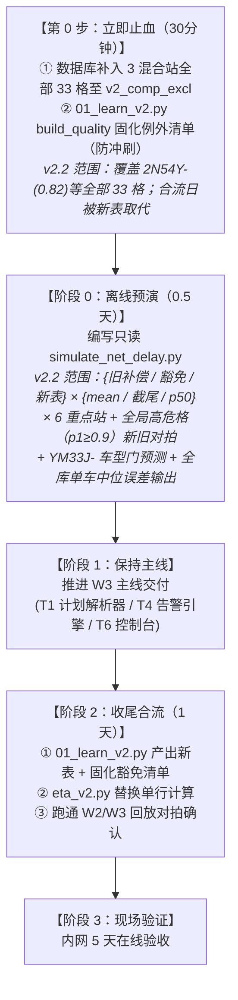

# 涂装车间 DSS 返工补偿机制问题诊断与期望净延误重构方案 (v2.2.1)

> **文档编号**：10  
> **文档版本**：v2.2.1 (2026-09-27) —— 独立复核（对拍全部命中：33 格/399 格[⑥a 口径]、147 格/51 站、SCC 75/9/106 站、4 处工位站性勘误、build_quality 冲刷机制）；返修链内 p≈1 站「歪打正着」口径实测修正（深层 22IS 走廊旧模型反而系统性低估 60~70h，见 ②③.1 与门禁 4）。v2.2 (2026-09-27) —— 吸收再次审核：全库 33 格（同站同类）与 399 格（全局高危）冰山真相口径披露；工位站性两处勘误（L3ACC21IS02=面漆喷房2、22IS005=报交1.1线出口、22IS340=点修补1线出口、22IS520=点修补1线入口，区域定名“末段质检走廊”）；豁免规模修正为 147 格/51 站；第二迭代明确最大 SCC（75 站）与多 SCC 并集（106 站）；表结构补充 sample_n_clean；S0 止血与 01_learn_v2.py build_quality 固化绑定；v2.1 吸收独立审核报告；v2.0 吸收 DB 实测。  
> **涉及模块**：W1 节拍表（只读复用，零代码改动）、W2 学习器 (`01_learn_v2.py`) + 估计器 (`eta_v2.py`)、W3 影子回放 (`predictor.py`，消费新引擎，零改动)  
> **核心对象**：返工延误补偿 ($p_1 \times L_1$)、`dim_loop_remaining` 环表、高返修车型 (`YM33J-`)、混合漏网工位 (`22IS340` / `L3ACC21IS02` / `22IS520`)

---

## 一、诊断确认的核心机理与事实修正（DB 实测支撑）

基于数据库全量数据只读复核（`04-14` ～ `09-24`）与历史产物对拍，最终确认的机理与事实边界如下：

### 1. 核心实锤断言（复核全部成立）
- **L1 现值失真**：`YM33J-` 在 `dss.dim_loop_duration` 中 $L_1 = \mathbf{143,823s \ (39.95h, n=2015)}$，远超该车型无返修干净车全行程时长（P50 = 29.7h）。
- **MES 标记污染根因**：全量 13,754 辆打标返修车中，高达 **93.49%（12,859 辆）在返修出环回到主线后，MES 从未将 `MDS_DATA[139]` 复位为 `'0'`**。
- **物理统计错误**：由于标记常驻，原公式 `max(t) - min(t) FILTER (WHERE flag='1')` 计算的不是“环内净耗时”，而是**“从首次进环到最终下线口的整段剩余时间”**。
- **双重累加效应**：直接估计器将 $T_{\text{clean}} + p_1 \cdot L_1$ 叠加，导致下游主线路径被**重复计算了 2 遍**。*(v2.1 量化注（2026-09-26 实测）：双算项 = $p_1 \times \mathrm{rem}@\text{首标站}$，仅占总补偿的 ~32%（2N54Y- 0.53h/1.67h）~48%（YM33J- 6.18h/12.75h）——机制成立、量级非全额。)*

### 2. 关键事实修正与冰山真相深度披露

#### ① 22IS005 已被豁免，真正的残余爆炸点是「漏网工位」
- **现状确认**：W2 已有 ⑥b 补偿豁免表 `dss.v2_comp_excl`（共 **147 格**，覆盖 51 个不同工位；YM33J- 覆盖 24 格/24 站），**22IS005 实际上已被加入豁免清单**（补偿已被强制置 0）。
- **车间拓扑定位与站性勘误（双源实锤：`shop_topology.json` + `stations_catalog.json`）**：
  - `L3ACC21IS02`：**面漆喷房2**（累加器进料口，非“报交线”）；
  - `22IS340`：**点修补1线出口**；
  - `22IS520`：**点修补1线入口**；
  - `22IS005`：**报交1.1线出口**（已豁免，非“点修补入口”）；
  - 区域统称修正为：“**末段质检走廊（面漆喷房2 → 点修补1线 → 报交1.1线，全程 62%～76% 处）**”。车辆在经过这些工位后，仍有相当比例的车被质检发现缺陷并再次送往返修。*(v2.1 注：22IS 区 p1 剖面为“返修专线段（005~170 p≈0.99~1.0、625 p=0.983）+ 主线决策区（340~520 p 0.53→0.14→0.21）”混合体，非单调主线。)*
  - 真正返修概率严格收敛至 0 的物理末端是 `25IS110` 之后（`32IS`、`35IS`、`K3` 出口系列）。
- **真正的残余爆炸点（YM33J- 视角 Top 3）**：
  | 工位编码 | 工位性质（权威定义） | YM33J- $p_1$ | 现行残余补偿量 | 豁免状态 |
  | :--- | :--- | :---: | :---: | :---: |
  | **22IS340** | 点修补1线出口 | 0.5313 | **+21.2h** | ❌ **漏网（未豁免）** |
  | **L3ACC21IS02** | 面漆喷房2 | 0.2993 | **+12.0h** | ❌ **漏网（未豁免）** |
  | **22IS520** | 点修补1线入口 | 0.2103 | **+8.4h** | ❌ **漏网（未豁免）** |
  | 22IS005 | 报交1.1线出口 | 0.9930 | （39.7h） | ✅ 已被 ⑥b 豁免 |

  > *(v2.1 口径注：表内 p1 为 W1 `dim_future_flag` 值；W2/W3 运行时实际消费 `v2_future_flag` ⑥a 净化值 0.5400 / 0.2927 / 0.2147 / 0.9929，差异 <1pp。新表 P(fut) 与消费端同源，用 ⑥a 值。)*

#### ② 漏网规模的冰山真相披露（v2.2 核心增补）
实测全库扫描（$p_1 \ge 0.1, n \ge 30$，未在 `v2_comp_excl` 豁免）：
1. **同站同类格漏网（33 格）**：
   上述 3 个工位上，未豁免的高危格共计 **33 格**（22IS340×7、22IS520×7、L3ACC21IS02×19，含 3 个 'ALL' 兜底）。不仅 YM33J- 漏网，主力车型 **`2N54Y-`（$p_1=0.816, n=825$，单辆补偿 12.9h）**、`IE14.-`（0.509）、`YM34K-`（0.508）等 **30 个车型格全部处于未豁免爆炸状态**！
2. **全局高危未豁免格（399 格）**：
   放眼全库，$p_1 \ge 0.3$ 且未豁免的格多达 **399 个**，且大量 $p_1 = 1.000$（如 `22IS110@YM33J-` 补偿 40.0h、`21IS565@IE14.-` 36.5h）。
3. **为什么文档聚焦上述 3 站？**
   - **返修链内站（399 格大头）**：$p_1 \approx 1.0$，车到此处基本 100% 返修、永洁车 ≈0，故旧补偿**不存在“永洁车被虚加几天”的穿帮**。但“歪打正着”仅部分成立（v2.2.1 实测修正）：上游决策站中位接近旧 ETA（21IS565/IE14.- 真值中位 40.1h vs 旧 ETA ≈40h，n=330），而**深层 22IS 走廊反而系统性低估**（22IS110/YM33J- 真值均值 106.1h / 中位 69.3h (n=523) vs 旧 ETA ≈42h；22IS060/YM33J- 真值均值 110.4h / 中位 70.8h (n=524)）——因新表 delay 列 ≈ E[rem|fut=1]−base，此类站**反而向真值收敛**（正收益副作用，预期显著缓解 YM33J- 日班系统性低估）；
   - **混合决策站（聚焦的 3 站）**：大量永洁主线车与返修车共同经过，导致永洁车被强行累加数十小时，肉眼可见严重穿帮。
4. **处置定调**：
   - **S0 止血范围**：必须覆盖这 3 个混合站上的**全部 33 格**（针对全车型生效，不能只插 YM33J-）；
   - **S0 持久化绑定**：`v2_comp_excl` 是全量重建表，**S0 必须同步将 3 站写入 `01_learn_v2.py` 的 `build_quality` 人工例外白名单**，防止重跑清空。

#### ③ 不是单纯的“系统性偏大”，而是“双峰混合的双向错配”
实测数据（V4c）表明，`YM33J-` 本质上是**双峰混合分布**（~67% 永洁车耗时 20～30h，~33% 严重滞留返修车耗时 68～73h+）：
- **永洁子组（未来不再返修）**：在 22IS340 实际剩余仅 19.9h，预测被补偿推至 40.8h $\rightarrow$ **严重高估 +20.9h**；
- **将返工子组（未来重返修）**：在 22IS340 实际剩余高达 68.9h，预测 40.8h $\rightarrow$ **反而严重低估 -28.1h**！
- **宏观反映**：在班次级上，`YM33J-` 表现为**日班近乎一致低估（-26% ～ -46%）**（W2 v3 全窗回放 15/16 班）、中班小样本过补偿（+60% ～ +640%，实际中位仅 10.5 台/班，13/14 班为正）。单个标量补偿对两拨车同时犯错。*(数据源：`w2_replay_models_20260921.csv`，W2 v3 全窗 5h 锚点回放，非 W2.1 排班版。)*

#### ④ 漏网之鱼：`dim_loop_remaining` 表的同源污染
MES 标记未复位不仅污染了主线补偿项，还导致车辆返修出环回到主线后 `flag` 依然常驻为 `'1'`。这使车辆继续走 `eta_v2.py` 的环内预测通路（line 103-112），导致 `dim_loop_remaining` 表中混入了大量出环后的主线事件（如 YM33J-@L3ACC11IS02 的 loop_rem f1 P50 高达 66h）。**此通路在第二迭代治理**（SCC 切环 + 环类型细分）；第一迭代不动环内通路，故第一迭代验收**不承诺返工车组改善**（其 W2 误差 +73.16% 主体在此路径）；内网 5 天在线验收返工组单独跟踪（docs/01 惯例）。*(v2.1 注：曾评估过的低成本 quick-win——末端 p=0 站把 flag=1 改走主线基线——实测排除：loop_rem@25IS110 f1 = 3.2h vs 干净 12.8h，两人群不同，SCC 切环是唯一正解。)*

---

## 二、重构方案：无偏双列站级期望净延误模型

为根除上述缺陷，重构方案废除 $p \times L_1$ 的标量乘积，建立无偏、双列、分层退化的期望延误模型。

### 1. 数学模型（条件集分解与无偏性保障）
$$\widehat{T}_{\text{rem}}(s) = T_{\text{clean\_baseline}}(s) + \Delta T_{\text{expected}}(s, \text{车型})$$

为保持宏观预测的无偏性，期望净延误按**未来进环事件**严格分解，并**坚决不在个体样本级做 `max(0, ·)` 截断**（实测个体截断会引入 1.6h～2.9h 的人为白补正向偏置）：
$$\Delta T_{\text{expected}}(s, m) = P_{\text{clean}}(\text{fut} \mid s, m) \times \mathbb{E}\big[ T_{\text{rem}, i}(s) - T_{\text{clean\_baseline}, m}(s) \;\big|\; \text{fut}=1 \big] + \text{基线修正项}$$
- **$P_{\text{clean}}(\text{fut} \mid s, m)$**：v1 表统一用 **⑥a 全窗**概率（来自 `dss.v2_future_flag`，与 diff 同窗，避免滚动 8 周与全窗混用的季节性错配——返工率月度双峰：04 23.5% / 06 10.8% / 07 23.1% / 09 15.5%）；周度化留作后续增强（周度 p 价值 W2.1 已证明，交互复杂度 v1 不背）。
- **净延误期望**：仅在聚合生成最终维表值时执行外层截断 $\max(0, \Delta T)$，内部样本允许负值抵消，保证统计均值无偏。
- **基线修正项（v2.1 定义）**：`mean(rem_clean) − p50(rem_clean)`（按 (车型, 工位)，与基线同人群过滤）。基线取 P50 而干净组自身有肥右尾（实测 22IS340/YM33J- 永洁组 P50 19.9h vs 均值 45.2h、P90 96h；01IS205/ALL +8.6h）——漏掉此项，`delay_mean_s` 会系统性低估（该站量级达 ~25h）。**只进 `delay_mean_s`，不进 `delay_p50_s`**。
- **diff 与基线同源一致性**：引擎 `base = resolve_cohort_p50(...) or resolve_main(...)`——diff 必须对引擎实际消费的基线学习（cohort 混合基线可用时按 cohort 基线或按 cohort 分行学习），否则残留 $P(\text{fut}) \times (\text{base}_{\text{cohort}} - \text{base}_{\text{main}})$ 量级残差（分钟级~小时级，量小但须成文）。
- **极端肥尾下均值脆弱**：22IS340 返工组均值 116.5h（P90 ≈ 233h），个别 10 天滞留车可拉动 `delay_mean_s` 分钟级。阶段 0 预演须同出 **mean / 截尾均值（P5~P95 winzorize）/ p50 三列**，按稳定性（n_fut≥30 且变异系数检查）逐站选列，选择结果留档。

### 2. 维表设计 (`dss.dim_expected_delay`)
同时存储 Mean 与 P50，满足不同业务层级需求：
| 字段名 | 类型 | 说明 |
| :--- | :--- | :--- |
| `body_type` | TEXT | 车型（含 `'ALL'` 兜底） |
| `station` | TEXT | 工位编码 |
| `delay_mean_s` | BIGINT | **期望均值延误（秒）**：⚠️ **W4.4b 勘误（2026-10-06）——原定位「供 W2/W3 班次级达成预测使用（加法无偏）」已被 G2 阈值计数实测证伪**：延误分布肥尾右偏（1,793 行 91% mean>2×p50，中位比值 3.77×），加法无偏仅在总量场景成立；班次产量预测是阈值计数（ETA 过不过班末阶跃函数），mean 列把 ETA 系统性推晚 → 班次产量低报（D 臂 −20.78%）。**mean 列在现行度量体系内已无合法消费场景，留表内仅诊断用途** |
| `delay_p50_s` | BIGINT | **中位延误（秒）**：供 W1 单车 ETA、单车看板，**及 W2/W3 班次级达成预测**（W4.4b 修订 2026-10-06：shift/vehicle 两档均消费本列，b 臂 10.60%/+0.71% ≈无偏）（抗停线离群）。**p≥0.5 站（如 22IS340）此列语义 = 返工轨迹条件 ETA**（混合 P50 落在返工簇 ≈68.9h） |
| `sample_n` | INT | fut=1 差分样本量（用于判定进环统计是否充分） |
| `sample_n_clean`| INT | **无返工干净基线样本量**（v2.2 补齐：用于双人群 N≥30 门槛判定） |

> **单车误差结构性下界（v2.1 明示）**：p≥0.5 站上，标量（无论取何分位数）无法同时摆对两簇——永洁组必被高估 ≈ `delay_p50_s`、返工组必被低估 ≈ (1−p)×Δ（22IS340 逐车符号中位落在返工簇 ~−23h）。真正的单车修复在第二迭代（SCC 切环后 flag 分支 + 环类型条件化）；第一迭代**不承诺 p≥0.5 站的单车精度**，看板文案按“返工轨迹条件 ETA”语义写。

### 3. 三级平滑退化树（防小样本抖动）
实测发现 `YM33J-` 在个别末端工位干净车样本极少（如 22IS005 干净样本仅 $n=5$），容易被单台车离群拉飞。设计三级收缩退化链：
$$\text{Level 1: } (m, s, N \ge 30) \longrightarrow \text{Level 2: } (\text{车型大类}, s, N \ge 30) \longrightarrow \text{Level 3: } ('ALL', s, N \ge 30) \longrightarrow 0$$
- **车型大类规则（v2.1 定义）**：默认 = `body_type` 前 2 字符（YM / 2N / IM / SS / DM / XV …）；若业务提供平台映射表则用映射表（固化进 `dss` 维表或常量）。
- **双人群 N≥30 门槛（v2.1 定义）**：`sample_n_clean` 与 `sample_n` (fut=1) **各自** $\ge 30$；任一不足即降下一级。
- **末级兜底 = 0 须配监控**：缺行回退 0 会把“有返修但无表”的站变成纯低估。回归跑数须输出**表覆盖率报告**（缺行站×车型清单，其中 p1≥0.1 的格子单独告警）；全局回滚由 `DSS_USE_NET_DELAY=0` 覆盖。

### 4. ETA 查表计算逻辑 (`eta_v2.py`)
```python
def estimate_event_v2(t: int, station: str, flag: str, model: str, week: str, tables: dict):
    # 1. 环内车辆：若有图判定进入SCC，查新loop_rem；降级走原口径
    if flag in ("1", "2"):
        return estimate_loop(t, station, flag, model, tables)
    
    # 2. 主线车辆：基线 + 期望延误
    base = resolve_cohort_p50(...) or resolve_main(tables["rem"], station, model)
    if base is None:
        return None, False
    
    # 3. 查站级期望延误（两档均用 p50——W4.4b 修订 2026-10-06，原「班次级用 mean」已证伪）
    delay = resolve_expected_delay(tables["expected_delay"], station, model, mode)
    eta = t + int(round(base + delay))
    return eta, True
```

**优先级（v2.1 成文）**：
- `DSS_USE_NET_DELAY=1` 且 `flag=0`：`base + delay` **取代**旧 `p×L1 + p×L2`；`v2_comp_excl` 仅对旧路径生效，新表上线后对相应站**取代豁免**（豁免为过渡态，合流日即被取代）。
- `flag∈{1,2}` 环分支第一迭代不变（治理在第二迭代）。
- W3 `predictor.py` 走本入口（`rem/α` 连带缩放 delay，合理；9.79% 影子基线须在 `DSS_USE_NET_DELAY=1` 下重跑确认无双重修正）。

---

## 三、图资产（CodeGraph/拓扑图）的演进定位

**核心决断：图资产是「第二迭代的结构性增强」，而非「本次止血修复的阻塞前置项」。**

| 演进阶段 | 实施内容 | 解决的核心痛点 | 耗时 |
| :--- | :--- | :--- | :---: |
| **第一迭代<br>(当前任务包)** | ① 豁免清单立即补漏（覆盖 3 混合站全部 33 格，固化进 `01_learn_v2.py`）；<br>② 落地站级双列净延误表 `dim_expected_delay`；<br>③ `eta_v2.py` 切换查表与三级退化。 | 拔除末端显性穿帮炸点；<br>校准 YM33J- 期望预测中枢；<br>杜绝 MES 标志常驻引起的双重累加。 | **1 天** |
| **第二迭代<br>(后续增强)** | ① 基于图的**最大 SCC（75 站）**自动定义返修区（涵盖 13IS/14IS 决策簇、15~21IS、22IS 全系、23IS、24IS、L3ABC/L3ACC 系；若取 SCC>1 并集共 9 个/106 站；25IS110 之后严格不在其中），彻底废除人工维护的豁免清单；<br>② 基于“进入 SCC $\rightarrow$ 离开 SCC”切分纯净段，**重构 `dim_loop_remaining` 表**；<br>③ 净延误按**具体环类型**（返喷环/修补环）细分分层。 | 彻底治愈 `loop_remaining` 污染；<br>从根本上把双峰分布拆解为具体路径条件概率；<br>为 W3/W4 单车数字孪生看板提供精准拓扑接口。 | **1.5～2 天** |

---

## 四、实施排期与推进节奏



---

## 五、验收门禁与安全兜底

1. **末端爆炸残余收敛（v2.1 改写，门值由阶段 0 预演定）**：
   - (a) **均值口径（W2/W3）**：三站 `mean(ETA−actual)` 绝对值相对基线显著下降（X 由预演定；22IS340 从当前 −43h 改善到 ≤−15h 量级）；
   - (b) **单车口径（W1 复验）**：三站逐车符号中位误差改善；预演同时输出全库单车绝对中位误差（对齐 W1 ≤30min 标准）；
   - (c) **永洁组高估（+20.9h 类“穿帮”）**：p<0.5 站以 `delay_p50_s` 口径收敛；p≥0.5 站（22IS340）明示为“返工轨迹条件 ETA”；
   - (d) **3 个已豁免站的正收益证据**（22IS005 / L3ACC11IS02 / 22IS625，当前均值低估 **−64h ~ −113h**）：新表 ETA 近乎完美对齐真值，纳入阶段 0 对拍输出。
2. **YM33J- 改善幅度以阶段 0 预演实测为准**：
   - 鉴于双峰混合物理限制，由阶段 0 模拟根据真实收敛幅度确定正式门限（预期从 42.67% 降至 15%~25%）。
3. **宏观指标不劣化（双基线核验）**：
   - W2.1 引擎 KW36/37 场景 3 保持在 **$\le 10\%$**（基线 8.08%）；
   - W3 影子回放引擎（α=off）保持在 **$\le 10\%$**（基线 9.79%）；
   - 在 `DSS_USE_NET_DELAY=1` 下分别核实。
4. **全局高危格（p1≥0.9）新旧对拍核验（v2.2 增补，v2.2.1 口径修正）**：
   - 阶段 0 预演必须单列全库 $p_1 \ge 0.9$ 的格在新旧引擎下的残差分布。判定口径：深层链内站当前系统性低估（22IS110/YM33J- 旧 ≈42h vs 真值 106h 量级）——新表应**向真值收敛**，出现背离才需排查（fut=1 人群、截尾）；上游链内站（21IS565 类，旧值已近真值中位）不得劣化。
5. **一键回滚开关**：
   - `eta_v2.py` 保留环境变量 `DSS_USE_NET_DELAY=1/0`。回归跑数一旦出现宏观指标劣化，30 秒切回原逻辑，确保主线交付绝对安全。
