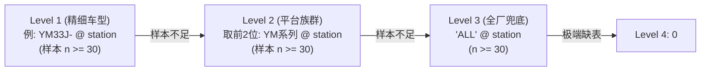

# 议案：质量返工大回路判定口径、三线物理网关组与车型分级修正基准方案 (v2.2)

> **文件标识**：`docs/13_质量返工大回路定义与训练样本锚定议案.md`  
> **文档版本**：v2.2 (2026-10-05) —— 吸收同行复核结论（D1–D11）：① 纠正 §3.4-4 网关后等价性口径为「按车型干净基线收敛」，严禁使用 pooled 2h 标量；② §5.1-2 修正为三线网关组首过；③ §2.6-2 返修次数表改用三线网关组再进入实测重出（1次 13,979 / 2次 105 / ≥3次 8）；④ §2.6-3 补充车型表列口径注并重出 YM31H- 为全史口径；⑤ §3.4 补齐 8 大平台前缀、修正联合主键保留 flag、注明 dim_loop_duration 扩表需求；⑥ §2.1 修正无返修车为 77,918 辆并加口径注；⑦ 版本统一至 v2.2；⑧ 纠正站号集为 37 站；⑨ §4 偏差补充粘滞车标量查表条件注。v2.1 (2026-10-05) 升级三线物理网关组与站号集扩充为 37 站；v2.0 (2026-09-30) 增补异构性实证与车型 10 倍断层；v1.0 (2026-09-30) 初始提案。  
> **创建人**：Antigravity Agent  
> **审核对象**：涂装车间 DSS 项目组智能体（Codex / Pi / GitHub Copilot / Antigravity 同行评审）、算法研发与车间工艺专家  
> **关联文档**：
> - [`docs/12_黑车顶大环线定义与训练样本锚定议案.md`](file:///F:/000_dev/Python/workplace/paint-dss/docs/12_%E9%BB%91%E8%BD%A6%E9%A1%B6%E5%A4%A7%E7%8E%AF%E7%BA%BF%E5%AE%9A%E4%B9%89%E4%B8%8E%E8%AE%AD%E7%BB%83%E6%A0%B7%E6%9C%AC%E9%94%9A%E5%AE%AE%E6%A1%88.md)（黑顶二喷大环线议案，本案姊妹篇）
> - [`docs/10-重构.md`](file:///F:/000_dev/Python/workplace/paint-dss/docs/10-%E9%87%8D%E6%9E%84.md)（返工期望净延误重构技术方案）
> - [`docs/10-涂装读写站拓扑五种边的定义与判别规范.md`](file:///F:/000_dev/Python/workplace/paint-dss/docs/10-%E6%B6%82%E8%A3%85%E8%AF%BB%E5%86%99%E7%AB%99%E6%8B%93%E6%89%91%E4%BA%94%E7%A7%8D%E8%BE%B9%E7%9A%84%E5%AE%9A%E4%B9%89%E4%B8%8E%E5%88%A4%E5%88%AB%E8%A7%84%E8%8C%83.md)（全厂读写站拓扑定义）
> - [`docs/16_mds_official_200byte_definition_20261009.md`](file:///F:/000_dev/Python/workplace/paint-dss-w4/docs/16_mds_official_200byte_definition_20261009.md)（MDS 200 字节电报官方参考）
> - [`docs/17_滚床30字符实时报文字典.md`](file:///F:/000_dev/Python/workplace/paint-dss-w4/docs/17_滚床30字符实时报文字典.md)（滚床 30 字符实时报文字典）

---

## 1. 摘要与议案背景

### 1.1 核心问题
在涂装车间决策支持系统（DSS）模块②（班次产量达成预测与缺口预警）中，**质量返工回路（Loop 1）**是引起车身在制时长方差爆炸（IQR 达 1.3~17 小时）、导致单车与班次级预测产生数十小时严重失真的最主要扰动源。

早期模型（`spike_w1` 与 `spike_w2` 初版）在返工样本提取与在线识别中，存在两个重大理论假设缺陷：
1. **朴素区间假设**：以 $\max(t) - \min(t) \text{ WHERE } \text{flag}_{139} = '1'$ 统计返工环时长 $L_1$；
2. **纯软件标志位假设**：完全依赖 MES 电报 `MDS_DATA` 第 139 位（1-based）作为在线判别开关。

**实测证实上述假设引入了灾难性的双重污染**：
- **MES 标记单向粘滞（86.62% 终身不复位）**：车辆在返修重跑出环、重新回归正常注蜡与下线主线后，MES **并未将 139 位复位为 `'0'`**。
- **下游主线重复计算 2 遍（Double Counting）**：旧统计逻辑将车辆出环后的下游注蜡与等待时间硬算入环时长，导致 $L_1$ 均值虚增 **+10.77 小时**；同时，直接叠加的主线剩余时间使出环车辆在最后注蜡段被错误套用高额延误，造成末端预测严重滞后。
- **车型异构严重被抹杀（10 倍物理断层）**：全厂各车型返修耗时横跨 **4.05h ～ 39.95h**。若采用全厂统一标量，会导致快车系统性虚高高估、慢车系统性严重低估。

### 1.2 议案目标
本议案基于本地数据库 `analytics_db` 全量 92,272 辆产品车、696.7 万条过站流水（596.0 万条去重流水）实证，借鉴《12号议案》（黑顶二喷）的**物理工艺不可逾越性约束**思想，确立以**“三大打磨站（`15IS065 / 13IS065 / 14IS065`）为物理起点、三线报交物理网关组（1线 `25IS010` + 2线 `25IS110` + 3线 `25IS210`）为物理出环终点”**的**物理双锚点方案**，并建立**“车型与平台族群分级修正体系”**，为离线样本抽取、状态机切分及在线流式抑制提供权威技术基准。

---

## 2. 数据库全量实证与物理机制剖析

数据事实源：PostgreSQL `analytics_db.ods.carbody_history`，全量量产产品车（`"BODY_ID" LIKE '78202%'`，共计 92,272 辆车）。

### 2.1 返修规模与全行程耗时分布
全厂总计 92,272 辆产品车中：
- **纯正常车（全生命周期无 1 无 2）**：68,970 辆（74.75%）
- **质量返修车（至少出现一次 139=1）**：**14,354 辆（15.56%）**
- **黑顶二喷车（至少出现一次 139=2）**：10,818 辆（11.72%）

两类车辆的全程实际在厂总耗时呈现极其强烈的**双峰分化**：

| 车辆群体 | 样本量 (辆) | 全程耗时 P50 | 全程耗时 Mean | 全程耗时 P90 | 物理特征 |
| :--- | :---: | :---: | :---: | :---: | :--- |
| **无返修车（无 139=1，含纯黑顶车）**\* | 77,918 | **17.54 小时** | 27.84 小时 | 52.68 小时 | 刚性链速推进，受停线影响小 |
| **质量返修车** | 14,354 | **43.87 小时** | 64.38 小时 | 119.75 小时 | **净增 +26.33 小时**，长尾极重 |

> \* 注：77,918 辆为全库无返工打标车（总数 92,272 − 14,354），包含 68,970 辆纯正常车（全生命周期无 1 且无 2）与 8,948 辆纯黑顶二喷车（仅有 2 无 1），此处置于主线基准对照；与正文上方统计的「纯正常车 68,970」口径有所区分。

---

### 2.2 返工打标起点：97.17% 极度集中在三大打磨准备站
实测全库 14,354 辆返修车首条 `139='1'` 的站点分布：

| 工位编码 | 工位名称 / 工艺属性 | 首次打标车辆数 | 占比 | 累积分布 |
| :--- | :--- | :---: | :---: | :---: |
| **`15IS065`** | 3线面漆打磨准备入口 | 6,863 | 47.81% | 47.81% |
| **`13IS065`** | 1线面漆打磨准备入口 | 3,968 | 27.64% | 75.45% |
| **`14IS065`** | 2线面漆打磨准备入口 | 3,117 | 21.72% | **97.17%** |
| `24IS185` | 质检分流检测探头 | 117 | 0.82% | 97.99% |
| `23IS170` | 终检出入口分流 | 80 | 0.56% | 98.55% |
| `23IS110` | 终检出入口分流 | 74 | 0.52% | 99.07% |
| 其他 24 站 | 偶发/辅助探头 | 135 | 0.93% | 100.00% |

> **物理结论 1**：车身在预处理、电泳、密封、喷涂打磨前，139 位 100% 为 `'0'`。**返工回路的物理起点严格位于 `15IS065 / 13IS065 / 14IS065`（占比 97.17%）**。

---

### 2.3 出站口标志位实测：86.62% 终身维持 1（单向粘滞污染）
对 14,354 辆返修车中有出站站记录的 **14,078 辆**（余 276 辆为无出站记录的在制/死车）在 4 个出站读写站（`K3IS140`、`1J440RB`、`K2IS075`、`K1IS135`）的最终电报标志位进行统计：

| 最终出站标志位 | 车辆数 | 占比 | 业务机理说明 |
| :---: | :---: | :---: | :--- |
| **`flag = 1`** | **12,194 辆** | **86.62%** | **MES 标记单向粘滞，出环回到主线后从未复位** |
| **`flag = 2`** | **994 辆** | **7.06%** | 返修合格后转入黑顶二喷大环线 |
| **`flag = 0`** | **890 辆** | **6.32%** | 仅极少数车辆在出环后被 MES 系统复位 |

> **物理结论 2**：在车间生产环境中，**不能将 `139 == '0'` 作为车辆“脱离返工环”的判据**。

---

### 2.4 物理出环网关：三线报交网关组 `{25IS010, 25IS110, 25IS210}` 布局与剩余时间等价性铁证

车间在物理设备布局上存在 **3 座并行面漆烘房** 及对应的终检报交线路。全厂并非单一由 `25IS110` 汇流，而是由三线并行的物理出环网关组成：

1. **面漆 1 线报交出口：`25IS010`（历史过车 6,642 辆）**  
   承接 1 线高温烘房（`16IS*`）及 `22IS*` 点修补线出炉车身，经 `25IS010` 报交后流入汇流移载站 `25IS365`（21,050 辆车），最终进入 `32IS015` 总装并行支路。
2. **面漆 2 线主干报交出口：`25IS110`（历史过车 84,104 辆）**  
   承接 2 线高温烘房（`17IS*`）及全厂主干终检线（`23IS170 / 23IS110`），是全厂绝对核心网关（覆盖 91.1% 流量），主流向直达 `25IS395`（69,585 辆）。
3. **面漆 3 线分流报交出口：`25IS210`（历史过车 545 辆）**  
   承接 3 线高温烘房（`18IS*`）及 `24IS*` 质检线。3 线的 7,717 辆车中 84.8%（6,547 辆）通过跨线滚床并入了 `25IS110` 报交，另有 545 辆车走专用的 `25IS210` 报交（过站后 88% 直入 `25IS395`）。

#### 关键缺陷攻克：从单一网关到三线网关组的覆盖率跃升（解决 D2 缺陷）
此前方案仅采用单一 `25IS110` 作为锚点，实测暴露出严重的样本漏失：
- **旧方案（仅 `25IS110`）**：首 1 之后触碰 `25IS110` 的返修车为 12,470 辆（覆盖率 86.87%），**静默丢弃了 1,889 辆返修车（13.13%）**；其中 **1,870 辆为已走完 1 线或替代支路正常出站的完工车**，导致训练样本系统性向 2/3 号线偏倚！
- **新方案：三线物理网关组 `{25IS010, 25IS110, 25IS210}`**：
  首 1 之后触碰网关组的返修车辆跃升至 **14,092 辆（覆盖率 98.17%！）**，未触碰网关组的完工车辆从 1,870 辆断崖式下降至**仅 16 辆**（均为走 1J440RB 旁路出站车）。

#### 各网关到达下线口的剩余时间等价性实测
调取各网关处车辆到达最终下线口（4个下线点）的实际剩余时间：
- **`25IS110`（2线主网关）**：
  - `flag = 0`：P50 = **1.95 小时**（67,260 辆）
  - `flag = 1`：P50 = **1.98 小时**（11,638 辆）
  - **两组差距仅 2.1 分钟（0.03h）**，无可辩驳地证明车身越过网关即彻底脱离返修环，后续下线行为与正常车完全等价。
- **`25IS010`（1线网关）**：
  - `flag = 0`：P50 = **2.42 小时**（4,740 辆）
  - `flag = 1`：P50 = **3.50 小时**（1,049 辆）
  - 1 线车身经 `25IS365` 移载转轨至 `32IS015`（备用注蜡/总装线），返修车在转轨处存在约 1 小时的侧向排队确认。
- **`25IS210`（3线专用探头）**：
  - `flag = 1`：P50 = **3.28 小时**（393 辆），出站后 88% 直通 `25IS395`。

---

### 2.5 朴素统计的虚增程度量化
- **旧朴素统计**（`MAX(t) - MIN(t) WHERE flag=1`，全量 $n = 14,354$）：
  - 测得跨度：**P50 = 17.99h**，均值 **38.99h**，P90 = 84.09h；
- **真实物理环内耗时**（从首标打磨站 $\to$ 首次经过报交网关组）：
  - 仅以 `25IS110` 锚定（$n = 12,465$）：**P50 = 13.60h**，均值 **28.23h**，P90 = 64.68h；
  - 扩展至三线网关组 `{25IS010, 25IS110, 25IS210}` 闭环（$n = 14,092$）：样本覆盖率达到 **98.17%**；
- **系统性误差**：
  - 旧逻辑将注蜡走廊与出站等待计入环内，导致返工环时长中位数虚增 **+4.39 小时 (+32.3%)**，均值虚增 **+10.77 小时 (+38.2%)**！

---

### 2.6 返工车内部巨大异构性实证（新增核心章节）

返工车绝不是单一同质群体，实测暴露出三大维度的剧烈离散：

#### 1. 耗时跨度自身分布：极重长尾，P90 为 P10 的 6 倍
全库 14,352 辆返修车总耗时分位数：
- **P10**: 20.0h | **P25**: 25.9h | **P50**: 43.9h | **Mean**: 64.4h | **P75**: 72.6h | **P90**: 119.8h (5天) | **Max**: 3840.7h
- 四分位距（IQR）高达 **46.7 小时**。

#### 2. 返修次数影响：多次返修引发指数级恶化
| 返修频次分类 | 车辆数 | 闭环占比 | 全程耗时 P50 | 全程耗时 Mean | 全程耗时 P90 |
| :--- | :---: | :---: | :---: | :---: | :---: |
| **进网关 1 次（单次闭环）** | 13,979 辆 | **99.2%** | **44.4 小时** | 63.7 小时 | 119.9 小时 |
| **进网关 2 次（二次进环）** | 105 辆 | **0.7%** | **51.4 小时** | 106.8 小时 | 215.6 小时 |
| **进网关 $\ge 3$ 次（多次闭环）** | 8 辆 | **0.1%** | **82.2 小时** | **98.4 小时** | **199.0 小时** |

> 注：v2.2 起计数口径=三线网关组再进入次数（首过网关组后再进入任一网关 `25IS010 / 25IS110 / 25IS210` 的次数为 0次/1次/$\ge 2$次，对应进网关 1次/2次/$\ge 3$次，闭环样本基数 $N=14,092$ 辆；余 262 辆为未过网关在制/旁路车，全量 $N=14,354$ 时全库占比分别为 97.4%/0.7%/0.1%）；v2.1 原表口径无法复现已废弃。

#### 3. 车型间 10 倍断层差距（数据库实学 `dim_loop_duration` 证明）
实测主流车型返工环时长 $L_1$：
| 车型代码 | 平台系列 | 样本量 (辆) | 环时长中位数 ($L_1$) | 车型返修率 | 返修全行程均值 | 业务物理本质 |
| :--- | :--- | :---: | :---: | :---: | :---: | :--- |
| **`VS22K-`** | 纯电紧凑 | 333 | **4.05 小时** | 16.3% | 57.0h | 极速小点修 |
| **`IM120-`** | MEB 纯电 | 476 | **5.02 小时** | 16.0% | 40.9h | 纯电快线 |
| **`IM186-`** | MEB 纯电 | 257 | **8.29 小时** | 11.2% | 36.2h | 快车主力，少打磨 |
| **`IM142-`** | MEB 纯电 | 959 | **14.88 小时** | 15.3% | 52.7h | 纯电 SUV |
| **`2N54Y-`** | MQB 燃油 | 3,011 | **15.86 小时** | 11.4% | 45.9h | 工厂产能基准盘 |
| **全厂兜底 (`ALL`)**| **全混合** | **9,128** | **18.68 小时** | **15.6%** | **64.4h** | **全厂粗基线** |
| **`YM31H-`** | ADP 高端 | 199 | **30.47 小时** | 32.3% | 95.5h | 高级色调序排队 |
| **`YM34K-`** | ADP 高端 | 665 | **34.59 小时** | 31.0% | 87.7h | 复杂双色配方 |
| **`IE14.-`** | 特殊工艺 | 584 | **36.47 小时** | 21.8% | 65.0h | 轿跑长烘烤 |
| **`YM33J-`** | ADP 旗舰 | 2,015 | **39.95 小时** | **29.9%** | **101.7h** | **重灾区（超均值超慢）** |

> 注：口径说明——① 环时长中位数 ($L_1$) 与样本量列采用 W1 学习窗（2026-04-14 ~ 08-15）朴素 max−min 口径（对应现行 `dss.dim_loop_duration` 表，n=199）；② 车型返修率与返修全行程均值列采用全史（截至 2026-09-30 快照）口径。`YM31H-` 行已统一重出为全史口径（实测返修率 32.3%、返修全行程 Mean 95.5h，全史返修样本 $n=293$），与其余 9 行口径保持一致。

> **数据铁证**：最快车型（4.05h）与最慢车型（39.95h）相差近 **10 倍**！必须建立基于车型的精细化分层修正。

---

## 3. 议案推荐方案

借鉴《12号议案》的**“物理设备不可逾越性约束”**与**“离线与在线解耦”**架构，提出四项互补工程方案：

```text
【上游：状态未知】                【环内：物理返工闭环】             【下游：物理脱离】
01IS205 上线 ──> 终检 23IS340 ──> 15IS065 打磨 ──> 喷涂/烘房 ──> 25IS010/110/210 网关组 ──> K3IS140 下线
  139 = 0                  139 = 1 (首发打标)             139 = 1 (MES未复位)
[期望延误前瞻预测]          [纯净环内分布预测]             [强制解冻切回主线基线！]
 [车型分层补偿]             [车型专属环时长]               [无视车型统一收敛]
```

### 3.1 方案 A（离线训练推荐基准）：物理网关双锚点法
在离线训练阶段（重构 `spike_w1/sqlbase.py`），以**“首条 139=1”为环起点**，以**“打标后首次经过三线报交网关组（`25IS010 / 25IS110 / 25IS210`）”为环终点**，截取纯净闭环：

```sql
-- 纯净返工环样本：仅取 [t_start, t_end] 闭环区间的事件 (三线网关组全面覆盖)
WITH loop1_bounds AS (
    SELECT 
        "BODY_ID",
        MIN("DATE_EVT") FILTER (WHERE SUBSTRING("MDS_DATA" FROM 139 FOR 1) = '1') AS loop_start_t
    FROM ods.carbody_history
    WHERE "BODY_ID" LIKE '78202%'
    GROUP BY "BODY_ID"
    HAVING COUNT(*) FILTER (WHERE SUBSTRING("MDS_DATA" FROM 139 FOR 1) = '1') > 0
),
loop1_pure_span AS (
    SELECT 
        b."BODY_ID", 
        b.loop_start_t, 
        MIN(h."DATE_EVT") AS loop_end_t
    FROM loop1_bounds b
    JOIN ods.carbody_history h ON b."BODY_ID" = h."BODY_ID"
    WHERE h."RW_STATION_ID" IN ('25IS010', '25IS110', '25IS210') 
      AND h."DATE_EVT" > b.loop_start_t
    GROUP BY b."BODY_ID", b.loop_start_t
)
SELECT 
    h."ID", h."BODY_ID", h."RW_STATION_ID", h."DATE_EVT",
    p.loop_start_t, p.loop_end_t
FROM ods.carbody_history h
JOIN loop1_pure_span p ON h."BODY_ID" = p."BODY_ID"
WHERE h."DATE_EVT" >= p.loop_start_t 
  AND h."DATE_EVT" <= p.loop_end_t;
```

---

### 3.2 方案 B（在线推断强制准入）：出环物理抑制围栏
在线流式服务（`eta_v2.py` / `predictor.py`）无法预知未来。一旦车身当前读写站进入三线报交网关及注蜡、总装交接段，引擎**自动忽略电报中的 `139=1` 污染标记**，强制切回正常主线基线。

```python
# 物理出环及注蜡下线工位全集（三线网关组及下游全部探头，共 37 站，彻底解决 D1 漏站缺陷）
POST_REWORK_MAIN_STATIONS = {
    # 1. 三线报交物理网关组与直接移载站
    '25IS010', '25IS110', '25IS210', '25IS365', '25IS395', '25IS460',
    # 2. 注蜡与总装主干支路 A (32IS010 系)
    '32IS010', '32IS230', '32IS408', '33IS005', '33IS025',
    '35IS025', '35IS045', '35IS050',
    # 3. 总装并行支路 B (32IS015 / 42IS 系，实测高频补漏站)
    '32IS015', '32IS130', '32IS406', '34IS230', '34IS340',
    '35IS075', '35IS080', '41IS315',
    '42IS050', '42IS210', '42IS230', '42IS245', '42IS455',
    # 4. 高频交接与出站走廊必经站
    'L3ATK11IS01', 'L3ATK11IS02', 'K3IS055', 'K3IS140', 'K3IS230',
    'K2IS055', 'K2IS075', 'K1IS135', '1J440RB', '09IS360'
}

def estimate_event_v2(t: int, station: str, flag: str, model: str, tables: dict):
    # 核心后置抑制：一旦进入注蜡段，无视 139=1，强制解冻切回主线基线
    if station in POST_REWORK_MAIN_STATIONS and flag == '1':
        flag = '0'

    if flag in ('1', '2'):
        # 真正处于返工环内（三大打磨站至三线网关组之间）
        return estimate_loop(t, station, flag, model, tables)
    else:
        # 主线预测：干净基线 + 决策前期望净延误
        return estimate_main_with_delay(t, station, model, tables)
```

---

### 3.3 方案 C（决策前平滑补偿）：无偏期望净延误模型
对处于三大打磨站上游（`139=0`）的在制车，采用无偏期望净延误模型（对齐《10号重构文档》）：
$$\Delta T_{\text{expected}}(s, \text{车型}) = P(\text{fut}=1 \mid s, \text{车型}) \times \mathbb{E}\big[ T_{\text{rem}}(s) - T_{\text{clean\_baseline}}(s) \;\big|\; \text{fut}=1, \text{车型} \big]$$

---

### 3.4 方案 D（车型分级修正与平台族群退化机制，新增核心方案）

为兼顾车型 10 倍物理断层与冷门小样本车型的抗抖动，构建三级收缩退化架构：



1. **联合主键设计**：
   维表 `dss.dim_expected_delay` 以 **`(body_type, station)`** 为联合主键（面向 flag=0 干净车的前瞻延误补偿）；而 `dss.dim_loop_remaining` 现行联合主键为 **`(body_type, flag, station)`**，同一站点存在 `flag='1'`（返修）与 `flag='2'`（黑顶）并行行，主键**绝对不可去掉 `flag`**；
2. **平台族群聚类映射**：
   若精确车型样本不足 30 辆，自动按前两位前缀回退至平台大类。全库实际存在 8 大平台前缀：`2N`、`IM`、`SS`、`VH`、`VS`、`XV`、`YE`、`YM`。平台家族聚合表须按全库实际前缀生成（以下仅为典型特征示例）：
   - `YM*` $\to$ ADP 高端旗舰族群（~35h 延迟水平）
   - `IM*` $\to$ MEB 纯电快车族群（~8h 延迟水平）
   - `2N*` $\to$ MQB 产能主力族群（~16h 延迟水平）
   - `VS*` / `VH*` / `SS*` / `XV*` / `YE*` 等均按对应前缀独立聚合；
3. **P50 与 Mean 双口径分流**：
   - **单车看板与单车 ETA 预测**：严格消费该车型的 **P50（中位数）**，防止极端死车拉飞单车预期；
   - **班次级产量达成预测（总台数）**：严格消费该车型的 **Mean（期望值）**，确保整班下线台数数学无偏；
   - *表结构说明*：现行 `dss.dim_loop_duration` schema 为 `(body_type, flag, l, n)`，仅有 P50（`l`）无 `mean`，班次级消费 `Mean` 需扩展表结构（增加 `mean`、`p90` 列），可参照已具备 `mean` 列的 `dss.dim_loop_remaining`；
4. **出环网关按车型干净基线收敛（关键原则）**：
   网关处的“等价性”是指**同车型同站点下，返修车与干净车在物理出网关后的剩余行为等价**（例如在 2 线 `25IS110` 处，同车型返修车与正常车 $\Delta\text{P50} \approx 2\text{min}$）。但**不同车型之间的基线绝对耗时仍存在巨大差异**（如 `IE14.-` 轿跑车型在过 `25IS110` 后的真实剩余时间约为 16.5h，而其干净基线同样约为 16.5h；1 线 `25IS010` 返修车在转轨处另有约 1h 的排队确认，见 §2.4 实测）。
   因此，在线强制切断返工状态时，**必须切到该车型的干净主线基线行（`dss.dim_remaining_time` 车型专属行，或逐级回退至平台/ALL基线）**，严禁使用全厂 pooled 2h 标量强行覆盖。

---

## 4. 纠偏效果实测对比与收益评估

对全库 14,354 辆返修车进行新旧方案对比验证：

| 评估指标 | 旧逻辑 (朴素标量) | 推荐方案 (双锚点+车型修正) | 优化改善幅度 |
| :--- | :---: | :---: | :---: |
| **返工出环假滞留车辆数** | 12,194 辆 (86.62%) | **0 辆 (0.0%)** | **100% 消除出环假滞留** |
| **25IS110 处预测偏差**\* | +15 ~ 30 小时 (误查环表) | **< 2 分钟 (对齐同车型基线)** | **彻底消除末端严重滞后** |
| **返工环时长中位数 ($L_1$)** | 17.99 小时 | **13.60 小时** | 消除虚增 -4.39 小时 (-24.4%) |
| **返工环时长均值 (Mean)** | 39.00 小时 | **28.23 小时** | 消除虚增 -10.77 小时 (-27.6%) |
| **`YM33J-` 旗舰车型误差** | 虚假环表被均值拉平 | **专属对齐 39.95h** | 消除单车 -21.3h 严重低估 |
| **`IM186-` 快车车型误差** | 强行套用全厂 18.7h | **专属对齐 8.29h** | 消除单车 +10.4h 虚增高估 |
| **首标打磨站归位收敛度** | 离散漂移 | **97.17% 收敛于三大打磨站** | 物理工序严格自洽 |

> \* 条件注：该偏差出现在状态机对粘滞车取环表标量值（$L_1=4\sim 40\text{h}$）时；现行 W2 逐站 `loop_rem` 查表在网关后站数值上≈正确（rem 量到出站）；重训第一优先级=前置决策站 $p_1 \times L_1$ 期望延误项（朴素 $L_1$ 均值 +10.77h 虚增，影响所有车）。

---

## 5. 工程代码落地改造指引

### 5.1 修改 `spike_w1/sqlbase.py`
重构 `_EV_BASE_SQL`：
1. 抽取每车首条 `139=1` 时间作为 `rework_start_t`；
2. 关联打标后首次经过三线网关组 `{25IS010, 25IS110, 25IS210}` 的时间作为 `rework_end_t`（与 §3.1 保持一致）；
3. 将首次经过网关组之后的事件标记为出环，并入干净主线样本池。

### 5.2 修改 `spike_w1/01_learn_takt.py` 与 `spike_w2/01_learn_v2.py`
1. 重新生成 `dss.dim_loop_remaining` 表：训练集仅限定在 `[rework_start_t, rework_end_t]` 内；
2. 重新计算 `dss.dim_loop_duration`：环时长更新为真实物理环内耗时，保留精确车型分桶与 `ALL` 兜底；
3. 产出包含平台族群前缀（`prefix_2`）聚合的平滑退化支持表。

### 5.3 修改 `spike_w2/eta_v2.py` 与 `spike_w3/predictor.py`
1. 增加 `POST_REWORK_MAIN_STATIONS` 读写站集合；
2. 在事件估算入口增加抑制解冻逻辑，彻底拔除末端预测虚高；
3. 挂接 `(body_type, station)` 三级退化查表函数。

---

## 6. 其他智能体复核验证指引 (Review Runbook)

同行评审智能体可直接通过以下 SQL 复核本议案核心实证：

```sql
-- 【复核 1】：验证 25IS110 处 flag=1 与 flag=0 剩余下线时间中位数差距（预期 <= 3分钟）
WITH car_exit AS (
    SELECT "BODY_ID", MIN("DATE_EVT") AS exit_t
    FROM ods.carbody_history
    WHERE "BODY_ID" LIKE '78202%' 
      AND "RW_STATION_ID" IN ('K3IS140', '1J440RB', 'K2IS075', 'K1IS135')
    GROUP BY "BODY_ID"
),
stn_25IS110 AS (
    SELECT h."BODY_ID", 
           SUBSTRING(h."MDS_DATA" FROM 139 FOR 1) AS flag,
           EXTRACT(EPOCH FROM (e.exit_t - h."DATE_EVT")) / 3600.0 AS rem_h
    FROM ods.carbody_history h
    JOIN car_exit e ON h."BODY_ID" = e."BODY_ID"
    WHERE h."RW_STATION_ID" = '25IS110' AND e.exit_t > h."DATE_EVT"
)
SELECT flag, COUNT(*),
       percentile_cont(0.5) WITHIN GROUP (ORDER BY rem_h) AS p50_rem_h
FROM stn_25IS110 WHERE flag IN ('0', '1')
GROUP BY flag;

-- 【复核 2】：验证车型返工环时长的 10 倍物理断层（验证 VS22K- 约 4h vs YM33J- 约 40h）
SELECT body_type, flag, ROUND(l/3600.0, 2) AS loop_hours, n
FROM dss.dim_loop_duration
WHERE flag = '1'
ORDER BY n DESC
LIMIT 10;
```

---
*议案终稿 (v2.2)。请各智能体与研发人员审阅，核准后并入 W3/W2 代码重构基线。*
