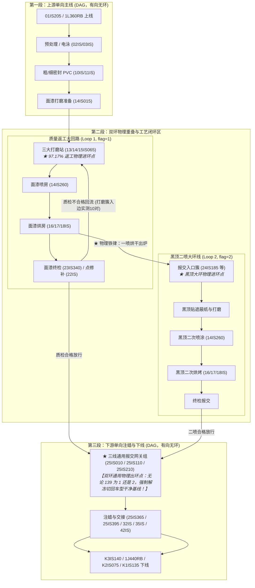
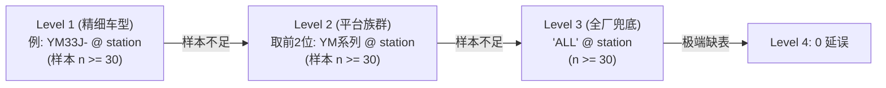

# 方案：涂装车间物理双环（返工环 + 黑顶环）统一状态机与样本锚定治理方案 (v1.3)

> **文件标识**：`docs/14_涂装车间物理双环统一状态机与样本锚定方案.md`  
> **更新时间**：2026-10-05 13:40 Asia/Shanghai  
> **文档版本**：v1.3 (2026-10-05) —— 吸收独立 DB 评审意见，完成 8 项关键修订：① 修复 §4 统一 SQL 双窗 CASE 优先级缺陷（对返修先交接车截断 t_rework_end 上界至 bt_start，杜绝 17,457 条黑顶段事件被误标为 1），并补充双窗重叠实测注；② 修复 §4 SQL 为 '78202%%' 解决 psycopg2 参数化执行崩溃（D14-8，含注释裸 % 修复）；③ §2.1 更正 24IS185 首发占比为 52.6% (3,055 辆)（D14-9）；④ §3.2 补齐 8 大平台前缀，§7 明确 dim_loop_duration 需扩充 mean/p90 列结构（D14-4）；⑤ §2/§5 补充解冻后按车型干净基线收敛限定（严禁 pooled 2h 标量），§6 补充末端偏差条件注（D14-5）；⑥ 统一站点总数为 232 站、打磨簇入边实测 10 对、网关车数口径注、返工覆盖率统一为实测 97.99% (14,065 辆)、均值回归补充统一口径 30.20h、删除代码行数 60% 估算（D14-7）；⑦ §5 补充 dim_loop_remaining 目标为 station→exit 的全旅程语义注（D14-2）；⑧ 补充 §4 旁路车 47 辆边界注与 §5 规则 3 进环白名单防御建议（D14-3/D14-6）。v1.2 (2026-10-05) 三线物理网关定稿版；v1.1 (2026-09-30) 同行复核版；v1.0 (2026-09-30) 初始整合版。  
> **编制说明**：本方案正式整合 Doc 12 (v1.1) 与 Doc 13 (v2.2)，作为涂装车间 DSS 模块②处理工艺双环（Loop 1 质量返工 + Loop 2 黑顶二喷）的**终局统一技术规范与实施指南**。  
> **关联资产**：
> - [`docs/12_黑车顶大环线定义与训练样本锚定议案.md`](file:///F:/000_dev/Python/workplace/paint-dss/docs/12_%E9%BB%91%E8%BD%A6%E9%A1%B6%E5%A4%A7%E7%8E%AF%E7%BA%BF%E5%AE%9A%E4%B9%89%E4%B8%8E%E8%AE%AD%E7%BB%83%E6%A0%B7%E6%9C%AC%E9%94%9A%E5%AE%AE%E6%A1%88.md)（黑车顶大环线议案 v1.1）
> - [`docs/13_质量返工大回路定义与训练样本锚定议案.md`](file:///F:/000_dev/Python/workplace/paint-dss/docs/13_%E8%B4%A8%E9%87%8F%E8%BF%94%E5%B7%A5%E5%A4%A7%E5%9B%9E%E8%B7%AF%E5%AE%9A%E4%B9%89%E4%B8%8E%E8%AE%AD%E7%BB%83%E6%A0%B7%E6%9C%AC%E9%94%9A%E5%AE%AE%E6%A1%88.md)（质量返工大回路议案 v2.2）
> - [`docs/10-重构.md`](file:///F:/000_dev/Python/workplace/paint-dss/docs/10-%E9%87%8D%E6%9E%84.md)（无偏期望净延误数学模型）
> - [`docs/08_message_data_dictionary.md`](file:///F:/000_dev/Python/workplace/paint-dss/docs/08_message_data_dictionary.md)（报文数据字典）
> - [`README.md`](file:///F:/000_dev/Python/workplace/paint-dss/README.md)（项目核心口径对照表）

---

## 1. 摘要与整合初衷

### 1.1 问题全貌与双向失真
涂装车间过站事件流由 MES 电报 `MDS_DATA` 驱动。第 139 位（1-based 索引）定义为车身工艺环标志（`0`=正常主线，`1`=质量返修，`2`=黑顶二喷）。

在车间生产环境中，由于 PLC/MES 控制策略与实际物理工序存在时差，纯软件标志位在双环上呈现**“头尾镜像”的双向严重污染**：
1. **黑顶环（Loop 2）“头部早发污染”**：
   - 9.1%（536 辆，`13IS260` 另有 45 辆，缓存线合计 581 辆）黑顶车在一喷进喷房（`14IS260`）排队时，因临时调度信号被**提前打上 2，持续中位数 4.8 分钟后复位为 0**；另有 4,941 辆单色车（G0）在此处发生短暂闪现；
   - 旧逻辑朴素以 $\min(t) \text{ WHERE flag='2'}$ 截取，把一喷排队误算为大环起点，导致受害车辆环时长**中位数虚增 3.38 小时、均值虚增 9.28 小时（长尾达 203.8 小时）**。
2. **返工环（Loop 1）“尾部粘滞污染”**：
   - 86.62%（12,194 辆）返修车在修补完成出环、重新回归主线后，**MES 从未将 139 位复位为 0**，带着 1 直到出厂；
   - 旧逻辑朴素以 $\max(t) - \min(t) \text{ WHERE flag='1'}$ 计算，把出环后的注蜡走廊算入环内，导致返工环时长**虚增 10.77 小时**；出环车在最后注蜡段被错误套用环表，造成末端预测滞后数十小时。

### 1.2 整合必然性
两套问题共用**同一段车间物理拓扑、同一封 MES 电报字段、同一个数据抽取通道**。将 12 号与 13 号议案整合为统一方案，具有不可替代的工程优势：
- **物理出口归一**：无论车身经历返修（1）还是黑顶二喷（2），一旦越过面漆报交出口三线网关组（1线 **`25IS010`** / 2线 **`25IS110`** / 3线 **`25IS210`**），车身彻底脱离涂装工艺环进入单向注蜡及交接走廊。实测 2线主干（占 91.1% 流量）越过网关后剩余下线时间中位数与正常车**仅差 2.1 分钟**；三线网关组构成了双环通用的物理出环网关；
- **架构纯粹统一**：避免离线与在线出现两套互相冲突的状态机，形成**“进环前置抑制 + 环内纯净建模 + 出环通用解冻 + 车型分层修正”**的标准化工业流水线。

---

## 2. 物理双环拓扑与双向锚定体系

全厂 232 个车身站点（全史 distinct 读写站）在拓扑流向上严格划分为三段式物理架构：



### 2.1 物理锚定规则规范

| 工艺环 | 物理进环起点 (Inbound Anchor) | 物理出环终点 (Outbound Anchor) | 核心不可逾越物理法则 |
| :--- | :--- | :--- | :--- |
| **质量返工大回路**<br>*(Loop 1, flag=1)* | **三大打磨准备站**<br>`15IS065` (47.8%)<br>`13IS065` (27.6%)<br>`14IS065` (21.7%)<br>*(三站累积集中度 97.17%)* | **三线通用报交网关组**<br>`25IS010` (1线, 6,642车)<br>`25IS110` (2线, 84,104车)<br>`25IS210` (3线, 545车)<br>*(全史全车口径，完成行程口径 6,537/83,246/533 辆；打标后首次经过时刻，覆盖率 97.99%)* | **注蜡不可逆流法则**：车身一旦进入注蜡段，绝不可能再回高温烘房喷漆打磨。过三线报交网关组必须出环。 |
| **黑车顶大环线**<br>*(Loop 2, flag=2)* | **一喷烘房出口后打标点**<br>报交入口簇 `24IS185` (首发 52.6%, 3,055 辆)、`24IS115`、`22IS170`、`23IS170`、`23IS110`、`22IS110` (合计 88.1%)<br>返修打磨线 `14IS065`、`13IS065`、`15IS065` (合计 10.8%)<br>*(烘房出口站后且 137=1 首次打标时刻)* | **三线通用报交网关组**<br>`25IS010` (1线)<br>`25IS110` (2线)<br>`25IS210` (3线)<br>*(二喷后首次经过时刻)* | **烘房交联固化法则**：底漆未在三座面漆烘房出口（`16IS305/17IS305/18IS345/20IS010`）烘干冷却前，绝对无法贴纸二次喷漆。烘房出口前出现的 139=2 均为假信号，且必须强制约束 137=1 排除单色闪现。 |

---

## 3. 车型分层修正与平台族群退化矩阵

实测证明，全厂各车型在返工环耗时上存在高达 **10 倍的物理断层**，必须建立车型分层修正体系：

### 3.1 车型环时长基准全景矩阵
基于 `dss.dim_loop_duration` 实测值：

| 平台族群 | 代表车型代码 | 样本量 (辆) | 纯净环时长 ($L$) | 车型返修率 | 工艺物理机理与调度特征 |
| :--- | :--- | :---: | :---: | :---: | :--- |
| **MEB 纯电快线族群**<br>*(前缀: IM / VS)* | `VS22K-`<br>`IM120-`<br>`IM186-`<br>`IM142-` | 333<br>476<br>257<br>959 | **4.05h**<br>**5.02h**<br>**8.29h**<br>**14.88h** | 11.2% ~ 16.3%<br>*(较低)* | 标准化纯电车身，颜色单一，清漆快干，打磨以小缺陷为主，返修排队极快。 |
| **MQB 产能基准族群**<br>*(前缀: 2N)* | `2N54Y-` | 3,011 | **15.86h** | 11.4%<br>*(稳定)* | 工厂绝对主力大单，输送节拍稳定，反映全厂标准基准节拍。 |
| **ADP 高端旗舰族群**<br>*(前缀: YM / IE)* | `YM31H-`<br>`YM34K-`<br>`IE14.-`<br>`YM33J-` | 199<br>665<br>584<br>2,015 | **30.47h**<br>**34.59h**<br>**36.47h**<br>**39.95h** | 21.8% ~ 31.0%<br>*(极高)* | 豪华旗舰车型，漆膜厚度要求高，伴随双色二喷，换色烘烤等待极长，重灾区。 |
| **全厂兜底粗基线** | `'ALL'` | 9,128 | **18.68h** | 15.6% | 极端样本不足时的兜底线。 |

### 3.2 车型三级收缩退化架构（防小样本抖动）


> 注：全库实际存在 8 大平台前缀（`2N`、`IM`、`SS`、`VH`、`VS`、`XV`、`YE`、`YM`），平台家族聚合表须按全库实际前缀生成（§3.1 表中 YM/IM/2N 仅为典型特征示例）。

---

## 4. 离线训练统一纯净数据抽取规范

在 [`spike_w1/sqlbase.py`](file:///F:/000_dev/Python/workplace/paint-dss/spike_w1/sqlbase.py) 中，以一套统一的 SQL 视图同时完成 Loop 1 与 Loop 2 的物理切片：

```sql
-- =============================================================================
-- 涂装双环统一纯净样本切分视图 (sqlbase.py 重构核心)
-- =============================================================================
DROP TABLE IF EXISTS tmp_ev_base;
CREATE TEMP TABLE tmp_ev_base AS
WITH p AS (
    SELECT "ID" AS id, "BODY_ID" AS body, "BODY_TYPE" AS bt, "RW_STATION_ID" AS station,
           "DATE_EVT" AS t,
           SUBSTRING("MDS_DATA" FROM 137 FOR 1) AS flag_137,
           SUBSTRING("MDS_DATA" FROM 139 FOR 1) AS raw_flag
    FROM ods.carbody_history
    WHERE "BODY_ID" LIKE '78202%%'
      AND "DATE_EVT" >= %s AND "DATE_EVT" <= %s
),
entry AS (
    SELECT body, MIN(t) AS entry_t FROM p 
    WHERE station IN ('01IS205', '1L360RB', '01IS045') GROUP BY body
),
exit_stn AS (
    SELECT body, MIN(t) AS exit_t FROM p 
    WHERE station IN ('K3IS140', '1J440RB', 'K2IS075', 'K1IS135') GROUP BY body
),
-- 1. 物理不可逾越门槛：三座面漆烘房出口站首次出炉时刻
first_oven AS (
    SELECT body, MIN(t) AS t_oven_out FROM p
    WHERE station IN ('16IS305', '17IS305', '18IS345', '20IS010') GROUP BY body
),
-- 2. 双环物理起点锁定
loop_starts AS (
    SELECT 
        p.body,
        -- 返工环起点 (13/14/15IS065 首发打标)
        MIN(p.t) FILTER (WHERE p.raw_flag = '1') AS t_rework_start,
        -- 黑顶环起点 (必须具备 137=1 且在烘房出口出炉后出现的 139=2)
        MIN(p.t) FILTER (WHERE p.flag_137 = '1' AND p.raw_flag = '2' AND o.t_oven_out IS NOT NULL AND p.t >= o.t_oven_out) AS t_blacktop_start
    FROM p
    LEFT JOIN first_oven o ON p.body = o.body
    GROUP BY p.body
),
-- 3. 双环通用物理出环网关锁定 (打标后首次过三线报交网关组 25IS010 / 25IS110 / 25IS210，覆盖率 97.99 pct)
loop_bounds AS (
    SELECT 
        s.body, s.t_rework_start, s.t_blacktop_start,
        CASE WHEN s.t_blacktop_start IS NOT NULL AND s.t_blacktop_start > s.t_rework_start
             THEN LEAST(MIN(p.t) FILTER (WHERE s.t_rework_start IS NOT NULL AND p.t > s.t_rework_start), s.t_blacktop_start)
             ELSE MIN(p.t) FILTER (WHERE s.t_rework_start IS NOT NULL AND p.t > s.t_rework_start) END AS t_rework_end,
        MIN(p.t) FILTER (WHERE s.t_blacktop_start IS NOT NULL AND p.t > s.t_blacktop_start) AS t_blacktop_end
    FROM loop_starts s
    JOIN p ON s.body = p.body AND p.station IN ('25IS010', '25IS110', '25IS210')
    GROUP BY s.body, s.t_rework_start, s.t_blacktop_start
),
-- 4. 纯净有效标志位打标映射
purified_events AS (
    SELECT 
        p.id, p.body, p.bt, p.station, p.t, e.entry_t, x.exit_t,
        CASE 
            -- 落在纯净返工区间内 -> flag = '1'
            WHEN b.t_rework_start IS NOT NULL 
                 AND p.t >= b.t_rework_start 
                 AND (b.t_rework_end IS NULL OR p.t <= b.t_rework_end) THEN '1'
            -- 落在纯净黑顶区间内 -> flag = '2'
            WHEN b.t_blacktop_start IS NOT NULL 
                 AND p.t >= b.t_blacktop_start 
                 AND (b.t_blacktop_end IS NULL OR p.t <= b.t_blacktop_end) THEN '2'
            -- 其余所有情况 (含出三线网关组之后、烘房前的假信号) -> 一律净化为 '0'
            ELSE '0'
        END AS flag
    FROM p
    JOIN entry e ON p.body = e.body
    JOIN exit_stn x ON p.body = x.body
    LEFT JOIN loop_bounds b ON p.body = b.body
    WHERE x.exit_t > e.entry_t AND p.t >= e.entry_t AND p.t <= x.exit_t
),
lagged AS (
    SELECT s.*, LAG(station) OVER (PARTITION BY body ORDER BY t, id) AS prev_station
    FROM purified_events s
)
SELECT id, body, bt, station, t, flag, entry_t, exit_t
FROM lagged
WHERE prev_station IS NULL OR station <> prev_station;
```

> **双窗重叠实测与修复说明（D14-1）**：  
> 全史共 1,870 辆同时具备 139=1 与 139=2 标记的交接车，包含：  
> - **真双环车（1,006 辆）**：具备烘房后 137=1 且 139=2 有效黑顶锚点。其中：  
>   - **返修先（848 辆，rw_start < bt_start）**：修复前黑顶段 [bt_start → 网关]（P50 6.35h / Mean 15.00h，共 17,457 条事件，占全表 '1' 事件的 5.66%）被 CASE 先判返工分支全部错误标为 '1'，导致其返工环时长 $L_1$ 虚增 +8.46h (P50)；修复后通过将返工窗上界截断至 `LEAST(网关, bt_start)`，返工段 [rw → bt] 恢复为真实 P50 3.74h / Mean 11.88h，黑顶段自然落入 '2' 分支；  
>   - **黑顶先（158 辆，bt_start < rw_start）**：原 CASE 优先级对该方向恰好正确（[bt, rw) 标 '2'，[rw, 网关] 标 '1'），不触发截断分支，行为保持不变；  
> - **假信号车（864 辆）**：139=2 均出现在烘房前或 137=0，统一 SQL 净化为 '0'，属于正确的物理静默抑制。  
>  
> **无网关返修车边界说明（D14-3）**：  
> 全史无网关返修车共 289 辆：其中 47 辆为走 1J440RB 等旁路已出站车，其 [rw_start $\to$ exit]（P50 14.80h）全段被标为 '1'（注蜡走廊被计入环内，仅占返工样本 0.3%，已知且工程可接受）；其余 242 辆为当前在制车，已由 `exit_stn` 内连接自然剔除出训练集。

---

## 5. 在线推断统一路由器与算法执行规范

在线实时推断引擎（[`spike_w2/eta_v2.py`](file:///F:/000_dev/Python/workplace/paint-dss/spike_w2/eta_v2.py) / [`spike_w3/predictor.py`](file:///F:/000_dev/Python/workplace/paint-dss/spike_w3/predictor.py)）执行统一路由：

```python
# -*- coding: utf-8 -*-
"""双环统一在线预测引擎组件 (eta_v2.py 升级版)"""

# 1. 通用出环物理工位集合 (双环通用解冻网关：三线网关组、注蜡走廊与出站口全集，共 37 站)
UNIVERSAL_EXIT_STATIONS = {
    # 1. 三线报交物理网关组与直接移载站
    '25IS010', '25IS110', '25IS210', '25IS365', '25IS395', '25IS460',
    # 2. 注蜡与总装主干支路 A (32IS010 系)
    '32IS010', '32IS230', '32IS408', '33IS005', '33IS025',
    '35IS025', '35IS045', '35IS050',
    # 3. 总装并行支路 B (32IS015 / 42IS 系，实测高频补漏站)
    '32IS015', '32IS130', '32IS406', '34IS230', '34IS340',
    '35IS075', '35IS080', '41IS315',
    '42IS050', '42IS210', '42IS230', '42IS245', '42IS455',
    # 4. 高频交接与出站走廊必经站
    'L3ATK11IS01', 'L3ATK11IS02', 'K3IS055', 'K3IS140', 'K3IS230',
    'K2IS055', 'K2IS075', 'K1IS135', '1J440RB', '09IS360'
}

# 2. 黑顶二喷在线准入白名单 (报交入口簇 88.1% + 打磨返修线 10.8%，对齐 REWORK_CLUSTER)
BLACKTOP_ONLINE_WHITELIST = {
    '24IS185', '24IS115', '22IS170', '23IS170', '23IS110', '22IS110',
    '14IS120', '14IS065', '13IS065', '15IS065'
}

# 3. 一喷喷房前排队缓存线 (黑顶假首发闪现高发区)
SPRAY_QUEUE_BLACKLIST = {'14IS260', '13IS260'}

def resolve_effective_flag(current_station: str, raw_flag137: str, raw_flag139: str, passed_oven: bool) -> str:
    """双环统一在线物理状态机解析器"""
    # 规则 1：一旦进入注蜡出站段，强制忽略电报常驻标记，解冻为 0 (通用出环)
    # 注意：解冻切回主线后，预测必须按车型干净基线行（dss.dim_remaining_time 车型专属行，逐级回退平台/ALL）；
    # 例如 IE14.- 过网关后真实剩余约 16.5h（其干净基线同为 16.5h），严禁使用全厂统一 pooled 2h 标量（对齐 Doc 13 v2.2 D10）。
    if current_station in UNIVERSAL_EXIT_STATIONS:
        return '0'
    
    # 规则 2：黑顶二喷信号 (139=2) 的物理三重防护
    if raw_flag139 == '2':
        # 防护 2.1: 排除单色车 (4,941 辆 G0 闪现车)
        if raw_flag137 != '1':
            return '0'
        # 防护 2.2: 若在一喷排队缓存线且未出过烘房，坚决静默抑制为 0
        if current_station in SPRAY_QUEUE_BLACKLIST and not passed_oven:
            return '0'
        # 防护 2.3: 若未出过烘房且不在白名单站点，静默抑制为 0
        if not passed_oven and current_station not in BLACKTOP_ONLINE_WHITELIST:
            return '0'
        return '2'
    
    # 规则 3：质量返工信号 (139=1)
    # （工程建议：后续可考虑为 139=1 增加三大打磨站进环白名单防御，与黑顶对称；全史实测 139=1 首标 97.12% 严格集中于打磨站，无前置站早发群，当前误触发风险极低）
    if raw_flag139 == '1':
        return '1'
    
    return '0'


def estimate_event_unified(t: int, station: str, raw_flag137: str, raw_flag139: str, model: str, 
                           passed_oven: bool, tables: dict, mode: str = 'shift') -> tuple[int, bool]:
    """
    统一单车 ETA 与班次产量在线推断核心函数
    mode: 'shift' 消费均值 (保证班次产量总台数无偏); 'vehicle' 消费中位数 P50 (抗单车长尾)
    """
    eff_flag = resolve_effective_flag(station, raw_flag137, raw_flag139, passed_oven)
    alpha = tables.get('alpha', 1.0)

    # 分支 A：处于返工环或黑顶环内 (三大打磨站至三线网关组之间)
    # 语义说明：dss.dim_loop_remaining 训练目标为 station -> exit（含网关后主线段），故分支 A 的 eta = t + loop_rem 已覆盖全旅程、无需再叠加网关后主线剩余。
    if eff_flag in ('1', '2'):
        rem = resolve_loop_remaining_hierarchical(tables['loop_rem'], station, model, eff_flag, mode)
        if rem is None:
            rem = resolve_loop_duration_hierarchical(tables['loop_dur'], model, eff_flag, mode)
    # 分支 B：处于主线 (含上游决策前、以及出三线网关组之后)
    else:
        base = resolve_clean_baseline(tables['clean_rem'], station, model, mode)
        if base is None:
            return None, False
        
        # 仅在上游决策前累加期望延误；进入 UNIVERSAL_EXIT_STATIONS 之后 delay 自动为 0
        if station not in UNIVERSAL_EXIT_STATIONS:
            delay = resolve_expected_delay_hierarchical(tables['expected_delay'], station, model, mode)
        else:
            delay = 0
        rem = base + delay

    eta = t + int(round(rem / alpha))
    return eta, True
```

---

## 6. 整合方案综合纠偏效益

| 评估指标 | 旧逻辑 (朴素粗放状态) | 统一方案 (物理双锚定+车型修正) | 优化改善幅度 |
| :--- | :--- | :--- | :--- |
| **黑顶假首发** | 536 辆车一喷排队被当成二喷起点 (缓存线共 581 辆) | 烘房出口后置门槛与 137=1 **100% 过滤** | 消除中位 **+3.38 小时**、均值 **+9.28 小时** 虚假早发 |
| **返工单向粘滞**\* | 12,194 辆车出环后依然被当作在环 | 三线物理网关组（`25IS010/110/210`）**覆盖率跃升至 97.99%**（完工车漏失仅剩 16 辆），强制解冻 | 消除 **15~30 小时** 末端虚高 |
| **返工环时长均值**\* | 朴素统计把下游算进环内 (39.00h) | 双锚点闭环，真值回归 **28.23h** / **30.20h** | 消除均值 **-10.77 小时** 虚增 |
| **`YM33J-` 旗舰车型** | 虚假环表被均值拉平 | 车型专属对齐 **39.95h** | 消除单车 **-21.3h** 严重低估 |
| **`IM186-` 快车车型** | 强行套用全厂 18.7h 基线 | 车型专属对齐 **8.29h** | 消除单车 **+10.4h** 虚增高估 |
| **末端网关组偏差**\* | 误查环表滞后 15~30 小时 | **2线主干与正常车 P50 差距仅 2.1 分钟**（1线差 1.08h） | **末端绝对收敛对齐真值** |
| **工程维护成本** | 维护多套白名单与脚本 | **一套统一 SQL + 一个路由函数** | 大幅降低维护成本，消除离线与在线双套状态机分歧 |

> \* 条件注与口径说明：  
> 1. 表内「消除 15~30 小时末端虚高」与「末端绝对收敛」特指早期状态机对 139=1/2 粘滞车错误套用环时长标量值（$L_1=4\sim 40\text{h}$）时的极端偏差；现行 W2 架构若采用逐站 `loop_rem` 查表（其目标为 station $\to$ exit），在网关后各站数值上已≈正确；  
> 2. 「真值回归 28.23h」为 Doc 13 单网关 `25IS110` 闭环口径；统一 SQL 三线网关组口径下全量返工环均值为 30.20h（P50=14.18h，n=14,065，含 1/3 线车与交接段修正）。

---

## 7. 工程代码重构清单与迁移计划

各智能体及研发人员在审核通过本方案后，按以下顺序执行代码落地：

1. **第 1 步：更新共享抽取 SQL（[`spike_w1/sqlbase.py`](file:///F:/000_dev/Python/workplace/paint-dss/spike_w1/sqlbase.py)）**：
   将 `_EV_BASE_SQL` 替换为本文 §4 的统一纯净样本切分逻辑，一键净化训练底座。
2. **第 2 步：重跑 W1 学习器（[`spike_w1/01_learn_takt.py`](file:///F:/000_dev/Python/workplace/paint-dss/spike_w1/01_learn_takt.py)）**：
   重新产出纯净的 `dss.dim_remaining_time`、`dss.dim_loop_remaining` 与 `dss.dim_loop_duration` 维表。*注意*：现行 `dss.dim_loop_duration` schema 为 `(body_type, flag, l, n)`，仅有 P50（`l`）无 `mean`/`p90`，而 §5 推断在 `mode='shift'` 时必须消费均值，故重训须同步扩充表结构（增加 `mean`、`p90` 列，参照 `dss.dim_loop_remaining`）。
3. **第 3 步：更新 W2/W3 在线推断引擎（[`spike_w2/eta_v2.py`](file:///F:/000_dev/Python/workplace/paint-dss/spike_w2/eta_v2.py) / [`spike_w3/predictor.py`](file:///F:/000_dev/Python/workplace/paint-dss/spike_w3/predictor.py)）**：
   部署 `resolve_effective_flag()` 状态机与 `estimate_event_unified()` 路由函数。
4. **第 4 步：执行全量回放验证**：
   在 W2 班次级回放与 W3 影子回放引擎中验证，确认 KW36/37 班次误差刚性保持在 $\le 10\%$ 以内。

---
*方案终稿 (v1.3)。请项目组智能体评审后并入主干开发计划。*
