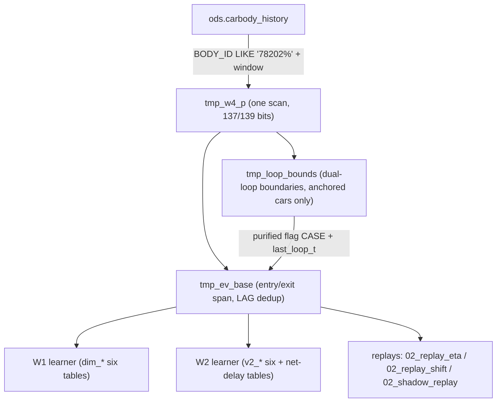

# 数据底座与 dss 学习表体系

This page documents the data foundation of the paint-shop DSS: the `ods.carbody_history`
event stream and its `MDS_DATA` flag bits, the shared `sqlbase.ev_base_sql` purification
pipeline that every learner and replay consumes, and the complete inventory of `dss`
schema tables (W1 six learning tables, W2 six `v2_*` tables, W4 net-delay tables, T1
weekly plan tables, and the W3 work tables). It closes with the three-tier row convention
(model → platform prefix → `'ALL'`, `n` always in the last column) and the read-only
principle that confines all DSS writes to the `dss` schema.

Scope note: this page describes SQL and code semantics only. It does not connect to any
database and does not execute DB reads or writes. Calibration claims cite their source
(`README.md` 关键口径 table, `docs/` document numbers, or the code docstrings that quote
them).

## Event foundation: `ods.carbody_history`

`ods.carbody_history` is the MES pass-through event stream — one row per station pass
("过站事件"), appended permanently as bodies travel the line. The current dataset is
≈6.276M rows over 83,493 bodies and 259 stations, spanning 2026-04-14 → 09-18
(`README.md` 数据源, line 9). The upstream ETL job `refresh_carbody_ods` is the only
writer to this table; the DSS treats it strictly as read-only
(`spike_w3/stream_pipeline.py`, `_SYNC_JOB`).

The columns used by every DSS query are stored uppercase and must be double-quoted in
SQL; unquoted lowercase references fail with `UndefinedColumn` (README 数据源;
`docs/superpowers/plans/2026-09-19-w1-takt-learner-eta-replay.md` 列名 note):

| Column | Meaning |
|---|---|
| `"ID"` | Monotonic row id; the DSS incremental watermark key (`WHERE "ID" > :wm ORDER BY "ID"`, `docs/03` §水位). |
| `"BODY_ID"` | Body identifier; product vehicles are `78202%`. |
| `"BODY_TYPE"` | Body type (e.g. `2N54Y-`, `YM33J-`); taken verbatim as `body_type` (R5: no prefix derivation). |
| `"RW_STATION_ID"` | Read/write station code (e.g. `15IS065`). |
| `"MDS_DATA"` | 237-char fixed-length MES telegram carrying the flag bits. |
| `"DATE_EVT"` | Event timestamp; every time query must run under `SET TIME ZONE 'Asia/Shanghai'` (session default is UTC, factory time = UTC+8). |

**Product-car filter.** Learning samples are restricted to product cars by
`"BODY_ID" LIKE '78202%'` (README 关键口径 table, row 产品车；the same predicate is
used in `spike_w1/sqlbase.py`, `spike_w3/stream_pipeline.py` `_CONSUME_SQL`/`_RECONCILE_SQL`,
and `spike_w2/02_replay_shift.py`). Entry/exit anchors are fixed station sets
(`spike_w1/common.py`): 3 entry points `01IS205` / `1L360RB` / `01IS045` and 4 exit
points `K3IS140` / `1J440RB` / `K2IS075` / `K1IS135` (README 关键口径 rows 上线点/下线点).
Beyond the 4 exit points there are 5 *post-exit continuation* stations
(`09IS360` / `09IS350` / `K3IS230` / `K2IS165` / `K1IS225`, `spike_w3/common.py`
`POST_EXIT_STATIONS`) used only by the W3 pool to avoid ghost-vehicle adoption; they do
not participate in offline learning.

### MDS_DATA flag bits

`"MDS_DATA"` is a fixed 237-character MES telegram (all six telegram types TS/TC/TE/TB/TO/TI
have min=max=237; a length drift is the first corruption signal — `docs/08_message_data_dictionary.md` §2.2).
Two positions drive the DSS (1-based indexing):

- **Position 139** — `SUBSTRING("MDS_DATA" FROM 139 FOR 1)`, the rework/blacktop
  process-loop flag: `0`=normal mainline, `1`=quality rework, `2`=blacktop second spray
  (a normal process, not a quality rework), `-`=unfilled, `3`=undefined (4 anomalous
  rows in the whole history). Semantics: the flag is a **body real-time state machine** —
  the decision happens mid-production and the bit flips only after the decision, so the
  latest event's flag is the current state; flag=0 covers both "never reworked" and
  "rework completed and back on the mainline". Crucially the bit is sticky: 93.49% of
  flagged rework vehicles are never reset to `0` after the loop ends, which is why the
  purification pipeline (below) derives windows instead of trusting the raw bit
  (`README.md` 关键口径 row 标志位语义; `docs/10-返工补偿机制问题诊断与期望净延误重构方案.md`
  line 16; value domain from `docs/08_message_data_dictionary.md` §2.2).
- **Position 137** — `SUBSTRING("MDS_DATA" FROM 137 FOR 1)`, the blacktop (two-tone)
  configuration flag, essentially lifetime-invariant (only 4 bodies ever changed it).
  It is a hard precondition for accepting a `139=2` blacktop anchor — it blocks the
  4,941 single-tone "flash" vehicles that transiently show `139=2` (README 关键口径 row
  黑车顶大环线锚定; `docs/12`; `docs/15` C3).

The DSS extracts both bits in SQL at every consumption point, e.g. the W3 incremental
stream query selects `SUBSTRING("MDS_DATA" FROM 139 FOR 1) AS flag` and
`SUBSTRING("MDS_DATA" FROM 137 FOR 1) AS flag137` directly from the table
(`spike_w3/stream_pipeline.py` `_CONSUME_SQL`).

## `sqlbase.ev_base_sql`: the shared purification pipeline

`spike_w1/sqlbase.py` defines `ev_base_sql(win_start, win_end) -> str`, the single
shared event-foundation builder used by all learners and replays (DRY, W4.1 unified
purified extraction, Doc14 §4 + errata). It returns a multi-statement SQL text with two
`%s` placeholders (start, end, in that order), executed as one `cur.execute(sql,
(win_start, win_end))`. The statements build three session-level TEMP tables:

1. **`tmp_w4_p`** (internal intermediate): one scan of `ods.carbody_history` restricted to
   product cars (`"BODY_ID" LIKE '78202%'`) inside the window, extracting both flag bits
   and indexed on `(body, t)` and `(station)`.
2. **`tmp_loop_bounds`** (contract companion table, docs/15 §0.1): per-vehicle dual-loop
   boundaries —
   - `t_rw_start` = first `139=1` event (rework loop start);
   - `t_bt_start` = first event with `137=1` AND `139=2` at or after the first
     **oven-out** station; the oven-out set is the errata-corrected 3 stations
     `{'16IS305','17IS305','18IS345'}` (the old 4th member `20IS010` was removed — it is
     the line-2 storage-line entry, not an oven exit);
   - `t_rw_end` / `t_bt_end` = first pass of the three-line handover gateway group
     (`25IS010` / `25IS110` / `25IS210`) after tagging; `NULL` = no gateway (bypassed or
     still in-process);
   - **C5 dual-window truncation**: for rework-first vehicles
     (`t_bt_start > t_rw_start`), the rework window upper bound is
     `LEAST(first gateway, t_bt_start)`;
   - only anchored vehicles enter the table
     (`t_rw_start IS NOT NULL OR t_bt_start IS NOT NULL`).
3. **`tmp_ev_base`** (contract main table; shape unchanged): product cars → first entry /
   first exit inside the window (`exit_t > entry_t`) → in-trip events
   (`entry_t ≤ t ≤ exit_t`) → consecutive-same-station dedup keeping the first row
   (`LAG(station) OVER (PARTITION BY body ORDER BY t, id)`). Its `flag` column is
   **purified** into `{'0','1','2'}`: inside the pure rework window `[t_rw_start,
   t_rw_end]` → `'1'` (priority); inside the pure blacktop window `[t_bt_start,
   t_bt_end]` → `'2'`; everything else (post-gateway, pre-oven false signals, `-`/`3`
   invalid values) → `'0'`. The `last_loop_t` expression is byte-for-byte unchanged from
   W1/W2: `max(t) FILTER (WHERE flag IN ('1','2')) OVER (PARTITION BY body)`, which
   preserves the "clean suffix" exclusion semantics for the main distribution.

Because the TEMP tables are session-scoped, every downstream learner/replay query must
run on the **same connection** that built them; that is why the W2 weekly loop
re-executes `ev_base_sql` to rebuild `tmp_ev_base` before each per-week statement
(`spike_w2/01_learn_v2.py` main, step 2).

### Production call-site contract

The call form ``cur.execute(sqlbase.ev_base_sql(a, b), (a, b))`` is byte-stable with
**6 production call sites across 5 files** (docstring double-audit B2 correction; the
original "3 sites" was a grep truncation): `spike_w1/01_learn_takt.py` (learner),
`spike_w1/02_replay_eta.py` (W1 replay), `spike_w2/01_learn_v2.py` (full-window build +
per-week rebuild), `spike_w2/02_replay_shift.py` (shift replay), and
`spike_w3/02_shadow_replay.py` (shadow replay). The contract is pinned by pure-text
unit tests with no database: `tests/test_w4_sqlbase.py` asserts the placeholder count,
the `78202%` predicate, both 137/139 `SUBSTRING` extractions, the errata oven set
(including an explicit assertion that `20IS010` is absent), the 3-station gateway set,
the entry/exit station sets, the C5 `LEAST(...)` truncation, the unchanged
`last_loop_t` expression, the `DROP/CREATE TEMP TABLE` pairs for both contract tables,
the anchored-only filter, the purified-flag `CASE`, and the unchanged `LAG` dedup.

*Caption: `sqlbase.ev_base_sql` builds the session TEMP tables; the W1/W2 learners and all replays consume `tmp_ev_base` (and `tmp_loop_bounds` for `dim_loop_duration`) on the same connection.*

## Learning table inventory (`dss` schema)

All learning tables live in the `dss` schema and are created by `DROP TABLE IF EXISTS`
+ `CREATE TABLE` in the learner DDL (full rebuild each run). Learners run offline:
`python spike_w1\01_learn_takt.py` (W1) and `python spike_w2\01_learn_v2.py` (W2;
README 运行).

### W1 six tables (plus meta)

Built by `spike_w1/01_learn_takt.py` (default learn window 2026-04-14 → 2026-08-15,
`--win-start`/`--win-end`). Flow: DDL → `ev_base_sql` → platform-prefix discovery →
four INSERT statements (each a multi-`UNION ALL` of the three tiers) → `dim_loop_duration`
→ meta → sanity checks S1–S6 → exit 0 only if all pass.

| Table | Key | Columns | Learning semantics |
|---|---|---|---|
| `dss.dim_remaining_time` | (body_type, station) | p50, mean, p90, n | Main distribution: clean suffix (flag='0', `t < exit_t`, `t > last_loop_t`), remaining seconds to exit. |
| `dss.dim_loop_remaining` | (body_type, flag, station) | p50, mean, p90, n | Loop distribution: flag ∈ ('1','2') in-trip events, remaining to exit. |
| `dss.dim_station_takt` | (frm, to_station, body_type) | p50, mean, p90, n | Segment takt from `LEAD` over the per-body path; each tier cleans outliers with its own per-bucket `dur ≤ q3 + 3·(q3−q1)` IQR rule (README 目录: 清洗 Q3+3×IQR per 桶). |
| `dss.dim_future_flag` | (body_type, station) | p1, p2, n | Pre-decision probabilities: P(first future flag=1 / flag=2 after this event), learned on flag='0' in-trip events joined to each body's first-flag times. |
| `dss.dim_loop_duration` | (body_type, flag) | l, l_mean, l_p90, n | Per-vehicle loop length L from `tmp_loop_bounds` (pure window duration; `end` NULL falls back to `exit_t`, which is joined from `tmp_ev_base` because the bounds table has no exit column). `l` is P50 (compatibility name) — consumers read `row[0]=l` / `row[-1]=n` unchanged (docs/15 §0.4; `tests/test_w4_learn_takt.py`). |
| `dss.dim_learner_meta` | (key) | value | Run metadata: window, learned_at, counts, `clean_suffix_rate`, `takt_iqr_excl_rate`, W4 keys `base_version='w4-purified'`, `n_rw_vehicles`, `n_bt_vehicles`, `bt_anchor_rate`, `platform_prefixes`. |

Platform prefix rows are generated at runtime, not hardcoded: prefixes are the distinct
`LEFT(bt, 2)` values with ≥30 vehicles in the learn window (C10, `SQL_PLATFORM_PREFIXES`);
the whitelist is validated against `^[A-Z0-9]{2}$` to prevent SQL injection
(`prefix_in_list`). If no prefix qualifies, only model + `'ALL'` rows are written.
Sanity gates S1–S6 (entry-station P50 range/consistency, first-flag concentration in the
rework cluster ≥80%, blacktop anchor placement rate ≥90% on the 10-station whitelist,
p1 profile step shape, `loop_duration`/`loop_remaining` sample sufficiency, takt IQR
exclusion ≤30%, clean-suffix rate ≥0.80) are the exit condition of the learner
(`sanity_checks`, W4.2d recalibrated thresholds).

### W2 six `v2_*` tables

Built by `spike_w2/01_learn_v2.py`. The learner writes only `dss.v2_*` plus the two W4
net-delay tables; the W1 six `dss.dim_*` tables are **read-only inputs** (regression
guardrail, module docstring). The W1 learner must run first with the same window because
`dim_expected_delay` reads the W1 `dim_remaining_time` as its same-source baseline.

| Table | Key | Columns | Semantics |
|---|---|---|---|
| `dss.v2_future_flag` | (body_type, station, week) | p1, p2, n | Weekly p: for each replay week, learned on a rolling 8-week `ev_base` window; plus `week='ALL'` rows from the full window. Purified ⑥a population: flag=0 events before the body's first flag=1 and first flag=2, so p = P(future loop entry \| currently pre-loop). |
| `dss.v2_cohort_remaining` | (body_type, station, cohort) | p50, mean, p90, n | Line-cohort remaining distribution for the 08IS/09IS parallel lines: shared (non-08/09) stations × the line a single-line car (c08 XOR c09) later took; cohort computed on `tmp_ev_base`, not the raw stream (post-exit stations would pollute it). |
| `dss.v2_line_prob` | (body_type, week) | w08, n | Probability a car of the model took the 08IS line (weekly + `week='ALL'`), for cohort mixing without hindsight. |
| `dss.v2_station_quality` | (body_type, station) | n_model, p1, mark | Per model×station quality mark: `low_n` (model row n<30), `mixed` (p1≥0.5), `both`, or `ok`. |
| `dss.v2_comp_excl` | (body_type, station) | — | Compensation exemption set (⑥b): exactly the `both`-marked cells (mixed low-n stations exempt from pre-decision compensation). |
| `dss.v2_learner_meta` | (key) | value | Row counts and run metadata for the W2 build. |

W2 sanity gates W2-S1–S5 (cohort table magnitude for `2N54Y-`, weekly p coverage plus
decision-cluster shape on `15IS065`, comp-excl set containing the known pathological cell
`(2N54Y-, 21IS565)` with total ≤500, weekly line-prob coverage, net-delay table
structural checks) gate the exit code.

### W4 net-delay tables (doc10)

| Table | Key | Columns | Semantics |
|---|---|---|---|
| `dss.dim_expected_delay` | (body_type, station) | delay_mean_s, delay_p50_s, sample_n, sample_n_clean | Station-level dual-column expected net rework delay (doc10 §2, W4.2c). Population = the ⑥a pre-loop events (flag=0, t<exit_t, before first flag=1/2 — the same population as `v2_future_flag`; the clean-suffix population is structurally disjoint from the fut=1 group and must not be used). `fut=1` = will re-enter rework; `rem_clean` = never reworks. Base = same-source baseline: the first `p50` row with n≥30 in the model→prefix→`ALL` hierarchy of `dss.dim_remaining_time`. `delay_mean_s = max(0, P(fut)·mean(rem−base | fut=1) + (mean(rem_clean) − p50(rem_clean)))`; `delay_p50_s = max(0, P(fut)·p50(rem−base | fut=1))`. Rows require **both** populations n≥30 (dual gate; engine degrades model→prefix→ALL→0, C14). The `max(0,·)` truncation applies to the final value only; internal samples may be negative (individual truncation would add 1.6–2.9h positive bias, doc10). Prefix tier = all `LEFT(bt,2)` prefixes (no platform whitelist, unlike the W1 five tables). |
| `dss.dim_expected_delay_shift` | (body_type, station, shift_type) | delay_mean_s, delay_p50_s, sample_n, sample_n_clean | W4.4h shift-tier variant: identical discipline, with an added shift dimension whose sample attribution is the **entry-event shift** — fixed bands DAY = [04:45, 16:30), MID = [16:30, 04:45) (the same attribution window as `spike_w2/shifts.py`; the low-activity tail gap is folded into MID). P(fut) reuses the non-shift-conditioned `v2_future_flag`. Optional table: absent table → empty dict → resolvers fall back to the shared row (zero drift); consumed only when `DSS_SHIFT_TIER_DELAY=1`. |

A coverage-gap monitor (`coverage_gaps`) reports cells with p1≥0.10 where all three tiers
have no delay row — those cells fall back to 0 in the engine (pure under-estimation risk;
doc10 §2.3 requires monitoring whenever the last-tier fallback is 0).

Consumption discipline: both delay tables store **mean before p50** (column order is the
reverse of the rem/loop_rem/loop_dur family). All three consumption sites (unified
engine, predictor, dashboard) must go through `resolve_expected_delay` /
`resolve_expected_delay_shift` in `spike_w2/eta_v2.py`, which read
`row[1]=delay_p50_s` for both tiers (W4.4b revision: the shift tier previously used the
mean column; G2 threshold-count measurements falsified that — delay distributions are
right-skewed with mean≫p50, so mean systematically pushed ETA late) and enforce the
dual-population dual gate (row[2]/row[3] ≥ 30, else degrade to the next tier).

### T1 weekly plan tables

Built/persisted by `spike_w3/plan_loader.py` (T1-lite, docs/06 contract; input spec
docs/08). Input files are CSV/Excel named `week_plan_<year?>KW<ww>*.{csv,xlsx,xls}`
found in the plan folder (default `plan_inbox`, overridable via `DSS_PLAN_FOLDER`); a
single-file override is `DSS_PLAN_CSV`. Rows have 4 required columns (日期, 日班工时,
中班工时, 出车计划) and 2 optional (进车计划, 备注); business entries use only
`8` / `10` / `11` / `休` (or blank), and the backend maps hours to physical shift windows
(day end 16:30 for all types; mid-shift window ends 04:00/03:00/01:00 = work full + 30min
handover tail — docs/08 §二; `spike_w2/shifts.py` `DAY_TYPES`/`MID_END_TIMES`).

| Table | Key | Semantics |
|---|---|---|
| `dss.dim_weekly_plan` | (plan_date) | One row per planned date: day_hours, mid_hours, total_plan, entry_plan, note, week_label, source, source_file, loaded_at. |
| `dss.work_plan_file_meta` | (file_name) | sha256 of each input file plus loaded_at; idempotency anchor. |

Both tables are created with `CREATE TABLE IF NOT EXISTS` and **upserted**, never
deleted. `persist_plan` is hash-idempotent: for each file it checks the stored sha256 and
skips unchanged files (0 writes); changed/new files upsert their date rows and the meta
row in one transaction, rolling back on failure to preserve old data. Cross-file
conflicts (same date, different values from two files) raise `ValueError` and the boot
sequence degrades to self-learning fallback mode (no plan, no targets) rather than
aborting. The online causal fallback (`infer_shift_causal`) uses only completed days and
events strictly before now, and is deliberately a separate re-implementation of the W2
hindsight-based `detect_*` functions (causality red line, plan_loader §因果兜底).

### W3 work tables

Runtime (online) tables, all created lazily with idempotent `CREATE TABLE IF NOT EXISTS`:

| Table | Key / id | Writer | Semantics |
|---|---|---|---|
| `dss.work_alert_log` | none (append) | `spike_w3/stream_pipeline.py` `record_dead_audit` | Dead-vehicle audit: one row per dead vehicle (type literal `'dead_car'`; station/flag/since from the pool; detected_at = judgment time). The table is designed to hold other alert types later; empty sweeps write nothing. |
| `dss.work_shift_alert` | (id BIGSERIAL) | `spike_w3/alert_engine.py` (DDL ready; backtest writes JSON/MD only, production enables DB writes per 拍板⑤) | Gap alerts: scope `day_total` / `shift`, level red/yellow/green with a debounced confirmation state, delta, gap/bottleneck/rework/blacktop counts, and a `sections` JSONB histogram. |
| `dss.dim_station_section` | (station) | `alert_engine.build_station_section` (two-level bootstrap: station-code prefix mapping + profile-mode area; upserted) | Station→process-section map (docs/02 eight-section vocabulary, or `待确认`), status `auto`/`confirmed`, used by the alert engine's bottleneck histogram. |

## Three-tier row convention

All W1 five distribution tables, `dim_expected_delay(_shift)`, and `v2_cohort_remaining`
carry a `body_type` dimension with **three tiers of rows**:

1. model row — the exact `BODY_TYPE` (e.g. `YM33J-`);
2. platform-prefix row — `LEFT(body_type, 2)` (e.g. `2N`), written only for prefixes
   that passed the ≥30-vehicle runtime filter in the W1 five tables (all prefixes in the
   delay tables);
3. `'ALL'` row — all vehicles pooled.

The learner emits the tiers as separate `UNION ALL` branches in one INSERT; the consumer
fallback chain is `model → LEFT(model,2) → 'ALL'` implemented in `_model_tiers` and the
`resolve_*` functions (`spike_w2/eta_v2.py` `resolve_hierarchical`), each tier usable
only when its row's `n` meets the gate (default `MIN_N=30`; delay tables use the
dual-population gate instead). The W1 learner's older two-tier `resolve`
(`spike_w1/eta.py`) reads the same rows but falls back only model→`ALL`; the prefix rows
are naturally inert for it (no behavior change).

**`n` is always the last column** of every table row ("n 恒在行尾",
`docs/superpowers/plans/2026-09-19-w1-takt-learner-eta-replay.md` 表行形状;
`spike_w1/eta.py` header). Every resolver therefore tests usability as `row[-1] >= min_n`
and reads statistics by explicit index (`row[0]`=P50/l for vehicle mode, `row[1]`=mean
for shift mode). This invariant survives the W4.2a extension of `dim_loop_duration`
from 2 to 4 statistics (`l, l_mean, l_p90, n`), which is why `l` is a "compatibility
name" even though it is P50. Note the deliberate exception: the delay tables invert
mean/p50 order, so they must not be indexed positionally by generic resolvers.

The learner exit codes and sanity reports are the quality gate of this schema: the W1
learner exits 0 only when S1–S6 all pass and writes
`output/w1_learn_sanity_<YYYYMMDD>.md`; the W2 learner likewise for W2-S1–S5.

## Read-only principle and configuration

**Write boundary.** The DSS writes only to the `dss` schema. `ods`, `dim`, `fct`,
`mart`, and `meta` schemas are read-only inputs — the ETL layer owns them (the
`refresh_carbody_ods` job is the sole writer to `ods.carbody_history`; its
`meta.refresh_watermark` `max_id` row is diagnostic only and explicitly not the DSS
starting watermark, `docs/03` F8, `spike_w3/stream_pipeline.py` S1/S2). This boundary is
enforced by test, not just convention: `tests/test_w3_dead.py` asserts the audit INSERT
targets `dss.work_alert_log` and contains none of `ods.`/`dim.`/`fct.`/`mart.`/`meta.`.

**Configuration.** The connection DSN is built from `DSS_DB_HOST` / `DSS_DB_PORT` /
`DSS_DB_NAME` / `DSS_DB_USER` / `DSS_DB_PASSWORD` environment variables (loaded via
`python-dotenv` from the project-root `.env`), each falling back to the local development
database defaults when unset (`spike_w1/common.py` `_dsn`, re-exported by
`spike_w3/common.py`); the template is `.env.example` (credential values themselves are
not quoted here). Every connection sets `autocommit` and
`SET TIME ZONE 'Asia/Shanghai'` — the factory-time discipline applies to every time
query, including the W2 shift-tier SQL, which converts `entry_t` to Asia/Shanghai before
bucketing the hour. Key runtime switches relevant to this page: `DSS_DUAL_RING`
(1 = unified dual-ring engine that consumes the purified flag / net-delay tables,
production default; 0 = legacy rollback path), `DSS_USE_NET_DELAY` (legacy-path only),
`DSS_SHIFT_TIER_DELAY` (1 = consume the shift-tier delay rows), `DSS_PLAN_FOLDER` /
`DSS_PLAN_CSV` (plan input location), and `DSS_LEARN_WIN_START` / `DSS_LEARN_WIN_END`
(learner baseline window). All strict 1/0 switches raise on illegal values at startup.

**Boot integration.** `spike_w3/01_boot_online.py` treats the learning tables as
existence-checked inputs: `DSS_DIM_TABLES` lists the W1 six tables, W2 six `v2_*`
tables, `dim_expected_delay`, and `dim_weekly_plan` (14 items; the boot reports ✓/✗ per
table). `dim_expected_delay_shift` is deliberately **not** in the required list — a
missing table loads an empty dict and the resolver falls back to the shared row, so the
online service starts cleanly without the optional table. The same boot sequence ensures
the T1 plan tables exist, persists the current plan files (hash-idempotent), derives the
post-exit station set data-drivenly and compares it against the constant
(`POST_EXIT_STATIONS`; mismatch only warns), and refuses to start the incremental stream
if the bootstrap window has no data (watermark=0, F8).

## Tests focused on this page

- `tests/test_w4_sqlbase.py` — pins the `ev_base_sql` contract (station sets, errata
  oven set, C5 truncation, purified-flag CASE, `last_loop_t` expression, dedup) as
  pure-text assertions.
- `tests/test_w4_learn_takt.py` — pins the W4.2a `dim_loop_duration` 6-column DDL,
  the "L from `tmp_loop_bounds`" new contract, the three-tier rows, and the
  runtime-generated prefix list.
- `tests/test_w3_dead.py` — pins the `dss.work_alert_log` DDL/INSERT and the
  dss-only write boundary.
- `tests/test_w3_plan.py` — pins plan parsing, hash-idempotent persistence, the
  causal-fallback SQL (read-only `ods.carbody_history`, `DATE_EVT < now` causality
  bound).
- `tests/test_eta.py` / `tests/test_w4_eta_unified.py` — pin the row-shape invariants
  (`row[-1]=n`, three-tier fallback, explicit delay-table column indexing).
- `tests/test_db_smoke.py` — the only DB-touching smoke test: pins tz/window bounds,
  the 139-bit flag distribution, and entry/exit station counts against a recorded
  snapshot; auto-skips via a socket probe when the database is unreachable.

## Related pages

- [Module Map](module-map.md) — where the learners, replays, and online engine sit in the codebase.
- [Flag and Loops](../concepts/flag-and-loops.md) — the 137/139 bit semantics and the dual-loop state machine.
- [Database](../integrations/database.md) — `analytics_db` schemas, ETL ownership, and the read/write boundary.
- [Learner Pipeline](../workflows/learner-pipeline.md) — the W1/W2 learning run flows that populate these tables.
