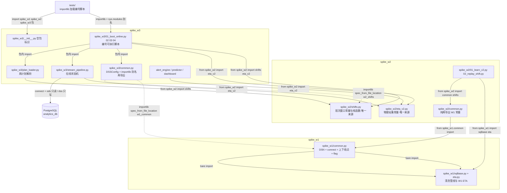
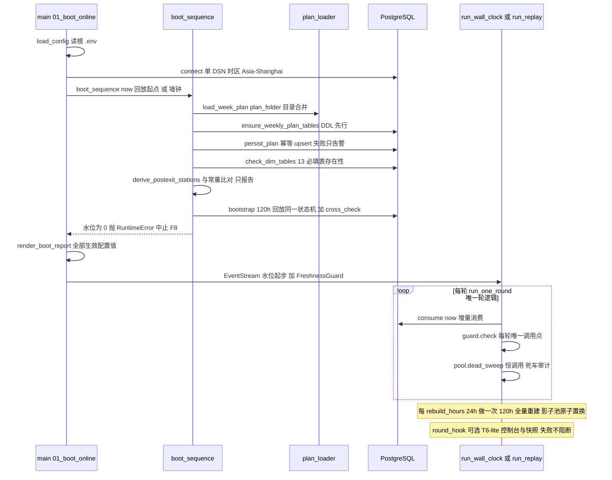

# 模块地图与跨包依赖纪律

本页给出 `spike_w1/`（W1 节拍学习器 + ETA 回放）、`spike_w2/`（W2 v2 学习器 + 班次级回放 + 班次日历）、`spike_w3/`（W3 在线引擎）与 `tests/` 的依赖拓扑和职责边界，并固化三条跨包纪律：① W3 经 importlib 按路径加载并注册 `sys.modules` 别名（`w1_common` / `w2_shifts`），防裸 import 撞名；② 常量单一事实源分布（DSN/上下线点/flag 在 `spike_w1/common.py`，班次窗口常量只存在于 `spike_w2/shifts.py`，物理站集只存在于 `spike_w2/eta_v2.py`，W3 一律再导出、禁止复制）；③ `01_`–`04_` 编号可执行脚本约定（数字开头，测试必须 importlib 路径加载）。辅助资产：`plan_inbox/` 周计划文件夹、`topology/` 站点目录与拓扑图、根目录 `d0_check.py`、`pytest.ini`、`.env.example`。

时间口径：所有模块共享 `spike_w1/common.py` 的 `connect()`（单 DSN + `SET TIME ZONE 'Asia/Shanghai'`，工厂时 = UTC+8），下游禁止另开连接逻辑（L3）。

## 1. 依赖拓扑与单一事实源（改规则改哪里）

*图 1：跨包依赖拓扑与单一事实源再导出路径（点线 = importlib 按路径加载 + `sys.modules` 注册）。*

### 1.1 单一事实源分布表

| 常量 / 能力 | 唯一来源（改这里） | 消费方（只再导出 / import，禁复制） |
| :--- | :--- | :--- |
<!-- openwiki: broken internal link [spike_w1/common.py] file "spike_w1/common.py" does not exist. Fix the href or restore the target, then delete this comment. -->
| DSN 解析（`DSS_DB_*` 覆盖 > 开发库默认 127.0.0.1/root/root/analytics_db）+ `connect()`（autocommit + 会话时区 `Asia/Shanghai`） | `spike_w1/common.py`（[`_dsn()`](spike_w1/common.py)、`DSN`、`connect()`） | `spike_w2/common.py`（`from spike_w1.common import ...`）；`spike_w3/common.py`（经 `w1_common` 别名再导出 `connect`）；`d0_check.py`（`sys.path` 插入 `spike_w1` 后 `from common import connect`） |
| 3 上线点 `ENTRY_STATIONS`（`01IS205` / `1L360RB` / `01IS045`）、4 下线点 `EXIT_STATIONS`（`K3IS140` / `1J440RB` / `K2IS075` / `K1IS135`） | `spike_w1/common.py` | 同上；`spike_w3/stream_pipeline.py`（经 `spike_w3.common` 包内导入）；`spike_w3/04_m5_acceptance.py` 等脚本（`from spike_w3.common import EXIT_STATIONS`） |
| MDS_DATA 第 139 位 flag 值域 `FLAG_NORMAL/FLAG_REWORK/FLAG_BLACKTOP = "0"/"1"/"2"` | `spike_w1/common.py` | `spike_w2/common.py`、`spike_w3/common.py` 再导出 |
| 班次窗口常量与纯函数：`CST` / `DAY_TYPES` / `MID_END_TIMES` / `ATTR_DAY_START` / `TANK_DAY_END` / `MID_START` / `ANCHOR_HOURS` / `GATE_ANCHOR_H` / `SURGE_MIN_15MIN` / `MIN_DAY_EVENTS` / `MID_MIN_FLOOR` + `Shift` / `shift_windows` / `anchors` / `gate_anchor` / `detect_day_type` / `detect_mid_type` / `normalize_shift_type` / `is_complete` / `iso_week_label` / `week_start` | **只存在于** `spike_w2/shifts.py`（全局约束 1，B1 拍板；改窗口 = 改这个文件） | `spike_w2/01_learn_v2.py`、`02_replay_shift.py`（`from spike_w2 import shifts`）；`spike_w3/common.py` 全套再导出（`w2_shifts` 别名）；`spike_w3/02_shadow_replay.py`、`03_alert_backtest.py`、`04_m5_acceptance.py`、`plan_loader.py`（`from spike_w2 import shifts`） |
| 物理站集常量（`UNIVERSAL_EXIT_STATIONS` / `BLACKTOP_ONLINE_WHITELIST` / `SPRAY_QUEUE_BLACKLIST` / `OVEN_OUT_STATIONS` / `LOOP_EXIT_GATEWAYS`，frozenset） | **只存在于** `spike_w2/eta_v2.py`（头注「单一事实源 = 本模块，W3 import；值与 Doc14 §5 逐字一致」） | `spike_w3/stream_pipeline.py`（`from spike_w2 import eta_v2`，用 `OVEN_OUT_STATIONS` / `LOOP_EXIT_GATEWAYS` 做烘房/出环状态派生）、`predictor.py`、`dashboard.py`、`02_shadow_replay.py` |

**W3 专有常量（不在上表，勿混入 W1/W2 事实源）**：`spike_w3/common.py` 定义 `POST_EXIT_STATIONS`（5 出站延续站 `09IS360` / `09IS350` / `K3IS230` / `K2IS165` / `K1IS225`，2026-09-24 幽灵车踩坑后新增；W1 底表已 SQL 截断、无出站延续站概念，故只能由 W3 定义）与 `DSSConfig`（`DSS_*` 参数汇总，见 [configuration](../operations/configuration.md)）。启动时 `stream_pipeline.derive_postexit_stations(conn)` 数据驱动重推并与该常量比对，不一致只进启动报告 + warning，不自动改。

### 1.2 W3 跨包加载纪律：importlib 按路径加载 + `sys.modules` 注册

<!-- openwiki: broken internal link [spike_w3/common.py] file "spike_w3/common.py" does not exist. Fix the href or restore the target, then delete this comment. -->
W3 的跨包地基在 [`spike_w3/common.py`](spike_w3/common.py)（T2.0 地基：env 加载 + 跨包再导出，无副作用）。两条纪律（docs/03 §0 接口契约）：

1. **撞名隔离**：`spike_w1/common.py` 与 `spike_w2/common.py` 同名，W3 若裸 import 会撞名——因此 `_load_module(alias, relpath)` 用 `importlib.util.spec_from_file_location` 按路径加载并改名别名：`w1_common`（← `spike_w1/common.py`）、`w2_shifts`（← `spike_w2/shifts.py`），然后**必须**在 `exec_module` 前注册 `sys.modules[alias]`（`spec_from_file_location` 不自动注册；缺注册会在按类名反查/序列化时炸）。
2. **再导出而非复制**：`connect` / `ENTRY_STATIONS` / `EXIT_STATIONS` / flag 常量一律从 `w1_common` 取；`shifts` 全套从 `w2_shifts` 取。W3 代码里禁止复制窗口常量、禁止另开连接逻辑（单 DSN + `Asia/Shanghai` 时区，L3）。

再导出语义：跨包路径加载产生独立模块对象，测试断言**值相等而非身份相同**——`tests/test_w3_common.py` 钉死 `common.ENTRY_STATIONS == w1c.ENTRY_STATIONS`（值）以及 `common.connect.__module__ == "w1_common"`（证再导出而非新写函数）。

W3 内部对编号脚本同样使用 importlib 别名加载（数字开头模块不可正常 import，且 `main` 有 `__main__` 守卫、import 无副作用）：`02_shadow_replay._w3_boot()`（别名 `w3_boot`）、`predictor._w2_replay_shift()`（别名 `w2_replay_shift`，只取 `SQL_DAYTYPE` / `SQL_MIDLAST` 常量，W2 文件零改动）、`dashboard`（别名 `w2_replay_cli_eta` 等）——统一「`sys.modules` 首查 + importlib 加载 + 注册」模式，且单测可预注入 stub。

依赖方向单向：W3 → W2 → W1；W2 脚本另 `from spike_w1 import sqlbase, eta`（复用 W1 清洗管线与 ETA）；W3 不依赖 `topology/`、`plan_inbox/` 作为 Python 模块（后者是数据资产，见 §6）。

## 2. 模块清单与职责

| 模块 | 职责 | 关键点 |
| :--- | :--- | :--- |
| `spike_w1/` | 节拍学习器 + ETA 离线回放 | `common.py`（事实源，见 §1.1）；`sqlbase.py` 共享清洗管线；`01_learn_takt.py` / `02_replay_eta.py` 编号脚本 |
| `spike_w2/` | v2 学习器 + 班次级回放 + 班次日历 | `common.py` 纯再导出 W1 常量（保证 W1/W2 口径单一来源）；`shifts.py` 班次日历纯函数（TDD）；`eta_v2.py` 物理站集 + 双环 ETA；`01_learn_v2.py` / `02_replay_shift.py` 编号脚本 |
| `spike_w3/` | 在线引擎：启动 / 影子回放 / 告警回测 / 验收 | `__init__.py` 空包标识（使 W3 可被测试 import）；`common.py` 跨包地基；`stream_pipeline.py` 在线状态机；`plan_loader.py` 周计划解析；`alert_engine.py` / `predictor.py` / `dashboard.py`；`01`–`04` 编号脚本 |
| `tests/` | 全离线单测 + 少量 DB 冒烟 | 见 §3；`pytest.ini` 基线配置 |
| `plan_inbox/` | 周计划输入监听文件夹（数据资产） | 见 §5 |
| `topology/` | 站点目录 + 车间拓扑图（辅助资产） | 见 §6 |
| 根目录 | `d0_check.py` / `pytest.ini` / `.env.example` / `environment.yml` | 见 §6 |

## 3. 编号可执行脚本约定（01–04）与测试加载纪律

- **命名约定**：W1/W2/W3 的编号脚本（`01_*`、`02_*`…；W3 为 `01_boot_online.py` / `02_shadow_replay.py` / `03_alert_backtest.py` / `04_m5_acceptance.py`）以数字开头，**直接可执行**（`python spike_w3/01_boot_online.py` 形态），但 Python 数字开头模块不可被 `import` 语句导入。
- **双导入形态**：W1/W2 脚本内用 `try: from . import common, sqlbase / except: import common, sqlbase` 同时支持包相对导入与脚本直跑（裸 import 依赖 sys.path）；`spike_w3/stream_pipeline.py` 同样用 `try: from .common import ... / except ImportError: from common import ...` 兜底脚本直跑。
- **测试纪律**：`tests/` 里 import 编号脚本一律走 importlib 路径加载 + `sys.modules` 注册（precedent：`spike_w3/common.py` 的 `w1_common`/`w2_shifts` 加载模式）——`tests/test_w3_bootstrap.py` 注释明示「注册（spec_from_file_location 不自动注册）」，别名如 `w3_boot` / `w3_boot_t1` / `w3_shadow_replay` / `w3_alert_engine`。
- **全离线默认**：测试不连库（`tests/test_w3_common.py`：全离线、不依赖 `.env` 存在），用 `FakeCursor` 逐批弹行并内置 SQL 占位符校验（`sql.count("%s") == len(params)`，防参数失配再逃逸——2026-09-24 真库 IndexError 的教训）。例外：`tests/test_db_smoke.py`、`tests/test_common_w2.py::test_db_smoke` 需真实库（回归护栏：W2 只读 W1 学习表在位）。
- **测试映射**：`test_w1_dsn_env.py`（W1 DSN env 覆盖）、`test_common_w2.py` / `test_shifts.py` / `test_eta.py` / `test_eta_v2.py`（W2 基座/日历/ETA）、`test_w3_*.py`（在线引擎各机制：bootstrap / mainloop / freshness / dead / pool_state / stream / plan / alert / m5 / m9 / dashboard / snapshot / t64_hook / eta_menu / predictor / alpha）、`test_w4_*.py`（W4 统一引擎接线）。整体策略见 [testing-strategy](../testing/testing-strategy.md)。

## 4. W3 在线引擎：启动序列与主循环

*图 2：`spike_w3/01_boot_online.py` 启动序列（T2.4/T2.6 定版）与主循环。*

**启动序列（顺序定版，docs/03 T2.4 Step 5）**：`main()` → `load_config()`（读根 `.env`，缺失不报错）→ `connect()` → `boot_sequence(conn, cfg, boot_now, pool=pool)`：

1. 读周计划（`load_week_plan`：`DSS_PLAN_CSV` env = 单文件模式保留旧回放干跑行为；否则 `plan_loader.load_plan(cfg.plan_folder)` 目录扫描 + 跨文件合并；无文件 / 全失败 / 跨文件同日期值冲突 → `None`，兜底自学模式：班制推断、无目标，服务不中断）；
2. `plan_loader.ensure_weekly_plan_tables(conn)` DDL 先行（全新库首启即在 13 项存在性检查前建 `dss.dim_weekly_plan` / `dss.work_plan_file_meta`），`persist_plan` 幂等 upsert 入库——入库失败只进 warning「旧数据保留，只报告不中止」；
3. `check_dim_tables`：13 必填表存在性清单 `DSS_DIM_TABLES`（W1 六表 `dim_*` + W2 六表 `v2_*` + `dim_expected_delay` + `dim_weekly_plan`；`dim_expected_delay_shift` 为可选表——缺表装载空 dict 回退共享行，仅 `DSS_SHIFT_TIER_DELAY=1` 生效、默认 0 零漂移，不进必填清单）；
4. 出站延续站 derive 启动闸门：`derive_postexit_stations(conn)` 数据驱动重推 vs `POST_EXIT_STATIONS` 常量，不一致只进报告 + warning，不自动改常量；
5. `bootstrap`：120h 回放同一状态机 + cross_check；**F8 不变量**——`watermark == 0`（回放窗无数据）抛 `RuntimeError` 中止启动，增量流不得从 0 起步（`meta.refresh_watermark` 是 ETL 层水位、仅作 B3 S2 诊断，不作 DSS 起始水位）；`replay_cursor` 模式下 bootstrap 必须锚定回放起点（锚墙钟会使水位置顶全库最大 ID、回放全程空转）；
6. `FreshnessGuard.check` 首查（启动即陈旧 → 宣告「数据陈旧/无数据属预期」，不假装最新）；`cross_check_pct > 1%` → warning 人工核对、不自动修；
7. `render_boot_report` 打印启动报告——含**全部生效配置值**（DoD：`config_echo` 逐项回显）。

随后 `EventStream(conn, wm=bootstrap.watermark)` + `front = data_max_ts` 起步（防首轮失去时间基准线），进入主循环。

**主循环**：`run_one_round` 是唯一轮逻辑（wall_clock / replay_cursor 共用），顺序定版：`consume(now)` → `frozen = guard.check(...)`（**每轮唯一调用点，不得二次调用**）→ `dead = pool.dead_sweep(now, frozen)`（恒调用，冻结语义在 sweep 内部消化）→ 有死车：`record_dead_audit` + commit → 状态行。两种驱动：

- `run_wall_clock`（生产形态）：5min 轮询（`poll_interval_sec` 默认 300），`next_grid_wait` 按 epoch 网格对齐下一 5min 边界 + 漂移补偿（下限 1.0s 防忙循环；保证帧 ts 分钟落在 5min 网格，M5 锚点帧可匹配）；
- `run_replay`（回放干跑 / 回归）：游标 `start → end` 步进（`DSS_REPLAY_START` / `DSS_REPLAY_END` env，ISO 格式，aware 时区，R7 纪律 `_require_aware`），返回状态行列表供轨迹/测试。

**自愈与附属件**：每 `rebuild_hours`（默认 24h）做一次 120h 全量重建 `_rebuild`——先建影子池再原子置换（bootstrap 中途失败 → 保留旧池并抛异常，不留空池）+ 水位只升不降（F8）；回放结束后在终点再重建一次（回放终态 = 终点纯 bootstrap 真值，验收锚点）。T6-lite 控制台/快照（`dashboard.build_t6_components`）作为 `round_hook` 挂接每轮之后——**装配失败不阻断主循环**（console 是附属件）；`DSS_CONSOLE=0` 关闭（回归基准两跑 diff 判据）。`load_rest_days(csv_path)` 是向后兼容垫片（02/03 冻结回放器动态加载本模块并调用），T1 接线后禁止删除。

## 5. 周计划输入文件夹 `plan_inbox/`

拍板（2026-09-23）：周计划固定文件夹 = 项目内 `plan_inbox/`（开发默认路径）；生产（内网部署机）用 `.env` 的 `DSS_PLAN_FOLDER` 覆盖，目录约定不变。

- **命名与格式**：`week_plan_<年份>KW<ISO周号>*.csv`（如 `week_plan_2026KW40.csv`）；6 列规范（`docs/08`）：`日期,日班工时,中班工时,出车计划,进车计划,备注`，工时取值 `8 / 10 / 11 / 休`（休 也可 `0` 或留空），日期 `YYYY-MM-DD` 或 `M/D` 均可。解析器认命名与列结构，**不认 `_sample` 后缀**（`PLAN_NAME_RE` 允许任意后缀；.xls 不支持、留痕提示另存）。
- **健壮性契约**（`plan_loader.load_plan`）：非命名文件忽略不报错；同日期多文件值一致 → 合并；同日期值不同 → `ValueError` 跨文件冲突（入库前拦截，`load_week_plan` 捕获后兜底自学、人工修文件）；坏行 / 表级失败 / 文件损坏均留痕不崩溃——**plan_inbox 里任何坏文件不得拖垮在线主循环**。
- **监听规则**（Task 1 目录监听 M3 实现时生效，见 `plan_inbox/README.md`）：新文件 / mtime 变化 → 解析入库 `dss.dim_weekly_plan`；解析失败不阻塞、报「计划解析失败」提示；某周无计划 → fallback 事件流自学模式（服务不中断）；历史文件保留不删（审计 + 回放）。当前库存：`week_plan_2026KW40_sample.csv`（示例，KW40 = 09-28~10-04）+ 真实原计划 KW38 / KW39 / KW41 + KW36 / KW37（实排班载体，出车计划列为实测回填——仅用于 M9 回放窗 + T1 解析器验证，不用于 Δ 对账）。

## 6. 辅助资产

| 资产 | 说明 |
| :--- | :--- |
| `topology/` | 站点目录与车间拓扑图（辅助数据资产，**不被任何 spike 模块 import**——运行期站集一律来自 §1.1 三个单一事实源 + `derive_postexit_stations` 重推）。`stations_catalog.json` = 全车间读写站目录（station_id / name / section / stage / status / 事件与车数统计，如 `01IS205` L3F01 预处理线2）；`shop_topology.json` / `shop_topology.graphml` = NetworkX DiGraph 标准产物（184 站、306 条数据驱动转移边，`graph_analysis_report.md`）；`raw_transitions.csv` / `major_transitions.csv` 原始与稳定转移边；`paint_shop_graph.py` 等构建脚本、`drawing_only_stations.json`、`append_48_stations.py` 辅助。 |
| `d0_check.py` | 内网部署机一次性快查（不进 spike 依赖链）：`sys.path` 插入 `spike_w1` 后 `from common import connect`（复用 W1 单 DSN），① 查 `ods.carbody_history` 的 `MAX("DATE_EVT")` 判 ETL 活性（时差 <5min 正常 / >30min 别开跑）；② 盘点 `dss` 表（学完表后再跑：13 必填表应全在）。 |
| `pytest.ini` | 基线配置（双审建议 4）：`addopts = --basetemp=scratch/.pytest-tmp`——Windows 默认临时树存在旧目录权限残留、不指定 basetemp 时全套件 teardown 报 38 个 PermissionError（环境问题、非代码回归）；`scratch/` 已被 `.gitignore` 覆盖。 |
| `.env.example` | `DSS_*` / `DSS_DB_*` 全量参数模板（DB 连接、`DSS_PLAN_FOLDER`、驱动模式、B3 护栏、α、红黄灯、双环门、M9 调试项）；生产部署用 `DSS_DB_*` 覆盖内网库、`DSS_PLAN_FOLDER` 覆盖周计划路径。完整配置语义见 [configuration](../operations/configuration.md)。 |

## 7. 关联页面

- [Overview](overview.md) — 项目总览与 W1→W2→W3 开发路线
- [Data Model](data-model.md) — `ods.carbody_history` 事件底座、`dss` 学习表清单、MDS_DATA 位语义
- [Configuration](../operations/configuration.md) — `DSS_*` / `DSS_DB_*` 环境变量与 `DSSConfig` 全量语义
- [Testing Strategy](../testing/testing-strategy.md) — 全离线单测纪律、FakeCursor 契约、DB 冒烟例外与验收门
