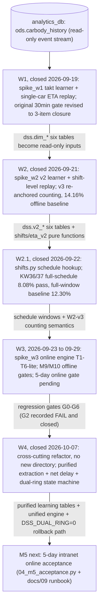
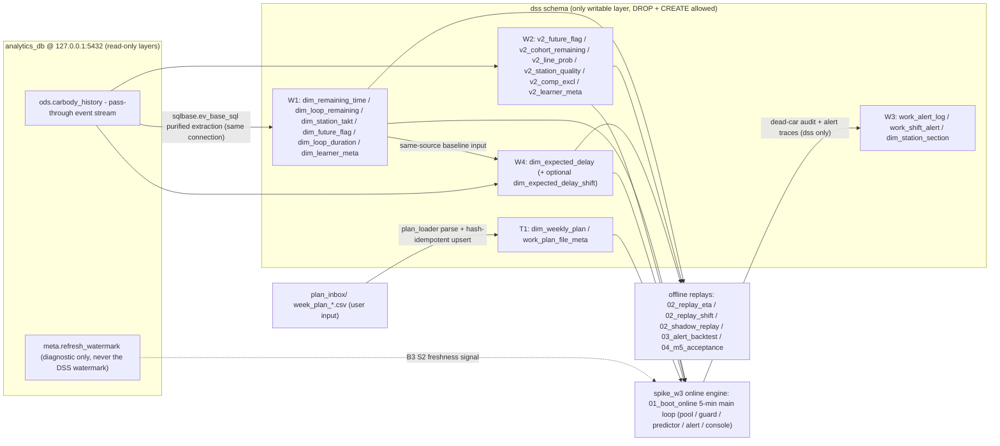

# 系统总览：三波开发 + W4 跨切重构 (System Overview)

This page is the system-level bird's-eye view of the paint-shop Decision Support
System (涂装车间 DSS). It places module ② (shift output achievement prediction,
班次产量达成预测) inside the overall DSS scope, traces the wave-by-wave evolution
W1 → W2/W2.1 → W3 → W4 with each wave's acceptance gate, maps the data flow from
`analytics_db` / `ods.carbody_history` into the `dss` schema, and fixes the hard
division of labor between Basic Memory (BM), `README.md`, `CHANGELOG.md`, and
OpenWiki itself.

Number discipline: every calibration/acceptance number below is annotated with its
source (`README.md` line / `docs/` document number / `CHANGELOG.md` wave entry / BM
note reference). Measured detail lives in the `output/` reports; `output/` is
excluded from this wiki by `.openwikiignore`, so this page cites report file names
only and never copies their content. Time logic everywhere in this system runs in
`Asia/Shanghai` (session default is UTC; factory time = UTC+8).

## What the system is

The DSS serves three functions: logistics balancing (物流均衡), shift output
achievement prediction (班次产量达成预测), and gap warning (缺口预警). Module ② is
built first as the core starting point because it is the only module that does not
depend on snapshot archiving — everything can be validated on historical data — and
it fail-fasts the project's highest-risk assumption ("can position × takt be
predicted") in the first week of replay (AGENTS.md 项目定位 L9; README.md L3-4;
`docs/01-开发阶段计划.md` 总览 L9-11). Modules ① (WIP kanban + water-level warning)
and ③ (flow-balancing suggestions) follow behind ② (docs/01 L13-19).

## Wave evolution: W1 → W2/W2.1 → W3 → W4 → M5

*Wave-by-wave data/control flow: each wave's artifacts (tables, pure functions,
regression gates) are the input contract of the next wave; W4 refactors all three
existing wave directories in place.*

### W1 — takt learner + single-car ETA replay (closed 2026-09-19)

`spike_w1/` holds the wave-1 code: `01_learn_takt.py` (learner, writes the six
`dss.dim_*` learning tables, learn window 2026-04-14 → 2026-08-15) and
`02_replay_eta.py` (out-of-sample single-car ETA replay, 08-16 → 09-18, three
estimators against each other: Σ segment median / Σ segment mean / direct remaining
distribution + loop routing + pre-decision compensation) (docs/01 W1 section
L21-46; CHANGELOG 2026-09-19 W1 关账 L123-129). The original acceptance gate —
single-car median ETA error ≤ 30 min — was recorded as **structurally unreachable**
(the error floor is the plant's inherent scatter, IQR/2, 1.3–17 h), and the gate was
revised by user decision to a three-item closure: quantify the structural floor,
record the center bias (+44~+87 min entry symbol median) as a known bias to be fixed
in W2 ⑤⑥, and verify the mechanism. All items achieved; W2 start conditions met
(docs/01 总览 table L15; evidence reports `output/w1-验证摘要.md`,
`output/w1-门判修订_20260919.md`).

### W2 — shift-level replay (closed 2026-09-21)

`spike_w2/` adds the v2 learner `01_learn_v2.py` (six `dss.v2_*` tables: weekly
rolling-8-week p, line-cohort remaining, weekly line probability, station quality
marks / compensation exemption, meta) and the shift-level replay `02_replay_shift.py`
with the D1' gate: at the shift's 5th hour, predict the shift's final achievement
from in-process car states (docs/01 W2 section L48-57). The pivotal fix was the v3
re-anchored counting rule (`t_anchor + rem ≤ 窗末`), which excluded expired in-process
cars from the count; after it, the plant-wide per-shift @5h median |err%| dropped to
**14.16%**, recorded as the **W2 offline baseline** with only +3.41% symbol bias
(README.md 关键口径 L34; CHANGELOG 2026-09-21 W2 关账 L112-121; evidence
`output/w2-验证摘要.md`). The ≤10% final goal gate was **rigidly kept and deferred to
W3** online absorption of line stops, night dips, and rework stagnation — W2 closed
with the baseline, not with a pass.

### W2.1 — schedule calendar hookup (closed 2026-09-22)

Root cause of W2's mid-shift +16.06% systematic over-estimate: missing shift
calendar — self-learning mis-judged most 11 h mid shifts, inflating 1.5–2 h of ghost
working time (CHANGELOG 2026-09-22 L95-97). The fix is the minimal schedule interface
in `spike_w2/shifts.py`: business input only `8` / `10` / `11` / `休` (or blank),
backend auto-maps to physical windows (day end 16:30 for all types; mid ends
04:00/03:00/01:00 = work full + 30 min handover tail), with automatic self-learning
fallback when no schedule exists and **0% training-stage dependency** on schedules
(README.md 关键口径 rows 班次窗口与窗末 / 排班日历接口 L29-30; `shifts.shift_windows`,
`spike_w2/shifts.py` L84). With the user's real KW36/37 schedules (09-05 → 09-13),
the plant-wide @5h median error reached **8.08% — passing the ≤10% gate**, mid-shift
3.38% with symbol bias +1.39%; the full 35-day window baseline was locked at
**12.30%** as the W2.1 baseline (README.md L34, L46; CHANGELOG 2026-09-22 L99-109).

### W3 — online engine, tasks T1–T6-lite (2026-09-23 → 09-29)

`spike_w3/` implements the online engine as TDD tasks (docs/02-W3开发实施方案.md
file structure L29-59; per-task sections):

- **T1** `plan_loader.py` — weekly plan parser (CSV/Excel, `plan_inbox/` folder,
  hash-idempotent upsert into `dss.dim_weekly_plan` / `dss.work_plan_file_meta`,
  causal self-learning fallback).
- **T2** `stream_pipeline.py` — WIP pool state machine (rules R1–R7), incremental
  consumption (ID watermark + skew two-band recompute), B3 three-state freshness
  guard (NORMAL/STALE/RECOVERY), B4 120 h bootstrap rebuild, M7 dead-vehicle sweep
  with `dss.work_alert_log` audit, periodic 120 h full rebuild (F-1 self-healing).
- **T3** `predictor.py` — rolling per-car ETA (`t + rem ≤ 窗末` counting, same
  semantics as W2-v3) + α adaptive correction (EMA, default **off**,
  `DSS_ALPHA_MODE`).
- **T4** `alert_engine.py` — gap alerting (Δ red/yellow/green at −5%/−10%, 10 min
  debounce, dual scope shift + full-day) + bottleneck localization via station→section
  mapping.
- **T5** `what_if.py` — line-stop dual-track What-If (Phase 2).
- **T6-lite** `dashboard.py` — console four-piece + 5 min JSON snapshots + per-station
  ETA menu, hooked as a non-blocking `round_hook` of the `01_boot_online.py` main
  loop (5 min grid; `run_wall_clock` / `run_replay` share `run_one_round`).

W3's offline quality gates are **M9** (`02_shadow_replay.py`, G1–G4: rolling-vs-static
consistency, G2 α=off ≤10% absolute line, self-check, softened G4) and **M10**
(`03_alert_backtest.py`, G0–G6, 8/8 on the KW36/37 window with G4-B = "no confirmed
level transition in [anchor−10min, anchor)") (CHANGELOG 2026-09-25 M9 L69-77;
2026-09-26 M10 L60-67; 2026-09-28 T6-lite L31-38). The production acceptance gate
remains: **5 consecutive days of stable online running at ±10% shift-level
prediction, in the intranet production environment** (docs/01 W3 row L17, L72;
docs/02 在线验收 L205-214).

### W4 — cross-cutting refactor: unified dual-ring state machine + net delay (closed 2026-10-07)

W4 is **not a new module and has no new code directory** — it is a cross-cutting
refactor of the existing `spike_w1/` / `spike_w2/` / `spike_w3/` code, rooted in
docs/14 (物理双环统一状态机) and driven by docs/15 (步级开发计划), to cure the
blacktop "head early-flash contamination" and rework "tail sticky contamination"
(docs/15 定位 L15). Four steps (docs/15 步级任务 L192-236):

- **W4.1** unified purified extraction — `spike_w1/sqlbase.py`
  `_EV_BASE_SQL` replaced with the Doc14 unified SQL plus the `tmp_loop_bounds`
  companion table; the purified flag (∈ {'0','1','2'}) is computed from dual-loop
  boundaries (rework start = first 139=1; blacktop start = first 137=1 ∧ 139=2 at or
  after the errata-corrected 3-station oven-out set `16IS305/17IS305/18IS345`; loop
  end = first pass of the three-line handover gateways `25IS010/25IS110/25IS210`).
  All 6 production call sites across 5 files stay byte-stable (`sqlbase.py` header
  L1-28).
- **W4.2** re-learn + table extension — `dim_loop_duration` extended to
  (l, l_mean, l_p90, n), three-tier rows (model → platform prefix → 'ALL') in all
  tables, and the new `dss.dim_expected_delay` net-delay table (doc10: dual-column
  mean/p50, dual-population n≥30 gate).
- **W4.3** unified online state machine — `spike_w2/eta_v2.py`
  `resolve_effective_flag` + `estimate_event_unified` (the state machine's
  stateless mirror of the offline purification), and the **only permitted W3
  frozen-contract change**: `Event.flag_137`, `VehicleState.passed_oven` /
  `flag_137`, rules O1/O2 (docs/15 §0.3 L155-170). `DSS_DUAL_RING` defaults to `1`
  (new engine is the production default; `0` = legacy full-path rollback,
  `.env.example` L91; D6 decision, docs/15 L261).
- **W4.4** full replay re-verification — W1/W2/W3 regression re-runs, KW38/39
  cross-window, doc10 five-gate reconciliation, and closeout.

Gate outcomes were recorded honestly (docs/15 §G L240-250; CHANGELOG 2026-10-07 W4
关账 L15-22; evidence `output/w4-双环重构验证摘要.md`):

- **G2 recorded FAIL and closed** (user decision (i), "no softening, no gate
  removal"): W2 sc3 (schedule input) = **10.60%** (symbol median −5.61 → +0.71%,
  systematic under-estimate eliminated) and M9 rolling α=off = **11.26%**, both
  above the 10% hard line;
- M10 alert backtest held at **8/8**; W1 replay showed no degradation; the
  `DSS_DUAL_RING=0` rollback verified **288/288 zero diff**;
- Rollback semantics clarified by the doc10 reconciliation: the ND retrofit alone
  (`DUAL_RING=0 ∧ USE_NET_DELAY=1`) is a **half-migrated degraded state, not a safe
  rollback** — the true rollback is `DSS_DUAL_RING=0 ∧ DSS_USE_NET_DELAY=0`
  (docs/15 W4.4f L234).

A follow-on experiment, **W4.4h** (2026-10-07), added the optional
`dss.dim_expected_delay_shift` table plus the `DSS_SHIFT_TIER_DELAY` switch (default
`0` = zero drift; missing table loads an empty dict and falls back to the shared
row, so it is deliberately **not** in the required boot table list —
`01_boot_online.py` `DSS_DIM_TABLES` L35-44). The KW37 dual-arm re-test showed the
on-arm G2 moving 11.26 → 11.90% (+0.64 pp, not improved), so the experiment was
**stopped with the switch left off and the mechanism retained** (CHANGELOG 2026-10-07
W4.4h L6-13; evidence `output/w4-W4.4h-班次型档-KW37双臂复测.md`).

### M5 — next gate: 5-day intranet online acceptance

The public-side preparation closed with W3-M5 prep (`04_m5_acceptance.py` acceptance
ledger CLI + `docs/09` runbook, CHANGELOG 2026-09-29 L24-29) and a post-W4 readiness
re-check against the W4 production-default snapshot (w4dry1, DUAL_RING=1, 288 frames)
(docs/15 里程碑 L59). M5 scoring: 5 h anchor Δactual ±10%, four mutually exclusive
reason buckets, out-of-flow periods excluded from the gate and reported separately
(docs/02 在线验收 L205-214).

### Acceptance gate ledger

| Wave | Gate | Criterion | Outcome (source) |
|---|---|---|---|
| W1 | Single-car ETA | original: median ≤ 30 min (08-16→09-18 replay) | recorded structurally unreachable; gate revised to 3-item closure, all achieved (docs/01 L15; CHANGELOG 2026-09-19; `output/w1-验证摘要.md`, `output/w1-门判修订_20260919.md`) |
| W2 | Shift-level D1' @5h | per-shift median \|err%\| ≤ 10% (model-level) | v3 re-anchor → **14.16%** fixed as offline baseline, symbol +3.41%; ≤10% final gate deferred to W3 (README.md L34; CHANGELOG 2026-09-21; `output/w2-验证摘要.md`) |
| W2.1 | Schedule hookup | ≤ 10% | KW36/37 full-schedule **8.08% ✅** (mid 3.38%, symbol +1.39%); full-window 35-day baseline **12.30%** (README.md L34, L46; CHANGELOG 2026-09-22) |
| W3 M9 | Shadow replay G1–G4 | G2 α=off ≤ 10% absolute; G1 ≤ 0.5 pp | three runs ✅, α default off (CHANGELOG 2026-09-25; `output/w3-影子回放验收.md`) |
| W3 M10 | Gap-alert backtest G0–G6 | 8/8 (G4-B: no confirmed transition in [anchor−10min, anchor)) | 8/8 ✅ (CHANGELOG 2026-09-26; `output/w3-T4-缺口告警回测.md`) |
| W3 T6-lite | Dry-run G0–G3 | 09-09, 24 h / 288 steps | all passed (CHANGELOG 2026-09-28; `output/w3-T6-lite-干跑报告.md`) |
| W4 | Regression gates G0–G6 | G2 ≤ 10% rigid | **G2 recorded FAIL, closed**: W2 sc3 10.60% / M9 11.26%; M10 8/8; rollback 288/288 zero diff (CHANGELOG 2026-10-07; docs/15 §G; `output/w4-双环重构验证摘要.md`) |
| M5 | Online 5 days | shift-level ±10%, stale/out-of-flow periods excluded | pending (docs/02; `docs/09` runbook) |

## Data flow master: analytics_db → dss schema

*Master data flow: the DSS reads only `ods.carbody_history` (plus diagnostic
watermarks) and the user plan folder; every derived artifact lands in the `dss`
schema, consumed by the offline replays and the online engine.*

Key properties of this flow:

- **Write boundary.** The DSS writes only to the `dss` schema; the `ods` / `dim` /
  `fct` / `mart` / `meta` layers are read-only (the ETL job
  `refresh_carbody_ods` owns `ods.carbody_history`). Inside `dss` the learners may
  `DROP` + `CREATE` (AGENTS.md 数据访问 L50-58; docs/15 红线 1 L39-45).
- **Single connection discipline.** One DSN (local defaults 127.0.0.1/root/analytics_db,
  overridable via `DSS_DB_*` env), `autocommit`, and `SET TIME ZONE 'Asia/Shanghai'`
  on every connection (`spike_w1/common.py` `_dsn`/`connect` L21-46, re-exported by
  the other waves; no second connection logic allowed).
- **Causal split.** The learn window is fixed at 2026-04-14 → 2026-08-15 and replay
  windows (from 08-16) are out-of-sample; W4 re-learned everything without changing
  the window (docs/15 C13 L35). The W1 six `dim_*` tables are read-only inputs of the
  W2 learner, so W1 must run first with the same window
  (`spike_w2/01_learn_v2.py` header L1-10).
- **ETL SLA (two-stage, 2026-09-23 decision).** Development (public network) =
  user-synced snapshots, on demand, no RTO, offline acceptance via shadow replay;
  production (intranet realtime) = RTO ≤ 1 h, out-of-flow periods counted separately
  and excluded from the acceptance gate, 5-day online acceptance runs in the intranet
  environment; runtime blind-window behavior is backstopped by the B3 freshness
  circuit breaker (STALE freeze + banner) (AGENTS.md L57).

## Knowledge division: BM × OpenWiki × README × CHANGELOG

The project runs a two-level agent memory with a hard boundary — each content type is
written in exactly one place (AGENTS.md 知识库分工 L31-48):

| Content type | Owner |
|---|---|
| Caliber / decision rationale / evolution history | BM thread note `basic-memory/projects/paint-dss/涂装车间-dss-方案设计与开发路线` (sole source of truth); `README.md` 关键口径 table is its frozen snapshot |
| Code architecture / module responsibilities / run paths / `DSS_*` parameters | OpenWiki (this wiki) only; BM mentions artifact paths, not code structure |
| Measured conclusions & acceptance results | BM stores "conclusion + reason + date"; the numbers live in the `output/` reports; OpenWiki cites report file names only (`output/` is ignored) |
| Tasks / tickets | BM Task Board (prefix `paint-dss:`) |
| Code change timeline | `CHANGELOG.md` at wave-level granularity, written at each wave closeout |

**Conflict priority: code > BM note > README snapshot > OpenWiki** (AGENTS.md L45).
An OpenWiki calibration drift is annotated on the affected page, resolved in favor of
BM, and self-heals on the next update run. A code-vs-BM mismatch is a **process
violation** (code must follow the decision) — it must be reported and fixed in code,
never masked at the documentation layer. Wave closeout flow: user commits code → BM
note appended with the wave's decisions/measured results → `CHANGELOG.md` entry →
`openwiki update` → presented file list + suggested commit message → user commits
(the agent never runs `git commit` — user decision 2026-09-20, AGENTS.md L62).

## Repository layout at a glance

- `spike_w1/` = W1 (01 learner → 02 replay), `spike_w2/` = W2/W2.1 (v2 learner, shift
  replay, schedule calendar), `spike_w3/` = W3 online engine (boot / shadow replay /
  alert backtest / acceptance ledger) + the W4 unified engine additions;
  `tests/` = the full TDD suite (470 passed at the W4.4h closeout, CHANGELOG L9).
- `output/` stores run reports/CSVs (ignored by `.openwikiignore` L15-16; only formal
  `*.md`/`*.json` reports are committed); `plan_inbox/` holds weekly plan inputs;
  `docs/` 01–15 are the design/plan documents whose numbers back this page
  (AGENTS.md L64; README.md 目录 L36-47).
- Runs happen in the dedicated conda env `paint-dss` via
  `conda run --no-capture-output -n paint-dss python <script>` (AGENTS.md L65-67).

## Related pages

- [Data Model](data-model.md) — event foundation, `MDS_DATA` bits 137/139, the
  `ev_base_sql` pipeline, and the full `dss` table inventory.
- [Module Map](module-map.md) — `spike_w1/2/3` dependency topology, single-source
  constants, and cross-package importlib discipline.
- [Flag and Loops](../concepts/flag-and-loops.md) — the dual-loop state machine
  semantics behind W4.
- [Configuration](../operations/configuration.md) — full `DSS_*` / `DSS_DB_*`
  semantics, including `DSS_DUAL_RING`, `DSS_USE_NET_DELAY`, `DSS_SHIFT_TIER_DELAY`.
- [Replay Acceptance](../workflows/replay-acceptance.md) — how the M9/M10/W4
  regression gates are actually run and scored.
