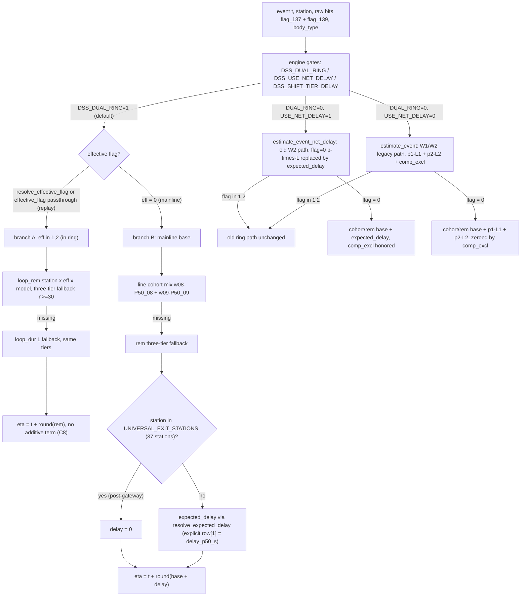
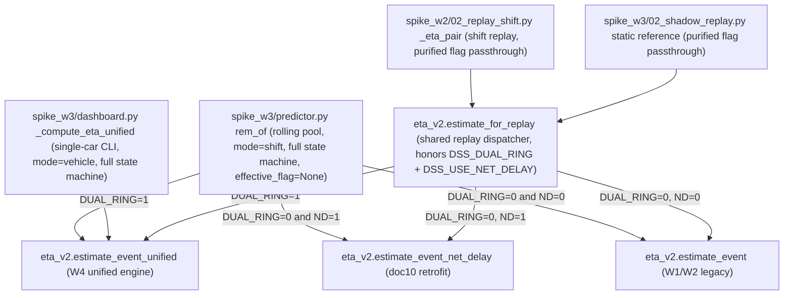

# ETA Decision Chain and Engine Gates (W1→W4)

This page documents how one read/write-station event (`RW_STATION_ID` + `DATE_EVT`,
epoch seconds) is turned into an absolute ETA in the paint-shop DSS. Three estimator
generations coexist in code and are selected by environment gates:

- **W1** — `spike_w1/eta.py`, the direct estimator: ring-distribution P50 for
  `flag ∈ {1,2}`, mainline P50 + pre-decision compensation `p1·L1 + p2·L2` for `flag=0`
  (caliber: BM note 2026-09-19 六确, frozen in the `eta.py` header docstring).
- **W2** — `spike_w2/eta_v2.py::estimate_event`, the v2 estimator: adds ① line cohort
  mixing, ② rolling 8-week weekly `p`, and ⑥b compensation exemption (`comp_excl`).
- **W4** — `spike_w2/eta_v2.py::estimate_event_unified`, the unified dual-ring engine
  (docs/14 §5 semantics, spec frozen in `docs/15` §0.2): an online physical state
  machine resolves an *effective* flag, then the same two branches (ring vs mainline)
  run on the new tables, with the old `p×L` compensation replaced by the
  `dss.dim_expected_delay` net-delay table.

The entrypoints (`predictor.rem_of`, `dashboard` single-car CLI,
`02_replay_shift._eta_pair`, `02_shadow_replay` static reference) all funnel into one
of four pure functions, dispatched by the gates `DSS_DUAL_RING`,
`DSS_USE_NET_DELAY`, and `DSS_SHIFT_TIER_DELAY`. The learning-side semantics
(`docs/10` net-delay formulas, `docs/14` state machine) are the caliber sources;
`docs/15` §0 is the frozen interface contract ("code is the contract — change §0
first").

## The decision chain

The W4 chain, end to end, is:



*The single-event ETA decision chain: gate dispatch to the three engine paths, then
state-machine flag resolution, ring/mainline branch selection, compensation or net
delay, and three-tier model fallback.*



*Entry dispatch: four consumers, four engine functions. The online rolling path
(predictor) and the CLI go straight into the unified engine under
`DSS_DUAL_RING=1`; both offline replay sides go through the shared
`estimate_for_replay` dispatcher so the G1 same-engine consistency gate holds.*

## W1: the direct estimator (`spike_w1/eta.py`)

`estimate_vehicle` walks a car's full in-window event sequence and produces, per
event, a *direct* ETA plus two diagnostic Σ estimators (sum of segment medians /
segment means along the actual path — hindsight, non-production use; they verify
"medians are not additive, means are"). The direct estimator's branching rule:

- `flag ∈ {1,2}` (in a purified ring window) → `loop_rem` P50 only, no compensation
  (the car is already inside the loop) — `eta.py` L84-86.
- `flag = 0` → mainline `rem` P50 (learned on clean suffixes) **plus** pre-decision
  compensation `p1·L1 + p2·L2`: `p1`/`p2` are the future-flag probabilities from
  `dss.dim_future_flag`, `L1`/`L2` the loop durations from `dss.dim_loop_duration`
  — `eta.py` L87-96. Re-enters concentrate in the three polishing stations
  13/14/15IS065 upstream of the mainline (doc 14 §2.1, constraint C4), which is why
  the compensation is a *pre-decision* expectation added on the mainline.

The W1 fallback is two-tier: `(key, model)` → `(key, 'ALL')`, a row is usable only
if its trailing `n >= 30` (`eta.py::resolve`, L41-48). Row shapes (n always last):

```text
rem:      {(station, model): (p50, mean, p90, n)}
loop_rem: {(station, flag, model): (p50, mean, p90, n)}
fut:      {(station, model): (p1, p2, n)}
loop_dur: {(flag, model): (l, l_mean, l_p90, n)}   # W4.2a: 2-tuple extended to 4
takt:     {(frm, to, model): (p50, mean, p90, n)}
```

W4.2a extended `loop_dur` from 2 to 4 columns (adding `l_mean`, `l_p90`); the W1
consumer is untouched because it reads `row[0]` (l) and `row[-1]` (n) only — the
`eta.py` header records this zero-change invariant.

## W2: v2 estimator and its three mechanisms (`spike_w2/eta_v2.py`)

`estimate_event` (L149-193) keeps the W1 ring branch verbatim (loop_rem P50,
model→ALL, `n≥30`, no compensation) and upgrades the `flag=0` branch:

- **① Line cohort mix** (`resolve_cohort_p50`, L98-129): P50 =
  `w08·P50_08 + w09·P50_09`, where cohorts are line-8/line-9 single-line cars and
  `w08` is the line probability. Cohort rows need `n≥COHORT_MIN_N (30)`, line-prob
  rows `n≥LINEPROB_MIN_N (100)`; any gap falls back to the W1 `rem` table. The mix is
  deliberately non-hindsight: line probability is learned from the past, not from the
  car's own realized line.
- **② Rolling 8-week p** (`resolve_p`, L132-146): weekly row
  `(station, model, week)` usable at `n≥P_WEEK_MIN_N (50)`, else the full-window
  `fut_all` (model→ALL, `n≥30`), else `(0.0, 0.0)`. The 8-week window is
  `shifts.week_learning_range` — the 8 ISO weeks *before* the target week,
  `[Monday−8w, Monday−1d]` (no future leakage; `shifts.py` L133-137), and
  `01_learn_v2` re-learns `fut_week`/`lineprob` per replay week over that range
  (`01_learn_v2.py` L553-562).
- **⑥b Compensation exemption**: if `(model, station) ∈ comp_excl` (loaded from
  `dss.v2_comp_excl`), the `p×L` compensation is zeroed (L180-183). `comp_excl`
  semantics are consumed by the legacy path only — the unified engine ignores the
  parameter entirely (docs/15 W4.3d: the old "exempt vs not" contrast lost meaning
  once `p×L` was replaced by `expected_delay`).

The same functions are reused by the unified engine, so the W4 mainline branch is
"the W2 mechanism with the compensation swapped for net delay".

## W4: unified online engine

### State machine (`resolve_effective_flag`)

Raw MDS bits (`flag_137` = bit 137 of `"MDS_DATA"`, `flag_139` = bit 139) are not
trusted directly: the online state machine (docs/14 §5, v1.4 loop-exit guard; code
`eta_v2.py` L215-245) maps them to an effective flag:

| Rule | Condition | Result |
|---|---|---|
| R1 | `station ∈ UNIVERSAL_EXIT_STATIONS` (37 stations) | `'0'` — forced thaw, highest priority |
| R2.1 | `flag139 = '2'` and `flag137 != '1'` (incl. `'-'`) | `'0'` — monochrome flash (blocks the 4,941 single-tone cars, docs/15 C3) |
| R2.2 | `139='2'`, in `SPRAY_QUEUE_BLACKLIST` and not `passed_oven` | `'0'` — first-spray queue false flashes (14IS260/13IS260) |
| R2.3 | `139='2'`, not `passed_oven` and not in `BLACKTOP_ONLINE_WHITELIST` | `'0'` — blacktop anchor requires oven-out (C2) |
| R2.4 | `139='2'`, `loop_exited` | `'0'` — v1.4 guard: raw bits persist after exit (measured 45% of blacktop cars), frozen to mainline |
| R3' | `flag139 = '1'` and not `loop_exited` | `'1'` (97.12% concentrate in polishing stations) |
| R3'' | `flag139 = '1'` and `loop_exited` | `'0'` — raw '1' residue persists (96% of rework cars measured) |
| else | anything else | `'0'` |

The physical constants are single-sourced in `eta_v2.py` (L46-79) and imported by
W3: `UNIVERSAL_EXIT_STATIONS` (37 stations, docs/15 C7), `BLACKTOP_ONLINE_WHITELIST`
(10 stations: report entry cluster 6 + polishing rework line 4, incl. 14IS120),
`SPRAY_QUEUE_BLACKLIST` (14IS260/13IS260), `OVEN_OUT_STATIONS` (16IS305/17IS305/
18IS345 — the 2026-10-05 docs/14 erratum removed 20IS010), and `LOOP_EXIT_GATEWAYS`
(25IS010/25IS110/25IS210, the loop-exit guard signal set, Doc14 v1.4 R3').
`loop_exited` defaults to `False`, which reproduces the pre-v1.4 semantics used by
the `DSS_DUAL_RING=0` rollback path and replay tests.

### The `effective_flag` passthrough channel

`estimate_event_unified` accepts `effective_flag: Optional[str]`
(`eta_v2.py` L310-346): when not `None`, the online state machine is skipped and the
value is used directly. This is the agy blocker-3 fix (docs/15 §0.2 review record):
offline purified flags from `tmp_ev_base` are ground truth, and the online state
machine is its stateless mirror — if the replay side passed raw 137/139 bits instead,
the missing 137 bit would kill every purified blacktop car (`fl='2'`) back to `'0'`
and distort the G2 gate. The online side (predictor) always passes `None` and runs
the full state machine; replay/static reference always passes the purified flag.

### Branch A / Branch B

- **Branch A** (`eff ∈ {'1','2'}`, L348-354): `rem = resolve_hierarchical(loop_rem,
  (station, eff), model, mode)`; missing → `loop_dur` L fallback on the same tiers;
  still missing → `(None, False)`. Then `eta = t + round(rem)` with **no additive
  term** — constraint C8 (docs/15): `dim_loop_remaining`'s training target is the
  full station→exit journey including the post-gateway mainline segment.
- **Branch B** (`eff = '0'`, L356-377): `base = cohort mix` (same W2 mechanism)
  else `rem` three-tier; missing → `(None, used_cohort)`. Then
  `delay = 0` when `station ∈ UNIVERSAL_EXIT_STATIONS` (post-gateway, 37 stations —
  the car has left the loop system, net delay is definitionally zero), otherwise
  `resolve_expected_delay` (falling back to the shift-tier table first when
  `DSS_SHIFT_TIER_DELAY=1`; missing row → 0). The net-delay table *replaces* the old
  `p×L1+p×L2` compensation (doc10 merge-day semantics), and `comp_excl` is not
  consumed at all. Finally `eta = t + round(base + delay)`.

Both branches return `(eta absolute epoch seconds | None, used_cohort bool)` — the
same shape as the legacy entrypoints.

### Three-tier model fallback (`resolve_hierarchical`)

`resolve_hierarchical` (L248-256) walks the tiers `model` → `LEFT(model,2)` platform
prefix → `'ALL'` (`_model_tiers`, L203-212; empty/`'ALL'` model skips to `('ALL',)`),
accepting the first row with trailing `n ≥ 30`. The `mode` parameter selects the
consumed column (see below). The learning side generates exactly these three row
tiers for the W1 five tables and the net-delay tables; the prefix list is measured
from data, not hardcoded (docs/15 C10/D3, meta key `platform_prefixes`).

### Column semantics: `mode='vehicle'` vs `mode='shift'`

Caliber C9 (docs/15, from docs/14 §5; also BM note 2026-09-19 六确 via the `eta.py`
header): shift-level consumption uses the **mean** (unbiased for total shift
output); single-vehicle consumption uses the **P50** (robust to per-car long
tails). `resolve_hierarchical` implements this as `row[1]` (mean / `l_mean`) for
`mode='shift'` and `row[0]` (P50 / `l`) otherwise — any mode other than `'shift'`
deliberately takes the P50 column to prevent misuse. The consumers match the
caliber: `predictor.rem_of` runs `mode='shift'` (shift output prediction), the
`dashboard` single-car CLI runs `mode='vehicle'`.

### The column-order trap: `expected_delay`

`dss.dim_expected_delay` rows are `(delay_mean_s, delay_p50_s, n_fut, n_clean)` —
**mean first, P50 second**, the *reverse* of `rem`/`loop_rem`/`loop_dur`/`cohort`
rows, where P50 is first. The explicit-index rule is frozen in docs/15 §0.2 and in
the loader comment (`02_replay_shift.load_tables`, L101-105): any consumer must go
through `resolve_expected_delay` / `resolve_expected_delay_shift`; inline row
parsing (`row[0]` generic take) is forbidden because it silently swaps mean and P50.
The same dedicated parser also enforces the dual-population dual-threshold gate
(`n_fut ≥ 30` **and** `n_clean ≥ 30` each, else drop a tier — independent of the
generic `n≥30` gate of the other tables) and the model→prefix→ALL fallback.

Both tiers consume `row[1] = delay_p50_s`. The W4.4b revision (2026-10-06, docs/15
§G2 + `eta_v2` docstring L19-27) changed the shift tier from mean to P50 after the
G2 threshold-count measurement falsified the doc10 "shift-level additivity is
unbiased" assumption: the delay distribution is fat right-tailed (`mean ≫ p50` in
91% of rows), so the mean column pushed ETAs systematically late (D arm
20.78% / −20.78% undercount vs the p50 arm 10.60% / +0.71% ≈ unbiased). The
`delay_mean_s` column stays in the table for diagnostics only. Conversely the
`rem`/`loop_rem` columns must **not** be p50-ized alongside (the cc "bp" arm at
11.17% showed it would worsen things).

### α at the consumption point only (B10)

The adaptive takt factor α is applied exactly once, at the consumption point —
`predictor.predict`'s comparison `t + rem/α ≤ shift.end` — and never inside any
estimator (`predictor.py` L39-40, L121; `eta_v2.py` header L29-31). The unified
engine does not read `tables.get('alpha')` (the doc14 §5 pseudocode line was
rejected) precisely to avoid double scaling; the rem it returns is the full
`base + delay` caliber, and α scales that whole rem once.

### Learning side: the net-delay tables

`spike_w2/01_learn_v2.py` writes `dss.dim_expected_delay` (W4.2c) and
`dss.dim_expected_delay_shift` (W4.4h) (`DDL`, L55-66; `SQL_EXPECTED_DELAY`
L187-258; `SQL_EXPECTED_DELAY_SHIFT` L267-340):

- Population: the ⑥a full-window pre-loop population (`flag=0`, before the car's
  first flag 1 and first flag 2 event) — same source as `v2_future_flag`. The clean
  suffix population must **not** be used (structurally disjoint from `fut=1`,
  measured `fut=1 ≡ 0`).
- Formulas (docs/10 §2): `delay_mean_s = max(0, P(fut)·mean(rem−base | fut=1) +
  (mean(rem_clean) − p50(rem_clean)))`, `delay_p50_s = max(0, P(fut)·p50(rem−base |
  fut=1))`; the baseline correction term (right-tail compensation) enters only the
  mean column; the outer `max(0,·)` truncates only the final value.
- `P(fut)` reuses `v2_future_flag` week=`'ALL'` p1 — the rolling 8-week `p` is
  deliberately **not** mixed in (doc10: seasonal bimodality), so the net-delay base
  is same-source as the engine's baseline (`dim_remaining_time` p50 via the same
  three-tier join).
- Dual population: rows are written only where `n_fut ≥ 30` and `n_clean ≥ 30`
  (`WHERE` clause), producing the three-tier rows (body_type / `LEFT(bt,2)` /
  `'ALL'`). Missing rows fall back 0 on the engine side (C14).
- The shift-tier table repeats the same discipline with the entry-event shift
  dimension (`DAY` = [04:45, 16:30), `MID` = [16:30, next 04:45),
  `entry_shift_of`, `eta_v2.py` L292-299); `P(fut)` is *not* shift-conditioned —
  W4.4h splits only the delay distribution.

`dss.dim_expected_delay` is in the required boot table list
(`01_boot_online.DSS_DIM_TABLES`, now 14 entries, docs/15 W4.3b/B8); the shift-tier
table is optional — missing table loads as an empty dict and the resolver falls back
to the shared row (zero drift).

## The three engine gates and entry dispatch

Gate semantics (docs/15 §0.5; `.env.example` L88-100; parsers `_strict01`,
`dual_ring_enabled`, `use_net_delay_enabled`, `shift_tier_delay_enabled` in
`eta_v2.py` L380-407). All three are strict `1`/`0` — any other value raises
`ValueError` at parse time.

| Gate | Default | Semantics |
|---|---|---|
| `DSS_DUAL_RING` | `1` | `1` = W4 unified state machine + unified engine (production default, D6); `0` = legacy `estimate_event` full path — the 30-second rollback (docs/11 red line) |
| `DSS_USE_NET_DELAY` | `1` | **Effective only when `DSS_DUAL_RING=0`** (B11): `1` = old engine consumes `expected_delay` instead of `p×L` (doc10 retrofit, G5 double-correction recheck); ignored under `DUAL_RING=1`, where the new engine always consumes net delay |
| `DSS_SHIFT_TIER_DELAY` | `0` | `1` = unified engine prefers the shift-tier delay row (`dss.dim_expected_delay_shift`, entry-event shift); missing row/threshold fails → shared row. Only the `DUAL_RING=1` path is affected; `0` = shared row, zero drift |

Zero-drift discipline: every gate-off path is bit-identical to pre-W4 behavior —
`DSS_DUAL_RING=0 ∧ DSS_USE_NET_DELAY=0` was verified as the *true* rollback
(DUAL_RING=0 with ND=1 alone is a half-migrated degraded state per the W4.4f gate
reconciliation, docs/15 §G), and `DSS_SHIFT_TIER_DELAY=0` leaves the unified path
unchanged.

Entry dispatch:

- **`predictor.rem_of`** (rolling pool, `spike_w3/predictor.py` L29-66): the W3
  frozen-interface rem for shift prediction. `DSS_DUAL_RING=1` →
  `estimate_event_unified(mode='shift')`, full state machine path: passes
  `v.flag_137`, `v.flag` (raw 139), `v.passed_oven`, `v.loop_exited`,
  `entry_shift=entry_shift_of(v.entry_ts)`, `effective_flag=None`; `ND=1` →
  `estimate_event_net_delay`; else legacy `estimate_event`.
- **`dashboard`** single-car CLI (`_compute_eta_unified`, L247-292): the W4 unified
  path with `mode='vehicle'`; derives `passed_oven` (own-trajectory query over the
  three oven-out stations), `loop_exited` (own-trajectory query over the three 25IS
  gateways), and `entry_shift` (first entry-station timestamp) as stateless single
  queries mirroring the pool state — a documented simplification for the rare
  post-exit secondary-rework case (0 cars in the KW36/37 window).
- **`02_replay_shift._eta_pair`** (shift replay, L161-184): calls
  `estimate_for_replay` for the D arm (purified flag passthrough,
  `mode='shift'`); under `DUAL_RING=1` the contrast arm `direct_nocomp` was
  redefined (docs/15 W4.3d, agy suggestion 2) as a *net-delay-off baseline* — the
  same event with both delay tables cleared to empty — measuring the net effect of
  `expected_delay` itself, since the old exemption-list contrast is degenerate
  (`eta_d ≡ eta_d0`) in the new engine.
- **`02_shadow_replay`** (static reference, L305 and L335): the two static-side call
  sites go through the same `estimate_for_replay` dispatcher as the rolling side —
  the cc blocker-3 fix that restores the G1 same-engine consistency gate
  (rolling vs static reference now differ only by rolling-pool/α state; under
  `DUAL_RING=0` both sides run the old engine, keeping gate semantics).
- **`estimate_for_replay`** (`eta_v2.py` L438-462): the shared replay dispatcher —
  `DUAL_RING=1` → `estimate_event_unified(mode='shift',
  effective_flag=flag_purified)`, `ND=1` → `estimate_event_net_delay`, else
  `estimate_event`.

The legacy entrypoints (`estimate_event`, `quality_mark`, `resolve_p`, ...) are kept
untouched as the `DSS_DUAL_RING=0` rollback path and existing test anchors (docs/15
§0.2 closing line; W1 `spike_w1/eta.py` is frozen except a header-comment
synchronization — zero-change red line).

### Pool state feeding the online state machine

The online state machine's inputs ride on the pool, not on the raw event stream:
`stream_pipeline.VehicleState` carries `passed_oven` (rule O1: set `True` when the
car hits any `OVEN_OUT_STATIONS`, monotonic, never reset — `stream_pipeline.py`
L394-445), `flag_137` (rule O2: latest-event value, `'-'` normalized to `'0'`, on
ingest/replay_car/adoptive paths; if the 137 bit were not pooled, the online
machine would kill all blacktop cars to `'0'` and paralyze the dual-ring engine —
agy blocker 2), and `loop_exited` (v1.4: set at the three `LOOP_EXIT_GATEWAYS`,
reset only on a new-cycle signal = re-entering an entry station — the R3
generalization branch). Invariant: `passed_oven` / `flag_137` / `loop_exited` follow
the car's own trajectory only (no cross-car contamination).

## Failure semantics and invariants

- **No coverage → `None`**: any branch whose base/rem/delay resolves to nothing
  after all fallback tiers returns `(None, …)`; the rolling predictor buckets such
  cars as `no_eta` (excluded from `pred`), and the dashboard reports an explicit
  "residual sample insufficient" error rather than guessing.
- **Dual threshold**: `expected_delay` rows require both populations `n ≥ 30`; a
  failing tier drops to the next tier (model → prefix → ALL → 0), independent of the
  generic `n≥30` gate used by the rem family.
- **Post-gateway**: the 37 `UNIVERSAL_EXIT_STATIONS` force `eff='0'` and `delay=0` —
  after the gateway the car converges to its model-specific clean baseline; a pooled
  2h scalar is explicitly forbidden (D14-5, docs/15 W4.3a test case IE14.- 16.5h).
- **Residue bits**: raw 137/139 bits persist after the loop exits (96% of rework
  cars, 45% of blacktop cars measured) — the R3'/R2.4 guards are what keep the
  online machine's `'0'` mainline semantics aligned with the offline purified
  windows; removing them was the primary cause of the first M9 G1 failure (0.833pp,
  docs/15 W4.4c).
- **Gate drift**: illegal gate values fail at startup; every default-off gate is a
  verified zero-drift path, so any gate can be flipped back independently in
  seconds.

## Tests

The pure-logic TDD suite (no DB) pins this chain: `tests/test_eta.py` and
`tests/test_eta_v2.py` (W1/W2 estimators), `tests/test_w4_eta_unified.py` (branch
A/B, `effective_flag` passthrough, post-gateway delay=0, IE14.- model-specific
baseline, α not embedded, `comp_excl` not consumed, `estimate_for_replay` dispatch),
`tests/test_w4_engine_wiring.py` (gate dispatch incl. `ND` consumption on the
`DUAL_RING=0` branch), `tests/test_w4_loop_exit_guard.py` (the v1.4 guard through
unified engine / `rem_of` / dashboard), `tests/test_w4_pipeline_flag137.py`
(137-bit pool rules O1/O2 and pre/post-oven behavior), and
`tests/test_w4_shift_tier_delay.py` (shift-tier gate on/off parity and
`estimate_for_replay` pass-through).

## Related pages

- [Flag and Loops](flag-and-loops.md) — flag bit semantics, the dual-ring definitions
  and anchor points feeding `tmp_ev_base` purification.
- [Shift Calendar](shift-calendar.md) — `Asia/Shanghai` shift windows, the 8-week
  learning range, and the entry-shift band used by `entry_shift_of`.
- [Prediction and Alert Workflow](../workflows/prediction-and-alert.md) — how
  `rem_of`/`predict` feed the rolling shift output prediction and gap alerts.
- [Replay and Acceptance](../workflows/replay-acceptance.md) — the G1–G6 replay/
  acceptance gates (G2 shift replay, M9 shadow replay, M10 backtest) that these
  engine paths are measured against.
