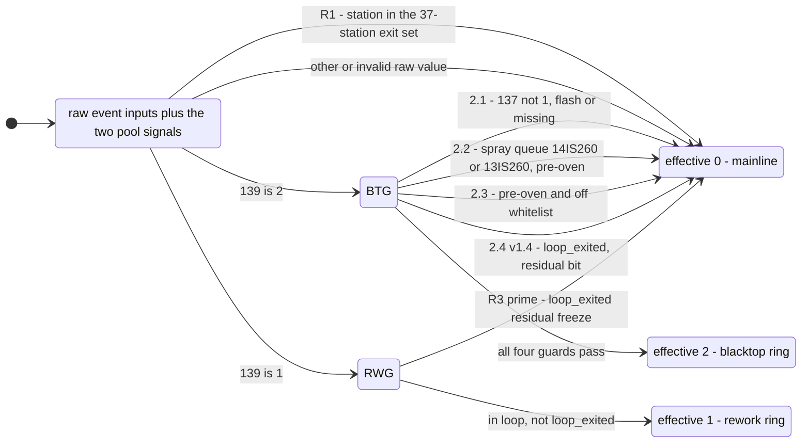

# MDS_DATA 标志位与物理双环锚定

This page is the caliber core (口径核心) of the paint-shop DSS process loops. It documents
how the MES telegram bits drive the two physical loops — **Loop 1 quality rework
(`139=1`)** and **Loop 2 blacktop second spray (`139=2`)** — the physical anchors that
bound them, the offline purification windows, and the online
`resolve_effective_flag` state machine. Calibration sources: `docs/12` (blacktop ring
proposal v1.1), `docs/13` (rework ring proposal v2.2), `docs/14` (unified dual-ring state
machine v1.4, the terminal specification integrating 12+13), the README 关键口径 table
(frozen snapshot), `docs/08` (telegram data dictionary), and the code that implements the
caliber (`spike_w1/sqlbase.py`, `spike_w2/eta_v2.py`, `spike_w3/stream_pipeline.py`).
Per the single-source-of-truth order (BM note > README > CHANGELOG), where the frozen
README snapshot and the erratum-corrected code disagree, the discrepancy is flagged
explicitly and **the code / docs/15 erratum prevails** (以 BM 笔记为准 — the BM note is the
upstream authority; the repo-internal docs/15 erratum and the shipped code are its
codification).

## MDS_DATA flag bits: body real-time state machine

`"MDS_DATA"` is the fixed 237-character MES telegram carried on every row of
`ods.carbody_history`. Two positions (1-based) drive the DSS:

- **Position 139** — `SUBSTRING("MDS_DATA" FROM 139 FOR 1)`: the process-loop flag.
  Value domain: `0`=normal mainline, `1`=quality rework, `2`=blacktop second spray,
  `-`=unfilled; a fourth value `3` exists in only 4 anomalous rows (README 关键口径 row
  返工/黑顶标志; `docs/08` §2.2 value-domain enumeration). Semantics: the bit is a
  **body real-time state machine** (车身实时状态机) — the rework/blacktop decision
  happens mid-production and the bit flips only after the decision, so the latest event's
  flag equals the current state; `0` simultaneously covers "never reworked" and "rework
  completed, back on the mainline" (README 关键口径 row 标志位语义).
- **Position 137** — `SUBSTRING("MDS_DATA" FROM 137 FOR 1)`: the black-roof
  (two-tone) configuration flag, essentially lifetime-invariant (only 4 bodies ever
  changed it, all rework blacktop re-sprays; `docs/08` §2.2). It is a hard precondition
  for accepting any `139=2` anchor (docs/14 §4 / doc12 §5.1 hard constraint, docs/15 C3).

**Post-exit residual (why raw bits cannot be trusted downstream).** The bit is sticky:
`docs/13` §2.3 measures 86.62% (12,194 of 14,078 exited rework cars, at the 4 exit read
stations `K3IS140` / `1J440RB` / `K2IS075` / `K1IS135`) still carrying `139=1` at their
final telegram — MES never resets the bit after the loop ends — and states the physical
conclusion that **`139 == '0'` must not be used as the criterion for "left the rework
loop"**. `docs/14` v1.4 (2026-10-06, M9 shadow-replay G1 per-car attribution) measured the
same residual across the full window as **96% of rework cars / 45% of blacktop cars**
keeping their raw bit uncleared after loop exit. These residual bits are the root cause
of the online loop-exit guard (R3' / R2.4 below) and of the offline window purification
(§4).

## Physical dual-ring topology

All 232 plant stations (`docs/14` §2) split into a three-segment physical architecture:
an upstream one-way DAG (upline `01IS205` → pre-treatment/electrocoat → sealing →
topcoat sanding prep), a **dual-ring overlap and process-closure zone**, and a downstream
one-way waxing/handover corridor ending at the 4 exit points. Both loops share the same
topology, the same `MDS_DATA` field, and the same extraction channel; the dual-ring
gateway group is their common physical exit (docs/14 §1.2).

| Process ring | Physical inbound anchor | Physical outbound anchor | Governing physical law |
|---|---|---|---|
| **Loop 1 quality rework** (`flag=1`) | Three sanding-prep stations `15IS065` (47.81%) / `13IS065` (27.64%) / `14IS065` (21.72%) — 97.17% cumulative (docs/13 §2.2) | Three-line handover gateway group `25IS010` (line 1) / `25IS110` (line 2) / `25IS210` (line 3), first pass after tagging, 97.99% coverage (docs/14 §2.1) | **Waxing no-backflow law**: once a body enters the waxing corridor it can never return to a topcoat oven for spraying/sanding; passing the gateway group must mean loop exit. |
| **Loop 2 blacktop second spray** (`flag=2`) | Tagging point after topcoat oven-out: report-entry cluster `24IS185` (first-tag 52.6%, 3,055 cars), `24IS115`, `22IS170`, `23IS170`, `23IS110`, `22IS110` (88.1% total) plus rework sanding lines `14IS065` / `13IS065` / `15IS065` (10.8%) (docs/14 §2.1) | Same three-line gateway group (first pass after the second spray) | **Oven cross-link curing law**: before the base coat cures and cools at one of the three topcoat oven exits (`16IS305` / `17IS305` / `18IS345`), the body physically cannot be masked and re-sprayed black on the roof; any `139=2` before the first oven exit is a false signal, and the anchor must be hard-constrained by `137=1` to exclude single-tone flashes (docs/14 §2.1; docs/12 §2.2). |

### Quality rework loop (Loop 1): entry, stickiness, exit

- **Entry concentration (docs/13 §2.2).** Of the 14,354 rework cars (15.56% of all
  92,272 product cars), the first `139='1'` is extremely concentrated: `15IS065` 47.81%,
  `13IS065` 27.64%, `14IS065` 21.72% — **97.17% cumulative at the three sanding-prep
  stations**; before these stations (pre-treatment, electrocoat, sealing, pre-spray
  sanding) the bit is 100% `'0'`. Physical origin: the rework decision is made at the
  sanding-prep gate after the topcoat inspection (`23IS340` / `24IS185` probes).
- **Exit anchor and coverage (docs/13 §2.4, docs/14 §2.1).** The outbound anchor is the
  three-line handover gateway group `{25IS010, 25IS110, 25IS210}` (line-1 handover exit,
  line-2 main trunk covering 91.1% of flow, line-3 dedicated probe). The old single-gateway
  `25IS110` anchor silently dropped 1,889 rework cars (13.13%), 1,870 of them finished
  cars that exited via line 1 / alternative routes — biasing training samples toward
  lines 2/3. The trio raises coverage to **98.17% (14,092 cars, docs/13)** with only 16
  finished bypass cars (`1J440RB` route) unaccounted; docs/14 quotes the unified full-history
  caliber as **97.99% (14,065 cars)**. *Caliber note: docs/13 §2.4 and docs/14 §2.1/§6
  report different coverage figures (98.17%/14,092 vs 97.99%/14,065) from the same trio
  anchor — docs/14 is the terminal integrated spec, its 97.99% figure is the unified
  caliber, the code implements the trio station set either way.*
- **Remaining-time equivalence (docs/13 §2.4).** At the line-2 main gateway `25IS110`,
  the median remaining time to the final exit point for flag=0 cars (P50 1.95 h, 67,260
  cars) and flag=1 cars (P50 1.98 h, 11,638 cars) differs by only **2.1 minutes** —
  proof that crossing the gateway fully exits the rework loop and downstream behavior is
  physically equivalent to normal cars. (Line 1 `25IS010` shows 2.42 h vs 3.50 h, ~1 h
  lateral queue confirmation at the `25IS365` transfer; line 3 `25IS210` 3.28 h.)
- **Naive-statistic inflation (docs/13 §2.5).** The old span `MAX(t) − MIN(t) WHERE
  flag=1` (P50 17.99 h / mean 38.99 h) counts the post-loop waxing corridor and exit
  waiting into the loop: the true physical span (first sanding tag → first gateway-group
  pass) is P50 13.60 h / mean 28.23 h — a systematic inflation of **+4.39 h (+32.3%) at
  P50 and +10.77 h (+38.2%) at the mean**, which the offline window closure removes.

### Blacktop second-spray ring (Loop 2): oven-exit anchoring and the 137=1 hard constraint

- **Physical iron law (docs/12 §2.2, docs/14 §2.1).** The plant has three parallel
  topcoat bake ovens; the effective thresholds are their **exit** read stations —
  `16IS305` (line 1, 9,617 cars historically), `17IS305` (line 2 main, 87,239 cars),
  `18IS345` (line 3, 7,717 cars). Before the first pass of any of these exit stations,
  **no `139=2` on the body is a true blacktop second-spray loop start**. Exception note:
  28 cars (4.8% of the victim group) carried their first 2-segment through the oven
  without reset (suspected special bodies sprayed with black roof base color at first
  spray); strict post-oven-exit anchoring compresses the residual bias to under 0.5%.
- **137=1 hard constraint (docs/12 §2.1/§5.1, docs/14 §4, docs/15 C3).** 4,941
  single-tone cars (`137=0`, group G0) show a transient scheduling signal `139=2` while
  queuing at the first-spray entry (`14IS260` / `13IS260`), median duration 4.8 min,
  100% reset within the spray-queue segment, at most 2 `139=2` events per car. The naive
  extraction counted them and pulled the `ALL flag2` row of `dss.dim_loop_duration` to a
  physically meaningless **P50 = 4.9 h phantom peak**. Every anchor must therefore
  require `SUBSTRING("MDS_DATA" FROM 137 FOR 1) = '1'`.
- **False first-activation (victim group, docs/12 §1.1/§2.1).** 536 blacktop cars
  (9.1% of the 5,877-car G1 group; a further 45 cars on the `13IS260` cache line, 581
  total) have their *first* `139=2` on the `14IS260` spray queue (a two-phase pattern:
  3.7 min flash → reset 0 → formal second-spray tag at the report entry). Treating that
  moment as the loop start inflated the victim group's loop duration by **median +3.38 h,
  mean +9.28 h (long tail to 203.8 h, 43 cars ≥ 24 h)**. Under the corrected anchor
  (137=1 ∧ post-oven-exit) the first-tag distribution converges to the **report-entry
  cluster 88.1% + sanding-rework line 10.8%** (99.0% physical placement, 98.9% coverage,
  5,813/5,877 cars, docs/12 §3), eliminating the 488 truly contaminated cars entirely.
- **Plan B demotion (docs/12 §3).** The clean-suffix backward method (locate the loop from
  the trailing clean suffix) has a **5.3% structural failure**: 112 cars (1.9%) read a 0
  reset at post-exit `09IS360` and have no events after the last non-2 (NULL anchors),
  and 199 cars (3.4%) took `139=1` rework inside the loop, breaking the trailing 2 so B
  grabbed the last 2-segment (systematic underestimation 16.16 h). It is therefore not a
  training main anchor — only a fallback for the 8 cars without oven events and an
  offline cross-check.

## Offline purification: `sqlbase.ev_base_sql` windows

`spike_w1/sqlbase.py::ev_base_sql(win_start, win_end)` (Doc14 §4 unified SQL + erratum)
derives per-body dual-loop windows in `tmp_loop_bounds` and purifies every event's flag in
`tmp_ev_base`:

- `t_rw_start` = first raw `139=1` (rework loop start);
- `t_bt_start` = first event with `flag_137 = '1'` AND `raw_flag = '2'` at or after the
  first oven-out (`first_oven` = `MIN(t)` over the errata-corrected 3-station set
  `{'16IS305','17IS305','18IS345'}`);
- `t_rw_end` / `t_bt_end` = first pass of the gateway group `{25IS010, 25IS110, 25IS210}`
  after tagging; `NULL` = no gateway (bypassed or still in-process cars);
- **C5 dual-window truncation** (docs/14 v1.3, D14-1; docs/15 C5): for rework-first
  handover cars (`t_bt_start > t_rw_start`), the rework window upper bound is
  `LEAST(first gateway, t_bt_start)`. Without it, the blacktop segment
  `[bt_start → gateway]` (P50 6.35 h / mean 15.00 h, **17,457 events, 5.66% of all
  '1'-flagged events**) would be mislabeled '1' by CASE priority and inflate the rework
  duration L1 by +8.46 h (P50); after truncation the rework segment recovers to its true
  P50 3.74 h / mean 11.88 h and the blacktop segment falls into the '2' branch.
  (Blacktop-first cars, 158 of the 1,870 dual-flagged handover cars, were already
  correctly ordered and are unaffected; the 864 false-signal cars are purified to '0'.)
- `tmp_ev_base.flag` purification: inside `[t_rw_start, t_rw_end]` → `'1'` (priority);
  inside `[t_bt_start, t_bt_end]` → `'2'`; **everything else — post-gateway, pre-oven
  false signals, `-`/`3` invalid values — → `'0'`**. The `last_loop_t` expression is
  byte-for-byte unchanged (`max(t) FILTER (WHERE flag IN ('1','2')) OVER
  (PARTITION BY body)`), preserving the clean-suffix exclusion for the main distribution.

> **Caliber discrepancy — oven-exit set (以 BM 笔记为准; code prevails in-repo).**
> docs/12 §3/§5.1 and the README 关键口径 row 黑车顶大环线锚定 still list the four-station
> set `16IS305/17IS305/18IS345/20IS010`, and docs/14 §4's original SQL also lists 4
> stations (document unchanged). The 2026-10-05 erratum (docs/15 C2 + 依据勘误行, backed
> by the user correction + full-DB measurement + `topology/stations_catalog.json`)
> removes **`20IS010`**: it is the line-2 bake-oven *storage-line entry* (median 46 s
> after `17IS305`), not an oven exit; measured 0 car-passes at `20IS010` earlier than
> the three exits, so all Doc14 baseline figures are unaffected. The shipped code
> (`spike_w1/sqlbase.py` `first_oven`, `spike_w2/eta_v2.py` `OVEN_OUT_STATIONS`) uses the
> corrected 3-station set. **The code and docs/15 erratum prevail; the docs/12 and README
> four-station listings are stale.**

## Online state machine: `resolve_effective_flag`

`spike_w2/eta_v2.py::resolve_effective_flag(station, flag137, flag139, passed_oven,
loop_exited=False) -> str` is the pure-function online physical state machine (Doc14 §5,
v1.4 loop-exit guard revision). It resolves the raw telegram bits plus two pool-side
signals (`passed_oven`, `loop_exited`) into an effective flag:

*Caption: `resolve_effective_flag` — priority order R1 (37-station forced unfreeze) → R2 blacktop four-fold protection (2.1 `137≠'1'` / 2.2 spray-queue suppress / 2.3 pre-oven non-whitelist suppress / 2.4 loop-exit guard) → R3' rework with loop-exit guard → default `'0'`.*

- **R1 — universal loop exit (37 stations).** If the current station is in
  `UNIVERSAL_EXIT_STATIONS` (37 stations: the gateway trio, direct transfer stations, the
  waxing and assembly corridor, and the exit corridor — Doc14 §5 set), the engine
  **forcibly ignores the resident telegram bits and unfreezes to `'0'`** (highest
  priority). After unfreezing, prediction must converge to the **body-type-specific clean
  mainline baseline row** (`dss.dim_remaining_time` model row, with tiered fallback to
  platform/ALL) — e.g. `IE14.-` genuinely has ~16.5 h remaining after the gateway, equal
  to its clean baseline; using a plant-wide pooled ~2 h scalar is strictly forbidden
  (Doc14 §5 note; Doc13 v2.2 §3.4 D10; docs/15 C7).
- **R2 — blacktop signal (139=2) four-fold protection.** 2.1: `137 != '1'` (including
  missing `-`) → `'0'` (blocks the 4,941 G0 flash cars). 2.2: station in
  `SPRAY_QUEUE_BLACKLIST` (`14IS260`/`13IS260`) and `passed_oven=False` → `'0'` (first-
  spray queue flash suppressed). 2.3: `passed_oven=False` and station not in
  `BLACKTOP_ONLINE_WHITELIST` → `'0'`. 2.4 (v1.4): `loop_exited=True` → `'0'` — the
  oven-out/whitelist defenses only protect the not-yet-oven-exited state; a car past the
  loop gateways has by construction already been oven-out, so the defenses are pierced
  and the residual '2' bit (45% of blacktop cars, measured) must be frozen to '0'.
  Otherwise → `'2'`.
- **R3' — rework signal (139=1) with loop-exit guard.** `139=1` and not exited → `'1'`
  (first-tag concentration at the sanding stations 97.17% per docs/13 §2.2; the Doc14 §5
  code comment / `eta_v2` docstring round this to 97.12%); `139=1` and `loop_exited`
  (96% residual, measured) → `'0'` — the offline purified-window semantics
  `[first raw-1, 25IS exit]` mirrored online (Doc14 v1.4, 2026-10-06 W4.4c (α)).
- **Default** — any other raw value (`0`, `-`, `3`) → `'0'`.
- `loop_exited` defaults to `False` = old semantics: the `DSS_DUAL_RING=0` rollback path,
  the static `effective_flag` passthrough path, and existing unit tests are unaffected.
  (Engineering note from Doc14 §5: a sanding-cluster inbound whitelist for 139=1,
  symmetric to blacktop, may be added later; measured first-tag concentration makes
  current false-trigger risk minimal.)

The physical constant sets (single source of truth in `eta_v2.py`, imported by W3;
values verbatim from Doc14 §5):

| Constant | Members | Role |
|---|---|---|
| `UNIVERSAL_EXIT_STATIONS` | 37 stations (gateway trio `25IS010/110/210` + transfer + waxing/assembly + exit corridor) | R1 forced-unfreeze set; also zeroes branch-B delay |
| `BLACKTOP_ONLINE_WHITELIST` | `24IS185, 24IS115, 22IS170, 23IS170, 23IS110, 22IS110` (report cluster, 88.1%) + `14IS120, 14IS065, 13IS065, 15IS065` (sanding lines, 10.8%) | R2.3 whitelist for `139=2` before oven-out |
| `SPRAY_QUEUE_BLACKLIST` | `14IS260, 13IS260` | R2.2 first-spray queue suppress (blacktop false-flash hot zone) |
| `OVEN_OUT_STATIONS` | `16IS305, 17IS305, 18IS345` | Oven-out hard precondition (erratum: `20IS010` removed) |
| `LOOP_EXIT_GATEWAYS` | `25IS010, 25IS110, 25IS210` | v1.4 loop-exit guard signal set — the online mirror of the offline `t_rw_end`/`t_bt_end` station set (a subset of the 37) |

### Pool-side state signals (O1 / O2 / 25IS exit)

`spike_w3/stream_pipeline.py` `VehiclePool` / `VehicleState` maintain the pool-side
signals the state machine consumes:

- **O1 `passed_oven`** — monotone set-once: pre-seeded `True` if the adoption event is an
  oven-exit station; set `True` (never reset) when a pool event passes an
  `OVEN_OUT_STATIONS` station; slice-replay merge is monotone OR (recomputed trajectory
  OR stored value).
- **O2 `flag_137`** — follows the car: always the latest event's 137-bit value,
  normalized with `'-'` treated as `'0'`; no cross-car contamination.
- **25IS exit signal `loop_exited`** (W4.4c (α)) — pre-seeded `True` if adoption happens
  at a `LOOP_EXIT_GATEWAYS` station (adoption at loop exit); set `True` when a pool event
  is at any gateway station (mainline residual-bit events do *not* reset it — the bit
  not being cleared is a data fact); **reset to `False` only on the "new cycle" signal: an
  in-pool car passing an entry station again (rework re-entry to the line head), which
  also resets `entry_ts` and `loop_count`**. Slice-replay merge: 25IS-exit event →
  `True`, entry-station event → `False` (same walk order as `_ingest_core`); no signal in
  the slice → stored value untouched. Invalid raw flags (`3`/`-`) inherit the last valid
  flag — they never reset to 0.
- The dashboard single-car CLI (`spike_w3/dashboard.py` `_compute_eta_unified`) mirrors
  `loop_exited` and `passed_oven` as **stateless single SQL count queries** (did this
  car reach the 25IS exits / oven exits at or before `as_of`); known simplification: the
  rare "second rework after loop exit" car is misjudged as mainline (0 cars measured in
  the KW36/37 window), while the online rolling-pool path has full state.

### Unified estimator routing and engine gates

`estimate_event_unified` (`eta_v2.py`) consumes the effective flag:

- **Branch A** (`eff ∈ {'1','2'}`): `rem` from `dss.dim_loop_remaining` via three-tier
  hierarchical resolve (model → platform prefix `LEFT(model,2)` → `'ALL'`, row `n≥30`),
  falling back to `dss.dim_loop_duration` L; all missing → `(None, False)`.
  `eta = t + round(rem)` with **no additive term** (C8: the loop tables' training target
  is station→exit full-journey, including the post-gateway mainline segment).
- **Branch B** (`eff == '0'`): mainline base from line-cohort mixing (else the
  `rem` table three-tier fallback; missing → `(None, used_cohort)`), plus expected
  net-delay from `resolve_expected_delay` / `resolve_expected_delay_shift` — **delay is
  forced 0 when the station is in `UNIVERSAL_EXIT_STATIONS`** (post-gateway);
  `eta = t + round(base + delay)`.
- `mode='shift'` consumes mean columns (unbiased shift total counts), `mode='vehicle'`
  P50 (robust to single-car long tails) (Doc14 §5; docs/15 C9). α is applied once at the
  consumption point (`rem/α`), never inside the estimator (no double scaling).
- **`effective_flag` passthrough channel** (docs/15 阻断项 3): replay sides pass the
  already-purified `tmp_ev_base` flag directly and skip the online state machine (offline
  purification is ground truth; the state machine is its stateless mirror). Passing raw
  137/139 + `passed_oven` to replay would mis-kill all pure blacktop cars missing the 137
  bit; the online side (predictor) always passes `None` and runs the full state machine.
- **Gates**: `DSS_DUAL_RING` (default `1` = unified engine production default, `0` =
  legacy-path 30-second rollback; strict 1/0 parsing, invalid values raise);
  `DSS_USE_NET_DELAY` (effective only under `DUAL_RING=0`: doc10 retrofit replacing
  `p×L` compensation with `expected_delay`); `DSS_SHIFT_TIER_DELAY` (`1` → shift-tier
  delay rows preferred, fallback to shared rows; `0` = zero drift).

## Tests

- `tests/test_w4_eta_unified.py` pins the constant sets verbatim and the state-machine
  case matrix: R1 gateway stations always `'0'` (incl. `loop_exited=True`); R2:
  `137≠1` (incl. `-`) → `'0'` even post-oven, spray-queue pre-oven → `'0'`,
  non-whitelist pre-oven → `'0'`, whitelist/cluster post-oven → `'2'`, loop-exited
  residual → `'0'`; R3': `139=1` → `'1'` in-loop, `'0'` with `loop_exited`; other raw
  values → `'0'`.
- `tests/test_w4_loop_exit_guard.py` pins the v1.4 guard end to end: `LOOP_EXIT_GATEWAYS`
  equals the trio and is a subset of the 37; unified branch selection (an exited raw-`1`
  car goes branch B and must not consume a `loop_rem` row, while the default
  `loop_exited=False` stays branch A — rollback lock); pool transitions (gateway event
  sets `loop_exited`, entry re-entry resets it, adoption pre-seeds it, slice merge,
  R1-idempotent consecutive same-station 25IS keeps it `True`); dashboard mainline
  behavior under the guard.
- `tests/test_w4_sqlbase.py` pins the purification SQL text (placeholder count,
  `78202%%` predicate, both 137/139 `SUBSTRING` extractions, the errata 3-station oven
  set with an explicit assertion that `20IS010` is absent, the 3-station gateway set, the
  C5 `LEAST(...)` truncation, the purified-flag `CASE`, the unchanged `last_loop_t` and
  `LAG` dedup).
- `tests/test_w4_pipeline_flag137.py` covers the O1/O2 pool contract (flag_137 into the
  pool + `passed_oven`).

## Related pages

- [Data Foundation and dss Learning Tables](../architecture/data-model.md) — event
  stream, `MDS_DATA` bit extraction, the `sqlbase` TEMP-table contract, table inventory.
- [ETA Decision Chain and Engine Gates](eta-decision-chain.md) — the full
  estimator chain and the `DSS_DUAL_RING` / `DSS_USE_NET_DELAY` / `DSS_SHIFT_TIER_DELAY`
  dispatch.
- [Learner Pipeline](../workflows/learner-pipeline.md) — offline learners that consume
  the purified windows and produce the ring tables.
- [Online Main Loop](../workflows/online-mainloop.md) — the W3 rolling pool and
  predictor loop that drives `rem_of` and the pool signals.
