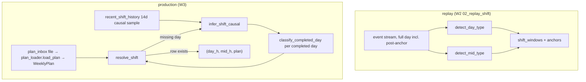
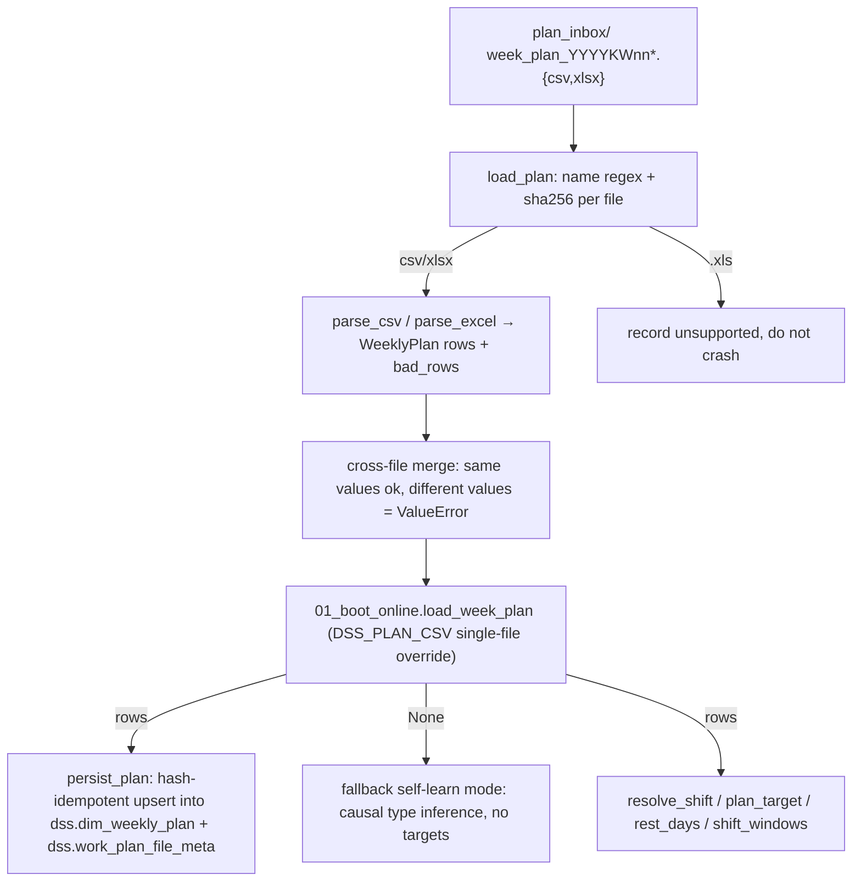

# Shift Calendar Caliber and Weekly Plan Input

`spike_w2/shifts.py` is the single source of truth for every shift-related time
caliber in the paint-shop DSS: shift windows, attribution windows, anchor points,
and the type self-learning heuristics. W3 code may not copy these window
constants — `spike_w3/common.py` re-exports the whole `shifts` module
(`CST`, `DAY_TYPES`, `MID_END_TIMES`, `Shift`, `shift_windows`, `anchors`,
`gate_anchor`, `is_complete`, …) and the module docstring marks copying window
constants as a global constraint (B1). All times on this page are
**Asia/Shanghai** (`CST = ZoneInfo("Asia/Shanghai")`); the default session
timezone is UTC and factory time = UTC+8, so every time query must
`SET TIME ZONE 'Asia/Shanghai'` (README data-source section;
`spike_w3/plan_loader.recent_shift_history` does this first).

Caliber provenance for the core numbers: BM note 2026-09-19 decision
("拍板" + refinement, quoted verbatim in the `shifts.py` header), the README
"关键口径" table (shift-window and shift-calendar rows), and
`docs/08-周计划与排班输入数据规范.md` (finalized 2026-09-22, with the
2026-09-23 window-end user decision in §二·1).

## Shift windows and attribution windows

A shift window = shift start + working hours + a fixed 30-min handover tail
("交班尾"). The window end is the **sole computation caliber** — counting,
target splitting, and display all use it; the point where working hours are
physically finished ("干满") is only a physical off-duty annotation. This was
frozen 2026-09-23 on the measurement basis that 0 vehicles actually exit during
the 30-min tail (08-24~09-22, 10h/11h days, all zero, so both cut conventions
yield identical numbers) and that the window-end cut is drift-resistant
(a trailing vehicle is captured rather than misattributed to the next day's
day shift) — `docs/08` §二·1.

| Shift | Working start | Window end (`end`) | Attribution window (`attr_start` → `end`) |
|---|---|---|---|
| day 11h | 05:00 | 16:30 same day | 04:45 → 16:30 |
| day 10h | 06:00 | 16:30 same day | 04:45 → 16:30 |
| day 8h | 08:00 | 16:30 same day | 04:45 → 16:30 |
| mid 11h | 16:30 (D) | 04:00 (D+1) | 16:30 (D) → 04:00 (D+1) |
| mid 10h | 16:30 (D) | 03:00 (D+1) | 16:30 (D) → 03:00 (D+1) |
| mid 8h | 16:30 (D) | 01:00 (D+1) | 16:30 (D) → 01:00 (D+1) |

Attribution rules (`ATTR_DAY_START = time(4, 45)`, `MID_START = time(16, 30)`,
`TANK_DAY_END = time(16, 30)` in `shifts.py`):

- **Day-shift attribution starts at 04:45**, not at formal shift start.
  Early work 04:45–formal start counts as the day shift (a generalization of
  the 04:45–08:00 early-start rule for 8h-type days).
- **Mid-shift attribution starts exactly at 16:30** — the same boundary used
  for the mid shift's working start. `spike_w3/dashboard.active_shifts_at`
  filters `attr_start <= t < end` over the current day and the previous day;
  the two windows never overlap (exactly one shift covers the 16:30 boundary,
  and the day shift's `end` is exclusive).
- The gap **(mid window end, 04:45)** has no attribution — a low-trough
  micro-gap reported as coverage in replay. `spike_w3/plan_loader.
  recent_shift_history` drops exit events in 04:45–16:30 for the same reason.

`shifts.Shift` is a frozen dataclass carrying `kind` ('day' | 'mid'), the
nominal `day` (mid shift's `day` = its opening day), `work_start` (anchor
origin), `attr_start` (actual exit-counting origin), `end` (the window end
used by the "t + remaining ≤ shift end" completion rule), and `type`
('11h' | '10h' | '8h'). `shift_windows(day, day_type=None, mid_type=None,
schedule=None)` returns `[day?, mid?]` — a `None` type means that shift does
not exist that day, and both-`None` returns `[]`. If a `schedule` dict is
passed and contains the day, its entry wins over the positional
`day_type`/`mid_type` arguments; both sides are routed through
`normalize_shift_type`, so schedule values of `11` / `"10"` / `"8h"` / `"休"`
all work and rest days yield `[]` (see
`tests/test_shifts.py::test_shift_windows_with_schedule`).

## Anchor points

- **Multi-anchor set**: `anchors(shift)` = `work_start + {3, 4, 5, 6}h`
  (`ANCHOR_HOURS = (3, 4, 5, 6)`).
- **Gate anchor** (the "5th hour" anchor, `GATE_ANCHOR_H = 5`):
  `gate_anchor(shift)` = `work_start + 5h`. Concrete values: day 11h → 10:00,
  day 10h → 11:00, day 8h → 13:00; **mid shift is always 21:30** regardless of
  8/10/11h. `spike_w3/dashboard.build_frame_ctx` documents the same anchor
  set (`work_start+{3,4,5,6}h`) for the 5-minute frame context.

Replay consumers: `spike_w2/02_replay_shift.py` and
`spike_w3/02_shadow_replay.py` iterate `shifts.shift_windows` per day and
`shifts.anchors(s)` per shift, and apply the v3 counting rule
(`t_anchor + rem ≤ 窗末`) with `attr_start`/`end` as the count bounds.

## Type self-learning (replay-only, hindsight)

`spike_w2/shifts.py` contains two self-learning detectors that infer shift
type from the event stream when no weekly plan exists. The module header is
explicit: **type self-learning uses full-day events (including events after
the anchors) and is hindsight — it belongs to the replay caliber and must not
be reused directly in production (W3)** ("回放专用" / "回放后视").

*Two type sources: replay self-learning (hindsight, `shifts.detect_*`) versus
production plan rows with causal fallback (`plan_loader`).*

- **`detect_day_type(counts, day_total)`** — `counts` maps the 15-minute
  buckets at 05:00 / 06:00 / 08:00 to event counts. If the whole day has
  fewer than `MIN_DAY_EVENTS = 500` events, it returns `None` (shutdown day).
  Otherwise the earliest bucket with count ≥ `SURGE_MIN_15MIN = 30`
  determines the type (05:00 → 11h, 06:00 → 10h, 08:00 → 8h). The threshold
  30 sits between the measured low-trough floor (~12% of peak ≈ 7–8
  events/15min) and full takt (~40–60 events/15min). If no bucket reaches
  the threshold (gradual ramp), it falls back to the most common type `10h`,
  which the replay audit table records.
- **`detect_mid_type(last_min)`** — `last_min` is the minutes from D 16:30 to
  the last product-vehicle exit event in the mid segment [D 16:30, D+1 04:45):
  `None` (no events) or `< MID_MIN_FLOOR = 300` (real 8h mid ends ≈
  480–540min; <300min means data truncation) → `None`; `≥ 630` → 11h;
  `≥ 510` → 10h; else 8h. A 10h type that trails past 03:00 on furnace-side
  tail activity can be misclassified as 11h — the audit table preserves the
  raw value.

Both detectors are still consumed in legitimate historical-window contexts:
`spike_w3/predictor.build_takt_baseline` applies them over pure past windows
(rolling 8-week learning range, no future leakage —
`spike_w3/predictor` reuses W2's `SQL_DAYTYPE`/`SQL_MIDLAST` via importlib).
The prohibition targets the *online causal* path only.

## Production type resolution: schedule table + causal fallback

Production (W3) never calls `detect_*` on the live path. Instead
`spike_w3/plan_loader.py` provides:

- **`normalize_shift_type(val)`** (re-exported from `shifts`): accepts
  `11` / `10` / `8` / `"11"` / `"10h"` / `"8h"` / `"休"` / `"休息"` / `0` /
  `None` and returns `'11h'` / `'10h'` / `'8h'` / `None`. This is the minimal
  input vocabulary of the shift-calendar interface — business staff only ever
  enter `8 / 10 / 11 / 休` (README 排班日历接口 row: "极简设计"), and the
  system maps working hours to physical windows; the plan table is used only
  in prediction/alert phases, and training has 0% dependency on it (physical
  takt has nothing to do with shift hours).
- **`resolve_shift(d, plan, history)`** — the frozen-contract orchestrator
  (docs/02): if `plan.rows` has a row for `d`, return
  `(day_h, mid_h, "plan")`; otherwise return
  `infer_shift_causal(history, d.weekday())` → `(..., "inferred")`. A
  `WeeklyPlan.shift_windows(d)` convenience wrapper must **not** be looped
  directly on the online path: a missing day and a both-sides-rest day both
  return `[]`, and a raw loop would silently bypass the fallback (L2
  discipline noted in `plan_loader.WeeklyPlan.shift_windows`).
- **`infer_shift_causal(history, weekday)`** — pure function, no DB. It
  filters the history to the same weekday and takes the per-side mode
  (rest = `None` does not enter side voting); ties resolve to the newer day's
  value; no samples → default `(11, 11, "inferred")`; samples that are all
  rest on both sides → `(None, None, "inferred")`. A missing side defaults to
  11h on that side.
- **`recent_shift_history(conn, now, weeks=2)`** — the causal DB builder.
  It sets `SET TIME ZONE 'Asia/Shanghai'`, clamps the sample upper bound to
  `min(now.date()-1, max(DATE_EVT date))` — a day is *completed* only when
  its mid-shift window (≤ next 04:45) has closed, so the current day and days
  beyond observed data are excluded rather than treated as rest — then reads
  14 days (`7*weeks`) of product-vehicle events
  (`"BODY_ID" LIKE '78202%'`) and the 4 exit-station events, splits exits
  into day events and mid-segment events (events < 04:45 count against the
  previous day; 04:45–16:30 are dropped), and classifies each completed day
  with **`classify_completed_day(day_evts, mid_exit_evts)`**.
- **`classify_completed_day`** — the inline, causal re-implementation of the
  W2 heuristics for *completed* days only: day type from the same 15-min
  bucket test (thresholds `shifts.SURGE_MIN_15MIN` / `shifts.MIN_DAY_EVENTS`
  reused as constants; a no-hit ramp falls back to 10h), and mid type from
  the last exit's minutes-from-16:30 with the same 630 / 510 / 300
  thresholds. It deliberately does **not** import `detect_day_type` /
  `detect_mid_type` (replay-hindsight semantics); a source-discipline test
  (`tests/test_w3_plan.py::test_causal_pure_discipline`) asserts those names
  do not appear in `plan_loader.py`. `(None, None)` from both event sets
  means a rest day (zero exits, zero events).

So the production fallback ladder is: **plan row → "plan"**; missing day →
**14-day same-weekday causal mode → "inferred"**; no history at all → default
`(11, 11)`; and when no plan file exists at all the boot layer drops into the
self-learn fallback mode (below). The policy is "better to report nothing
than to report fake numbers" (宁可不报，不报假数): inference only uses
completed days and events strictly before `now` (the causal red line,
`DATE_EVT < now`).

## Weekly plan input chain

The plan input flows from an inbox folder through a tolerant parser to
persistent dimension tables:

*The plan_inbox → plan_loader → boot → persistence/consumption chain, with
the no-plan fallback branch.*

- **Folder and naming** (`plan_inbox/README.md`): the fixed watch folder is
  `plan_inbox/` by default, overridable via the `.env` key `DSS_PLAN_FOLDER`
  (`DSSConfig.plan_folder`, default `"plan_inbox"`) on the intranet deployment
  machine. Files are named `week_plan_<year>KW<ISO-week>*.csv` (suffixes like
  `_sample` are allowed); extensions `.csv` / `.xlsx` / `.xls` match the name
  regex, but `.xls` is recognized and recorded as unsupported (re-save as
  `.xlsx` or export CSV) rather than parsed.
- **Column spec** (`docs/08` §一): 6 columns
  `日期, 日班工时, 中班工时, 出车计划, 进车计划, 备注` — the first 4 are
  required (a missing core header cell raises table-level `ParseError`);
  `进车计划` and `备注` are optional. `日期` accepts `YYYY-MM-DD` or `M/D`;
  hours accept `8 / 10 / 11` or `休 / 0 / blank`; `出车计划` is the all-day
  exit target (0 on rest days).
- **`parse_csv` / `parse_excel`** share `_rows_from_grid`: header cells are
  stripped before matching; Excel parsing reads the first sheet with
  `openpyxl` (`data_only=True`). Per-row tolerance: bad rows (unparseable
  date, illegal hours like `12`, non-integer totals like `920.5` — integral
  floats such as `920.0` are accepted) are **skipped and recorded in
  `bad_rows`, never crashed on and never defaulted**; duplicate dates within
  a file → last row wins plus a trace entry; empty file → one trace entry.
- **`M/D` candidate-year resolution** (`resolve_md_date`): `M/D` strings try
  candidate years `file_year ± 1` and pick the one whose ISO (year, week)
  matches the filename's (year, KW); no match → `None` → true bad row.
  Every parsed date must also fall in the file's ISO week, else bad row.
- **`load_plan(folder)`** scans the directory (files not matching the name
  regex are silently ignored), records a `sha256` hash for every recognized
  file, parses each, and merges across files: same date with identical
  `(day_h, mid_h, total, entry)` merges (later file wins
  `source_file`, deterministic lexicographic order); same date with
  different values raises `ValueError` pre-insertion (docs/02 contract).
  Table-level `ParseError`, corrupted files, and unsupported `.xls` are all
  traced without crashing — startup robustness requirement: any bad file in
  `plan_inbox` must not drag down the online main loop.
- **`WeeklyPlan` accessors**: `shift_windows(d)` (delegates to
  `shifts.shift_windows` with the plan row's types), `plan_target(d)` →
  `(day_target, mid_target)` via `spike_w3/alert_engine.split_target`
  (single source of truth, F10) with the docs/08 formula
  day share = H_day/(H_day+H_mid) and largest-remainder rounding; a missing
  row or `total` → `(None, None)` — **targets are never guessed**
  (2026-09-27 user decision ③). `rest_days()` = days where both shifts are
  rest (expected-silence days for the freshness guard); `missing(d0, d1)`
  lists uncovered days in a closed interval.
- **Persistence** (`persist_plan`, `ensure_weekly_plan_tables`): idempotent
  upsert into `dss.dim_weekly_plan` (PK `plan_date`, upsert on conflict) and
  `dss.work_plan_file_meta` (PK `file_name` + `sha256`). Per file, the stored
  hash is compared first — identical content skips all writes; changed or new
  files upsert only their own rows, so a renamed file overwrites the rows it
  previously wrote and no `DELETE` is ever issued. One transaction; failure
  rolls back, preserving old data ("shadow discipline").
  `ensure_weekly_plan_tables` must run before `check_dim_tables` in
  `boot_sequence` (L3).

## Boot wiring and the no-plan fallback

`spike_w3/01_boot_online.load_week_plan(cfg)` is the entrypoint:

- `DSS_PLAN_CSV` env set → single-file mode (explicit replay dry-run
  override, legacy main behavior), parsed directly.
- Otherwise → `plan_loader.load_plan(cfg.plan_folder)`; a `ValueError`
  (cross-file conflict) or an empty/missing file set → `None`.
- `None` → **fallback self-learn mode** ("兜底自学模式：班制推断、无目标"):
  the service never stops because of a missing plan — shift types come from
  the causal inference above, and plan targets simply do not exist. This
  matches `docs/08` §二·3 ("容错安全网"): a week without a recorded plan
  auto-falls back to event-stream self-learning to keep the service alive.
- `plan_note_text` renders three states: no plan → fallback note; loaded →
  `n days / m files` plus current-week missing-day count and bad-row count.
  `replay_rest_days` reuses the same load for the B3 expected-silence set,
  and `boot_sequence` calls `ensure_weekly_plan_tables` then
  `persist_plan` (failure → warning "旧数据保留，只报告不中止", never abort).

## Invariants and failure semantics

- **Window constants exist only in `spike_w2/shifts.py`** — W3 re-exports via
  `spike_w3/common.py`; tests assert window values against the `shifts`
  constants (e.g. `tests/test_w3_plan.py::test_shift_windows_delegates`)
  precisely to prevent copied-value drift.
- **`is_complete(shift, replay_start, replay_end)`** = attribution window ⊆
  replay window (rule C2): incomplete shifts are excluded from the door-judgment
  list; in replay it is a safety net since the day loop starts at the first
  replay day anyway (`tests/test_shifts.py::test_is_complete`).
- **Causal red line**: production type inference reads only completed days
  and only events with `DATE_EVT < now`; the W2 `detect_*` functions are
  replay-hindsight and are banned from the online path (source-discipline
  tests enforce the absence of the names in `plan_loader.py`).
- **Fail-soft parsing**: row-level faults → `bad_rows` trace; table-level
  faults → `ParseError` for that file only; cross-file value conflict →
  `ValueError` caught at boot and degrading to the fallback mode; persist
  failure → rollback + report. Bad input never crashes the online loop, and
  missing plans never fabricate targets.
- **Rest-day consistency**: `休/0/blank` on both sides → `rest_days()`
  (B3 `expected_silence`), `(None, None)` from `classify_completed_day`, and
  `[]` from `shift_windows` all express the same "no production" day.

## Tests

- `tests/test_shifts.py` — pure-function coverage of `detect_day_type`
  (11h/10h/8h, shutdown <500 events, ramp fallback), `detect_mid_type`
  (660/600/510/509/480/300 boundaries, truncation/None), `shift_windows`
  geometry (16:30 day end, 03:00/04:00 mid ends, schedule override and
  rest-day `[]`), `anchors`/`gate_anchor` (mid gate always 21:30),
  `is_complete`, ISO-week labels, and `normalize_shift_type`.
- `tests/test_w3_plan.py` — the parser contract (BOM tolerance, `M/D`
  candidate-year cases including year-boundary weeks, hours pre-validation,
  integral-float cells, header stripping, duplicate dates, cross-file
  merge/conflict, Excel parity, empty files), the idempotent persistence
  (same-hash skip, per-file rewrite, rename upsert with no `DELETE`, SQL
  discipline with only `SELECT`/`INSERT` + `ON CONFLICT`), the causal layer
  (mode/tie/newer-wins, all-rest, default 11/11, 14-day window,
  `max(DATE_EVT)` clamp, current-day exclusion, `classify_completed_day`
  synthesis), and boot wiring (`load_week_plan` three modes,
  `resolve_shift` orchestration, `plan_note` states, boot ordering).

## Related pages

- [Data Model](../architecture/data-model.md) — `dss.dim_weekly_plan` and
  `dss.work_plan_file_meta` schema, dim-table boot checks.
- [ETA Decision Chain](eta-decision-chain.md) — per-vehicle ETA consumption
  of the same anchor/window structure (`t + rem ≤ 窗末`).
- [Prediction and Alert](../workflows/prediction-and-alert.md) — online
  rolling prediction and target-splitting alert flow built on `plan_target`.
- [Replay Acceptance](../workflows/replay-acceptance.md) — replay windows,
  completeness rules, and M9/M10 acceptance that consume `shift_windows`.
