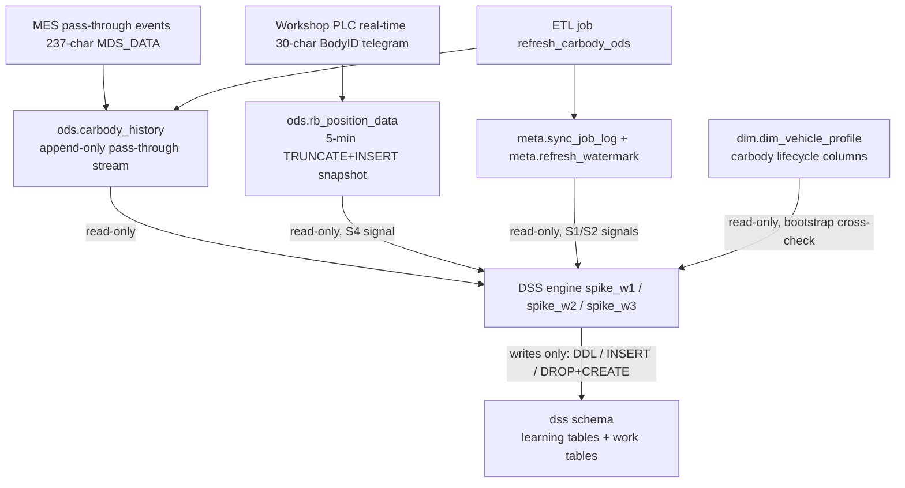
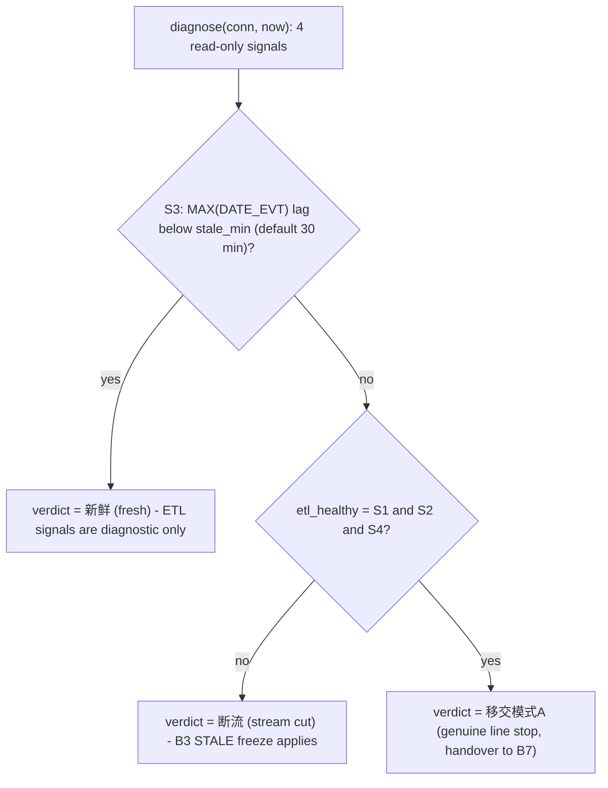

# analytics_db Data Access and ETL Signals

The DSS's only external data dependency is `analytics_db`, the workshop's
analytical Postgres instance: the upstream ETL (job `refresh_carbody_ods`)
writes the event stream and bookkeeping tables, and the DSS reads from them
while writing only into its own `dss` schema. This page documents the
connection path and its mandatory discipline, the read-only layering red
line, the exact cross-layer read-only reference surface, the F8 watermark
separation, and the `FreshnessGuard.diagnose` four-signal ETL diagnostic that
distinguishes "stream cut" (link failure) from "handover mode A" (genuine
line stop).

Scope note: this page describes connection and SQL semantics only and records
**no credential values** — it documents the `DSS_DB_*` variable names and the
default development-library semantics, per the project rule that connection
credentials never leave the local machine (`AGENTS.md` 数据访问).

## Connection configuration and credential discipline

- **Single DSN, single `connect()`** — `spike_w1/common.py` is the sole
  connection implementation. `_dsn()` is a pure function (unit-testable) that
  resolves `DSS_DB_HOST` / `DSS_DB_PORT` / `DSS_DB_NAME` / `DSS_DB_USER` /
  `DSS_DB_PASSWORD` environment overrides with defaults pointing at the local
  development `analytics_db` (host `127.0.0.1`, port `5432`; the dev-credential
  values themselves are intentionally not recorded here). `connect()`
  re-resolves `_dsn()` on **every call** (runtime `DSS_DB_*` overrides take
  effect; the DSN is not frozen at module import), enables `conn.autocommit =
  True`, and runs `SET TIME ZONE 'Asia/Shanghai'` on a fresh cursor.
- **Cross-package re-export, no duplicated logic** — `spike_w3/common.py`
  loads `spike_w1/common.py` via importlib alias (`w1_common`, registered in
  `sys.modules`) and re-exports `connect` / `ENTRY_STATIONS` / `EXIT_STATIONS`
  so W3 never opens its own connection or copies DSN values
  (`spike_w3/common.py` module docstring: "single DSN + SET TIME ZONE
  'Asia/Shanghai' (L3), do not open another connection path").
- **Credential handling** — `python-dotenv` loads the root `.env` (missing
  file is not an error); `.env` is not committed and `.env.example` carries
  the configuration template with the `DSS_DB_*` block commented out (the
  dev default applies when it is absent). Project policy: if this repo is
  ever pushed to a remote, credentials must first move to environment
  variables or a gitignored config file (`AGENTS.md` line: 连接凭据不离开本机).

## Connection discipline (mandatory rules)

Four machine-enforced or historically enforced disciplines apply to every DB
interaction; all four are restated in the W4 run-discipline list
(`docs/15-W4双环重构步级开发计划.md`, 运行纪律).

1. **`SET TIME ZONE 'Asia/Shanghai'` is mandatory for every time/shift query.**
   The session default is UTC while factory time is UTC+8; without it, every
   time/shift boundary is displaced by 8 hours. `connect()` applies the
   session timezone per connection, and the R7 discipline makes the rest of
   the chain safe: `_require_aware` (`spike_w3/stream_pipeline.py`) raises
   `TypeError` on naive datetimes, so pool, guard, and stream code only ever
   see aware (Asia/Shanghai) timestamps.
2. **Uppercase column names require double quotes.** `"DATE_EVT"`, `"BODY_ID"`,
   `"BODY_TYPE"`, `"RW_STATION_ID"`, `"MDS_DATA"`, `"SKID_ID"` (and
   `"SKID_IS_EMPTY"`) are stored uppercase and must be double-quoted
   identifiers in SQL; unquoted lowercase references fail with
   `UndefinedColumn`. String literals use single quotes — a past bug mixed the
   two and silently produced wrong station filters.
3. **`cursor.execute()` returns `None` in this environment — chained fetch is
   forbidden.** `cur.execute(sql).fetchall()` is a runtime error; every DSS
   query executes first and then fetches from the cursor (`d0_check.py` and
   all `stream_pipeline` SQL follow `execute` → `fetchall`).
4. **Full-table window functions are forbidden** — one full-table window
   function crashed Postgres; all DSS aggregation SQL uses ts-range-bounded
   `GROUP BY` instead (e.g. the replay acceptance gate's GT SQL check).

## Read-only layering and write surface

> **READ-ONLY RED LINE: zero writes to the `ods` / `dim` / `fct` / `mart` /
> `meta` layers — no DSS code may modify any table or view in these five
> layers. DSS artifacts write only to the `dss` schema, and inside `dss`
> `DROP` + `CREATE` is permitted** (`AGENTS.md` 只读原则; `stream_pipeline.py`
> section comment: "只写 dss schema，ods/dim/fct/mart/meta 只读").

*Layer map of the analytics_db access boundary: DSS reads five external tables and writes only to `dss`.*

### Cross-layer read-only reference surface

The complete set of external tables the DSS reads (all SELECT-only):

| Table | Layer | Role in the DSS | Consumed by |
|---|---|---|---|
| `ods.carbody_history` | ods | Pass-through event stream (one row per station pass; `"ID"` = monotonic row id, `"DATE_EVT"` = event ts). All consumption points: incremental consume, per-car late replay, bootstrap replay, bootstrap cross-check window, freshness signals S2/S3. | `stream_pipeline.py` `_CONSUME_SQL` / `_CAR_LOG_SQL` / `_BOOTSTRAP_SQL`, `d0_check.py` |
| `dim.dim_vehicle_profile` | dim | External in-process reference set: `carbody_last_seen_at` / `carbody_last_rw_station`. The bootstrap cross-check compares the replayed pool against "seen within the last N hours AND last station not in (4 exit stations ∪ 5 post-exit stations)"; diff > 1% is a boot warning (report only, no auto-fix). | `stream_pipeline.py` `_CROSS_CHECK_SQL`, `cross_check()` |
| `meta.sync_job_log` | meta | ETL job check-in (`started_at`, `status`) for `refresh_carbody_ods` — freshness signal S1. | `FreshnessGuard.diagnose` |
| `meta.refresh_watermark` | meta | ETL-layer watermark row (`source_name = 'ods.carbody_history.max_id'`) — freshness signal S2. **Diagnostic only; not a DSS starting watermark (F8, see below).** | `FreshnessGuard.diagnose` |
| `ods.rb_position_data` | ods | Real-time PLC position snapshot, full refresh every 5 min (TRUNCATE+INSERT, so no position history is kept) — independent freshness signal S4 (`MAX(vehicle_updated_at)`). | `FreshnessGuard.diagnose` |

### DSS write surface (`dss` schema only)

The only places DSS code issues DDL/DML:

- **`dss.work_alert_log`** — dead-vehicle audit rows (`type = 'dead_car'`);
  lazily created by `ensure_work_alert_log` (`CREATE TABLE IF NOT EXISTS`)
  before the first dead-car audit; `record_dead_audit` is the sole writer
  (`stream_pipeline.py`).
- **`dss.dim_weekly_plan`** (+ companion tables) — weekly-plan persistence:
  `plan_loader.ensure_weekly_plan_tables` runs DDL first in the boot
  sequence, then `persist_plan` writes rows; a persistence failure keeps the
  old data and is reported, not fatal (`spike_w3/01_boot_online.py`).
- **`dss` learning tables** — the W1/W2/W4 learners rebuild their tables
  (`dss.dim_*`, `dss.v2_*`, `dss.dim_expected_delay`, ...) with
  DROP + CREATE inside `dss`. The boot sequence checks the 14-name
  completeness list `DSS_DIM_TABLES` via `information_schema` (existence
  only, content loaded later by T3); `d0_check.py`'s re-check after learning
  expects the 13 required tables to be present.

## Watermark discipline (F8)

- **ETL watermark vs DSS watermark** — `meta.refresh_watermark`
  (`ods.carbody_history.max_id`) is the **ETL-layer** watermark and is used
  only as the B3 S2 diagnostic input. It is explicitly **not** the DSS
  starting watermark (two-round review finding F8): the DSS keeps no local
  state file, so every start replays the last `DSS_BOOTSTRAP_HOURS` (default
  120 h) through the same state machine and starts the incremental stream at
  the **max row ID inside that bootstrap window** (`BootstrapReport.watermark`).
  A watermark of `0` means an empty replay window and **aborts startup** —
  the incremental stream must never start from 0 and re-pull the full 120 h.
- **In-process, monotonic watermark** — the watermark lives in
  `EventStream` (process memory). `set_watermark` only raises, never lowers
  (F8: the incremental stream start point never regresses), and is re-aligned
  after each periodic 120 h full rebuild (default every 24 h,
  `DSS_REBUILD_HOURS`), which is also the self-healing bound for F-1 row loss
  and watermark poisoning.
- **Bounded consume query** — the incremental pull is bounded on both sides:
  `WHERE "ID" > :wm AND "DATE_EVT" <= :now ORDER BY "ID"`. The `:now` upper
  bound is mandatory (round-1 review B1): in `replay_cursor` mode rows with
  ts > now are skipped until the cursor reaches them (the watermark must not
  leap over the cursor); in `wall_clock` mode data is always in the past so
  the condition is a no-op. Missing the bound would make the first replay
  round pull the whole ~6.3M-row table and exhaust the watermark. Because
  roughly 52% of real rows are ID/ts out of order, fetched rows are re-sorted
  by (ts, ID) before dispatch.

## `FreshnessGuard.diagnose`: four-signal ETL diagnostics

`FreshnessGuard` (`spike_w3/stream_pipeline.py`) is the B3 data-freshness
guard: a three-state machine (`NORMAL` → `STALE` → `RECOVERY` → `NORMAL`,
recovery requires two consecutive fresh checks) plus the read-only
`diagnose(conn, now)` four-signal probe whose verdict separates a link
failure from a real line stop (断流判定口径, BM 2026-09-22).

| Signal | Source query | Meaning | Freshness rule |
|---|---|---|---|
| **S1** | latest `meta.sync_job_log` row where `job_name = 'refresh_carbody_ods'` | ETL job check-in | `status = 'success'` AND `started_at` lag < `lag_min` (default 15) |
| **S2** | `meta.refresh_watermark` value for `ods.carbody_history.max_id` vs `MAX("ID")` on `ods.carbody_history` | ETL-layer watermark vs table reality | gap == 0 |
| **S3** | `MAX("DATE_EVT")` on `ods.carbody_history` | Event-stream frontier | lag < `stale_min` (default 30) → `event_fresh` |
| **S4** | `MAX(vehicle_updated_at)` on `ods.rb_position_data` | Independent 5-min snapshot (3 cycles stale ⇒ ETL side dead) | lag < `lag_min` (default 15) |

`etl_healthy = S1 ∧ S2 ∧ S4`. The verdict logic:

*`FreshnessGuard.diagnose` verdict: event freshness decides first; ETL signals then separate stream-cut from genuine line stop.*

- **`event_fresh` → `"新鲜"`** — when the event frontier is fresh, ETL
  signals are recorded for diagnosis but never override the event-layer fact.
- **Event stopped + ETL unhealthy → `"断流"`** — the link is broken; B3 STALE
  freeze applies (frozen scope = alert evaluation + dead-vehicle sweep; pool
  consumption and prediction computation keep running so backfill after a
  line-stop recovery stays ordered; `check()` is the single per-round call
  point in the main loop).
- **Event stopped + ETL healthy → `"移交模式A"`** — the pipeline is delivering
  fine and the line itself is stopped (a real production stop, not a data
  problem); detection and handling is handed over to the B7 station-level
  white-list logic.
- **Rest-day downgrade (`expected_silence`)** — STALE state and freeze are
  unchanged, but the label degrades to "无数据属预期" and `is_anomaly =
  False` (not counted as anomaly or acceptance); alerts remain frozen.
- **Where it runs** — `diagnose` is invoked per 5-min frame by the dashboard
  in `wall` mode; in `replay` mode it must not be called (time penetration
  makes the verdict meaningless — snapshot invariant F-MED-05), and the
  diagnose dict is the banner payload in wall-mode snapshots.

## Preflight check: `d0_check.py`

`d0_check.py` is the quick connectivity/liveness probe for the intranet
deployment machine (run as `D:\dss\env\python.exe d0_check.py` from `D:\dss`):

1. **ETL liveness** — `MAX("DATE_EVT")` on `ods.carbody_history` (under
   `SET TIME ZONE 'Asia/Shanghai'`) compared against the local UTC+8 clock:
   lag < 5 min = normal; lag > 30 min = do not start the run, escalate to
   the intranet data owner (per the ETL SLA: link failures in production are
   owned by the intranet data-side role, RTO ≤ 1 h; outage windows are
   tracked separately and excluded from acceptance gates).
2. **`dss` table inventory** — lists all tables in the `dss` schema
   (`information_schema.tables`); after the learners have run, the 13
   required tables (`dim_*` / `v2_*` / `dim_expected_delay` /
   `dim_weekly_plan`, auto-created at startup) should all be present.

## Related pages

- [Data Model](../architecture/data-model.md) — event foundation, MDS_DATA
  bits, purification pipeline, and the full `dss` table inventory.
- [Configuration](../operations/configuration.md) — the complete `DSS_*`
  parameter surface and `.env` handling.
- [Deployment and M5](../operations/deployment-and-m5.md) — intranet
  deployment, M5 acceptance, and the Windows run-discipline workarounds.
- [Online Main Loop](../workflows/online-mainloop.md) — the boot sequence,
  per-round order (consume → `guard.check` → `dead_sweep`), and the
  periodic rebuild.
