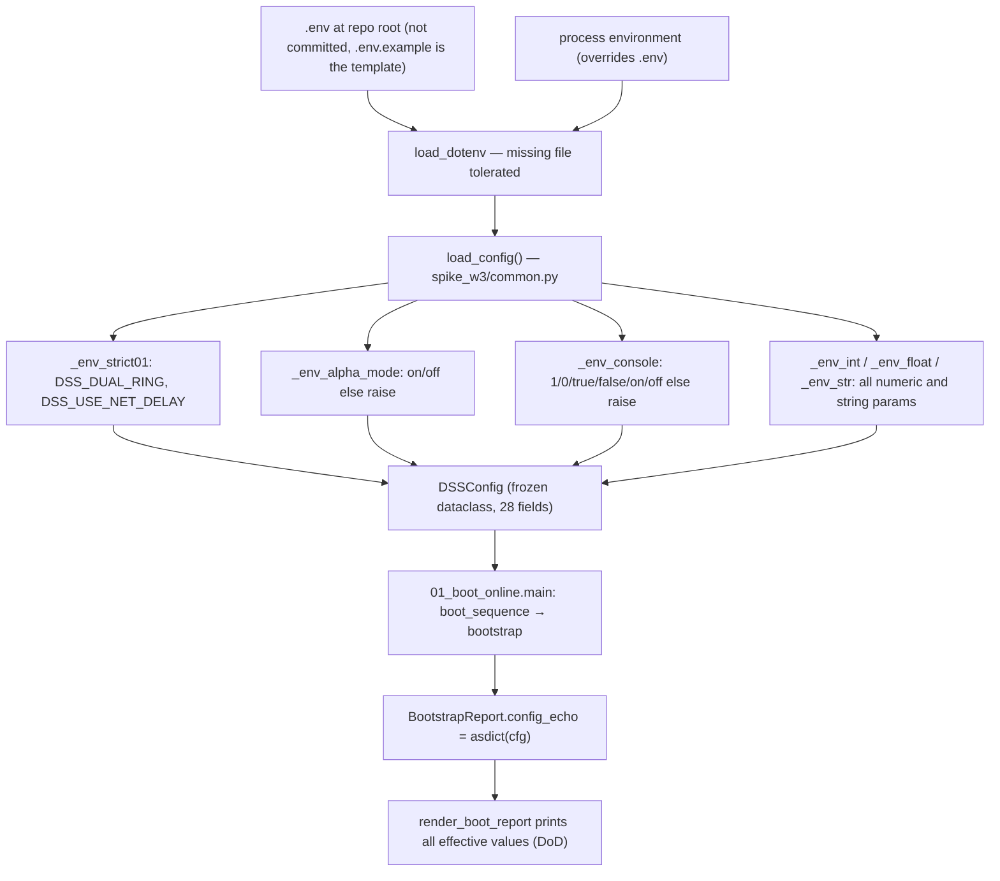
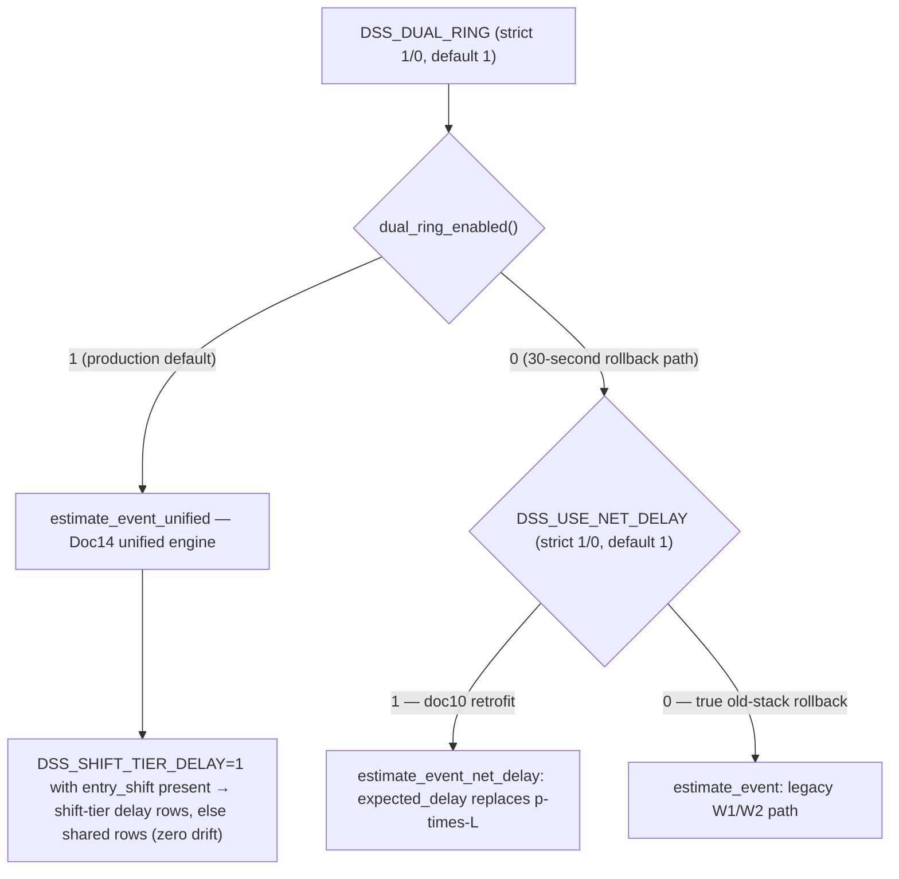

# DSS_* Parameter Configuration and .env Discipline

Every business and algorithm parameter of the DSS (Decision Support System) is tunable through environment variables with the `DSS_` prefix. This is a standing user decision (2026-09-22) recorded in `AGENTS.md` and `README.md`: freshness circuit breakers, dead-vehicle timeout, the α window, alert thresholds, and driver mode are all env-configurable, loaded uniformly through `python-dotenv` from the **project-root `.env`**, which is **never committed** — `.env.example` is the committed template (`cp .env.example .env`). The `.gitignore` pins this down: `.env` and `.env.*` are ignored, `!.env.example` is allowed. See also [Module Map](../architecture/module-map.md) for where these consumers live and [Database](../integrations/database.md) for the connection layer.

## Loading mechanism

Two loaders exist and both feed `os.environ`:

- `spike_w3/common.py::load_config()` calls `load_dotenv(_ROOT / ".env")` (root `.env`; a missing file is a no-op, not an error) and then builds the frozen dataclass `DSSConfig` from `os.environ` with per-field defaults.
- `spike_w1/common.py` calls `load_dotenv()` at import time (with a pure-`os.environ` fallback if `dotenv` is missing), which is what makes the `DSS_DB_*` credentials visible to the connection layer before `spike_w3` is ever imported.

Existing process environment variables always take precedence over `.env` values (`load_dotenv` does not override pre-set variables by default). Parsing helpers in `spike_w3/common.py`:

| Helper | Behavior |
|---|---|
| `_env_str(key, default)` | unset or empty → default |
| `_env_int` / `_env_float` | unset or empty → default, else cast |
| `_env_float_opt` | unset or empty → `None` (used to detect *explicit* configuration) |
| `_env_strict01(key, default)` | **strict 1/0 gate** — see below |
| `_env_alpha_mode()` | `on`/`off` case-insensitive, anything else raises `ValueError` |
| `_env_console()` | lenient `1/true/on` vs `0/false/off` (case-insensitive), anything else raises |

*Config load path: from `.env`/process environment through the parsing helpers into `DSSConfig`, then echoed verbatim in the startup report.*

Important nuance: the dual-ring engine gates are **not** read only from `DSSConfig`. `spike_w2/eta_v2.py` re-reads the environment per call through its own `_strict01` (`dual_ring_enabled()`, `use_net_delay_enabled()`, `shift_tier_delay_enabled()`), so the live consumption points (`predictor.rem_of`, dashboard) and the single tests (`monkeypatch.setenv`) operate on the env value directly; the `DSSConfig.dual_ring` / `use_net_delay` fields are a mirror for the startup-report echo, while `DSS_SHIFT_TIER_DELAY` has no `DSSConfig` field at all.

## Parameter reference

Defaults below are the **production defaults**: the M5 acceptance runbook states that during the 5-day online acceptance these values must stay untouched ("changed = acceptance void"). Effective-wave column uses the project's task/wave labels (T1–T6 tasks, B3/B4/B5 decision points, W1–W4 learning/engine waves, M3/M9 milestones). Decision origins are the dated user decisions (拍板) quoted in `.env.example` comments and the numbered docs.

### Driver mode and polling (system)

| Variable | `DSSConfig` field | Default | Effective | Semantics and decision origin |
|---|---|---|---|---|
| `DSS_CLOCK_MODE` | `clock_mode` | `wall_clock` | T2.6 main loop | `wall_clock` = live wall-clock polling incremental stream (production form); `replay_cursor` = offline historical-event cursor replay (fast regression). `.env.example` §1; architecture in docs/02. `replay_cursor` additionally requires `DSS_REPLAY_START`/`DSS_REPLAY_END` (see debug switches). |
| `DSS_POLL_INTERVAL_SEC` | `poll_interval_sec` | `300` | T2.6 | Incremental poll period (site default 5 min; debug replay may use 1–5). Wall-clock loop sleeps to the next 5-minute grid point via `next_grid_wait` (drift-compensated, floor 1 s, so frame timestamps always land on the :00/:05/… grid — M5 anchor-frame matching); the replay cursor steps by the same value. `.env.example` §1; M5 prep agy block F2. |

### B3 guardrails, dead vehicle, bootstrap, rebuild (T2)

| Variable | Field | Default | Effective | Semantics and decision origin |
|---|---|---|---|---|
| `DSS_STALE_MIN` | `stale_min` | `30` | T2 (B3) | Staleness fuse: no events for >30 min → data-cut declared, circuit-breaker alarm. ETL SLA decision 2026-09-23: intranet production pipeline failures handled by the intranet data owner, RTO ≤ 1 h; outage periods are reported separately and excluded from the acceptance gate. |
| `DSS_LAG_MIN` | `lag_min` | `15` | T2 (B3) | Data-lag observation-state threshold (min). |
| `DSS_SKEW_WINDOW_MIN` | `skew_window_min` | `15` | T2 (M4) | Out-of-order tolerance window for incremental ingest (min). |
| `DSS_DEAD_VEHICLE_HOURS` | `dead_vehicle_hours` | `120` | T2 (M7) | Dead-vehicle threshold: no event moving the body out of the active pool for >120 h. |
| `DSS_BOOTSTRAP_HOURS` | `bootstrap_hours` | `120`, bound to `DSS_DEAD_VEHICLE_HOURS` | T2 (B4) | Cold-start bootstrap replay length. **Two-value binding (B4 point 7)**: when `DSS_BOOTSTRAP_HOURS` is not explicitly set, `bootstrap_hours` takes the *resolved* `DSS_DEAD_VEHICLE_HOURS` value (so raising the dead-vehicle horizon also widens the bootstrap window); an explicit value always wins. `.env.example` comment + `tests/test_w3_common.py::test_bootstrap_bound_to_dead`. |
| `DSS_REBUILD_HOURS` | `rebuild_hours` | `24` | T2.6 (F-1) | Periodic full-rebuild interval of the main loop; the self-healing ceiling for F-1 dropped-row / watermark poisoning (a full 120 h rebuild rebuilds the pool and re-anchors the watermark). |

### Task 1 weekly plan

| Variable | Field | Default | Effective | Semantics and decision origin |
|---|---|---|---|---|
| `DSS_PLAN_FOLDER` | `plan_folder` | `plan_inbox` | T1 (M3 directory watch) | Weekly-plan input folder (files named `week_plan_YYYYKWww*.csv`). User decision 2026-09-23: the in-repo `plan_inbox/` directory is the development default path; production (intranet deployment machine) overrides the *path* only — the directory convention is unchanged (docs/06, `plan_inbox/README.md`). No file / all-parse-fail / cross-file conflict → fallback self-learn mode (shift inferred, no targets). |

### α family (Task 3)

| Variable | Field | Default | Effective | Semantics and decision origin |
|---|---|---|---|---|
| `DSS_ALPHA_MODE` | `alpha_mode` | `off` | T3 (B5) | on = adaptive α experiment caliber, off = default. User decision 2026-09-25: **production default off**, and the M9 gate is judged at α=off (mid-shift α fix is a separate task tied to the meal-time calendar). Parsed case-insensitive (`ON` → `on`); any other value raises `ValueError` at startup. |
| `DSS_ALPHA_WINDOW_HOURS` | `alpha_window_hours` | `3` | T3 | Sliding departure-rate statistics window (h). |
| `DSS_ALPHA_MIN_SAMPLES` | `alpha_min_samples` | `30` | T3 | Minimum departures in the window; below it α is not adjusted. |
| `DSS_ALPHA_EMA_BETA` | `alpha_ema_beta` | `0.3` | T3 | EMA smoothing factor. |
| `DSS_ALPHA_CLAMP_MIN` / `DSS_ALPHA_CLAMP_MAX` | `alpha_clamp_min` / `alpha_clamp_max` | `0.6` / `1.5` | T3 | Clamp/debounce interval for α. Note from the dataclass: the α hysteresis (0.05 / 2 cycles) is a **code-level constant deliberately not exposed as env**. |
| `DSS_ETA_STALE_HOURS` | `eta_stale_hours` | `6` | T3.0 (docs/04 §2) | L4 stale threshold: a WIP body whose `last_event` is older than this is only *marked* stale but still counts toward the prediction (the static reference has no such concept — kept for constructive consistency). |
| `DSS_LEARN_WIN_START` / `DSS_LEARN_WIN_END` | `learn_win_start` / `learn_win_end` | `2026-04-14` / `2026-08-15` | T3 | α baseline (takt baseline) learning window = the W1 learning window; pure history, no future leakage. |

### Gap-alert red/yellow lines (Task 4)

| Variable | Field | Default | Effective | Semantics and decision origin |
|---|---|---|---|---|
| `DSS_ALERT_RED` | `alert_red` | `-0.10` | T4 | Shift-gap red emergency line (fraction vs target; −0.10 = gap exceeds 10%). |
| `DSS_ALERT_YELLOW` | `alert_yellow` | `-0.05` | T4 | Yellow warning line (−0.05 = gap exceeds 5%). |
| `DSS_ALERT_DEBOUNCE_MIN` | `alert_debounce_min` | `10` | T4 | Debounce: the gap must persist at that level for this many minutes before the alert fires. User decision 2026-09-23: these two lines went live as-is, with a 5-day shadow period observing the false-positive rate before tuning this file. |

### Line-stop detection (Task 5, mode A)

| Variable | Field | Default | Effective | Semantics and decision origin |
|---|---|---|---|---|
| `DSS_LINE_STOP_MIN` | `line_stop_min` | `30` | T5 | Backbone key-station line-stop trigger: no events at a critical station for this many minutes. |
| `DSS_OBSERVE_MIN` | `observe_min` | `15` | T5 | Observation state: no events at a key station for this duration marks "observe" (pre-attention, **no** line-stop alarm). |

### T6 console / run tag / snapshots

| Variable | Field | Default | Effective | Semantics and decision origin |
|---|---|---|---|---|
| `DSS_CONSOLE` | `console` | `1` (true) | T6 (docs/07 v1.2 decision ④⑤) | `0` = disable the 5-min console frame and snapshot writing (regression baseline). **Lenient parsing** — `1/true/on` and `0/false/off` case-insensitively — unlike the strict 1/0 gates; any other value still raises. Console assembly failure never blocks the main loop (console is an accessory; a `[T6] WARNING` is printed and the loop continues). |
| `DSS_RUN_TAG` | `run_tag` | `""` (auto `YYYYMMDD-HHMMSS`) | T6 | Snapshot directory tag. Empty → auto-generated from the start time; an auto tag that already holds `snap_*` files is bumped `-r2/-r3` (overwrite protection, detected once at startup). An **explicit** tag = operator intent to continue in the same directory (M5 prep agy block F3): idempotent append, restarts do not fork a `-r2` (filenames carry their own timestamps). M5 runbook sets `DSS_RUN_TAG=m5`. |
| `DSS_SNAPSHOT_DIR` | `snapshot_dir` | `output/snapshots` | T6 | Snapshot root; per-run files land in `output/snapshots/{run_tag}/snap_{ts}.json` (atomic tmp→replace write). High-frequency snapshots are git-ignored (`output/snapshots/`). |

### Dual-ring three gates (W4.3d / W4.4h)

The engine switch stack, all **strict 1/0** (docs/15 §0.5 / D6; illegal values abort at startup):

| Variable | `DSSConfig` field | Default | Effective | Semantics and decision origin |
|---|---|---|---|---|
| `DSS_DUAL_RING` | `dual_ring` | `1` | W4.3d (docs/15 §0.5, D6) | `1` = Doc14 unified engine (137/139 dual-bit state machine + oven trajectory + `expected_delay` net delay) — **the production default**; `0` = old `estimate_event` full-path rollback (~30-second rollback, docs/11 red line). |
| `DSS_USE_NET_DELAY` | `use_net_delay` | `1` | W4.3d (doc10 retrofit; dual-review B11) | **Only effective when `DSS_DUAL_RING=0`**: `1` = old engine consumes `expected_delay` in place of `p×L`. Under `DSS_DUAL_RING=1` the unified engine *always* consumes `expected_delay`, so this parameter is ignored (B11 revision removed the "default 1 but inactive under DUAL_RING=1" contradiction). Rollback semantics (docs/09): true old-stack rollback = `DSS_DUAL_RING=0 ∧ DSS_USE_NET_DELAY=0`; `DUAL_RING=0 ∧ ND=1` is a half-migrated degraded state (W4.4f measured 11.00%/11.99% — fail) and **must not** be used as a rollback. |
| `DSS_SHIFT_TIER_DELAY` | — (no `DSSConfig` field; `eta_v2.shift_tier_delay_enabled()` reads env directly) | `0` | W4.4h (2026-10-07 user decision) | `1` = the unified engine's delay lookup prefers the shift-tier rows of `dss.dim_expected_delay_shift` (sample attribution = entry-event shift, fixed bands DAY [04:45,16:30) / MID [16:30,04:45) per `entry_shift_of`); missing row / threshold not met falls back to the shared row. **Default 0 = status quo (shared rows, zero drift)**; only the `DUAL_RING=1` path consumes it. The shift-tier table is optional at startup (absent table → empty dict → fallback; it is deliberately *not* in the required-table list). |

*Engine dispatch under the dual-ring gates, as resolved in `estimate_for_replay` / `predictor.rem_of`.*

## Strict 1/0 gate discipline vs lenient parsing

Two gate families coexist, and the difference is deliberate (docs/15 §0.5 "strict 1/0, illegal value → startup error"):

- **Strict 1/0** — `_env_strict01` (`spike_w3/common.py`) and the identical `_strict01` (`spike_w2/eta_v2.py`): unset or blank → default; value after strip must be exactly `"0"` or `"1"`, otherwise `ValueError` names the variable and the offending value. **No silent fallback**: `2`, `true`, `on`, `1.0`, `x` all abort startup. This applies to `DSS_DUAL_RING`, `DSS_USE_NET_DELAY`, and `DSS_SHIFT_TIER_DELAY`. Tests pin it (`tests/test_w4_engine_wiring.py`): `load_config()` and `dual_ring_enabled()`/`use_net_delay_enabled()` both raise on bad values, and the gates are verified end-to-end through `estimate_for_replay`.
- **Controlled-enum, case-insensitive** — `DSS_ALPHA_MODE` (`on`/`off` only) and `DSS_CONSOLE` (`1/true/on` / `0/false/off`). Both normalize case and both still raise on anything else; `DSS_CONSOLE` is simply wider than the strict 1/0 contract, which the `common.py` docstring calls out explicitly ("different from the `_env_console` lenient rule").
- **Numeric/string** — everything else uses the permissive helpers: empty or unset means *use the default*, so a commented-out `.env` line is indistinguishable from the built-in default (except where an "explicitness" check matters, e.g. `_env_float_opt` for the `DSS_BOOTSTRAP_HOURS` binding).

The operational consequence: a typo in a gate variable (`DSS_DUAL_RING=2`) crashes the process at startup *loudly* rather than silently running the wrong engine — this is the D6 rollback-gate discipline.

## DSN and `DSS_DB_*` overrides

Database credentials are the one sensitive part of the configuration and follow a "credentials never leave the machine" principle: the values live only in the local untracked `.env`, and **this wiki documents only the variable names, default sources, and the override mechanism — never the credential values**.

- `_dsn()` in `spike_w1/common.py` is a **pure function** (unit-testable without a database): it maps `DSS_DB_HOST` / `DSS_DB_PORT` / `DSS_DB_NAME` / `DSS_DB_USER` / `DSS_DB_PASSWORD` to a psycopg2 kwargs dict, falling back to the development database defaults when each variable is unset (the development DB target is documented in `.env.example` §0 as commented-out template lines and verified in `tests/test_w1_dsn_env.py::test_dsn_defaults`). `DSS_DB_PORT` is cast to `int`.
- `connect()` calls `_dsn()` **fresh on every invocation** — the DSN is *not* frozen at module import (the historical bug where editing `.env` had no effect, M5 prep agy block F1, is what forced this). It also sets `autocommit = True` and session `TIME ZONE 'Asia/Shanghai'` (factory time = UTC+8, mandatory; W3 re-exports `connect` as the single connection entry point).
- `spike_w3/common.py` re-exports `connect` from `spike_w1/common.py` (loaded as module alias `w1_common` via `importlib` to avoid the `common.py` name clash across packages), so all packages share one DSN + timezone discipline.
- Production deployment (docs/09 M5 runbook, D0 step 2): copy `.env.example` → `.env` and change only the `DSS_DB_*` block (production intranet DB), `DSS_PLAN_FOLDER`, and `DSS_RUN_TAG=m5`; the account needs `CREATE` on the `dss` schema and `SELECT` on the `ods` layer. All other keys stay at defaults because *defaults are the production caliber*.

## Debug and replay switches (M9 / dry runs)

These variables are consumed directly by the scripts (they are **not** part of `DSSConfig`) and are "off = production semantics":

| Variable | Default | Consumed by | Semantics |
|---|---|---|---|
| `DSS_M9_START` / `DSS_M9_END` | `2026-09-05T00:00` / `2026-09-13T23:59` (KW36/37) | `02_shadow_replay` (module-level, ISO, `CST`) | M9 shadow-replay window bounds. |
| `DSS_SELF_CHECK_BAND` | code constant `[0.1089, 0.1339]` (D5(a) re-anchor 2026-10-06, new-stack anchor 11.63%) | `02_shadow_replay.load_self_check_band()` | Step-A self-check fixed band as `'lo,hi'`; **strict validation** (`0 < lo < hi < 1`, two numeric parts) — a malformed or out-of-range value raises `ValueError` at startup instead of silently using the default. Override only for probing/re-anchoring (e.g. `'0.01,0.99'`). |
| `DSS_M9_CROSS_MACHINE` | `scratch/02_replay_kw37.py` | `02_shadow_replay.cross_machine_path()` | Cross-check machine script for the local replay-vs-static |Δpred| ≤ 2/shift check. In the W4 workspace the W2.1 frozen copy is absent, so this points at the scene machine (`scratch/tmp_w4_4b_scene.py`, whose `--scenario 2` calendar matches `plan_inbox` day-for-day). |
| `DSS_M9_CROSS_DIR` | `output/tmp_kw37_review` | `02_shadow_replay.cross_outdir()` | Cross-check machine's output directory; must be overridden together with the machine. |
| `DSS_PLAN_CSV` | unset = directory merge | `01_boot_online` (`load_week_plan`, `replay_rest_days`) | Single-file plan mode (explicit override for replay dry runs, preserves the old behavior); otherwise the `DSS_PLAN_FOLDER` directory is scanned and merged across files. |
| `DSS_REPLAY_START` / `DSS_REPLAY_END` | **required when `DSS_CLOCK_MODE=replay_cursor`** | `01_boot_online.main` | ISO cursor bounds; missing → `SystemExit` with a hint. In replay mode the bootstrap anchors to `DSS_REPLAY_START` (not the wall clock), so the watermark is the replay window's max row ID and the incremental stream does not run dry (agy T2.6 review). |
| `DSS_G4_HARD` | unset = G4 softening | `02_shadow_replay.main` | `1` restores the G4 hard gate (docs/04 v2.1, pending user decision). Under the α=off baseline G4 is definitionally False, so the hard gate would block; it has production-admission diagnostic value only with `DSS_ALPHA_MODE=on`. |

## Startup report DoD

"Print every effective value at startup" is a defined DoD for the configuration layer: `bootstrap()` stores `config_echo = asdict(cfg)` on the `BootstrapReport`, and `render_boot_report` in `01_boot_online.py` renders the final line `生效配置 : k=v …` with **all** effective `DSSConfig` values (sorted), alongside plan status, dim-table presence, pool state, watermark, cross-check, and freshness guard. The M5 runbook trial-run checklist (D0 step 5) requires reading this report line-by-line before the formal 5-day run, and `tests/test_w3_bootstrap.py` pins the echo contents. Together with the strict-gate startup errors, this guarantees that an operator always sees *exactly* which parameter set is running — no hidden fallbacks.

## Tests anchoring the configuration contract

- `tests/test_w3_common.py` — `DSSConfig` defaults, the `bootstrap_hours` two-value binding, env overrides, `DSS_ALPHA_MODE` case-normalization and `ValueError` on bad values, re-exports.
- `tests/test_w4_engine_wiring.py` — strict 1/0 behavior of `load_config()` and of `eta_v2` gates (`"2"`, `"true"`, `"on"`, `"1.0"`, `"x"` all raise), plus end-to-end `estimate_for_replay` dispatch under every gate combination.
- `tests/test_w4_m9_config.py` — `DSS_SELF_CHECK_BAND` strict band validation (8 malformed-value cases raise), `DSS_M9_CROSS_*` defaults and overrides.
- `tests/test_w1_dsn_env.py` — `_dsn()` defaults, `DSS_DB_*` override, port int-cast, and `connect()` re-parsing a freshly-set env (not import-frozen).
- `tests/test_w3_dashboard.py` — `DSS_CONSOLE`/`DSS_RUN_TAG`/`DSS_SNAPSHOT_DIR` defaults, values, and the `ValueError` on `DSS_CONSOLE=banana`.
- `tests/test_w3_mainloop.py` — `replay_cursor` mode wiring with `DSS_REPLAY_START/END` set.

See [Deployment and M5](deployment-and-m5.md) for the runbook that consumes these defaults, and [Online Main Loop](../workflows/online-mainloop.md) for how `clock_mode`, the guardrail thresholds, and the rebuild interval drive the runtime.
