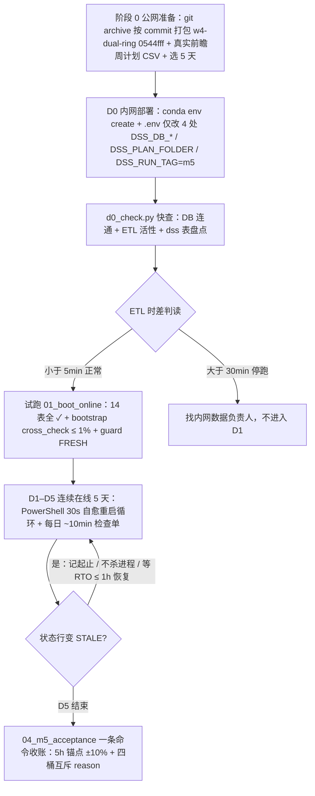
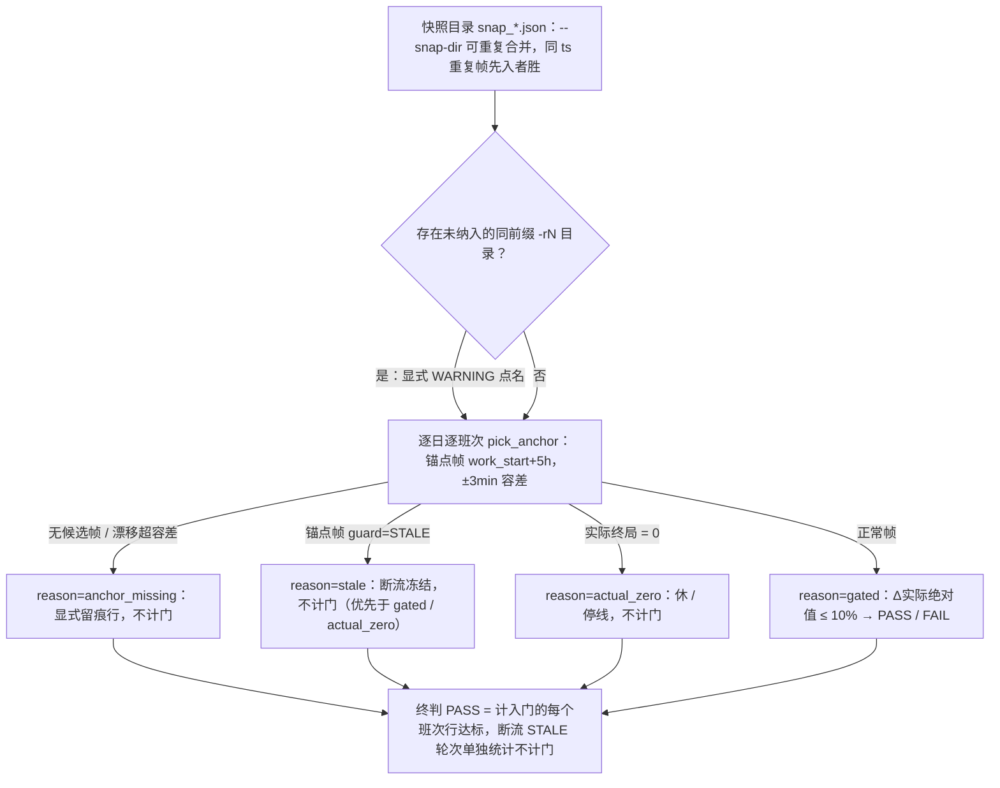

# 内网部署与 M5 在线验收

本页记录从 W4 关账到 M5 内网 5 天在线验收的完整运行路径。W4 于 2026-10-07 关账，M5 验收基线代码 = 分支 `w4-dual-ring` @ `0544fff`（含 W4 双环重构关账 + W4.4h；未合并 `main` 不影响部署——内网只看代码内容，分支名无关，部署时以 commit hash 记版本基线）。

**M5 定义（W3 最终验收）**：系统在内网生产环境**连续在线 5 个自然日**，验收 5h 锚点预测精度（±10%）、告警行为、断流熔断。关键约束：内网环境**无 agent**，全部操作手动照 `docs/09-M5内网在线验收运行手册.md`（v1.0，2026-09-29）执行；自动化产物只有收账脚本 `spike_w3/04_m5_acceptance.py`（14 单测 + 真库冒烟 2026-09-29 已验，W4 改动后端到端复验 2026-10-07）。

**时间口径**：本页所有时间描述以 `Asia/Shanghai`（工厂时 = UTC+8）为准；所有库查询 `SET TIME ZONE 'Asia/Shanghai'`。

## 时间线总览

| 阶段 | 在哪 | 时长 | 做什么 |
|---|---|---|---|
| 阶段 0 准备 | 公网 | 半天 | 打包代码 + 备验收周计划 + 选 5 天 |
| D0 部署 | 内网 | 半天 | 装环境、配 .env、建学习表、D0 快查、试跑 |
| D1–D5 在线跑 | 内网 | 连续 5 天 | 启动一次；每天记 4 样东西（~10 min/天） |
| 收账判分 | 内网（或回公网） | 1 小时 | 跑 1 条收账命令 + 核验收报告 |

**红线（全程）**：只读 `ods/dim/fct/mart/meta`；产物只写 `dss` 层；5 天内**不改任何 `DSS_*` 参数**（改 = 验收作废）；断流不杀进程（等 RTO≤1h 恢复，记时段）；勿删 `output\snapshots\m5\`（留痕审计）。



*M5 运行路径：从公网准备到收账判分，含 D0 ETL 活性门禁与 D1–D5 断流处置纪律。*

## 阶段 0：公网准备（半天）

1. **打包代码**：分支 `w4-dual-ring`（HEAD = `0544fff`）建议 `git archive` 按 commit 打包（自动排除未跟踪文件），拷到内网可达介质。必需内容：`spike_w1/ spike_w2/ spike_w3/ tests/ plan_inbox/ environment.yml .env.example`（`scratch/`、`output/snapshots/` 不用带）。
2. **验收周计划**：按 `plan_inbox/README.md`（docs/08 规范）生成验收周的 `week_plan_YYYYKWww.csv`——**必须是真实前瞻计划（非实测回填）**：M5 的 ±10% 门考的就是「计划 vs 实际」。支持极简工时格式（8/10/11/休 + 全天出车/进车总量）。
3. **选 5 天**：避开停线/检修/休息周；计划「休」日自动剔出门外（不占验收名额，但建议选 5 个连续工作日，中间不跨休）。

## D0 快查（d0_check.py）

开跑前必须先过 ETL 活性这关，否则 5 天白跑。内网部署机（`D:\dss` 下）执行：

```
D:\dss\env\python.exe d0_check.py
```

`d0_check.py` 做两件事（会话先 `SET TIME ZONE 'Asia/Shanghai'`）：

1. **DB 连通 + ETL 活性**：取 `SELECT MAX("DATE_EVT") FROM ods.carbody_history` 与当前时间（UTC+8）比较得时差。判读（原样）：**ETL 时差 <5min = 正常；>30min = 别开跑，找内网数据负责人**。
2. **dss 表盘点**：列出 `dss` schema 全部表。学完表后再跑一次（见 D0[3]）：**13 必填表应全在**（`dim_*` / `v2_*` / `dim_expected_delay` / `dim_weekly_plan` 启动时自动建）。

## D0：内网部署 checklist（docs/09）

```bat
:: [1] 装环境（机器无 miniconda 则先装；environment.yml 已固化版本）
conda env create -f environment.yml

:: [2] 配 .env（只改 4 处，其余全部保持默认——默认即生产口径）
copy .env.example .env
```

**[2] `.env` 只改这 4 行**：

| 键 | 值 | 说明 |
|---|---|---|
| `DSS_DB_HOST` / `DSS_DB_PORT` / `DSS_DB_NAME` / `DSS_DB_USER` / `DSS_DB_PASSWORD` | 内网生产库 | 账号需 `dss` schema 的 CREATE 权限 + `ods` 层 SELECT 权限。**M5 准备 agy 阻断 F1 已修**：`DSS_DB_*` 现真正被连接层读取（`spike_w1/common.py` 的 `_dsn()` 纯函数按 `DSS_DB_*` 解析、默认开发库 127.0.0.1，`connect()` 每次调用现解析；此前代码硬编码 127.0.0.1，这 5 行改了也不生效） |
| `DSS_PLAN_FOLDER` | 生产计划目录 | 把验收周 CSV 放这里 |
| `DSS_RUN_TAG` | `m5` | 5 天快照进同一目录 `output/snapshots/m5/`，收账方便；**显式 tag 重启幂等追加同目录**（agy 阻断 F3 已修，不再落 -r2 割裂快照；文件名自带时间戳不冲撞） |
| （可选）`DSS_SNAPSHOT_DIR` | 保持默认 `output/snapshots` | |

**不动的默认值（都是生产口径，改了 = 验收作废）**：`DSS_CLOCK_MODE=wall_clock`、`DSS_POLL_INTERVAL_SEC=300`、`DSS_STALE_MIN=30`、`DSS_ALPHA_MODE=off`、`DSS_ALERT_RED=-0.10`、`DSS_ALERT_YELLOW=-0.05`、`DSS_ALERT_DEBOUNCE_MIN=10`、学习窗 2026-04-14→08-15；W4 新键同样全部默认 = 生产口径：`DSS_DUAL_RING=1`（双环统一状态机新引擎，W4.3d 默认）、`DSS_USE_NET_DELAY=1`、`DSS_SHIFT_TIER_DELAY=0`（W4.4h 班次型档，停线保持 off）。

**[3] 生产库重建学习表**（生产 dss 层初始为空——这是关键一步，漏了启动会报缺表）：

```bat
conda run --no-capture-output -n paint-dss python spike_w1\01_learn_takt.py
conda run --no-capture-output -n paint-dss python spike_w2\01_learn_v2.py
```

- 建出 14 张：`dim_station_takt / dim_remaining_time / dim_future_flag / dim_loop_duration / dim_loop_remaining / dim_learner_meta`（W1，6）+ `v2_line_prob / v2_cohort_remaining / v2_future_flag / v2_comp_excl / v2_station_quality / v2_learner_meta`（W2，6）+ `dim_expected_delay`（W4.2c 期望净延误表，必填）+ `dim_expected_delay_shift`（W4.4h 班次型档，**可选**——缺表不阻断启动，引擎回退共享行）。
- 第 15 张 `dim_weekly_plan` 不用手动建——01 启动自动建 + 从 `DSS_PLAN_FOLDER` 入库。
- 启动存在性清单 = `spike_w3/01_boot_online.py` 的 `DSS_DIM_TABLES`（14 张必填；`dim_expected_delay_shift` 刻意不进必填清单）。
- 验证：13 必填表（含 `dim_expected_delay`）`count(*)` 非空。

**[4] ETL 活性检查**（`d0_check.py`，必须先过这关再开跑）。

**[5] 试跑**（正式开跑前一次）：`conda run --no-capture-output -n paint-dss python spike_w3\01_boot_online.py`，启动报告逐项核对（**全过才进 D1**）：

- [ ] 14 张 dss 表全 ✓（13 必填 + `dim_expected_delay_shift` 可选；shift 表缺失会标注但不阻断）
- [ ] 「周计划已加载: N 天 / X 文件」（含验收周每一天，无缺日标注）
- [ ] 120h bootstrap 完成，cross_check ≤ 1%
- [ ] guard = FRESH（非 STALE）
- [ ] 首帧控制台输出（池=… + 班次 A/pred/目标/Δ + ETL 诊断）
- [ ] `output/snapshots/m5/` 开始落快照文件

试跑确认无误后 `Ctrl+C` 停掉，等 D1 正式开跑。

## D1–D5：正式在线跑（一次启动，连续 5 天不停）

PowerShell 自动重启循环：进程崩溃 30s 后自愈重启，状态由 120h bootstrap 重建；按天写日志。

```powershell
# ⚠ 两个编码坑（2026-10-08 内网实测，均踩过）：
#   ① PYTHONIOENCODING=utf-8：GBK 系统下 python 输出重定向到文件时 ✓/✗/⚠ 触发 UnicodeEncodeError 崩溃
#   ② 不要用 PS 的 `*>` 重定向：PS5.1 会先按 GBK 解读子进程 UTF-8 输出再写文件 = 乱码被“烧”进日志；
#      改用 cmd 的 `>`（原始字节直拷，无编码转换）→ 日志为纯净 UTF-8
$env:PYTHONIOENCODING = 'utf-8'
New-Item -ItemType Directory -Force m5 | Out-Null
# 便携环境（conda-pack，内网新电脑，无需装 conda；env 目录不在代码下时替换为实际路径，如 D:\env\python.exe）：
while ($true) { cmd /c "D:\dss\env\python.exe -u spike_w3\01_boot_online.py > ""m5\log_$(Get-Date -f yyyyMMdd).log"" 2>&1"; Start-Sleep 30 }
# 机器装有 conda env paint-dss 时改用（同 cmd /c 形态）：
# while ($true) { cmd /c "conda run --no-capture-output -n paint-dss python -u spike_w3\01_boot_online.py > ""m5\log_$(Get-Date -f yyyyMMdd).log"" 2>&1"; Start-Sleep 30 }
```

**日志为 UTF-8**：实时盯日志用 `Get-Content m5\log_YYYYMMDD.log -Wait -Tail 20 -Encoding UTF8`（PowerShell 5.1 默认按 GBK 读，不加 `-Encoding UTF8` 中文乱码；Ctrl+C 只停查看，不停 DSS）。

**屏幕上每 5 分钟看到**：

- 状态行：`[MM-DD HH:MM] 池=… cross_check=… FRESH|STALE`
- 控制台帧（`[DSS]` 开头）：各活跃班次的 A / pred / 目标 / Δ / 红黄绿、最近确认告警、ETL 诊断
- 快照：`output/snapshots/m5/snap_YYYYMMDDTHHMMSS.json`（每轮一个，一天 288 个）。**wall_clock 已做 5min 网格对齐 + 漂移补偿**：`01_boot_online.next_grid_wait()` 纯函数每轮把 sleep 补偿到下一个 epoch 5min 网格点（而非裸 `sleep(poll)`），帧 ts 分钟恒为 :00/:05/.../:55，锚点帧可被 ±3min 容差匹配；首帧 = 启动时刻可能未对齐，后续帧自动对齐。

### 每日检查单（~10 分钟）

| 时间 | 动作 | 记录到哪 |
|---|---|---|
| 04:45 前 | 进程活着？（日志有新状态行；没有 → 看日志尾 + 重启循环是否工作） | 运行日志 |
| **日班锚点（随型：11h→10:00 / 10h→11:00 / 8h→13:00，常见 10:00）/ 21:30** | **抄当天两帧的 A / pred / 目标 / Δ / 灯色**（5h 锚点帧 = work_start+5h，验收核心；快照里有，手抄是双保险） | 锚点记录表 |
| 红/黄告警出现（`[DSS]` 帧有「确认」字样） | 记：时刻 + 班次 + 缺口台数 | 告警台账 |
| 状态行变 STALE（断流） | 记断流**起止时刻**（开始 = 首个 STALE 状态行；恢复 = 回到 FRESH）。**不杀进程、不动 ETL**（内网数据负责人处理，RTO≤1h） | 断流记录 |
| 次日 04:00 前 | 数当天快照：`dir output\snapshots\m5\ /b \| find /c "snap_2026-10-05"` 应 = 288 | 快照清单 |

### 记录模板（5 天用一张纸 / 一个本子即可）

**锚点记录表**

| 日期 | 日班锚点（10:00/11:00/13:00 按型；A/pred/目标/Δ/灯） | 中班 21:30（A/pred/目标/Δ/灯） | 当日快照数 |
|---|---|---|---|
| D1 | | | |

**告警台账**

| 时刻 | 班次(scope) | 转换（如 green→yellow→red） | 缺口台 | 事后核实（真缺口 or 误报） |
|---|---|---|---|---|

**断流记录**

| 起止时刻 | 时长 | ETL 侧原因（问数据负责人） | 期间是否触发 STALE 冻结横幅 |
|---|---|---|---|

## ETL SLA（两段式，2026-09-23 拍板）

| 段 | 环境 | 纪律 |
|---|---|---|
| 开发期 | 公网 | 用户同步快照、按需同步、**不设 RTO**；离线验收（影子回放）公网完成 |
| 生产期 | 内网实时连接 | 链路故障由内网数据负责人（角色）处理、**RTO ≤1h**；**断流时段预测/预警单独统计、不计入验收门**；5 天在线验收在内网生产环境跑 |

盲窗（断流冻结期）运行时行为由 B3 新鲜度熔断兜底：STALE 冻结告警 + 横幅，期间帧照常产出但预测/预警单独统计。出处：`AGENTS.md` 数据访问节 + `.env.example` B3 节注释（2026-09-23 拍板）。

## M5 收账（04_m5_acceptance.py）

D5 结束后一条命令出验收报告：

```bat
conda run --no-capture-output -n paint-dss python spike_w3\04_m5_acceptance.py --snap-dir output\snapshots\m5 --dates <D1日期>,<D2日期>,...,<D5日期>
```

产出：`output/w3-M5-验收报告.md`（主表 + 断流统计 + 告警台账 + 终判）+ `output/w3-M5-验收.json`（机读）。**只读零库写**：本脚本仅 SELECT，产物只写本地 MD/JSON。



*04 收账判分：每班次行落入唯一 reason 桶，四桶互斥 + 计入门 = 总行数。*

**判分口径**（docs/01 W3 验收门 + W2/M9 同源，与 G2 干跑门同源）：

- **主判据**：逐工作日 5h 锚点（**日班随班次型**：11h→10:00 / 10h→11:00 / 8h→13:00；中恒 21:30；锚点帧容差 ±3min）|Δ实际| ≤ 10%（`--tol` 默认 0.10）；Δ实际 = (pred − 实际终局)/实际终局。
- **实际终局** = 4 下线点产品车闭区间计数（`BODY_ID LIKE '78202%'`）：日班 [D 04:45, D 16:30]；中班 [D 16:30, D+1 按型 `MID_END_TIMES`：11h→04:00 / 10h→03:00 / 8h→01:00]，与 a_of `<=end` 同源。4 下线点 = `spike_w3/common.EXIT_STATIONS`：`K3IS140 / 1J440RB / K2IS075 / K1IS135`。
- **锚点帧** = work_start+5h（agy 阻断 F5：日班开班随型变——11h→05:00→锚 10:00 / 10h→06:00→锚 11:00 / 8h→08:00→锚 13:00；中恒 16:30→锚 21:30）；`pick_anchor` 在该日 `pred.shift.kind` 候选帧中取距锚点时刻最近且 ≤ ±3min（`ANCHOR_TOL_SEC = 180`）的一帧，超容差按锚点帧缺失处理。
- **四桶互斥 reason**（报告分别计数，和 + 计入门 = 总行数）：`gated`（计入门）、`actual_zero`（实际终局 0，停线/无事件，不计门）、`stale`（锚点帧 STALE 断流冻结，**优先于 gated/actual_zero**，不计门）、`anchor_missing`（进程离线/缺帧/漂移超容差，显式留痕行不静默跳过）。休日（日班锚点帧无班次 / 计划休）剔出门外，列于注记。
- **终判 PASS** = 计入门的每个班次行 |Δ实际| ≤ 10%。
- **多目录合并收账**：`--snap-dir` 可重复传（同 ts 重复帧先入者胜 + 计数，报告头部列重复数）；未纳入收账的同前缀 `-rN` 目录（如 `m5-r2`）由 `find_sibling_run_dirs` **显式 WARNING 点名**，防静默漏收。显式 `DSS_RUN_TAG` 下 `dashboard.resolve_run_tag` 幂等追加同目录（agy 阻断 F3 修复），正常重启不再产生 -rN；旧版本/自动 tag 遗留的 -r 目录确认属同一 M5 运行时重复传 `--snap-dir` 合并。
- **断流统计**（不计门，ETL SLA 2026-09-23 拍板）：`guard.status=STALE` 轮次单独统计（连续段归并，5min/轮，段末扩展到段内最后一轮的下一轮），报告列出连续段。
- **告警台账**：快照 `alerts` 数组逐条汇总，仅**确认转换**（10min 去抖）才进台账，与 03/M10 同源。

**报告人工核对三件事**（脚本之外）：① 告警台账每行填「事后核实」——该缺口事后是否真实发生（真缺口 = 告警有效；未发生 = 误报）；② 断流时段与数据负责人的 ETL 故障记录对得上；③ 快照数每天 = 288（缺帧 = 进程中断过，查对应日志）。验收报告归档：`output/w3-M5-验收报告.md` + 三份记录表 + 关键日志节选 → 回公网后 agent 协助整理成正式验收报告。

### 已知假阳类别：烘房通道存储死车（不计验收门，单独统计）

烘房关闭加热态时，16IS（1线）/18IS（3线）通道作临时存储线，车身可滞留通道内长时间。全史实测（16,815 辆次，首入 16/18IS 通道 → 首出炉）：>120h（死车阈值）47 辆次（0.28%）、最大 190.4h（≈7.9 天）；17IS（2线，主流量 ~90%）无存储。死车扫描（`DSS_DEAD_VEHICLE_HOURS` 默认 120h）会对通道存储车产生死车条目（假阳）。

**处置（2026-10-05 D8 拍板 (a)，不动代码/不动红线参数）**：列为已知假阳类别——04 收账判分只消费 5h 锚点 Δ实际（死车条目不进判分），**不计验收门**；D1–D5 期间日志/台账出现此类条目时，记录并核对该车是否驻留 16/18IS 通道站（驻留 = 已知假阳，单独统计）；量级 0.28%，不影响 PASS 判据。机制安全（已实测坐实）：滞留发生在出炉**之前**，不破坏「出炉⇒已烘干冷却」语义，`first_oven` 锚点与 `passed_oven` 状态均安全。

### 测试

`tests/test_w3_m5_acceptance.py` 21 个单测覆盖：锚点选择随型（F5）、±180s 容差（F2）、四桶 reason 互斥（F4）、实际终局闭区间按型、断流段归并、多目录合并/-rN 提醒等；另真库冒烟（2026-09-29 已验，W4 改动后 2026-10-07 端到端复验）。M5 准备 agy 一审 5 项阻断/中等（F1 DSN env 覆盖 / F2 网格对齐 / F3 显式 tag 幂等 / F4 结构化 reason / F5 锚点按型）的修复均已进入 04 与在线路径。

## 回滚纪律（D6 回滚门）

- **`DSS_DUAL_RING=0` → 30 秒回滚旧引擎**：严格 1/0 门（非法值启动报错），默认 1 = Doc14 统一引擎（生产默认，W4.3d / D6 拍板）；0 = 旧 `estimate_event` 路径（W1/W2 原语义）。消费点 `spike_w2/eta_v2.py::dual_ring_enabled()` 每次现读环境变量（`DSSConfig.dual_ring` 仅为启动报告镜像）。
- **真回滚旧栈 = `DSS_DUAL_RING=0 ∧ DSS_USE_NET_DELAY=0`**；`DUAL_RING=0 ∧ ND=1` 是半迁移退化态（W4.4f 实测 W2 sc3 11.00% / W3 M9 11.99% ❌），**不可用作回滚**（docs/15 W4.4f doc10 三向门禁对账）。
- **先例**：W4 关账验证 **回滚 288/288 零 diff（DSS_DUAL_RING=0）**——24h/288 步状态行序列与基线逐字一致（2026-10-07，CHANGELOG / docs/15）。
- 回滚语义仅排障参考，**验收期间禁用**（改任何 `DSS_*` 参数 = 验收作废）。

## Git 与波次关账流程

- **agent 不执行 git commit（2026-09-20 用户拍板）**——提交全部由用户自行执行；agent 只在任务/波次完成时呈报变更文件清单 + 建议 commit message，用户核对后自己提交。
- **波次关账流程**：用户提交代码 → BM 线程笔记追加本波决策/实测 → `CHANGELOG.md` → Pi 发起 `openwiki update` → 呈报文件清单 + 建议 commit message → 用户提交。
- `CHANGELOG.md` 为波次级粒度（每波关账时写入，非逐 commit）；设计决策/口径/踩坑进 BM 线程笔记。
- M5 相关关账记录：2026-09-29（04 收账脚本 + docs/09 运行手册 + agy 一审 5 项修复，TDD 297/297 绿）、2026-10-07（W4 关账：288/288 零 diff、G2 留痕 FAIL 关账，TDD 449 绿）。

## 排障速查（docs/09，7 项）

| 现象 | 第一反应 |
|---|---|
| 启动报「缺表」 | 学习表没建全（D0[3]）→ 重跑 `01_learn_takt` / `01_learn_v2` |
| 启动报周计划缺日 | 验收周 CSV 行不全 / 日期格式错 → 对照 `plan_inbox/README.md` 修文件，重跑 01（upsert 幂等） |
| 持续 STALE | ETL 断流（非本系统故障）→ 记时段，找数据负责人；恢复后自动解冻，期间不计门 |
| cross_check > 1% | 查启动报告明细（哪几台不一致）；若 bootstrap 数据本身有问题找数据负责人 |
| 进程反复重启 | 看 `m5\log_*.log` 尾部异常栈；常见 = 库连接断（重启循环会自愈） |
| 快照缺帧 | 对应时刻进程不在线（查日志）；缺帧时段在收账报告里体现为「锚点帧缺失」行 |
| 帧里「段=待确认」 | 85 个工位段名未补（M3 挂账）——不阻断，告警瓶颈定位显示「待确认」，M5 前补上更好 |

## 与既有口径的一致性（收账脚本已对齐，勿改）

- 4 下线点：`K3IS140 / 1J440RB / K2IS075 / K1IS135`（`spike_w3/common.EXIT_STATIONS`）
- 产品车：`BODY_ID LIKE '78202%'`
- 时区：所有查询 `SET TIME ZONE 'Asia/Shanghai'`
- 中班 end 按型：11h→次日 04:00 / 10h→03:00 / 8h→01:00（`spike_w2/shifts.MID_END_TIMES`）
- 5h 锚点 = work_start+5h（日班开班随型变：11h→05:00→锚 10:00 / 10h→06:00→锚 11:00 / 8h→08:00→锚 13:00；中恒 16:30→锚 21:30；`spike_w2/shifts.DAY_TYPES/MID_START`）；锚点帧容差 ±3min（`04.ANCHOR_TOL_SEC`）
- 告警语义：仅**确认转换**（10min 去抖）才进台账，与 03/M10 同源

## 相关页面

- [Database](../integrations/database.md) — `analytics_db` 连接层：`DSS_DB_*` 覆盖、只读分层红线、F8 水位与 ETL 诊断信号
- [DSS_* Configuration](configuration.md) — `DSS_*` 参数总表与 `.env` 纪律（默认值 = 生产口径）
- [Online Main Loop](../workflows/online-mainloop.md) — `01_boot_online` 主循环：bootstrap、新鲜度熔断、增量流
- [Replay Acceptance](../workflows/replay-acceptance.md) — 影子回放与验收门（M9/M10/G2）
