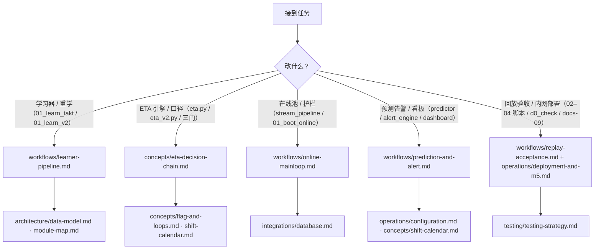

# 快速上手与任务路由图

本页是 OpenWiki 的唯一入口：说明项目一句话定位、当前开发状态、单一事实源链与
引用纪律，并把高频任务路由到各域页面。按 [AGENTS.md](../AGENTS.md) 约定，源码与测试
是最终权威；OpenWiki 是派生产物（代码 grounding、可再生、仅本仓库有效）。

## 项目一句话定位与当前状态

涂装车间 DSS（决策支持系统）：物流均衡 + 班次产量达成预测 + 缺口预警。本仓库先做
模块②（班次产量达成预测：对 `ods.carbody_history` 过站事件流做在线滚动 ETA、班次
达成预测与缺口预警），模块①（WIP 看板）与③（流量均衡建议）在②之后。数据源为
`analytics_db @ 127.0.0.1:5432`（开发库；生产期在内网），核心表
`ods.carbody_history`（只读事件流），全部产物只写 `dss` schema。

当前状态（截至 W4 关账）：**W4 已于 2026-10-07 关账**（物理双环统一状态机 + 净
延误第一迭代，跨切重构、无新代码目录），全套件 470 passed（W4.4h 后基线）；
**M5 内网 5 天在线验收就绪**——收账脚本 `spike_w3/04_m5_acceptance.py`（5h 锚点
±10% 判分、四桶互斥 reason）、内网运行手册 `docs/09-M5内网在线验收运行手册.md`、
D0 快查 `d0_check.py` 均已定版。验收数字只引 `output/` 报告文件名（如
`output/w4-双环重构验证摘要.md`），不复制其内容。

## 新 agent 上手顺序

按 [AGENTS.md](../AGENTS.md)（知识库分工，2026-10-06 拍板）：

1. `AGENTS.md`（agent 启动自动加载，全局规则原件）；
2. `README.md` 口径对照表（BM 笔记的固化快照，速查）；
3. 涉口径/决策 → Basic Memory 线程笔记 `basic-memory/projects/paint-dss/涂装车间-dss-方案设计与开发路线`（口径唯一事实源，经 BM MCP/CLI 读写，裸文件直写永远禁止）；
4. 涉代码结构 → OpenWiki `search` / `read`（可选的 just-in-time 上下文，非每次任务起手式）；检索工具不可用时读本文件并沿链接走。

**不要**在任务起手时枚举/预载/搜索 wiki；一旦问题落地即止（AGENTS.md OpenWiki 节）。

## 单一事实源链与引用纪律

两条相关但不同的顺序：

- **口径事实来源（单一事实源，优先级高→低，INSTRUCTIONS.md）**：BM 线程笔记
  （`README.md` 口径表是其固化快照）> `README.md` 口径表 > `CHANGELOG.md`。
  OpenWiki 是派生产物（代码 grounding、可再生），**不得与以上来源冲突**；发现冲突
  时在相关页面显式标注差异并注明「以 BM 笔记为准」，不得自行改写口径。
- **漂移处理优先级（AGENTS.md 硬规则）**：**代码 > BM 笔记 > README 快照 >
  OpenWiki**。OpenWiki 口径漂移 → 相关页面标注差异、以 BM 为准、下次 update 自愈；
  代码与 BM 口径不一致 → **流程违规**（代码应跟随拍板），报出修代码，文档层不得掩盖。

| 内容类型 | 唯一归属 |
|---|---|
| 口径 / 决策理由 / 演进历史 | BM 线程笔记（`README.md` 口径表是其快照）；OpenWiki 只引用出处，不复制口径细节 |
| 代码架构 / 模块职责 / 运行路径 / `DSS_*` 参数 | OpenWiki（本 wiki）；BM 只提产物路径，不展开代码结构 |
| 实测结论与验收结果 | BM 存「结论 + 理由 + 日期」；数字在 `output/` 报告；OpenWiki 只引报告文件名 |
| 任务 / 工单 | BM Task Board（前缀 `paint-dss:`）；OpenWiki 不管任务 |
| 代码变更时间线 | `CHANGELOG.md`（波次级粒度，每波关账时写入） |

- 波次关账流程：用户提交代码 → BM 线程笔记追加本波决策/实测 → `CHANGELOG.md` →
  `openwiki update` → 呈报文件清单 + 建议 commit message → 用户提交。**agent 不执行
  `git commit`**（2026-09-20 用户拍板），且暂不推 remote。

## 全局不变量（任何任务都要守住）

- **时间口径 Asia/Shanghai**：会话默认 UTC，工厂时 = UTC+8；所有时间/班次查询必须
  `SET TIME ZONE 'Asia/Shanghai'`（`spike_w1/common.py::connect()` 统一执行，
  `d0_check.py` 亦自行 SET），否则班次边界全部错位 8 小时。本 wiki 描述任何时间
  逻辑时以 `Asia/Shanghai` 为基准。
- **只读原则**：不得修改 `ods` / `dim` / `fct` / `mart` / `meta` 层任何表与视图；
  产物只写 `dss` schema（`dss.dim_*` / `dss.work_*`），`dss` 内可 DROP + CREATE。
- **wiki 引用纪律**（[openwiki/INSTRUCTIONS.md](INSTRUCTIONS.md)）：wiki 生成不得
  连接数据库、不得执行任何 DB 读写；禁止引用 `output/` 下实产数据报告（已被
  `.openwikiignore` 排除，只许引用报告文件名）；`.env` 中的数据库凭据不落 wiki
  （凭据不离开本机）。
- **运行约定**：专用 conda 环境 `paint-dss`（`environment.yml` 固化）；连库脚本
  一律 `conda run --no-capture-output -n paint-dss python <脚本>` 启动（不依赖
  shell 激活状态）；`python -c` 仅限单行（多行参数报错）；脚本门判约定
  exit 0 = 过 / exit 1 = sanity 失败 / exit 2 = 门未过（conda run 此时打印的
  `ERROR conda.cli... failed` 属上报约定而非运行失败，以产物为准）。
- **参数纪律**：关键业务与算法参数一律 `DSS_*` 环境变量（`python-dotenv` 从根
  `.env` 加载；`.env` 不入库，`.env.example` 为模版），严格 1/0 门非法值启动报错
  不静默回落——全部字段语义见 [Configuration](operations/configuration.md)。

## 任务路由图

五类高频任务的入口路由（先查左列第一站，再按需看伴随页）：

| 任务类型 | 第一站 | 伴随页 |
|---|---|---|
| 改学习器 / 重学 | [Learner Pipeline](workflows/learner-pipeline.md)（`spike_w1/01_learn_takt.py` → `spike_w2/01_learn_v2.py`，因果切分窗 2026-04-14→08-15） | [Data Model](architecture/data-model.md)（`dss` 表清单与三层行约定）、[Module Map](architecture/module-map.md) |
| 改 ETA 引擎 / 口径 | [ETA Decision Chain](concepts/eta-decision-chain.md)（W1→W4 三引擎与 `DSS_DUAL_RING` / `DSS_USE_NET_DELAY` / `DSS_SHIFT_TIER_DELAY` 三门） | [Flag and Loops](concepts/flag-and-loops.md)（`MDS_DATA` 137/139 位与双环锚定）、[Shift Calendar](concepts/shift-calendar.md)（班次窗与周计划输入） |
| 改在线池 / 护栏 | [Online Main Loop](workflows/online-mainloop.md)（`spike_w3/01_boot_online.py` + `stream_pipeline.py`：池状态机 R1–R7、FreshnessGuard 三态、死车、周期重建） | [Database](integrations/database.md)（连接纪律、ETL 四信号、F8 水位分离） |
| 改预测告警 / 看板 | [Prediction and Alert](workflows/prediction-and-alert.md)（`predictor` / `alert_engine` / `dashboard`：滚动预测、红黄绿去抖、双 scope、5min 快照与 ETA 菜单） | [Shift Calendar](concepts/shift-calendar.md)、[Configuration](operations/configuration.md) |
| 跑回放验收与内网部署 | [Replay Acceptance](workflows/replay-acceptance.md)（W1/W2/M9/M10/M5 各门判驱动）+ [Deployment and M5](operations/deployment-and-m5.md)（`d0_check.py` D0 快查、docs/09 运行手册、回滚纪律） | [Testing Strategy](testing/testing-strategy.md)（回归红线与门判锚点） |



*五类高频任务 → 第一站页面 → 伴随页面的路由图（节点为 wiki 页面相对路径）。*

路由原则：

- **改口径先对表**：写代码前先对 `README.md` 口径表，口径变更先改 BM 笔记、再同步
  表与代码；拿不准的口径问用户，不猜不拍板。
- **冻结红线**：W1/W2/W3 关账结论不翻案、既有门语义零改动、`DSS_DUAL_RING=0` 回滚
  路径保留为测试锚点、`estimate_event` 旧入口冻结；红线核验走 `git diff`（冻结
  模块零改动）。细节见 [Testing Strategy](testing/testing-strategy.md) 与
  [System Overview](architecture/overview.md)。
- **改动波次收尾**：全套件零回归 + 门判如实上报（不软化、不删门）+ `CHANGELOG.md`
  波次条目 + `openwiki update`。

## 域页面索引

| 页面 | 覆盖 |
|---|---|
| [System Overview](architecture/overview.md) | 三波开发 + W4 跨切重构总览、验收门台账、`analytics_db` → `dss` 数据流总图 |
| [Data Model](architecture/data-model.md) | `ods.carbody_history` 事件底座、`sqlbase.ev_base_sql` 净化管线、全部 `dss` 表盘点与三层行约定 |
| [Module Map](architecture/module-map.md) | `spike_w1/2/3` + `tests/` 依赖拓扑、常量单一事实源分布、importlib 别名纪律 |
| [ETA Decision Chain](concepts/eta-decision-chain.md) | 单事件 ETA 全链、三引擎分发与三门回滚语义（`DSS_DUAL_RING` / `DSS_USE_NET_DELAY` / `DSS_SHIFT_TIER_DELAY`） |
| [Flag and Loops](concepts/flag-and-loops.md) | `MDS_DATA` 137/139 位标志语义、质量返工/黑顶双环物理锚定、`resolve_effective_flag` 状态机 |
| [Shift Calendar](concepts/shift-calendar.md) | 班次窗/归属窗/锚点单一事实源（`spike_w2/shifts.py`）、周计划输入链与兜底自学 |
| [Learner Pipeline](workflows/learner-pipeline.md) | W1/W2/W4 重学端到端流程、因果切分、sanity 门（exit 0/1）、DROP+CREATE 语义 |
| [Online Main Loop](workflows/online-mainloop.md) | 启动序列、5min 主循环、池状态机、增量消费、FreshnessGuard、死车、24h 重建 |
| [Prediction and Alert](workflows/prediction-and-alert.md) | 滚动预测（α 族）、AlertEngine（双 scope、去抖、恒等式）、T6-lite 看板与快照 |
| [Replay Acceptance](workflows/replay-acceptance.md) | W1→M5 全部回放/验收驱动与门判体系、exit 码约定、因果切分不变量 |
| [Database](integrations/database.md) | 连接纪律（autocommit / tz / 大列双引号）、只读分层、跨层引用面、ETL 四信号诊断 |
| [Configuration](operations/configuration.md) | `DSS_*` 全字段语义、严格 1/0 门、`DSS_DB_*` 覆盖机制、调试开关 |
| [Deployment and M5](operations/deployment-and-m5.md) | 内网部署（阶段 0 / D0 / D1–D5）、ETL SLA 两段式、M5 收账与回滚纪律 |
| [Testing Strategy](testing/testing-strategy.md) | TDD 门判先行、FakeConn/FakeCursor、importlib 路径加载、零回归基线与回归红线 |

## 脚本速查（编号约定 `01_`–`04_`）

```bash
conda run --no-capture-output -n paint-dss python spike_w1\01_learn_takt.py    # W1 学习器（dss 六表 + 自校验 S1–S6）
conda run --no-capture-output -n paint-dss python spike_w1\02_replay_eta.py    # W1 单车 ETA 回放（三估计器对打）
conda run --no-capture-output -n paint-dss python spike_w2\01_learn_v2.py      # W2 v2 学习器（v2_* 六表 + 净延误表）
conda run --no-capture-output -n paint-dss python spike_w2\02_replay_shift.py  # W2 班次级回放（D1' 门判）
conda run --no-capture-output -n paint-dss python spike_w3\01_boot_online.py   # W3 在线引擎（生产主循环）
conda run --no-capture-output -n paint-dss python spike_w3\02_shadow_replay.py # M9 影子回放
conda run --no-capture-output -n paint-dss python spike_w3\03_alert_backtest.py# M10 告警回测
conda run --no-capture-output -n paint-dss python spike_w3\04_m5_acceptance.py # M5 验收收账
conda run --no-capture-output -n paint-dss pytest                             # 全套件（根 pytest.ini：basetemp→scratch/.pytest-tmp）
```

顺序约束：W1 学习器先于 W2 学习器（W1 六张 `dss.dim_*` 是 W2 的**只读**输入，
`01_learn_v2.py` 头注钉死「只读不写」回归护栏；学习器 DROP+CREATE 重建，回放窗
只用学习窗之后的数据）。启动存在性清单 = `01_boot_online.py` 的
`DSS_DIM_TABLES`（14 张必填：W1 六表 + W2 v2 六表 + `dim_expected_delay` +
`dim_weekly_plan`；`dim_expected_delay_shift` 为可选表，缺表不阻断启动、引擎回退
共享行）。
