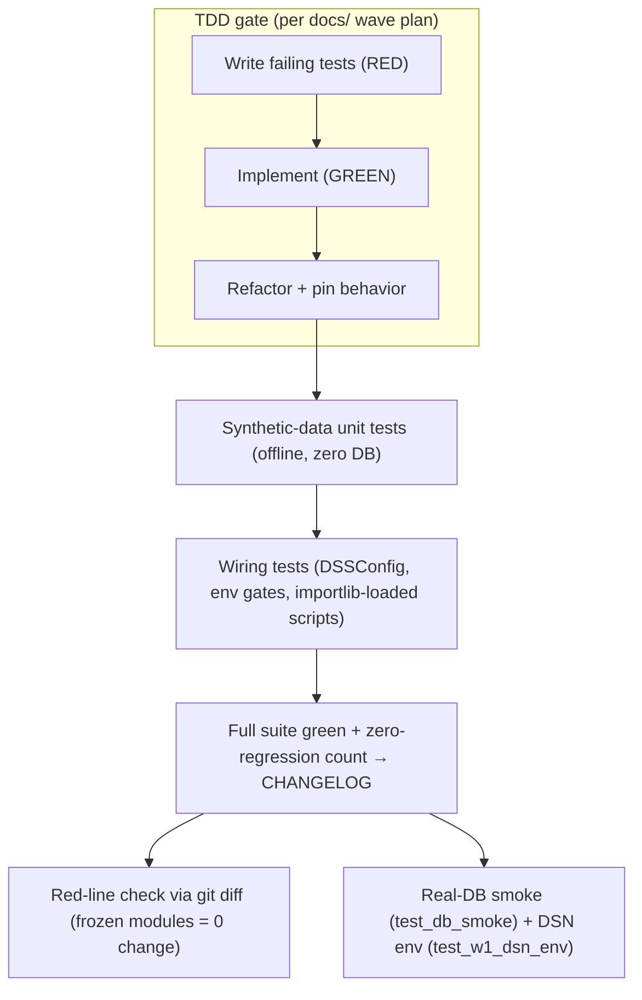

# Testing Strategy and Regression Red Lines (测试策略与回归红线)

This page documents the test suite under `tests/` and the discipline that keeps the
paint-shop DSS safe to change across waves. The suite is **TDD-first** (each wave's plan
in `docs/` specifies failing tests before code), overwhelmingly **offline** (synthetic
data, zero DB dependency for pure logic), and anchored by a small number of **real-DB**
smoke and env tests. Every wave closes with a **zero-regression** pass count recorded in
`CHANGELOG.md`, and a set of **frozen red lines** (unchanged frozen modules, preserved
rollback path, un-reopenable gate semantics) is verified by `git diff`.

Time reference: all tests use aware datetimes in `Asia/Shanghai` (factory time = UTC+8).
The `R7` rule — naive timestamps raise `TypeError` — is itself pinned by tests.

## 1. Overall strategy: TDD gates first, then synthetic-data unit tests

The dominant pattern is **pure-function-first**: the test targets the estimator and
state-machine cores that carry no I/O, then the wiring tests that connect them. Three
families matter most:

- **`tests/test_eta_v2.py`** — pure-logic unit tests (synthetic data) for the W2/W4 ETA
  engine (`spike_w2/eta_v2.py`). Tables are built as plain dicts of tuples (`_tables()`);
  each test pins one semantic branch: two-level `resolve_main` fallback, weekly-`p`
  fallback chain (low-`n` discard), cohort mixing with line-probability weighting, the
  `estimate_event` main path (flag 1 uses loop distribution with no compensation; flag 0
  adds `p×L`; `comp_excl` kills compensation), and `quality_mark`.
- **`tests/test_w3_freshness.py`** — the `FreshnessGuard` three-state machine
  (NORMAL/STALE/RECOVERY), the 30-min latch, STALE freeze semantics, rest-day downgrade,
  and four-signal `diagnose()`. `check()` is pure computation (injected `now` /
  `max_event_ts`); `diagnose()` runs through a `FakeCursor` with five preset row batches.
- **`tests/test_w3_pool_state.py`** — pool state machine rules R1–R7 on synthetic event
  streams (same-station idempotence, flag inheritance, multiple entry/exit, mid-stream
  adoption, `BODY_TYPE` direct read, loop count, tz enforcement).
- **`tests/test_w3_mainloop.py`** — the `run_replay` cursor-stepping dry run on a
  synthetic 48h event stream (576 rounds, 5-min step), exercising dead-vehicle sweep,
  STALE freeze (pool preserved at 3 during the gap), watermark poisoning + periodic
  rebuild self-healing, and the per-round status-line contract.

These run with **zero DB dependency**: they import package modules (`from spike_w3 import
stream_pipeline`) and pass synthetic rows / injected `now`, so the full suite is
reproducible on any machine that has the `paint-dss` conda environment.



Caption: The per-wave loop from plan-doc TDD through offline unit tests, wiring tests, the
zero-regression suite count, the `git diff` red-line check, and the DB smoke/env tests.

## 2. Simulating DB behavior with `FakeConn` / `FakeCursor`

Where a function *must* run SQL, tests replace the connection with hand-written
stand-ins rather than hitting a database. These are defined locally per test file (no
shared `conftest.py` exists), and they carry specific responsibilities:

- **`FakeCursor`** — each `execute()` pops one pre-baked row batch from a queue and
  records `(sql, params)` for later assertions. `fetchall()` returns the batch. Variants
  add **placeholder validation**: `sql.count("%s") == len(params)` is asserted to catch
  SQL parameter mismatches (a real-DB `IndexError` regression from 2026-09-24).
- **`FakeConn`** — wraps a `FakeCursor` and, crucially, records **`commit()`** and
  **`rollback()`** calls. This matters because the boot sequence now performs DDL
  (weekly-plan tables via `plan_loader.ensure_weekly_plan_tables`) inside a transaction:
  `tests/test_w3_bootstrap.py` `FakeConn` tracks `committed` / `rolled_back` counters,
  and `tests/test_w3_mainloop.py` asserts `conn.commits >= 1` after the dead-vehicle
  audit `INSERT INTO dss.work_alert_log` (write-to-`dss`-only discipline).
- **SQL-discipline assertions** — tests do not just check rows; they assert the *shape*
  of the SQL that ran: bootstrap is a read-only `SELECT` with a double-bounded
  `"DATE_EVT" >= %s ... <= %s` window, `ORDER BY "ID"`, exactly two params;
  `FreshnessGuard.diagnose` issues exactly five read-only `SELECT`s against named tables
  (`meta.sync_job_log`, `meta.refresh_watermark`, `ods.carbody_history`, etc.);
  `cross_check` uses a windowed reference query with the 9-station `NOT IN` exclusion.

`tests/test_w3_mainloop.py` goes further with a **`FakeStoreCursor`** that actually
filters the synthetic rows by the `WHERE` clause (watermark `wm` + `now` bounds), so the
real consume/bootstrap SQL semantics execute against in-memory data rather than being
simulated by hand.

## 3. Loading numbered cross-package scripts: importlib by path + `sys.modules` registration

Executable entrypoints are named with a numeric prefix (`spike_w3/01_boot_online.py`,
`spike_w2/02_replay_shift.py`, `spike_w3/04_m5_acceptance.py`, ...), so they cannot be
imported with a normal dotted path. Tests load them **by file path with importlib** and
**register a `sys.modules` alias** before `exec_module`. The canonical loader
(`tests/test_w3_mainloop.py::_load_boot_module`):

```python
import importlib.util, os, sys as _sys
if "w3_boot" in _sys.modules:
    return _sys.modules["w3_boot"]
p = os.path.join(os.path.dirname(os.path.dirname(os.path.abspath(__file__))),
                 "spike_w3", "01_boot_online.py")
spec = importlib.util.spec_from_file_location("w3_boot", p)
mod = importlib.util.module_from_spec(spec)
_sys.modules["w3_boot"] = mod          # 注册（spec_from_file_location 不自动注册）
spec.loader.exec_module(mod)
return mod
```

Two non-obvious invariants are pinned by tests:

- **The `sys.modules` name must not contain a dot** (`.openwikiignore`/`docs/07` 踩坑
  沉淀). Registration is required for two reasons: to avoid re-executing the module on
  each test (idempotency), and because some code resolves deferred annotations by module
  name at runtime (`tests/test_w3_alert.py` notes "dataclass 延迟注解按模块名反查").
- **Module-name collision avoidance.** Different test files load the *same* script under
  the same alias (e.g. `w3_boot` in `test_w3_mainloop.py`, `test_w3_bootstrap.py`,
  `test_w3_dashboard.py`; `w3_shadow_replay` in `test_w3_alert.py`, `test_w3_m9.py`,
  `test_w4_m9_config.py`). The `if name in sys.modules: return sys.modules[name]` guard
  makes the loader idempotent so a second import reuses the first-executed module.

A few W4 tests instead use `importlib.import_module("spike_w1.01_learn_takt")` /
`importlib.import_module("spike_w2.01_learn_v2")` (hyphen-free, dotted module names are
legal there) — e.g. `tests/test_w4_learn_takt.py`, `tests/test_w4_learn_v2.py` — to pin
the learner's `DDL` / SQL contract strings as plain text assertions.

## 4. Real-DB tests: `test_db_smoke` and DSN-env override

Only a small slice of the suite touches a live database, and it is **skipped
automatically** when the DB is unreachable so the rest of the suite stays runnable on a
public network without the `analytics_db` snapshot.

- **`tests/test_db_smoke.py`** — a real read-only DB smoke test. It probes
  `socket.create_connection(("127.0.0.1", 5432), timeout=2)`; if the port is down the
  whole file is skipped via `pytest.mark.skipif`. When up, it pins **tz / quoting /
  constant 口径** against known stock data (the 2026-09-30 11:36 sync snapshot): the
  `min("DATE_EVT")` lower bound with a `CST = UTC+8` timezone, the `MDS_DATA` flag
  distribution (fixed-position 139 substring) grouped by flag, and entry/exit station
  counts (parametrized `IN (%s, ...)` with `%%`-escaped `LIKE`). These assert *exact*
  stock values and must be refreshed when data is re-synced.
- **`tests/test_w1_dsn_env.py`** — the DSN override contract added for M5 (agy blocking
  F1). It verifies `spike_w1.common._dsn()` defaults to the dev database
  (`127.0.0.1/root/root`, zero behavior change), that `DSS_DB_HOST/PORT/NAME/USER/PASSWORD`
  env vars override it (port parsed to `int`), and — without a real connection — that
  `connect()` resolves the DSN *fresh at call time* (not frozen at import) by
  monkeypatching `psycopg2.connect` to capture kwargs.

`tests/test_w3_alert.py` follows the same skip pattern (`_db_up()` + a `db_only` marker)
for its two DDL-shape tests, which confirm idempotent table creation and the exact
column list/order/types of `dss.work_shift_alert` and `dss.dim_station_section`.

## 5. `pytest.ini`: `basetemp` → `scratch/.pytest-tmp` (Windows permission workaround)

`pytest.ini` sets the only global pytest option:

```ini
addopts = --basetemp=scratch/.pytest-tmp
```

The comment in the file records why (双审 agy 建议 4, 2026-10-05): on Windows the
default temp tree `C:\Users\<user>\AppData\Local\Temp\pytest-of-*` accumulates stale
directory-permission residue, and without an explicit `basetemp` a full-suite teardown
raises **38 `PermissionError`s** — an environment problem, not a code regression.
Pointing the temp base at `scratch/.pytest-tmp/` avoids it; `scratch/` is already covered
by `.gitignore`, so no extra ignore entry is needed. This is the **reason** to keep the
file (and to keep `scratch/` gitignored) when running the suite on Windows.

## 6. Suite-size timeline and the zero-regression baseline

The suite grows monotonically; each wave's closing entry in `CHANGELOG.md` records the
total and the delta, with **零回归** (zero regression of the prior baseline) as the gate:

| Milestone (CHANGELOG entry) | Full-suite result | Delta |
|---|---|---|
| W2 closeout (2026-09-21) | 43 passed | baseline after W1 + W2 |
| W3-T2 (2026-09-25) | 96 passed | +W1/W2 unchanged |
| W3-T1-lite (2026-09-27) | 215 passed | 174 baseline + 41 |
| W3-T6-lite (2026-09-28) | 270 passed | 215 baseline + 55 |
| W3-M5 prep (2026-09-29) | 297 passed | 270 baseline + 27 |
| **W4 closeout (2026-10-07)** | **449 passed** | 297 baseline + 152 |
| W4.4h shift-tier (2026-10-07) | **470 passed** | **449 baseline + 21, zero regression** |

The **W4 baseline of 449 passed** and the **470 passed** figure (449 + 21, zero
regression) are the authoritative zero-regression numbers cited by `CHANGELOG.md`. The
`43 → 96 → 215 → 270 → 297 → 449 → 470` progression is the suite-size timeline. Detailed
acceptance numbers live in the `output/` reports, which are intentionally *not* expanded
here (see the BM × OpenWiki division in `AGENTS.md`: measured results → BM, wiki cites
the report filename only).

## 7. Regression red lines (回归红线)

The frozen red lines are the change-protection contract. They are stated in `docs/15`
(§红线) and `docs/07` (v1.1 红线) and verified **by `git diff`** at wave closeout — not
by re-reading prose. The three that must not be silently deleted when code changes are
made:

1. **W1/W2/W3 closeout conclusions are not re-opened** (关账结论不翻案). Their acceptance
   gates become W4 **regression gates** (docs/15 §G); if a gate fails, the cause is
   attributed and reported honestly — the gate is never soft-deleted or silently
   re-scoped.
2. **Existing gate semantics are unchanged** (既有门判逻辑零改动). The gate pure
   functions in `spike_w3/02_shadow_replay.py` (`gates()`) and
   `spike_w3/03_alert_backtest.py`, and the `run_one_round` fixed order +
   `_render_status_line` in `spike_w3/01_boot_online.py`, are byte-for-byte frozen
   (docs/07: "`run_one_round` 与 `_render_status_line` 字节不变"). The **only**
   sanctioned exception is the W4.3 minimal contract extension (Event +1 `flag_137`
   field, VehicleState +2 fields, new rules O1+O2), which must be recorded in
   `docs/03 §0` and pass review.
3. **The `DSS_DUAL_RING=0` rollback path is retained as a test anchor** (回滚路径保留为
   测试锚点). `spike_w2/eta_v2.py` keeps the old entrypoint `estimate_event` and
   `quality_mark`/`resolve_p` untouched **specifically because** they are the
   `DSS_DUAL_RING=0` full-path rollback plus the existing test anchors — deleting them
   would silently remove the rollback capability. The old entrypoint **`estimate_event`
   is frozen as an entry** (旧入口冻结).

Concrete test-side anchors that lock these lines in place:

- **Rollback-path pins.** `tests/test_w3_predictor.py` and `tests/test_w3_eta_menu.py`
  use an autouse fixture that forces `DSS_DUAL_RING=0` + `DSS_USE_NET_DELAY=0` and state
  explicitly "本文件 = 旧引擎 / 旧路径行为回归钉死" — i.e. they are the regression pins
  for the frozen old path. `tests/test_w4_engine_wiring.py` then exercises both sides of
  the gate: `DUAL_RING=1` routes to the unified full-state-machine path (raw 139 + 137
  bit + `passed_oven`), while `DUAL_RING=0` returns to the old engine (with the
  `DSS_USE_NET_DELAY` retrofit), and `dashboard.compute_eta` under `DUAL_RING=0` is
  asserted to produce a **zero-drift** old-path response shape.
- **Frozen-module zero-change (git diff).** Wave closeouts report e.g.
  "红线核验（git diff）：02/03/predictor/stream_pipeline 零改动；冻结代码唯一微动 =
  alert_engine `deb_state()`；`run_one_round`/`_render_status_line` 字节不变"
  (W3-T6-lite) and W4's docs/15 §文件变更清单 lists the **零改动（红线核验对象）** set
  explicitly. `docs/15 §G G6` defines the regression-red-line gate: the `t6dry1`
  09-09 **status-line sequence** (baseline hash), the KW36/37 original artifact hashes,
  and **frozen-path diff = 0** (except the §0.3 documented extensions).
- **Status-line sequence as the G1 regression criterion (not full output).** The
  per-round status line (`now`/`pool_size`/`max_ts`/`guard_state`/`frozen`/`dead_count`)
  is the regression判据. `tests/test_w3_dashboard.py::test_run_replay_hook_none_unchanged`
  runs `run_replay` twice with `round_hook=None` and asserts the **status-line dict
  sequence is identical round-for-round** (determinism / zero side effect), and
  `test_run_wall_clock_hook_param_static` pins by source inspection that `round_hook=None`
  is a default parameter and that the hook call occurs *after* `run_one_round` — i.e. the
  frozen loop's call order is locked. This is why regressions are judged on the
  status-line sequence rather than the full console output.

## 8. Windows run discipline (运行纪律)

The `AGENTS.md` "Windows 运行坑" section fixes how the suite and DB scripts are run, and
these are treated as conventions the tests/ops depend on:

- **`conda run --no-capture-output` for DB scripts.** DB-connected scripts (psycopg2) are
  always launched as `conda run --no-capture-output -n paint-dss python <脚本>`,
  independent of shell activation. Directly invoking the env interpreter was observed to
  crash with an access violation (`psycopg2.connect`, exit `-1073741819` = `0xC0000005`,
  non-deterministic, DLL/PATH dependent), so that older guidance is void.
- **`-c` is single-line only.** `conda run -n paint-dss python -c "<multi-line>"` fails
  (no embedded newlines); keep `-c` to one line and put multi-line code in a script file.
- **`exit 2` is a reporting convention, not a crash.** When a gate script (e.g. `02`)
  reports a gate `FAIL`, it exits `2` by convention; `conda run` then prints an
  `ERROR conda.cli... failed` line — this is the reporting convention, not a run
  failure; judge by the produced artifact.

## 9. Where this fits

- **Architecture & module boundaries** (who imports whom, the `w1_common`/`w2_shifts`
  importlib aliases, single-source constants): see [Module Map](../architecture/module-map.md).
- **Learner pipeline** (W1/W2 learners whose DDL/SQL contracts the learner tests pin):
  see [Learner Pipeline](../workflows/learner-pipeline.md).
- **Online main loop** (`run_one_round` / `run_replay` / `run_wall_clock` frozen order
  and the status-line contract tested here): see
  [Online Main Loop](../workflows/online-mainloop.md).
- **Replay & acceptance** (the shadow-replay and M9/M10 gates whose semantics are frozen):
  see [Replay Acceptance](../workflows/replay-acceptance.md).

> **Scope note.** This page describes *strategy and conventions* (how tests are written,
> loaded, skipped, and how regressions are gated). It does **not** enumerate every test
> file in `tests/` (31 files), and it does **not** expand the measured acceptance numbers
> that live in `output/` reports — those are cited by `CHANGELOG.md` entry and left to
> the BM decision notes.
