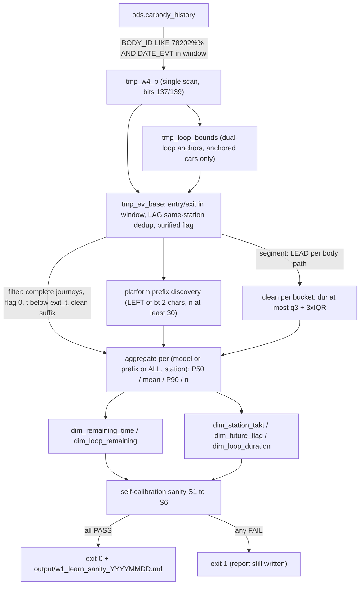
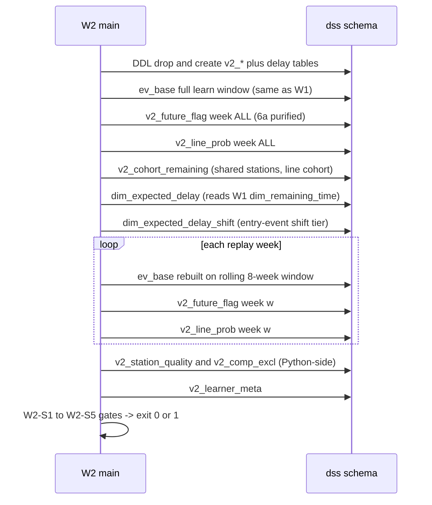

# 学习器管线（W1/W2/W4 重学）

This page documents the offline re-learning flow that rebuilds the `dss` learning
tables: the W1 takt learner (`spike_w1/01_learn_takt.py`), the W2 v2 learner
(`spike_w2/01_learn_v2.py`), and the W4 net-delay tables both learners participate in.
It is descriptive of pipeline and SQL semantics only: wiki generation does not execute
the learners or connect to any database. Downstream consumption of the artifacts is
covered by [Replay Acceptance](replay-acceptance.md), the table inventory and
three-tier row convention by [Data Model](../architecture/data-model.md), flag-bit
caliber by [Flag and Loops](../concepts/flag-and-loops.md), and the learner test
contracts by [Testing Strategy](../testing/testing-strategy.md).

## Causal window split (因果切分)

The learning window is split causally from the replay window:

- Default **learn window `2026-04-14` → `2026-08-15`** (`--win-start` / `--win-end` in
  `01_learn_takt.py`, `--learn-start` / `--learn-end` in `01_learn_v2.py`); the end day
  is padded to `23:59:59`. The M5 acceptance runbook freezes this exact window as the
  production default (docs/09 M5 手册).
- **Replay uses only subsequent windows** (`因果切分：回放只用后续窗口`, module
  docstring): the W1 replay script defaults to the learn window ending `2026-08-15` and
  a replay window to `2026-09-18` (`02_replay_eta.py`); the W2 learner defaults the
  replay window to `2026-08-16` → `2026-09-19` (`01_learn_v2.py`), which is what the
  per-replay-week tables are learned for. No learner may learn from, or a replay gate
  may evaluate on, events outside its own window.
- Inside the learn window the population is **self-contained complete journeys**: a car
  counts only if both its first entry and first exit events fall inside the window
  (`x.exit_t > e.entry_t` in `tmp_ev_base`); in-progress cars truncated by the window
  boundary are excluded from the sample.

## Shared event foundation: `sqlbase.ev_base_sql`

Both learners build the same session TEMP tables through one multi-statement execute of
`spike_w1/sqlbase.py::ev_base_sql(win_start, win_end)`, which is the single shared
extraction caliber (DRY) of learners and replays. Because the TEMP tables are
session-scoped, **all learning queries must run on the same connection** that built
them:

- `tmp_w4_p` — internal intermediate: one scan of `ods.carbody_history` for product
  cars `BODY_ID LIKE '78202%%'` inside the window, extracting bit 137 (`flag_137`) and
  bit 139 (`raw_flag`); indexed on `(body, t)` and `station`.
- `tmp_loop_bounds` — dual-loop boundary companion table (docs/15 §0.1): `t_rw_start`
  = first `139=1`; `t_bt_start` = first `137=1 AND 139=2` at or after the first oven-out
  (`first_oven` over `16IS305/17IS305/18IS345`, hard oven constraint; the 3-station
  erratum set, not including `20IS010`); `t_rw_end`/`t_bt_end` = first pass of the
  three-line gateway group `25IS010/25IS110/25IS210` after tagging, `NULL` when no
  gateway was passed (bypass / in-progress cars); the C5 dual-window truncation caps the
  rework window at `t_bt_start` for cars where the blacktop loop started first; only
  anchored cars (at least one start non-NULL) enter the table.
- `tmp_ev_base` — the contract main table: product cars → window-internal entry/exit
  first-occurrence span → in-span events → consecutive same-station dedup (keep first,
  `LAG`-based, unchanged) → **purified flag** in `{'0','1','2'}`: inside the pure
  rework window `[t_rw_start, t_rw_end]` → `'1'` (priority); inside the pure blacktop
  window `[t_bt_start, t_bt_end]` → `'2'`; everything else (post-gateway,
  pre-oven false signals, `'-'`, `'3'`) → `'0'`. `last_loop_t` keeps the byte-identical
  expression `max(t) FILTER (flag IN ('1','2')) OVER (PARTITION BY body)`, so the
  clean-suffix exclusion semantics of all W1/W2 consumers is preserved.

## W1 five-step pipeline

The W1 learner realizes the five-step mechanism
**过滤 → 分段 → 清洗 → 聚合 → 自校准** (README 目录; docs/01 阶段计划) as SQL over the
`tmp_ev_base` foundation:


*Caption: W1 learner control flow — filter (product cars + complete journeys) → segment (entry/exit trip caliber) → clean (per-bucket Q3+3×IQR + loop-event exclusion) → aggregate (three-tier P50/mean/P90/n) → self-calibration (S1–S6 gate).*

`main()` executes, in order:

1. **DDL** — `CREATE SCHEMA IF NOT EXISTS dss` then `DROP TABLE IF EXISTS` +
   `CREATE TABLE` for all six tables. Rebuild semantics: every run is a **full
   rebuild** of the six W1 tables; there is no incremental merge.
2. **Filter** — `sqlbase.ev_base_sql` (above), then a `count(*)` diagnostic on
   `tmp_ev_base`.
3. **Prefix discovery** — `SQL_PLATFORM_PREFIXES` (below) → `prefixes` tuple.
4. **Aggregate** — four multi-statement INSERTs: `dim_remaining_time`,
   `dim_loop_remaining`, `dim_station_takt` (three tiers), `dim_future_flag`.
5. **`dim_loop_duration`** — separate INSERT (different per-vehicle source).
6. **Meta** — counts over `tmp_ev_base` (vehicles, events, flag0/1/2, clean-suffix
   count and `clean_suffix_rate`), dedup-removed count vs. the raw product stream
   (`SQL_DEDUP_REMOVED`), takt IQR exclusion stats (`SQL_TAKT_EXCL`), W4 anchor counts
   (`SQL_W4_ANCHOR_COUNTS`), blacktop anchor rate (`SQL_BT_ANCHOR_RATE`), merged with
   `w4_meta_rows` into `dss.dim_learner_meta`.
7. **Self-calibration** — `sanity_checks` + `write_sanity_report` (Markdown to
   `output/w1_learn_sanity_<YYYYMMDD>.md`), then `return 0 if all(ok) else 1`.

### Three-tier rows and runtime prefix list

Every W1 distribution table carries three tiers of rows: full **body type** (车型),
**platform prefix** `LEFT(bt, 2)` (平台前缀), and `'ALL'`. The prefix list is
**discovered at runtime, never hardcoded** (C10, W4.0b caliber): `SQL_PLATFORM_PREFIXES`
selects distinct `LEFT(bt, 2)` with `count(DISTINCT body) >= 30` inside the learn
window; `prefix_in_list` builds the SQL `IN` list and rejects any token not matching
`^[A-Z0-9]{2}$` (data-derived whitelist, injection guard), raising `ValueError`. When no
prefix qualifies the list is empty and only model + `'ALL'` rows are written (the
pre-W4.2 row shape).

### Cleaning and aggregation semantics

- **Segment** (`dim_station_takt`): segment duration is `LEAD(t) - t` over the per-body
  path (`WINDOW w AS (PARTITION BY body ORDER BY t, id)`).
- **Clean** (`dim_station_takt`): per bucket (`frm, to_st` per tier) compute
  `q1`/`q3` and keep only `dur <= q3 + 3.0 * (q3 - q1)`. Each of the three tiers cleans
  **independently** (its own per-bucket IQR fence); the overall exclusion rate is
  recorded in meta as `takt_iqr_excl_rate`. Night-stop (夜停) cross-window gaps have no
  explicit time-band removal — they are absorbed by the in-bucket IQR outlier
  exclusion (docs/01 阶段计划; W1 plan 3c).
- **Aggregate**: each tier emits `round(percentile_cont(0.5))` (P50), `round(avg)`,
  `round(percentile_cont(0.9))` (P90) and `count(*)` per key — `n` always last.
- `dim_remaining_time`: main distribution on the **clean suffix** population
  (`flag = '0' AND t < exit_t AND (last_loop_t IS NULL OR t > last_loop_t)`), value =
  remaining seconds `exit_t - t`.
- `dim_loop_remaining`: loop distribution on `flag IN ('1','2') AND t < exit_t`.
- `dim_future_flag`: pre-decision probabilities `p1`/`p2` = share of clean-suffix
  (`flag = '0' AND t < exit_t`) events for which the body's first flag=1 (`f1`) /
  first flag=2 (`f2`) time lies strictly after the event. The join to per-body
  first-flag times is materialized **once** in the `j` CTE and each tier only
  aggregates: an earlier per-branch join was chosen as a Nested Loop by the planner
  (outer `ff` × materialized `tmp_ev_base`, ~3.68M rows re-scanned) and timed out
  (>600 s), while the single-branch form took ~6 s (hash join) — W4.2b 实测坑, 2026-10-05.
- `dim_loop_duration` (new contract, docs/15 §0.4): per-vehicle loop length `L` comes
  from `tmp_loop_bounds` — pure window duration `t_rw_end - t_rw_start` (flag `'1'`) /
  `t_bt_end - t_bt_start` (flag `'2'`); a `NULL` end falls back to the car's `exit_t`
  (D4 no-gateway in-progress cars), which is JOINed from `tmp_ev_base` because the
  bounds table has no exit column. `l` = P50 (compatibility name): consumers read
  `row[0]=l` / `row[-1]=n` unchanged, so the row shape extended from 2 to 4 statistics
  (`l, l_mean, l_p90, n`) without consumer changes. Cars with neither end nor `exit_t`
  are excluded naturally (`l` NULL).

### Sanity gates S1–S6 (W1)

`sanity_checks` returns `[(name, ok, detail)]` for S1–S6; the learner exits 0 only if
all pass, and always writes the sanity report first. Gate summary (current, W4.2d-
calibrated — history below):

- **S1** entry-station P50 (ALL row): `01IS205` / `1L360RB` judged on absolute range
  8–30 h, `rem P50 <= journey P50` (direction check) and deviation <=
  `max(10%, 1.5× W1 closeout measured deviation)`, with same-window journey n >= 50;
  `01IS045` is report-only (small-sample substitute entry station).
- **S2a** first flag=1 concentration in the rework cluster (`15IS065/13IS065/14IS065`)
  >= 80%.
- **S2b** blacktop **anchor placement rate** >= 90%: share of `t_bt_start` event
  stations inside the 10-station whitelist (post-oven report-entry cluster + polishing
  line; identical to the online `BLACKTOP_ONLINE_WHITELIST`, W4.3a single source).
- **S2c** p1 profile along journey position (n >= 1000 stations): max >= 0.03 and
  min <= 0.01, with >= 5 such stations (step shape exists and tail ~0).
- **S3** `dim_loop_duration` ALL-row sample sufficiency: flag1 n >= 8,500, flag2
  n >= 4,000.
- **S4** loop-event volume measured on the true population directly from `tmp_ev_base`:
  flag1 events >= 180,000, flag2 >= 80,000.
- **S5** takt IQR exclusion rate `takt_iqr_excl_rate` <= 0.30 (else alert).
- **S6** clean-suffix rate >= 0.80; under W4 purification both `flag` and
  `last_loop_t` are purified values, so the ratio is the share of purified flag='0'
  events with `t > last_loop_t` (D7, formula unchanged, semantics updated).

## W2 v2 learner and W4 net-delay tables

The W2 learner writes the six `dss.v2_*` tables plus the two W4 net-delay tables
(`dss.dim_expected_delay`, `dss.dim_expected_delay_shift`); **the six W1 `dss.dim_*`
tables (including meta) are read-only inputs** (regression guardrail, module
docstring). W1 must therefore be re-learned first with the same learn window, because
the net-delay baseline reads `dss.dim_remaining_time`.


*Caption: W2 v2 run sequence — full-window artifacts (including both W4 net-delay
tables) first, then the rolling 8-week per-replay-week loop, quality marks, meta and
sanity gates.*

`main()` order: DDL → full-window `ev_base` → `SQL_FUTURE_FLAG` + `SQL_LINE_PROB`
(week `'ALL'`) → `SQL_COHORT_REM` → `SQL_EXPECTED_DELAY` → `SQL_EXPECTED_DELAY_SHIFT`
→ per-replay-week loop (`ev_base` rebuilt per week, then weekly `v2_future_flag` and
`v2_line_prob`) → `build_quality` → meta → `sanity_checks` → report
(`output/w2_learn_sanity_<YYYYMMDD>.md`) → `return 0 if all ok else 1`. All sanity
gates W2-S1–S5 must pass for exit 0 (otherwise exit 1).

### Weekly p, cohort and line probability

- `v2_future_flag` (⑥a purified population): events must be `flag = '0'`,
  `t < exit_t`, **and before the body's first flag=1 and first flag=2** — this
  excludes "loop-then-back-to-mainline" cars (flag reset to 0) and inter-loop events
  of multi-loop cars, so p = P(future loop entry | currently pre-loop, flag=0). The
  full window produces `week='ALL'` rows; for each **replay week** (ISO weeks covered
  by `--replay-start/--replay-end`), the learner rebuilds `ev_base` on that week's
  **rolling 8-week window** — `shifts.week_learning_range` returns the 8 ISO weeks
  *before* the week, `[Monday - 8w, Monday - 1d]`, so there is no future leak — and
  learns weekly p and line probability.
- `v2_cohort_remaining`: remaining-time distributions for the 08IS/09IS parallel lines,
  per model × shared station (stations not starting `08IS`/`09IS`) × the line a car
  later took (`c08 XOR c09` single-line cars, cohort = '08'/'09'). The cohort must be
  computed on `tmp_ev_base` (not the raw stream): post-exit record stations
  `09IS360/09IS350` would pollute the `LIKE '09IS%%'` match.
- `v2_line_prob`: per model × week, `w08` = share of cars that took the 08IS line
  (XOR cohort only), weekly rows plus `week='ALL'`; the `ALL` row is the cohort
  fallback-chain endpoint.
- `v2_station_quality` / `v2_comp_excl` (⑤⑥): derived in Python by reading the W1
  `dim_remaining_time` model rows (`body_type <> 'ALL' AND length > 2` — 2-char prefix
  rows are excluded from marking) and `v2_future_flag` week='ALL' p1 (missing model
  row falls back to the station ALL row). Mark = `low_n` (model row n < 30), `mixed`
  (p1 >= 0.5), `both`, else `ok`; `v2_comp_excl` = exactly the `both` cells (⑥b: mixed
  low-n stations are exempt from pre-decision compensation). Cells with no model row
  (rare model × station) are left unmarked, defaulting to `ok` in the engine.

### W4 net-delay tables (双人群双门槛)

`dim_expected_delay` (W4.2c, doc10 §2 v2.2.1) and its shift-tier variant
`dim_expected_delay_shift` (W4.4h) share one discipline:

- **Population**: the ⑥a pre-loop events (flag=0, `t < exit_t`, before the body's
  first flag=1/2 — the same population and window as `v2_future_flag` week='ALL';
  "diff 与 P(fut) 同窗"). The clean-suffix population must *not* be used here: it is
  structurally disjoint from `fut = 1` (measured: `fut = 1` would be identically 0).
  `fut = 1` = the body's first flag=1 lies after this event (will re-enter rework);
  the `fut = 0` sub-population (`f1 IS NULL`) is the never-rework "clean" group.
- **Baseline**: per event, the engine hierarchy `车型 → 前缀 → ALL` over
  `dss.dim_remaining_time` — the first row with `n >= 30` (`COALESCE(rm.p50, rp.p50,
  ra.p50)`, three LEFT JOINs gated on `n >= 30`, same gate as the engine fallback).
  This is why W1 must be re-learned first with the same window.
- **P(fut)**: `v2_future_flag` week='ALL' p1 (model row, falling back to the station
  ALL row); the rolling 8-week values are forbidden here (seasonal double-peak).
- **Dual population dual gate**: a row is written only if **both** `sample_n` (fut=1)
  and `sample_n_clean` (fut=0) are >= 30; otherwise the row is absent and the engine
  degrades 车型→前缀→ALL→0 (C14).
- **Formulas**: `delay_mean_s = max(0, round(P(fut) × mean(rem − base | fut=1) +
  (mean(rem_clean) − p50(rem_clean))))`; `delay_p50_s = max(0, round(P(fut) ×
  p50(rem − base | fut=1)))`. The `max(0,·)` truncation applies to the final value
  only (internal samples may be negative; per-sample truncation adds 1.6–2.9 h
  positive bias, doc10). The right-tail correction term
  `mean(rem_clean) − p50(rem_clean)` enters only `delay_mean_s`, never the p50 column.
- **Tiers**: model + all `LEFT(bt, 2)` prefixes (no platform whitelist, unlike the W1
  five tables — small prefixes are naturally eliminated by the dual gate) + `'ALL'`.
- **Shift tier (W4.4h)**: identical discipline plus a `shift` dimension; sample
  attribution is the **entry-event shift** — entry minutes-of-day in `[285, 989]`
  (04:45–16:30) → `'DAY'`, else `'MID'` (`[16:30, 04:45)`, low-activity tail gap
  folded into MID) — the same attribution windows as `spike_w2/shifts.py`. P(fut)
  reuses the non-shift-conditioned `v2_future_flag` (probabilities are not
  shift-conditioned; W4.4h splits only the delay distribution). The table is optional:
  absent rows/table make the engine resolver fall back to the shared row.
- **Coverage-gap monitor**: `coverage_gaps(p1_cells, delay_rows, p1_threshold=0.10)`
  reports cells with p1 >= 0.10 where none of 车型/前缀/ALL has a delay row — the
  engine falls back to 0 there (pure under-estimation risk), which doc10 §2.3 requires
  to be monitored. The learner report lists the top-30 gaps sorted by p1 descending.

## Sanity threshold history (变更历史)

- **W2-S2, 1000 → 300** (2026-09-21 W2 关账): the W2-S2 check for the decision cluster
  `15IS065` (ALL) required weekly `n >= 1000`; the measured 8-week rolling window
  yields n = 343–810, so the threshold was lowered to **n >= 300** (with p1 in
  `[0.03, 0.98]` per replay week). Source: `CHANGELOG.md` 2026-09-21 entry (学习器自校验
  修正); the fix was recorded in the W2 plan notes (2026-09-19-w2-shift-level-replay,
  执行修订 ①) and is pinned by `tests/test_w4_learn_v2.py` source-level assertions and
  the current code.
- **W4.2d recalibration** (docs/15-W4双环重构步级开发计划.md, W4.2d 自检更新, L212):
  under the purified event base, sample sizes structurally dropped, so the old
  thresholds (calibrated on the legacy suffix method: S3 flag1 >= 9000 / flag2 >= 7000
  from 13,010/9,711; S4 flag1 >= 250,000 / flag2 >= 100,000) would misfire. The
  transition baselines are **new measured values × 92% margin**: S3 flag1 >= 8,500 ∧
  flag2 >= 4,000 (measured 9,351 / 4,356 cars); S4 flag1 >= 180,000 ∧ flag2 >= 80,000
  (measured 192,197 / 86,210 events). S2b was **replaced**, not recalibrated: the old
  "first flag=2 concentrated in the 2-station `BLACKTOP_CLUSTER` >= 60%" rule must
  fail under purification (the `14IS260` false blacktop is purified to '0'), so the
  new S2b is the anchor placement rate >= 90% on the 10-station whitelist, with no
  code residue of the old rule (agy 建议项 3). S4's metric source also changed to the
  true population measured directly from `tmp_ev_base` — `SUM(n)` over the three-tier
  table rows double-counts (~2×). S5 (IQR) is unchanged (population unchanged); S6's
  threshold 0.80 is kept, semantics updated to the purified flag.
- **W1 S1 calibration** (W4.2e, per the in-code comment citing `output/w1-验证摘要.md`
  L38): `01IS045` became report-only (small-sample substitute entry station; the old
  n >= 50 gate could not exclude it and S1 had FAILed since the W1 closeout), and the
  consistency band became `max(10%, 1.5 × W1 closeout measured deviation)` (01IS205
  11.6% / 1L360RB 30.9%) as a regression gate — the clean-suffix population is
  structurally lower than the full journey population, so the original 10% threshold
  was unreachable by design.

## Running the learners (operations)

- **Commands** (M5 handbook runbook; Windows discipline from `AGENTS.md` Windows 运行坑):

  ```bat
  conda run --no-capture-output -n paint-dss python spike_w1\01_learn_takt.py
  conda run --no-capture-output -n paint-dss python spike_w2\01_learn_v2.py
  ```

  DB-connected scripts are always launched this way, independent of shell activation:
  directly invoking the env interpreter was observed to crash at `psycopg2.connect`
  with an access violation (exit `-1073741819` = `0xC0000005`, non-deterministic,
  DLL/PATH dependent). `python -c` under `conda run` is **single-line only** (no
  embedded newlines); multi-line code goes in a script file.
- **Rebuild semantics**: learner DDL is `DROP TABLE IF EXISTS` + `CREATE TABLE` per
  table (full rebuild each run, inside the `dss`-only write boundary — the read-only
  principle forbids touching `ods`/`dim`/`fct`/`mart`/`meta` layers; `dss` may be
  dropped and recreated).
- **Connection**: `spike_w1/common.py::connect()` — `psycopg2`, `autocommit = True`,
  session `SET TIME ZONE 'Asia/Shanghai'` (factory time = UTC+8, mandatory), DSN
  resolved fresh per call with `DSS_DB_HOST/PORT/NAME/USER/PASSWORD` env overrides
  (defaults: dev DB `127.0.0.1/root/root`, `.env` loaded via `python-dotenv`). The
  W2 module reuses this W1 connection helper.
- **Exit-code convention**: the **learners exit `1`** when any sanity gate fails (exit
  0 = all gates PASS; the sanity report is written in both cases). The **`exit 2`
  convention belongs to the replay gate scripts** (`02_*`, e.g. `02_replay_shift.py`
  D1' 门判: exit 0 过 / exit 2 未过). When a script exits non-zero, `conda run` prints
  an `ERROR conda.cli... failed` line — that line is the reporting convention, not a
  run failure; judge by the produced artifact (report files in `output/`).
- **Production sequence**: in the M5 production rebuild, the two learners run
  back-to-back (W1 then W2) to create the 14 learning tables (6 W1 + 6 W2 +
  `dim_expected_delay` + optional `dim_expected_delay_shift`), which the online boot
  (`spike_w3/01_boot_online.py`) loads as read-only inputs.

## Focused tests (no-DB contract tests)

`tests/test_w4_learn_takt.py` and `tests/test_w4_learn_v2.py` are **pure contract
tests** (no DB; real-DB re-learning verification is the separate W4.2e step). They
load the learners via `importlib.import_module("spike_w1.01_learn_takt")` /
`importlib.import_module("spike_w2.01_learn_v2")` (dotted names are legal there, unlike
the hyphen-sensitive `spec_from_file_location` pattern used elsewhere — see
[Testing Strategy](../testing/testing-strategy.md)) and pin:

- **W1** (`test_w4_learn_takt.py`): the `dim_loop_duration` DDL 6-column shape;
  `loop_duration_sql` using `tmp_loop_bounds` (not the legacy `max(t) - min(t)`
  suffix method), the `exit_t` JOIN fallback per `t_rw_end`/`t_bt_end`, the four
  statistics, prefix rows (empty list → no prefix block), `prefix_in_list` builder and
  `ValueError` rejection (`"2N5"`, `"2n"`, `"2N--"`, `"O'Brien"`), `SQL_PLATFORM_PREFIXES`
  (`LEFT(bt, 2)`, `count(DISTINCT body)`, `>= 30`), the three-tier prefix pattern in
  the other four table SQLs with per-tier IQR fences (`q.q3 + 3.0 * (q3 - q1)` at least
  three times in `takt_sql`), the `future_flag_sql` single-join refactor (exactly one
  `JOIN ff f ON f.body = e.body`), sanity source contracts (`SQL_BT_ANCHOR_RATE` +
  `>= 0.90` and no `SQL_FIRST_FLAG2`/`in2 / tot2` residue; S3/S4 recalibrated
  thresholds present and old ones absent; `SQL_LOOP_EV_COUNTS` replacing
  `SUM(n) FROM dss.dim_loop_remaining`; S1 `s1_report_only`/`s1_base_dev` and
  `p50 <= j`; S6 净化 semantics + `>= 0.80`), the `w4_meta_rows` pure function, and a
  FakeCursor check that `02_replay_shift.load_tables` reads the 4-tuple loop-duration
  row shape.
- **W2/W4** (`test_w4_learn_v2.py`): the `dim_expected_delay` DDL (6 columns, PK,
  `DROP TABLE IF EXISTS` in DDL); the `SQL_EXPECTED_DELAY` contract — exactly three
  `LEFT JOIN dss.dim_remaining_time` with `n >= 30` gates, P(fut) from
  `v2_future_flag WHERE week = 'ALL'`, `last_loop_t` absent (clean-suffix population
  forbidden), the dual gate `a.n_fut >= 30 AND a.n_clean >= 30`, exactly two
  `GREATEST(0,` (outer truncation only), the correction term exactly once and
  `a.p50_diff` once; the `coverage_gaps` pure function (prefix-tier fallback,
  p1 threshold, descending sort, empty inputs); and a source-order assertion that
  `SQL_EXPECTED_DELAY` executes after the full-window `ev_base` and before the week
  loop.

Only `tests/test_db_smoke.py` and `tests/test_w1_dsn_env.py` touch a live database
(read-only smoke, auto-skipped when unreachable; DSN override contract).

## Where this fits

- Table inventory, row shapes and consumption resolvers: [Data Model](../architecture/data-model.md)
- MDS_DATA flag bits, physical anchors and purification caliber: [Flag and Loops](../concepts/flag-and-loops.md)
- Replay gates that consume the artifacts (causal replay windows, exit 0/2): [Replay Acceptance](replay-acceptance.md)
- Test suite discipline and the Windows run conventions: [Testing Strategy](../testing/testing-strategy.md)
