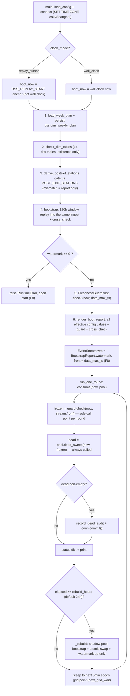
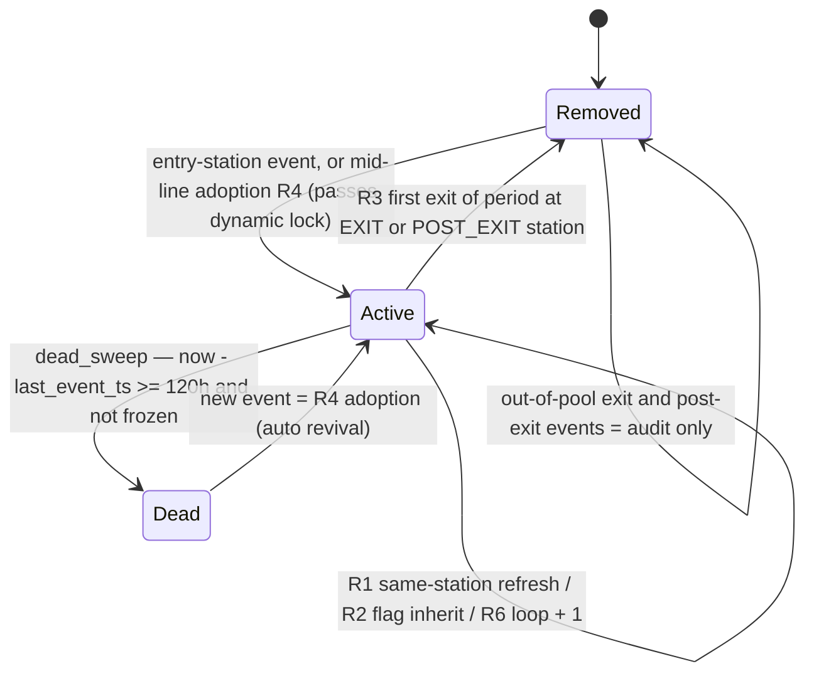
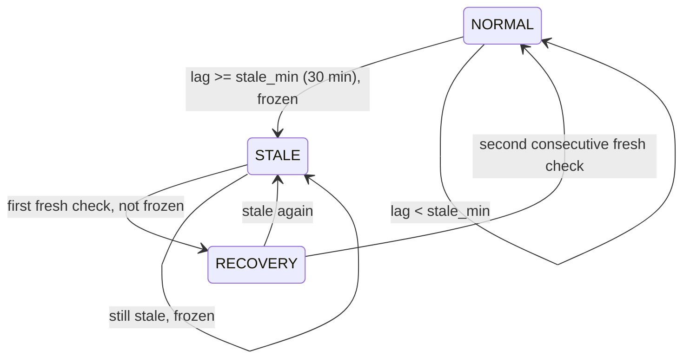

# Online Engine Main Loop: Pool State Machine + Freshness Guard + Dead Cars

The W3 online engine is the always-on half of the paint-shop DSS. It keeps an in-memory
work-in-process (WIP) pool of bodies (~1,000 cars) current against the
`ods.carbody_history` event stream, guards data freshness, retires dead bodies, and
reports its state every 5 minutes. Two modules carry it:

- `spike_w3/01_boot_online.py` — boot orchestration (`boot_sequence`, `main`) and the
  main-loop drivers (`run_one_round`, `run_replay`, `run_wall_clock`, `_rebuild`).
- `spike_w3/stream_pipeline.py` — the state and stream owners: `VehiclePool` (state
  machine R1–R7), `EventStream` (watermark + skew consumption), `FreshnessGuard`
  (B3 freshness guard), `bootstrap` / `cross_check` (B4), and the dead-car audit
  helpers.
- `spike_w3/common.py` — `DSSConfig` (all `DSS_*` environment variables) plus
  re-exports: `connect` (single DSN + `SET TIME ZONE 'Asia/Shanghai'`, re-exported
  from `spike_w1/common.py`), `ENTRY_STATIONS` / `EXIT_STATIONS`, and the W3-only
  `POST_EXIT_STATIONS` (5 stations: `09IS360`, `09IS350`, `K3IS230`, `K2IS165`,
  `K1IS225`).

Clock decoupling: `DSS_CLOCK_MODE=wall_clock` (production, `now` = wall clock) versus
`replay_cursor` (test/dry-run harness, `now` = cursor time). Both modes drive the
**same round function** `run_one_round`, so the replay harness is the regression
surface for the production loop. Downstream consumption of the pool (rolling ETA
prediction and red/yellow/green alerts) is covered by [Prediction and Alert](prediction-and-alert.md);
flag-bit caliber that the state machine ingests is documented in [Flag and Loops](../concepts/flag-and-loops.md).

## Frozen contracts (red lines)

> **Frozen contract — changes require syncing the docs/03 §0 interface contract.**
>
> - **`run_one_round` fixed order**: `consume → guard.check (the sole call point per
>   round) → dead_sweep (always called) → audit + commit when dead is non-empty →
>   status dict`. Callers must never conditionally skip a step — the frozen semantics
>   are absorbed *inside* `dead_sweep` (`frozen` argument), not by caller-side
>   skipping (docs/03 §7 Step 1).
> - **Pool state-machine rules R1–R7** (below) are frozen semantics; each rule has a
>   pinning test in `tests/test_w3_pool_state.py`.
> - **Single state machine (B4)**: online consumption and bootstrap replay feed the
>   **same** `VehiclePool.ingest`. No second ingest path may exist.
> - **R7 timezone hard constraint**: every `datetime` is aware on the
>   **Asia/Shanghai baseline** (`connect` runs `SET TIME ZONE 'Asia/Shanghai'`; the DB
>   returns `+08:00` aware). A naive `ts` raises `TypeError` at every pool/loop entry
>   point — machine-enforced, not documented-only.
> - **02/03 zero-change red line**: the frozen replayers `spike_w3/02_shadow_replay.py`
>   and `spike_w3/03_alert_backtest.py` load `01_boot_online` dynamically and call its
>   `load_rest_days` shim; the shim **must not be removed** even after T1 wiring
>   (agy M3; caller at `02_shadow_replay.py` L404–L409).

## Entry point and boot sequence

`main()` loads `DSSConfig`, opens the single connection, then runs the boot sequence.
In `replay_cursor` mode it additionally requires `DSS_REPLAY_START` / `DSS_REPLAY_END`
(ISO timestamps) and **anchors the bootstrap to the replay start** (`boot_now =
replay_start`, agy T2.6 中①): anchoring to the wall clock would pin the watermark at
the current table max ID and make the whole replay consume nothing.

The boot sequence order is finalized (docs/03 T2.4 Step 5) and implemented by
`boot_sequence`:

1. **Read the week plan** (`load_week_plan`, T1-lite `plan_loader`; single-file mode
   via `DSS_PLAN_CSV` or directory scan of `plan_folder`). Missing/failed/conflicting
   files → fallback self-learning mode (班制推断、无目标), noted in the report.
   `ensure_weekly_plan_tables` DDL runs first, and `persist_plan` writes
   `dss.dim_weekly_plan`; a persist failure is reported (old data kept), not fatal.
2. **`dss` learning-table existence check** (`check_dim_tables`, read-only
   `information_schema`): 14 entries in `DSS_DIM_TABLES` — the 13 `dss` learning
   tables (W1 six `dim_*`, W2-v2 six `v2_*`, W4.2c `dim_expected_delay`) plus
   `dim_weekly_plan`. Existence only; content is used by T3, not loaded at boot.
3. **Post-exit station derive gate** (`derive_postexit_stations`): the 5-station
   `POST_EXIT_STATIONS` constant is re-derived from data (product-car events at a
   station where ≥95% of events have a prior exit-station event, ≥30 samples). A
   mismatch **only goes into the boot report + warning — the constant is never
   auto-changed** (human decision).
4. **Bootstrap** (120h window `= now − bootstrap_hours`, default 120h): the same
   `ingest` replays the window, then `cross_check` runs (see below).
5. **F8 gate**: if `BootstrapReport.watermark == 0` (no data in the window) the boot
   raises `RuntimeError` and aborts — the incremental stream must never start from 0.
6. **FreshnessGuard first check** (`guard.check(now, data_max_ts,
   expected_silence)`): if the data is already stale at boot, the report declares
   「数据陈旧」/「无数据属预期」 immediately instead of pretending freshness.
7. **Boot report**: `render_boot_report` renders the `BootReport` including the
   `cross_check` result and the **full effective configuration echo**.

`main()` then constructs `EventStream(conn, wm=BootstrapReport.watermark,
skew_window_min=cfg.skew_window_min)` and sets `stream.front =
BootstrapReport.data_max_ts` — the incremental stream starts exactly where the replay
window ended (F8: `watermark` = max row ID of the replay window; `meta.refresh_watermark`
is the ETL-layer watermark and is **never** used as the DSS start watermark, only for
B3 S2 diagnosis). An optional T6 console/snapshot hook (`round_hook`) is wired from
`cfg.console`; assembly failure prints a warning but never blocks the main loop.



_W3 boot sequence and the 5-minute main-loop round (consume → guard → dead_sweep →
periodic rebuild), both clock modes._

## Main-loop round (`run_one_round`)

`run_one_round(pool, stream, guard, conn, now, expected_silence=False)` is the single
round logic shared by `run_wall_clock` and `run_replay`:

1. `stream.consume(now, pool)` — incremental pull and dispatch (below).
2. `frozen = guard.check(now, stream.front, expected_silence=expected_silence)` — the
   **only** `guard.check` call per round; `stream.front` (the max processed event ts)
   is the freshness probe value.
3. `dead = pool.dead_sweep(now, frozen=frozen)` — **always called**; the freeze
   semantics are handled inside the sweep (no caller-side conditional skip).
4. If `dead` is non-empty: `record_dead_audit(conn, dead, now)` + `conn.commit()`.
5. Return the status dict `{now, pool_size, max_ts, guard_state, guard_label,
   frozen, dead_count}`, printed as one status line per round.

The drivers:

- `run_wall_clock` (production): infinite loop, `now = datetime.now().astimezone()`
  (aware, R7); every round checks whether `now − last_rebuild >= rebuild_hours`
  (default 24h) and calls `_rebuild` before the round; then sleeps with
  `next_grid_wait` — a pure function that waits to the **next epoch grid point**
  (`int(ts) // poll_sec + 1) * poll_sec`, lower bound 1.0s to prevent busy-spin) so
  frame timestamps land on the 5-minute grid (`:00/:05/…/:55`, matching UTC+8 minute
  boundaries) with drift compensation (M5 anchor-frame preparation, agy 阻断 F2).
- `run_replay` (dry run / regression): cursor stepping `start → end` with step
  `step_sec` (default `poll_interval_sec`), `now` = cursor moment (aware); same
  per-round rebuild check (anchored at the replay start), plus a **final rebuild at
  the end point** so the replay terminal state equals the pure-bootstrap truth
  (acceptance anchor). It accepts `expected_silence_fn` (rest-day set from the week
  plan) and returns the full status-line list.

## VehiclePool state machine (R1–R7 + O1/O2 + loop_exited)

`VehiclePool` is `dict[BODY_ID → VehicleState]` — in-memory, **no local state file**
(all state is reconstructed purely from the event stream, B4 point ③). It holds:
`audit` (four keys: `exits` / `same_station_dups` / `invalid_flags` /
`late_out_of_window` — per-car counters plus a global int; audit counts never mutate
pool state), `_visited` (per-car visited-station set, R6 helper),
`_station_last_event_ts` (station-level last-event ts), and `_seen_row_ids` (per-car
recent row_id sets, bounded at 256, for `replay_car` dedup). Pool invariants: every
car in `snapshot()` has a `last_event_ts`; exited cars are always removed; dead-sweep
removals clear `_vehicles` + `_visited` as a pair.

The rules are frozen (each is a named rule with pinning tests in
`tests/test_w3_pool_state.py`):

| Rule | Semantics |
|---|---|
| **R1** | Entry (any of the 3 `ENTRY_STATIONS`) = enter pool / update position. Consecutive same-station events = **idempotent update** (`last_event_ts` refreshed + `same_station_dups` audit count only, `loop_count` unchanged). Events are **never dropped by time window** — real adjacent fast passes (~18.2%) must be kept. |
| **R2** | Invalid flag `{'-', '3'}` → inherit the last valid flag; **must not reset to 0**. Valid flags = `{'0','1','2'}`; invalid events count into `invalid_flags` audit. |
| **R3** | First exit of the period (any of the 4 `EXIT_STATIONS`) = pool removal + `exits` audit +1. Re-entry at an entry station = **new period** (flag = that event's valid value, `entry_ts` reset, `loop_count` = 0, `loop_exited` = False). Exits from a car no longer in the pool (exits_seen ≥ 2) are audit-only. |
| **R4** | Mid-line adoption: an out-of-pool car with a non-entry, non-exit station event enters the pool immediately (position = that station, `entry_ts` = that event ts). **Double ghost-car insurance** (2026-09-24 incident): ① *dynamic history lock* — a car with `exits_seen > 0` is absolutely barred from R4 adoption at non-entry stations (re-entry to the line head must pass an entry station); ② *static set* — `POST_EXIT_STATIONS` events for an out-of-pool car are audit-only (silent, not counted as `exits`); for an in-pool car they trigger pool removal (silent, no `exits` count). |
| **R5** | `body_type` is taken **directly from the DB column `BODY_TYPE`** (same source as W1 `tmp_ev_base.bt`); **no prefix derivation**. NULL → empty string, never crashes. |
| **R6** | `loop_count`: non-consecutive re-pass of the same station +1 (consecutive same-station runs do not count — R1). |
| **R7** | **Timezone hard constraint**: `ingest` raises `TypeError` on a naive `ts` (naive/aware mixed comparison would blow up at runtime). The Asia/Shanghai baseline is machine-enforced, not a convention. |

W4.3c / W4.4c per-car trajectory fields (part of the frozen §0 contract):

- **O1 `passed_oven`**: set `True` monotonically when the car passes an oven-out
  station (`eta_v2.OVEN_OUT_STATIONS`, single source of truth); **never reset** (exit
  or dead removal deletes the whole `VehicleState`, which is the only "clear").
- **O2 `flag_137`**: the 137th bit follows the car = the **latest event's value**
  (`'-'`/NULL normalized to `'0'` by `_norm137`); it follows only that car's own
  trajectory (no cross-car contamination).
- **`loop_exited`** (W4.4c (α), Doc14 v1.4 R3' loop-exit guard): set `True` at the
  three 25IS gateway exits (`eta_v2.LOOP_EXIT_GATEWAYS`: `25IS010/110/210`); reset
  to `False` **only** on the new-period signal (re-passing an entry station).
  Mainline residual-bit events do **not** reset it (the bit never clearing is a data
  fact, see [Flag and Loops](../concepts/flag-and-loops.md)).

`last_event_by_station()` returns each station's most recent pass-event ts with
**station-level retention**: the ts survives the car leaving or the pool emptying
(every ingest event updates it, including audit-only exit events, `max` semantics).
This is the B7 line-stop dependency — station-level freshness must distinguish "just
left" from "silent for a long time", which per-pool-car scanning would lose.



_VehiclePool lifecycle across the R1–R7 state machine (active pool membership) and
the M7 dead-car sweep._

## EventStream: incremental consumption

`EventStream` owns the incremental pull. One query per round:

```sql
SELECT "ID", "BODY_ID", "BODY_TYPE", "RW_STATION_ID",
       SUBSTRING("MDS_DATA" FROM 139 FOR 1) AS flag,
       SUBSTRING("MDS_DATA" FROM 137 FOR 1) AS flag137, "DATE_EVT"
FROM ods.carbody_history
WHERE "ID" > :wm AND "DATE_EVT" <= :now
ORDER BY "ID"
```

- **ID watermark**: after dispatch, `watermark = max(row_id)`; `set_watermark` is
  **up-only** (F8: the incremental start point never regresses).
- **`:now` upper bound discipline** (audit B1): in `replay_cursor` mode events with
  `ts > now` are not pulled this round — the watermark must not advance past the
  cursor; those rows have `ID > wm` and are picked up naturally once the cursor
  reaches them. Without the bound, the first replay round would pull the whole table
  (~6.33M rows) and exhaust the watermark. In `wall_clock` mode data is always in the
  past, so the condition is a no-op.
- **`front`**: the max processed event ts (initial `None`; the main loop sets it to
  `BootstrapReport.data_max_ts`, then it advances per round).
- **Round-internal dispatch order = `(ts, ID)` ascending** after fetch (F-1②,
  2026-09-25): real data has ~52% ID/ts inversions; dispatching in ID order made
  those rows misfire the "in-window late" path after `front` advanced, causing ~136k
  per-car log subqueries (7-day replay ≈ 2016 rounds → ~200k subqueries ≈ 11h,
  infeasible). Timestamp-ordered dispatch makes `front` advance monotonically; the
  skew routing below remains as the safety net for genuine late arrivals.

The **skew three-way split** (M4, `skew_window_min` default 15):

1. `ts >= front` (in order) → normal `ingest`, `front` advanced, event returned.
2. `front − skew_window <= ts < front` (late but in window) → `_replay_late`:
   per-car log query (`WHERE "BODY_ID" = :b AND "DATE_EVT" BETWEEN :since AND :now
   ORDER BY "DATE_EVT","ID"`; `since = entry_ts` full-cycle for in-pool cars,
   `now − 24h` cap for out-of-pool cars) → `pool.replay_car` recompute.
3. `ts < front − skew_window` (older than the window) → `audit["late_out_of_window"]
   += 1`, pool state untouched (the daily reconcile is the backstop).

`replay_car` (the recompute merge rule, frozen): the slice is replayed through the
**same R1/R2/R6 state machine** from a fresh position; then `station / flag /
loop_count / last_event_ts` = recompute result, while **`entry_ts` / `exits_seen`
are untouched** (lifecycle counts come from in-order events only). If the latest
slice event is at an exit or post-exit station: in-pool cars are removed (invariant),
out-of-pool cars are **not** adopted (audit only). Out-of-pool + latest non-exit
non-post-exit (and passing the dynamic lock) → R4 adoption with `entry_ts` = first
log event ts (approximate). Per-car `_seen_row_ids` dedup makes the recompute
idempotent (same slice twice → no state change, no duplicate audit counts; the set
is bounded at 256 with collapse-to-latest). Station-level ts merge takes `max` over
the slice. O1/O2 merge: `flag_137` = latest slice event value; `passed_oven` =
trajectory OR (monotonic for in-pool cars).

Note: `_dispatch` is incremental-consumption-only. The bootstrap replay **does not**
go through it — it feeds pure `pool.ingest` in `(BODY_ID, ts, ID)` ascending order
(per-car independent state machine; a complete replay window has no "late" concept).

## FreshnessGuard (B3): three-state machine

`FreshnessGuard.check(now, max_event_ts, expected_silence)` is pure computation
(injected `now` / `max_event_ts`, fully offline-testable); it computes
`lag = now − max_event_ts` in minutes (`None` → infinite lag → STALE, conservative)
and advances the state machine with a two-fresh latch:

- `NORMAL → STALE` immediately when `lag >= stale_min` (default 30 min).
- `STALE → RECOVERY` on the first fresh check (transitional, **not** frozen).
- `RECOVERY → NORMAL` on the **second consecutive** fresh check (filters transient
  dips); `RECOVERY → STALE` if it goes stale again.
- Every transition is appended to `g.log` as `(time, "OLD->NEW")`.

**STALE freeze semantics (B3 final, DoD note): what is frozen = alerts + the
dead-car sweep; pool consumption and prediction computation are NOT frozen**
(consume/ETA keep advancing so post-line-stop data backflow cannot desync). The
freeze also prevents the whole pool from being collectively declared dead during a
stop. Only `STALE` returns `frozen=True`.

**`expected_silence` (rest-day downgrade, P2 clause)**: on rest days the state and
freeze are unchanged — the guard still goes `STALE` and still returns frozen — but
the label degrades to 「无数据属预期」 and `is_anomaly = False` (not counted as an
anomaly or in acceptance statistics). Labels: 「数据新鲜」 / 「数据陈旧」 /
「无数据属预期」 / 「恢复中」.

`diagnose(conn, now)` (read-only, the only DB-touching part) reads four signals:

- **S1** `meta.sync_job_log` last run of ETL job `refresh_carbody_ods` (status + lag).
- **S2** `meta.refresh_watermark` row `ods.carbody_history.max_id` vs full-table
  `MAX("ID")` (gap; this ETL-layer watermark is diagnostic only, never the DSS start
  watermark — F8).
- **S3** `MAX("DATE_EVT")` of `ods.carbody_history` (event-layer freshness).
- **S4** `MAX(vehicle_updated_at)` of `ods.rb_position_data` (independent snapshot).

Verdict (BM 断流判定口径): event fresh (S3 lag < `stale_min`) → 「新鲜」 (ETL
signals are diagnostic only and never override the event-layer fact); events stopped
+ ETL unhealthy → 「断流」 (link failure — freeze); events stopped + ETL healthy
(`etl_healthy` = S1 success and fresh < `lag_min` ∧ S2 gap = 0 ∧ S4 fresh <
`lag_min`) → 「移交模式A」 (a genuine line stop, not a pipeline problem — handed to
B7 station-level whitelist judgment).



_FreshnessGuard three-state machine with the two-fresh recovery latch; only STALE
freezes (alerts + dead sweep, never pool consumption)._

## Dead cars (M7)

`dead_sweep(now, frozen)` is a **pure method with the frozen signature (no `conn`)** —
the DB is not mixed into the pure state machine. Semantics:

- **Judgment basis**: no new event **since the last event** for ≥
  `dead_vehicle_hours` (default 120h, injected via the constructor
  `VehiclePool(dead_vehicle_hours=cfg.dead_vehicle_hours)`; tests compress it, e.g.
  1h, to verify the boundary — B4 point 7). It is *not* total journey time.
- Cars meeting the threshold are removed from the active pool and returned as
  `DeadCar(body_id, station, flag, since=last_event_ts, hours)`; downstream T3
  prediction reads only the active pool, so dead cars are naturally excluded from
  shift prediction.
- **`frozen=True` (B3 STALE) = no-op** (empty result, no sweep).
- **Auto revival**: a new event on a dead car re-enters the pool via R4 adoption
  (`entry_ts` = new event ts) — no extra code, pinned by test.
- **Cleanup discipline**: removal clears `_vehicles` + `_visited` (paired
  invariant); **`_seen_row_ids` is deliberately kept** — it is the lifecycle dedup
  set, and popping it would make later skew-late recomputes double-count
  dup/invalid audit on old row_ids (regression
  `test_dead_sweep_replay_no_audit_double_count`).
- Because the bootstrap window (120h) equals the dead threshold, dead-sweep
  naturally fires zero at startup; dead cars appear only in long online runs or
  after the cursor advances past 120h.

Audit persistence is in the orchestration layer: `record_dead_audit(conn, dead,
now)` returns 0 for an empty list; otherwise it runs `ensure_work_alert_log`
(`CREATE TABLE IF NOT EXISTS dss.work_alert_log`, lazy — built on first dead audit),
then one `INSERT INTO dss.work_alert_log (body_id, type, station, flag, since,
detected_at) VALUES (%s, 'dead_car', %s, %s, %s, %s)` per dead car (`since` = last
event ts, `detected_at` = judgment moment `now`). Writes go to the `dss` schema
only — `ods` / `dim` / `fct` / `mart` / `meta` are read-only (docs/02 global
constraint 8).

## Periodic full rebuild (F-1 self-healing)

The F-1 incident (2026-09-25, real DB): a watermark skip in consume permanently lost
rows (0.37% measured on day 1; a real "watermark poisoning" case on 09-13 lost ~11h
of data, during which B3 correctly reported STALE for 203 rounds). The fix is a
**periodic full rebuild** every `rebuild_hours` (env `DSS_REBUILD_HOURS`, default
**24h**), effective in both `wall_clock` and `replay_cursor` modes:

- `_rebuild` builds a **shadow pool** first: a fresh `VehiclePool` (same
  `dead_vehicle_hours`) bootstrap over the 120h window with the same state machine;
  only on success are its internal structures (`_vehicles`, `_visited`,
  `_station_last_event_ts`, `_seen_row_ids`, `audit`) swapped into the main pool
  **atomically**. If the bootstrap fails mid-way, the old pool is kept and the
  exception propagates — never an empty pool (agy T2.6 低①).
- Then `stream.set_watermark(report.watermark)` (up-only, F8) and `stream.front =
  report.data_max_ts`.
- `VehiclePool.reset()` is the full zeroing primitive for this path (clears all pool
  state; the threshold parameter is kept — the instance is not replaced).
- `run_replay` additionally rebuilds **once at the end point**, so the replay
  terminal state = the pure-bootstrap truth (acceptance anchor).
- Residual risk (accepted, non-blocking): row loss is bounded to one rebuild
  interval (≤24h ≈ 0.37%/day measured) and each rebuild costs ~3.8s; the 24h cycle
  also bounds the `_seen_row_ids` growth (a prior long-run GC concern dissolved
  naturally).

## Cross-check and daily reconcile

- **`cross_check` (B4 point ⑤)**: the replay pool is compared against the external
  in-production reference set from `dim.dim_vehicle_profile` — vehicles with
  `carbody_last_seen_at` inside `[now − hours, now]` and
  `carbody_last_rw_station ∉ (4 EXIT_STATIONS ∪ 5 POST_EXIT_STATIONS)`. It returns
  `(diff, pct)` where `diff` is the **symmetric difference** count and
  `pct = diff / max(len(pool), len(ref))`. **> 1% is the DoD gate: the boot report
  gets a warning (差集率 … > 1%, 人工核对, 不自动修)** — never auto-repaired. At
  historical replay acceptance points the dim table (a present-state snapshot) is
  structurally invalid (F-2), so acceptance switches to GT-SQL truth comparison.
- **`reconcile(conn, now, pool, days=7)`** (daily full check): pulls 7 days of
  product-car events, feeds a clean pool in ts order, and compares vehicle sets +
  per-car `station`/`flag` → `ReconcileReport(pool_size, only_in_live, only_in_fresh,
  state_mismatches)`. Differences > 0 are reported (startup/inspection report),
  never auto-fixed.

## Configuration and operations

Key `DSS_*` settings for this workflow (full inventory in
[Configuration](../operations/configuration.md); deployment and the M5 acceptance
runbook in [Deployment and M5](../operations/deployment-and-m5.md)):

| Env | Default | Role |
|---|---|---|
| `DSS_CLOCK_MODE` | `wall_clock` | `wall_clock` (production) vs `replay_cursor` (dry run) |
| `DSS_POLL_INTERVAL_SEC` | `300` | 5-minute main-loop poll grid |
| `DSS_STALE_MIN` | `30` | B3 STALE threshold (freeze latch) |
| `DSS_LAG_MIN` | `15` | ETL-healthy lag threshold in diagnose |
| `DSS_SKEW_WINDOW_MIN` | `15` | M4 late-event recompute window |
| `DSS_DEAD_VEHICLE_HOURS` | `120` | M7 dead-car threshold |
| `DSS_BOOTSTRAP_HOURS` | bound | **Two-value binding**: when unset, `bootstrap_hours` takes the `dead_vehicle_hours` value (B4 point 7) |
| `DSS_REBUILD_HOURS` | `24` | Periodic full rebuild interval (F-1 self-heal) |
| `DSS_PLAN_FOLDER` | `plan_inbox` | Week-plan directory (`DSS_PLAN_CSV` overrides with a single file) |
| `DSS_REPLAY_START` / `DSS_REPLAY_END` | — | Required (ISO) in `replay_cursor` mode; the bootstrap anchors to the start |

Operational invariants: single DSN with `SET TIME ZONE 'Asia/Shanghai'` (all DB
timestamps are `+08:00` aware; the Asia/Shanghai baseline is carried through every
time computation in this workflow); the write side is the `dss` schema only
(`dss.work_alert_log`, `dss.dim_weekly_plan`, learner tables — DROP+CREATE allowed);
everything else is read-only. The engine is launched by running
`python spike_w3/01_boot_online.py` directly (the `01_` prefix is the W1/W2 script
convention; tests load it via `importlib`, same pattern as the `w1_common` /
`w2_shifts` cross-package aliases in `spike_w3/common.py`).

## Focused tests

All W3 tests run offline (`FakeCursor` / `FakeStoreCursor` canned-row fakes; the pure
single tests never skip, DB tests gate on `tests/test_db_smoke.py`).

- **`tests/test_w3_mainloop.py`** pins the main-loop contract:
  - `test_main_loop_replay_mode` — 48h synthetic stream, 5min step = 576 rounds:
    dead car A swept exactly once at round 22 (`T0+110min`, compressed
    `dead_vehicle_hours=1.0`); a global 1h gap `[24h,25h)` drives
    NORMAL→STALE (frozen rounds keep the pool size — cars past the threshold are not
    swept) → RECOVERY at round 300 → NORMAL at 301 (two-fresh latch); `max_ts`
    monotonic non-decreasing; dead audit `INSERT INTO dss.work_alert_log` + commit.
  - `test_run_replay_rebuild_recovers_wm_poison` — a poisoned row (ID 1000, ts =
    `T0`) jumps the watermark so all later rows are unpullable (the real 09-13
    shape); with `rebuild_hours=2` the periodic rebuild restores the pool and the
    terminal state equals the pure-bootstrap truth; the no-rebuild control stays
    frozen at round 1.
  - `test_main_replay_branch_anchors_boot_to_start` — `main()` in `replay_cursor`
    mode anchors `boot_sequence`'s `now` to `DSS_REPLAY_START` (agy 中①).
  - `test_rebuild_shadow_pool_keeps_old_on_failure` — `_rebuild` with a failing
    bootstrap keeps the old pool intact and re-raises; on success it atomically
    swaps, advances the watermark up-only, and re-anchors `front` (agy 低①).
  - `test_vehicle_pool_reset`, `test_next_grid_wait_*` — reset zeroing (threshold
    kept) and epoch-grid sleep math (1.0s lower bound, arbitrary poll).
- **`tests/test_w3_freshness.py`** pins the guard: NORMAL→STALE→RECOVERY→NORMAL
  transitions with the exact `log` entries; STALE-only freeze; rest-day downgrade
  (`expected_silence=True` → still STALE/frozen but 「无数据属预期」 +
  `is_anomaly=False`); the four-signal diagnose with all three verdicts (断流 /
  移交模式A / 新鲜); SQL discipline (5 read-only SELECTs, table names pinned); and
  R7 — naive `now`/`max_event_ts` raise `TypeError`.
- **`tests/test_w3_pool_state.py`** pins R1–R7 rule by rule (same-station idempotency,
  flag inheritance, multi entry/exit, mid-line adoption with exit exclusion,
  `BODY_TYPE` passthrough, loop counting, tz enforcement) plus
  `last_event_by_station` retention and snapshot round-trip;
  **`tests/test_w3_stream.py`** pins the consume SQL shape (watermark + `:now` bound
  + `BODY_TYPE` column + `ORDER BY "ID"`), the skew split, and the replay merge
  rules; **`tests/test_w3_dead.py`** and **`tests/test_w3_bootstrap.py`** pin the
  dead-car boundary/revival/frozen/audit SQL and the same-ingest 120h replay,
  respectively.
