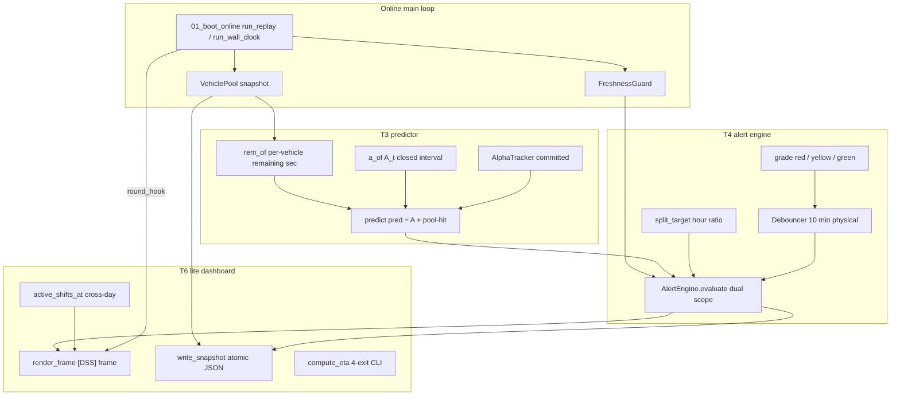

# Rolling Prediction and Gap Alerting (T3 / T4 / T6)

This page documents the online **consumption chain** that sits on top of the frozen
pool/state machine of the [Online Engine Main Loop](online-mainloop.md): the rolling
ETA predictor (T3), the gap-alert engine (T4), and the human-readable T6-lite console,
snapshot, and per-car ETA menu. Together they turn the in-memory
[`VehiclePool`](../workflows/online-mainloop.md) into a per-shift prediction, a
red/yellow/green gap warning with bottleneck localization, and an operator-facing
frame plus 5-minute JSON audit trail. Per-car ETA semantics (the estimator itself)
are covered by [ETA Decision Chain](../concepts/eta-decision-chain.md); shift-window
and attribution-window geometry by [Shift Calendar](../concepts/shift-calendar.md).

## Module layout

| File | Role |
|---|---|
| `spike_w3/predictor.py` | T3.1/T3.2 rolling predictor: `rem_of`, `a_of`, `predict`, `obs_window`, `build_takt_baseline`, `AlphaTracker`. |
| `spike_w3/alert_engine.py` | T4 alert engine: `split_target`, `grade`, `Debouncer`, `AlertEngine`, `build_station_section`, `render_alert_line`, and the two `dss` DDLs. |
| `spike_w3/dashboard.py` | T6-lite: `active_shifts_at`, `build_frame_ctx`, `render_frame`, `write_snapshot`/`validate_snapshot`/`resolve_run_tag`, `compute_eta`, and the main-loop hook factory `make_t6_hook` / `build_t6_components`. |
| `spike_w3/02_shadow_replay.py` | M9 shadow-replay acceptance (`run_rolling`), with the parameterized `alert_hook` (default `None`). |
| `spike_w3/03_alert_backtest.py` | M10 backtest driver (`make_hook`) reusing `run_rolling` + `alert_hook`. |
| `spike_w3/common.py` | `DSSConfig` (all `DSS_*` env) and re-exported constants (`EXIT_STATIONS`, `Shift`, `CST`, …). |
| `spike_w3/plan_loader.py` | `WeeklyPlan.plan_target` (delegates to `alert_engine.split_target`) — single source for shift targets. |

Everything in this chain shares one timezone discipline: all `datetime` values are
aware on `Asia/Shanghai`, and a naive timestamp raises `TypeError` at each entry
point (machine-enforced, not documented-only).



_Caption: per 5-minute round the main-loop `round_hook` pulls a pool snapshot through
the T3 predictor, evaluates the T4 dual-scope engine, and renders + snapshots the T6
frame._

## T3 — the rolling predictor

### `rem_of`: per-vehicle remaining seconds through the engine gates

`predictor.rem_of(v, t, tables, comp_excl)` computes one vehicle's remaining seconds
as `ETA − last_event_ts` and is the online consumption point for the single-car
estimator. It dispatches across the three estimator generations selected by the
environment gates (documented in [ETA Decision Chain](../concepts/eta-decision-chain.md)):

- `DSS_DUAL_RING=1` → `eta_v2.estimate_event_unified(..., mode='shift',
  passed_oven=…, loop_exited=…, entry_shift=…)` — the unified dual-ring engine on the
  raw 139-bit flag + 137-bit flag + oven-passed/loop-exited trajectory.
- `DSS_DUAL_RING=0` + `DSS_USE_NET_DELAY=1` → `eta_v2.estimate_event_net_delay`
  (doc10 retrofit).
- otherwise → `eta_v2.estimate_event` (legacy engine).

If no distribution row resolves it returns `None` — the **no-ETA bucket** (visible in
reports, counted in `no_eta`, never in `pred`). The week label is the ISO week of the
anchor `t.date()` (same as the static W2 replay). A key invariant recorded in the
source header (B10): the returned `rem` is the **full-caliber** `base + delay`
(including net delay), and `α` is applied **only once at the `predict` consumption
point** (`rem·α`, single scaling point) — never re-scaled inside the estimator.

### `a_of`: closed-interval offline count

`predictor.a_of(conn, shift, t)` counts distinct product bodies
(`BODY_ID LIKE '78202%'`) with an exit event at any of the 4 `EXIT_STATIONS` inside
the **closed interval** `[shift.attr_start, t]` (`COUNT(DISTINCT BODY_ID)`, 2
placeholders). The closed-interval semantics are deliberate: an exit at exactly
16:30:00 counts to **both** the day shift (as `t=end`, inclusive) and the mid shift
(as `attr_start`, inclusive), matching the W2 static `02_replay_shift.py`
constructively. It does **not** use the pool (the pool removes a car the moment it
exits, `R3`, and carries no exit timestamp), so the SQL is the same source as the
W2 static `exit_arr` — which is why the `α=off` result is consistent with the static
replay by construction. The window is bounded (≤ ~12 h, ~12 ms per real query), so
it is safe to run once per 5-minute round.

### `predict`: the pure-function prediction

`predictor.predict(conn, pool, shift, t, tables, comp_excl, cfg, alpha=1.0)` is the
frozen pure interface:

```
pred(t) = A(t) + Σ over in-process { t + rem_v / alpha <= shift.end }
```

Concretely:

- `A = a_of(conn, shift, t)`.
- **In-process set** = `pool.snapshot() ∩ product cars` (body_id starts with
  `78202`); the pool construction already excludes exited/continuing stations, so no
  extra station test is needed. Non-product (sentinel/fake) bodies are dropped from
  both the count and the `by_vehicle` detail.
- For each in-process car: `rem = rem_of(...)`; `stale = (t − last_event_ts) >
  cfg.eta_stale_hours`. A car with `rem is None` is counted into `no_eta` and not
  into `pred`. Otherwise it contributes one to `hit` iff
  `t + timedelta(seconds=rem / alpha) <= shift.end`.
- `α` acts **only on the `rem` comparison**, never on `A(t)` (A is an already-occurred
  fact). Stale cars **are still counted** in `pred` (the static side has no stale
  exclusion, so this preserves `α=off` consistency).

It returns `{shift_id, t, A, inproc, pred, no_eta, stale, by_vehicle}`, where
`by_vehicle` is `[{body_id, station, flag, body_type, rem_sec, stale}]`. It raises
`ValueError` if `t < shift.attr_start`.

### `obs_window`: the 3-hour tail-band clip

`predictor.obs_window(t, shift, window_hours)` returns the observation window
`[max(t − window, attr_start), min(t, end − 30min)]` and the window length in hours.
It returns `None` when `t >= shift.end` or `t < attr_start` (outside the shift), or
when the resulting length is `< 1h` (not enough data). The `end − 30min` pin removes
the **last 30 minutes before shift end** (the B5 finalized "pre-closing 30-minute
tail"), so `α` never reacts to the final-moment stop. The production Phase-1 line-stop
exclusion set is empty (reserved interface slot, enabled after T5).

### `build_takt_baseline`: the α denominator (historical P50 rate)

`build_takt_baseline(conn, win_start, win_end, min_samples)` computes, once at boot
(via a SQL aggregate, no new table), the per-(shift-kind, shift-type) **P50 hourly
exit rate** that serves as the α denominator:

1. Per-day shift types in the learning window come from
   `shifts.detect_day_type` / `detect_mid_type` (reusing the W2 module-level
   `SQL_DAYTYPE` / `SQL_MIDLAST` via `importlib`; applied to a **pure historical
   window**, so there is no future leakage — T1.3's prohibition targets online causal
   fallback, not this case).
2. Product-car exit events (4 stations) are attributed to a shift by exit hour: hour
   buckets `[05:00, 16:00)` → same-day day-shift type; hours `≥ 16` → same-day mid,
   hours `≤ 4` → previous-day mid. Days with type `None` (stop/no-shift) are dropped.
3. Counts per `(kind, type)` hour bucket (each bucket = 1 h, so the count **is** the
   rate) → `statistics.median` (P50).
4. If `n_hours < min_samples`, fall back to the nearest shift type by work-hour
   distance (same kind, only direct data for the target type used); if still
   insufficient, that type has **no baseline** and the tracker keeps `α = 1.0` with a
   `no_baseline` flag.

Returns `{(kind, type): (p50_rate, n_hours, source)}` where `source` is `"direct"` or
`"fallback_<other>"`.

### `AlphaTracker`: the EMA state machine

`AlphaTracker` is a pure state machine (no DB dependency, fully synthetic-testable)
implementing the B5-finalized parameters: `window_hours=3.0`, `ema_beta=0.3`,
`clamp [0.6, 1.5]`, and a code-level hysteresis constant
(`HYST_THRESHOLD=0.05`, `HYST_CYCLES=2`, deliberately **not** env-configured).

- `on_shift(shift)` (shift switch, new `attr_start` arrived): resets `committed=1.0`,
  `ema=None`, clears the hysteresis counters, and binds the `(kind, type)` baseline
  (if that type is missing → `no_baseline`, `α` stays `1.0`).
- `update(t, shift, exits_in_window, window_hours)` → `committed`: if the shift key
  doesn't match or there is no baseline, return the current value; `obs_window`
  `None` → no observation (state frozen); otherwise `raw =
  (exits_in_window / window_hours) / p50`, **immediately clamped** to `[0.6, 1.5]`,
  then `ema = β·raw_clamped + (1−β)·ema_prev` (first observation = `raw_clamped`).
- **Same-direction hysteresis**: `committed = ema` only when `(ema − committed)` has
  the **same sign** and `|Δ| ≥ 0.05` for **2 consecutive cycles** — a `+0.06/−0.06`
  oscillation never commits.

Semantics: `α > 1` means "faster than history", so `rem/α` shortens and `pred` grows.
**Production default is `DSS_ALPHA_MODE=off`** (fixed by the 2026-09-25 decision,
recorded in `docs/04` §5 and in `.env.example` L46-49; `DSSConfig.alpha_mode =
"off"`). With `off`, `α = 1.0` throughout and the tracker does not advance the
prediction — this must not be conflated with the BM/learning-side calibers.

## T4 — the gap-alert engine

### `split_target`: hour-ratio target split

`alert_engine.split_target(h_day, h_mid, total)` implements the M2 formula (docs/08
decision): day share = `H_day/(H_day+H_mid)`, largest-remainder rounding (day takes
`floor`, mid takes the remainder, so the sum equals `total` exactly). A rest/0/missing
side contributes work-hours 0 (a single-side rest → the other side gets all of
`total`); both sides empty or `total=0` → `(0, 0)`. This is the **single source** for
shift targets: `plan_loader.WeeklyPlan.plan_target` and the dashboard both delegate
to it, so the console, the engine, and the M9/M10 gates share one target.

### `grade`: the red/yellow/green bands

`grade(delta, cfg)` maps `Δ = (pred − target)/target` to a level:
`Δ <= cfg.alert_red` → `"red"`; `alert_red < Δ <= cfg.alert_yellow` → `"yellow"`;
else `"green"` (boundaries inclusive). The thresholds are the **2026-09-23 user
decision** preserved verbatim: `DSS_ALERT_RED=-0.10` (red at Δ ≤ −10%) and
`DSS_ALERT_YELLOW=-0.05` (yellow at −10% < Δ ≤ −5%), with
`DSS_ALERT_DEBOUNCE_MIN=10` (see `.env.example` L71-79). `AlertEngine` and the
dashboard both call this `grade`, and the M10 G2 gate re-derives it independently.

### `Debouncer`: the 10-minute physical-time filter

`Debouncer(debounce_min=10)` confirms a level transition only after it has persisted
for `debounce_min` **physical minutes** (the physical-time-difference criterion,
docs/05 caliber 6): `feed(t, level)` confirms when
`(t − pending_since) >= timedelta(minutes=debounce_min)`. Rules:

- **First level** (initial state, `current is None`) confirms immediately on the
  first `feed` (a `prev_level=None` baseline record, no 10-minute wait).
- **Same level / flash back to the confirmed level** → no transition, clear pending.
- **Third level** → switch and restart the timer.
- After confirming, the same level does not re-fire (no spamming).
- At a 5-minute step, this is detect on step 0 / 5 min on step 1 / confirm at step 2
  (10 min), 3 samples total.

### `AlertEngine.evaluate`: dual scope

`AlertEngine.__init__(plan, cfg, section_map, guard=None, alpha=1.0)` builds the
engine; `evaluate(t, shifts_today, day_shifts_done, pred_fn, a_fn)` is the frozen
per-step signature. It evaluates two scopes:

**Shift scope (active shift, the scheduling-team view).** For each active shift
(`attr_start <= t < end`) with a valid plan entry (`total > 0`), the target comes
from `split_target` (day or mid side). `pred = a_fn(shift, t) + hit` where
`hit, bottleneck, no_eta = _split_pool(pred_fn(shift, t)["by_vehicle"], t,
shift.end, alpha)`. Δ and the grade feed a **per-scope-key** `Debouncer`
(`"YYYY-MM-DD_kind"`); a confirmed transition appends an `Alert`.

**Day-total scope (the whole-day main view, F10-activated only during mid shift).**
The union formula is evaluated **only while a mid shift is active**
(`[16:30, next-day 04:00)`): `A_all = a_fn(day_shift_done[0], t)` (the day-shift
attribution window `[04:45, t]` is a superset of the mid window, so the union counts
each car once), `hit` uses the **later** end-of-day (`max` of that day's shift ends,
i.e. the mid `end`), `pred = A_all + hit`, and the target is the whole-day `total`.
The F10 closure argument (docs/05 §1/F10, the agy round-1 blocking item): the whole
day's WIP is open before ~16:30 (new bodies entering from welding are not yet in the
pool), so the day-total view is systematically low by 10–12% during the day shift;
it is only closed once the mid shift starts. During the day shift, the primary
warning is the day-shift view instead. Debouncer key is the bare `"YYYY-MM-DD"`.

Two invariants the engine enforces by construction:

- **Self-computed `pred` (M9 error-isolation, F9):** the engine does **not** trust
  the `A`/`pred` scalar fields returned by `pred_fn`; it only consumes
  `by_vehicle` and re-derives `hit` via `_split_pool`. A wrong scalar from the
  predictor therefore does not propagate into alerts. `pred_fn` returning the
  `M9 predict()` shape with a shared `by_vehicle` means zero new pool queries per
  step.
- **Self-consistency identity (F4):** `_split_pool` partitions every in-process car
  into exactly one of **in-process** (`t + rem/α <= scope_end`), **bottleneck**
  (`t + rem/α > scope_end`), or **no-ETA** (`rem is None`), so
  `pool_product_cars = inproc + bottleneck + no_ETA` holds exactly; `M10 G5`
  re-computes it independently from the JSON.

**STALE freeze (docs/02):** if the injected `guard.status() != "FRESH"`,
`evaluate` returns `[]` **and does not advance** any Debouncer — a stream break
freezes new alerts while the existing level is held for the banner.

### `_split_pool`, `gap_n`, and bottleneck flag layering

`AlertEngine._split_pool(by_vehicle, t, scope_end, alpha)` (a static method reused by
the dashboard as the single source of the pool's three-way split) returns
`(hit, bottleneck, no_eta)`. `gap_n = max(0, target − pred)`. Bottleneck cars are
layered by the `flag` bit (docs/05 F5): `rework_n` = `flag=1` (quality rework),
`blacktop_n` = `flag=2` (black-top two-tone, a **normal** process, not quality
rework), and the rest is mainline; `sections` is the per-section histogram of all
bottleneck cars via the `section_map` (missing station → `"待确认"`).

### `build_station_section`: two-tier station→section bootstrap

`build_station_section(conn, min_n_profile=3)` builds the full 259-station
station-to-section map (docs/02 eight-section vocabulary) using a **two-tier**
bootstrap:

- **Tier 1 — prefix code:** the first 2 characters of the station id map to a
  section via the `PREFIX_MAP` table (26 evidence-backed prefixes covering ~163/259
  stations, e.g. `01/05→前处理`, `03→电泳`, `14/16/17/…→顶涂`, `41/42→黑顶`).
- **Tier 2 — profile mode correction:** from `dim.dim_vehicle_profile`, the
  modal `current_process_area` per `carbody_last_rw_station` (non-NULL pairs with
  `n >= min_n_profile`) is mapped through the keyword rule `kw_section` to a
  section. Tier 2 **takes precedence** (it can correct a prefix).
- Both tiers without evidence → `section="待确认"` (user fills in).

It returns the full 259-row list
`[{station, prefix_section, area_mode, n, section, status:'auto'|'待确认'}]`; after
user confirmation it is upserted into `dss.dim_station_section` (`status='confirmed'`).
The two idempotent DDLs (`ensure_work_shift_alert`, `ensure_dim_station_section`)
create the `dss` tables; **backtests write only to JSON/MD, never to the DB**
(2026-09-25 decision ⑤) — production writing to `dss.work_shift_alert` is enabled
separately.

### `render_alert_line` and the dual-track hint

`render_alert_line(a, day_total_level)` renders a single line, e.g.
`09-12_mid Δ −11.7% red | 缺口 56 台 | 瓶颈 636 台（返修 109 / 黑顶 107 / 主线 …）:
顶涂 210 · 打磨 180 · 前处理 90 …`. Mainline = `bottleneck_n − rework_n −
blacktop_n` (constructively consistent); sections are shown Top-3 by count. When a
**shift** scope is red but the **day-total** main view is green, it appends the
`[拆分目标偏置（全天主视图绿，见 F8）]` note (the F8 dual-track contrast), flagging a
possible split-target bias rather than a real gap.

## T6-lite — dashboard, snapshot, and ETA menu

### `active_shifts_at`: cross-day dynamic resolution

`dashboard.active_shifts_at(plan, t)` returns the shift(s) active at `t`
(`attr_start <= t < end`) by scanning the plan's `shift_windows` for **today and
yesterday**. The previous-day union is what makes **cross-day mid shifts** work: a
mid shift with `attr 16:30` and `end` next-day `04:00` still belongs to the
previous calendar day, so `09-10 00:00–03:59` correctly resolves to the `09-09`
mid shift. This is the round-1 F-BLK-02 fix — the static
`_shifts_for_window`/`is_complete` filter would drop a cross-day mid shift inside a
24-hour dry-run window and is deliberately **not** used on the online path. A missing
plan day returns `[]` (the fallback inference lives in the resolve layer; this
function is pure window logic and never guesses).

### `build_frame_ctx` + `render_frame`: the four-piece frame

`build_frame_ctx(pool, conn, guard, plan, cfg, t, pred_fn, a_fn, …)` assembles the
per-frame context (isomorphic to the snapshot schema): pool flag distribution
(product cars), the three-way pool split via `AlertEngine._split_pool` (scope_end =
active shift `end`, else next shift `end`, else all-`rem` are bottleneck), the
`pred.shift` track (`A + hit`, target from `plan_target`, `grade` gated by the
first anchor `work_start + 3h`), and the `pred.day_total` track (filled **only
during mid shift**). `render_frame(ctx)` turns it into the four-piece console frame
whose first line always carries the `[DSS]` prefix (the G1 mechanical frame-count
criterion: 288 `[DSS]` lines over a 24 h dry run).

Two deliberate display semantics (round-1 fixes):

- **Δ tiering (F-MED-04):** before the first anchor the Δ is shown as "observation
  progress" with the red/yellow/green grade suppressed (no false deep-red at shift
  start); after the first anchor the formal `grade(Δ)` takes effect.
- **Freshness banner (F-MED-05):** in `replay` mode the S1–S4 ETL diagnose is
  displayed as "not applicable · time penetration" (`diagnose` is `null`, negative
  lag would read as "false fresh"); in `wall` mode the real `guard.diagnose` is
  shown. The frame also labels the prediction `pred(α=1.0)` (off mode fixed 1.0; on
  mode = tracker committed value).

### Snapshots: atomic 5-minute JSON + tag anti-overwrite

`write_snapshot(ctx, run_tag, snapshot_dir, ts)` writes one JSON per round to
`output/snapshots/{run_tag}/snap_{ts compact}.json` via **atomic** write (write to a
`.tmp` sibling in the same directory, then `os.replace`). `resolve_run_tag(cfg, ts,
snapshot_dir)` implements tag anti-overwrite (F-LOW-01): an auto-generated tag whose
directory already contains `snap_*` files is bumped to `-r2/-r3` (and the boot
report notes it); an explicit `DSS_RUN_TAG` is treated as an intentional resume into
the same directory (idempotent append, no `-r2`). `validate_snapshot(obj)` checks
structure only (keys/types/enums/nullability/identity), not business values — the
G1 gate calls it per file; it enforces the pool three-way identity
(`inproc + bottleneck + no_ETA <= size`), the exact `bottleneck_sections` sum, the
`shift.grade`-is-`null`-in-`pre` rule, and the replay-diagnose-is-`null` rule.

The snapshot carries a **dual-track `pred`** (F-MED-01): `pred.shift` for the active
shift (null object when outside shift; target = split_target share) and
`pred.day_total` (filled only during mid shift). `target` is **pre-filled whenever
the plan is known** (plan has a `total` for the day) while `A/pred/delta/grade` fill
strictly per scope-active window. The `alert_state` block is a snapshot of
`engine.deb_state(t)` so that even on rounds where `alerts == []`, the audit trail
records "which level it was at, how long pending."

### `AlertEngine.deb_state`: the only allowed frozen-file change

`AlertEngine.deb_state(now)` is a **pure read** of the per-scope Debouncer state
(`{scope_key: {current_level, pending_level, pending_min}}`). It is the **only**
permitted micro-change to the frozen `alert_engine.py` (docs/07 decision ⑥); its
unit tests pin that it does not mutate any `_deb` field (deep-equal before/after)
and calls no `feed`. It exists so the T6-lite snapshot can record debouncer state
without the dashboard reaching into the private `engine._deb`.

### `compute_eta`: the 4-exit-only station ETA menu

`dashboard.compute_eta(conn, body_id, target_station, as_of)` is an **independent
read-only DB tool** (CLI: `python -m spike_w3.dashboard --eta <BODY_ID> <TARGET>
[--as-of ISO]`) that does not read the in-memory pool or depend on the main-loop
process. The v1 scope is **contracted to the 4 exit stations only** (round-1
F-BLK-01): the trunk-sequence slice ETA is deferred to Phase 3 (a takt-graph shortest
path, same mechanism as T5.3 v2). It:

1. Loads the most recent event (`DATE_EVT <= as_of`, tie-broken by higher `ID`) —
   current station/flag from the DB (`MDS_DATA` `SUBSTRING(139 FOR 1)`), never the
   pool.
2. Returns `status='exited'` when the latest event is at an exit station **or a
   post-exit station** (`common.POST_EXIT_STATIONS`, F-R2-01: 76% of exited cars'
   latest event is at a continuation station, so judging exit points alone would
   misreport "still in the shop").
3. For a valid exit target, resolves the remaining-time row with the **n≥30
   discipline** (W1 same caliber): body-type row preferred if `n ≥ 30`, else `ALL`,
   else an explicit error "no estimate." Re-work/loop cars (`flag` 1/2) are annotated
   "in rework loop" with a `dim_loop_remaining` reference.
4. Under `DSS_DUAL_RING=1` it runs the unified engine path
   (`estimate_event_unified`, `mode='vehicle'`); otherwise the legacy `n≥30` path.
   A target not among the 4 exits returns an explicit "intermediate-station ETA v1
   not open (Phase 3)" error — it never guesses.

### Wiring into the main loop: `make_t6_hook`

`make_t6_hook(plan, cfg, guard, engine=None, tracker=None, …)` returns a hook closure
`hook(t, pool, conn_, cfg_, st)` that is installed as `round_hook` on the main loop
(after each `run_one_round`). Per round the hook: resolves the active shift
(`active_shifts_at`), computes the shared pool view **once** (injected `pv_fn` or
`_pool_view`), advances `α` in `on` mode (update then read committed, same as
`run_rolling`), calls `engine.evaluate` (STALE → `[]`), assembles `build_frame_ctx`,
`write_snapshot`, and `sink(render_frame)`. `build_t6_components` is the production
assembler (loads `tables`/`comp_excl`/`section_map`, builds the engine and — only in
`on` mode — the `AlphaTracker` baseline) and returns the hook. `01_boot_online.main`
wires this in when `DSS_CONSOLE` is on (default), and a failed console
assembly **does not block** the main loop (console is an accessory; default `None`
hook = zero impact, byte-identical to the frozen T2.6 behavior when `DSS_CONSOLE=0`).

## Backtest integration with zero production impact

`02_shadow_replay.run_rolling` (the M9 Step B driver) accepts an
`alert_hook=None` parameter (T4.4). With the default `None` its behavior is
byte-for-byte unchanged (zero production impact, M9 semantics preserved); when a
hook is supplied it is called every 5-minute step with
`alert_hook(cur, pool, conn, tables, comp_excl, cfg_m9, [active_shift] or [])` and
its returned serialized alerts are accumulated into the result. The M10 backtest
driver `03_alert_backtest.make_hook` builds exactly such a hook (reusing
`run_rolling` + the same `_pool_view`), and its gates are: G0 unit tests, G1
day-total accuracy (21:30 anchor, median ≤ 5pp + zero red), G1b engine `pred` == M9
`pred_off@5h` (14/14), G2 `level == grade(Δ)` (21 scope-days), G3 advance ≥ 2 h, G4
debounce stability (2026-09-26 decision B: no confirmed transition in the
`[anchor−10min, anchor)` window; transition count demoted to the observation item
`G4_obs`), G5 the pool self-consistency identity, G6 full 21-scope-day coverage.

## Configuration surface

All knobs are `DSS_*` env vars loaded into the frozen `DSSConfig`:

| Env | Default | Meaning |
|---|---|---|
| `DSS_ALPHA_MODE` | `off` | **Production default** (2026-09-25 decision): `off` = `α=1.0` fixed; `on` = experimental tracker. |
| `DSS_ALPHA_WINDOW_HOURS` | `3` | Sliding exit-rate window. |
| `DSS_ALPHA_MIN_SAMPLES` | `30` | Min sample to adjust `α`. |
| `DSS_ALPHA_EMA_BETA` | `0.3` | EMA β. |
| `DSS_ALPHA_CLAMP_MIN` / `MAX` | `0.6` / `1.5` | `α` clamp band. |
| `DSS_ETA_STALE_HOURS` | `6` | L4 stale threshold (mark only, still counted). |
| `DSS_LEARN_WIN_START` / `END` | `2026-04-14` / `2026-08-15` | α takt-baseline learning window (pure historical). |
| `DSS_ALERT_RED` | `-0.10` | **2026-09-23 user decision**: red at Δ ≤ −10%. |
| `DSS_ALERT_YELLOW` | `-0.05` | **2026-09-23 user decision**: yellow at −10% < Δ ≤ −5%. |
| `DSS_ALERT_DEBOUNCE_MIN` | `10` | **2026-09-23 user decision**: 10-minute physical-time debounce. |
| `DSS_CONSOLE` | `1` | T6-lite console + snapshot on/off (0 = frozen T2.6 behavior). |
| `DSS_RUN_TAG` / `DSS_SNAPSHOT_DIR` | `""` / `output/snapshots` | Snapshot tag and directory. |

Note the α hysteresis (`0.05` / 2 cycles) is intentionally a **code-level constant**,
not env-configured (2026-09-23 review B1 fix).

## Focused tests

- `tests/test_w3_predictor.py` — `rem_of`/`a_of`/`predict` on a fully offline
  synthetic pool (FakeConn/FakeCursor), including the `α=1` vs `α=1.2` comparison,
  the stale-still-counted rule, and the non-product exclusion. Pinned to the legacy
  engine via `DSS_DUAL_RING=0` + `DSS_USE_NET_DELAY=0` (unified-engine `rem_of`
  semantics live in `tests/test_w4_engine_wiring.py`).
- `tests/test_w3_alpha.py` — `build_takt_baseline` P50 + fallback and the full
  `AlphaTracker` lifecycle (window < 1 h no-observe, first-observation ema=raw,
  `|Δ|<0.05` no-commit, 2-cycle commit, clamp bounds, `on_shift` reset, no-baseline
  stays 1.0).
- `tests/test_w3_m9.py` — the M9 `gates()` pure function (G1–G4, each gate flipped
  independently on synthetic data, no DB).
- `tests/test_w3_alert.py` — `split_target`/`grade`/`Debouncer` pure-function suite,
  the dual-scope engine (union double-count regression, F10 activation window,
  STALE freeze, bottleneck flag layering, self-consistency identity, `deb_state`
  pure-read regression).
- `tests/test_w3_dashboard.py` / `tests/test_w3_snapshot.py` /
  `tests/test_w3_eta_menu.py` — frame rendering (five states, pre/post-anchor grade
  gating, replay banner), snapshot schema + atomic write + tag anti-overwrite, and
  the seven-branch `compute_eta` (exit / body-type→ALL fallback / rework annotation /
  non-exit error / missing-residual error / exited / not-found) with the `n≥30`
  boundary.
- `tests/test_w3_t64_hook.py` — the T6.4 hook: one-round call order (render before
  snapshot), STALE round (`pred` still computed, `alerts=[]`, debounce not advanced),
  and `deb_state` pure-read regression.

## Invariants and failure semantics (summary)

- **Single α scaling point:** `α` is applied once at the `predict` consumption point
  (`rem·α`); it is never re-scaled inside the estimator and never scales `A(t)`.
  Production default `off` ⇒ `α = 1.0` (2026-09-25 decision, `docs/04`; must not be
  conflated with the BM/learning-side calibers).
- **Constructive `α=off` consistency:** `a_of` uses the same closed-interval
  `ods.carbody_history` source as the W2 static `exit_arr`, and the in-process set is
  `pool ∩ product cars`; together these make the `α=off` prediction agree with the
  static replay by construction.
- **Pool identity (F4):** `pool_product_cars = inproc + bottleneck + no_ETA` holds
  exactly by the `_split_pool` partition; already-exited cars (A) are out of the pool
  and never appear in it.
- **Error isolation (M9/F9):** the alert engine recomputes `pred` from `by_vehicle`
  and ignores the predictor's scalar `A`/`pred`, so a wrong predictor scalar cannot
  contaminate alerts.
- **STALE freeze (docs/02):** a non-FRESH guard yields no new alerts **and** does not
  advance the debouncers; the current level is held for the banner.
- **F10 activation:** the day-total scope is evaluated only during the mid shift
  (`[16:30, next-day 04:00)`); the day-shift window has no day-total scope because
  the whole-day WIP is open (systematically low) before the mid shift starts.
- **Timezone discipline:** naive `datetime` raises `TypeError` at every entry point;
  all SQL uses the single DSN with `SET TIME ZONE 'Asia/Shanghai'`.

## Related pages

- [ETA Decision Chain](../concepts/eta-decision-chain.md) — the three estimator
  generations and the `DSS_DUAL_RING`/`DSS_USE_NET_DELAY`/`DSS_SHIFT_TIER_DELAY`
  gates that `rem_of`/`compute_eta` dispatch through.
- [Shift Calendar](../concepts/shift-calendar.md) — shift-window, attribution-window,
  and anchor geometry (`attr_start`, `end`, `work_start + {3,4,5,6}h`).
- [Online Engine Main Loop](online-mainloop.md) — the frozen `VehiclePool`,
  `FreshnessGuard`, and the `round_hook`/`run_one_round` contract this chain hangs
  off.
- [Replay Acceptance](replay-acceptance.md) — the M9/M10 backtest harnesses that
  validate this chain against real data.
