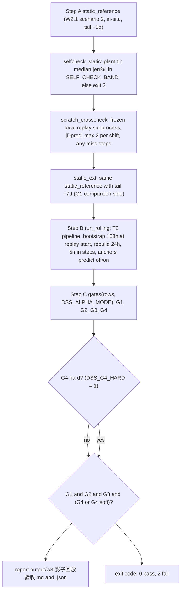

# 离线回放与验收门（W1→M5）

This page documents the **replay-driven acceptance gate system** of the paint-shop
DSS: every development wave was closed by running a replay driver over a later
time window and passing a hard gate. The five gate drivers are:

| Wave / milestone | Driver | Gate | Output artifacts (filenames only) |
|---|---|---|---|
| W1 | `spike_w1/02_replay_eta.py` | direct-remaining estimator, per-vehicle median then cross-vehicle median ≤ 30min | `output/w1_replay_report_*.md`, `output/w1_replay_gate_*.json`, `output/w1_replay_errors_*.csv`, `output/w1_replay_by_station_*.csv` |
| W2 | `spike_w2/02_replay_shift.py` | D1': plant-wide AND main-model per-shift median |err%| ≤ 10% @5h | `output/w2_replay_report_*.md`, `output/w2_replay_gate_*.json`, `output/w2_replay_shifts_*.csv`, `output/w2_replay_models_*.csv` |
| W3 / M9 | `spike_w3/02_shadow_replay.py` | G1–G4 (judged per `DSS_ALPHA_MODE`; G4 soft by default, `DSS_G4_HARD=1` restores) | `output/w3-影子回放验收.md`, `output/w3-影子回放验收.json` |
| W3 / M10 | `spike_w3/03_alert_backtest.py` | G0–G6 on the alerting pipeline | `output/w3-T4-缺口告警回测.json`, `output/w3-T4-缺口告警回测.md` |
| W3 / M5 | `spike_w3/04_m5_acceptance.py` | per shift-row |Δ实际| ≤ tol (default 10%) on the 5h anchor | `output/w3-M5-验收报告.md`, `output/w3-M5-验收.json` |

All drivers run inside the dedicated `paint-dss` conda environment, and the
documented launch form is
`conda run --no-capture-output -n paint-dss python <script>` (see
[Testing Strategy](../testing/testing-strategy.md) and
[Intranet Deployment and M5](../operations/deployment-and-m5.md) for the full
Windows run conventions). All times are aware `Asia/Shanghai` (factory time =
UTC+8); every SQL path issues `SET TIME ZONE 'Asia/Shanghai'` semantics via the
shared connect layer.

## Exit code convention

The convention (AGENTS.md 运行坑②) that every replay/acceptance driver follows:

- **exit 0 = 门过** (gate passed);
- **exit 1 = sanity 失败** (sanity check failure — e.g. a learner self-check
  threshold, used by the `01_learn_*` scripts; the M9 self-check band violation
  instead exits 2 by explicit design, see below);
- **exit 2 = 门未过** (gate not passed — a legitimate measured result, not a
  crash).

Because the scripts are launched through `conda run`, a gate-FAIL run (exit 2)
makes `conda run` print an `ERROR conda.cli...` line: this is the **reporting
convention, not an execution failure** — the produced `output/` reports are the
source of truth. Gate drivers return `0 if passed else 2` from `main()`
(`02_replay_eta.py` L276, `02_replay_shift.py` L574, `02_shadow_replay.py` L765,
`03_alert_backtest.py` L439).

## 因果切分 (causal split) — hard invariant

> **DO NOT BREAK.** The causal split is a calibration (口径) invariant that is
> not allowed to be violated, in `Asia/Shanghai` time throughout:

- The **learn window is frozen** at `2026-04-14 → 2026-08-15` (default
  `DSS_LEARN_WIN_START` / `DSS_LEARN_WIN_END` in `spike_w3/common.py` L126-L127);
  every learning table is built from events inside it only.
- **Replay windows are later dates only.** Replay scripts never evaluate
  learning-table behavior on the window the tables were learned from.
- **Anchors consume only events ≤ t.** In every replay, a prediction anchored at
  time `t` uses only the per-car event with the largest timestamp `≤ t` (bisect
  lookups in `02_replay_eta.py` / `02_replay_shift.py` /
  `02_shadow_replay.py`); the rolling side is watermark-line driven so it never
  sees events after the cursor (`02_shadow_replay.py` L15: “滚动侧只消费 ≤t
  事件（T2 水位线）；静态侧 = W2 因果窗口径”). The rolling predictor's
  `a_of`/`predict` enforce the same closed-interval `[attr_start, t]` counting
  with aware `Asia/Shanghai` datetimes and raise `TypeError` on naive inputs
  (`spike_w3/predictor.py` L24-L90).
- All drivers rebuild the shared event base `tmp_ev_base` through
  `spike_w1/sqlbase.ev_base_sql(win_start, win_end)` — the single DRY event-base
  caliber shared by learners and replays (`spike_w1/sqlbase.py` L2-L27).
- The static side extends the event window by a **7-day front margin**
  (`MARGIN_DAYS = 7`, “≥ 最长行程 120h”: any car exiting inside the window has
  its entry event inside the extended window). W2 sets `ev_base 窗 =
  [回放始−7d, 回放末+1d]` (`02_replay_shift.py` L35, L195-L196); M9 Step A uses
  the same 7d front edge with `tail_days` 1 (self-check/cross-check) or 7
  (G1 comparison side) (`02_shadow_replay.py` L51, L222-L223).
- W2's *shift-type self-learning* (no plan CSV in the replay window) consumes
  all-day events including post-anchor ones; `spike_w2/shifts.py` marks this as
  **回放专用后视** (replay-only hindsight, L17) — production (W3 online) must
  not reuse it and instead reads `plan_inbox/week_plan_*.csv` schedules.

## M9 shadow replay structure (M9, 02_shadow_replay.py)

Caption: M9 three-step flow — self-check and scratch cross-check gate Step A,
then the rolling engine, then the mode-branching gates with G4 softening.

### Step A — static reference, self-check band, cross-check

Step A re-implements the W2.1 scenario-2 direct-estimator path **in-situ** on an
independent window (default M9 window `2026-09-05 → 2026-09-13`, product cars,
7d ev_base front edge), reusing `sqlbase.ev_base_sql`, W2 `load_tables`
(imported by path) and `shifts.shift_windows` with the plan-CSV schedule. Two
machines then guard the static reference before any rolling work:

- **Self-check fixed band** (`selfcheck_static`, L511-L522): the plant-wide 5h
  median |err%| must lie inside `SELF_CHECK_BAND`, default
  `(0.1089, 0.1339)` — re-anchored in W4.4c (2026-10-06) from the old 8.74%
  anchor to the new-stack 11.63% static retest (band geometry
  锚点−0.74pp / +1.76pp preserved, covering the full-window variant). Being out
  of band is declared **结构性漂移 (baseline drift)** and stops the run with
  `SystemExit` (exit 2) telling the operator to re-calibrate. The band can be
  overridden with `DSS_SELF_CHECK_BAND='lo,hi'`, strictly validated: malformed
  or out-of-range values raise `ValueError` instead of silently falling back
  (`load_self_check_band`, L65-L78).
- **Local scratch cross-check** (`scratch_crosscheck`, L525-L561): a frozen
  local W2.1 replay script (default `scratch/02_replay_kw37.py`, overridable via
  `DSS_M9_CROSS_MACHINE` / `DSS_M9_CROSS_DIR`) is executed as a subprocess for
  the fixed 09-05→09-13 scenario-2 window, and the 5h predictions are compared
  per shift: `|Δpred| ≤ 2 台` (`CROSS_MAX_DELTA`) with the
  **单班超差停机规约** — one violating shift (or a missing shift, or no fresh
  CSV produced) raises `SystemExit` and Step B must not run.

A second static pass with `tail_days = 7` (尾 +7d, symmetric to the 7d front
edge) builds the **G1 comparison side** (`static_ext`): cars that only exit
after the window end are restored, eliminating the 窗尾盲区 (cls4 window-tail
blind spot) found in the first M9 run. The two windows (tail +1d vs tail +7d)
are deliberately not comparable with each other; `static_ext_view` embeds the
extended-window per-vehicle `I_bodies` / `A_bodies` and `p3_candidates` lists so
the formal JSON artifact is self-contained for offline audit.

### Step B — rolling driver reusing T2 production semantics

Step B (`run_rolling`, L390-L504) drives the **production T2 pipeline
unmodified** in replay cursor time: `bootstrap_hours=168` is explicitly
injected (via `dataclasses.replace` on the frozen `DSSConfig`) so the
bootstrap and every periodic rebuild use a 168h window matching the static
7d edge, `rebuild_hours=24` keeps production rebuild semantics, and the
bootstrap is **anchored at the replay start** (not wall clock). Each 5-minute
step (`STEP_SEC = 300`) calls the production `run_one_round`
(`spike_w3/01_boot_online.py`), with rest days from `plan_inbox` feeding the
guard's `expected_silence`. The α tracker observes shifts using **pre-fetched
exit events** (`_prefetch_exits`, one SQL, counted only within the observed
window — no future leak). At every anchor instant (work_start + {3,4,5,6}h) the
shift prediction is computed twice — `alpha=1.0` (off) and the current
committed α (on) — via the production `predict`
(`spike_w3/predictor.py` L96-L120), and at the 5h anchor the rolling
in-progress set and per-vehicle detail are recorded for G1/diagnosis.
`alert_hook` defaults to `None` (zero production impact); when supplied (M10)
it is called every step.

### Step C — gates G1–G4, judged per DSS_ALPHA_MODE

`gates(rows, alpha_mode)` is a **pure function** (L106-L163) tested offline on
synthetic rows (`tests/test_w3_m9.py`). Per row it consumes the 5h-anchor
values `{actual, pred_static, pred_roll_off, pred_roll_on, p3_inproc}`:

| Gate | Criterion |
|---|---|
| G1 (α=off engine consistency, both modes) | per shift `|roll_off − static| ≤ min(p3_inproc, 25)+2`, hard cap `p3_inproc ≤ 25` (pool anomaly), AND full-plant and mid-shift 5h median relative error difference `≤ 0.5pp` |
| G2 | `alpha_mode="off"` (production default): plant-wide **off** 5h median |err%| ≤ 10%; `alpha_mode="on"` (experimental switch): **on** median ≤ 10% |
| G3 | off mode: `True` by definition (α not enabled → “not worse than static/off”); on mode: full-plant on ≤ off |
| G4 | off mode: `False` by definition (not strictly better); on mode: mid-shift on < off (strict) |

Overall pass (`main`, L737-L740): `G1 ∧ G2 ∧ G3 ∧ (G4 ∨ g4_soft)`, where
`g4_soft = (not G4) ∧ G1 ∧ G2 ∧ G3 ∧ (DSS_G4_HARD != 1)` — the
**G4 软化** disposition: when G1–G3 are met, a failing G4 does not block; the
report carries the mid-shift sensitivity analysis back for a decision. The
report states that `DSS_G4_HARD=1` has production-admission meaning only when
`DSS_ALPHA_MODE=on` (under the off baseline G4 is constantly False, so the hard
flag would block).

**Window configuration:** M9 and M10 share the window from
`DSS_M9_START` / `DSS_M9_END` (defaults `2026-09-05T00:00` /
`2026-09-13T23:59:59`, `Asia/Shanghai`; `02_shadow_replay.py` L49-L50). Both
drivers read `plan_inbox/week_plan_*.csv` schedules with strict discipline: a
missing in-window date raises `KeyError` (缺排班不得静默丢班) and conflicting
rows across files raise `ValueError` (`load_schedule`, L170-L188; same
discipline in `03_alert_backtest.py` `load_plan_with_total`, L50-L69). All
shift geometry (work starts, attribution windows, `MID_END_TIMES`, the
{3,4,5,6}h anchors and the 5h gate anchor) comes from the single source of
truth `spike_w2/shifts.py` — W3 code must not duplicate window constants
(`spike_w3/common.py` L54-L67).

## M10 gap-alert backtest (03_alert_backtest.py)

M10 backtests the T4 alerting pipeline over the same M9 window. It **reuses
`run_rolling` with an `alert_hook`** (`make_hook`, L185-L266): every 5-minute
step the hook runs the production `AlertEngine.evaluate` (with the engine
self-computing predictions from the pool, preventing M9 error propagation),
appends every **confirmed** level transition to the alert list, and captures
anchor snapshots — the shift-scope 5h snapshot (`s5`), the day 3h anchor
timestamp (`a3`), and the **all-day main view** snapshot taken at the mid-shift
21:30 anchor when the F10 activation window is active. α is pinned to 1.0 for
the backtest (`alpha=1.0` at `main` L296). Alerts are **only emitted as
JSON/MD — never written to any `dss` table** (2026-09-25 拍板⑤).

The M10 gates (all pure functions; `main` L302-L410):

| Gate | Check |
|---|---|
| G0 | `pytest tests/test_w3_alert.py` subprocess run: returncode 0 and “passed” in output |
| G1 | all-day main view accuracy: at the **21:30** anchor, median of |全天Δ_5h − 全天Δ_终局| ≤ 5pp over the all-day scope-days AND zero all-day red at 21:30 (`gate_g1`, L76-L82). When the plan CSV 出车计划 column is a measured backfill (`all_day_final ≡ 0`), G1 honestly measures the 21:30 prediction vs. actual gap; with a true forward plan it measures the real forward-prediction error |
| G1b | engine 5h predictions == M9 JSON `pred_off@5h` for every shift (14/14) (`gate_g1b`, L85-L89) |
| G2 | 21 scope-days (14 shift + 7 all-day) at the 5h anchor: `level == grade(Δ)`, with the debouncer-lag exemption (pending level already equals grade and pending age < `DSS_ALERT_DEBOUNCE_MIN`) (`gate_g2`, L92-L105) |
| G3 | for every non-green final scope-day, the first confirmed alert at the final level (baseline included) arrives **no later than the 3h anchor** (lead time ≥ 2h) (`gate_g3`, L108-L121). Day-scope non-green finals are reported as H-split bias notes (F8 dual-track) and excluded from G3 |
| G4 | **no confirmed transition inside the half-open window [anchor−10min, anchor)** before the 5h anchor — anchor reading stability (2026-09-26 拍板 B). Transitions exactly at `t == anchor` are the level in effect at the anchor and are not counted; total transition count is downgraded to the observation item `G4_obs` in the JSON (`gate_g4`, L124-L143) |
| G5 | self-consistency identity at the 14 shift 5h anchors: pool product cars = in-progress + bottleneck + no-ETA (exact) AND pool n == M9 `inproc_5h_n` (same pool, same instant) (`gate_g5`, L146-L152) |
| G6 | full coverage: every scope-day (21 = 14 shift + 7 all-day) has at least one alert, baseline included (`gate_g6`, L155-L159) |

Overall: `passed = all(G0, G1, G1b, G2, G3, G4, G5, G6)` → exit 0/2. Outputs
are `output/w3-T4-缺口告警回测.json` / `.md` (filenames only; the MD renders the
gate table, the F8 day-scope bias notes, the 5h engine views, and the confirmed
alert timeline via `render_alert_line`).

## M5 online acceptance scoring (04_m5_acceptance.py)

M5 scores the 5-day online acceptance run from the 5-minute console snapshots
(`output/snapshots/m5/snap_*.json`) plus read-only DB queries. The driver is
**只读零库写 (read-only, zero DB writes)**: only `SELECT` queries (one per
shift row), and reports are written only to local MD/JSON
(`spike_w3/04_m5_acceptance.py` L24).

- **Primary criterion** (`assess`, L106-L124): per workday per shift row, the
  5h anchor frame |Δ实际| ≤ `tol` (default 10%), where
  **Δ实际 = (pred_锚点 − 实际终局) / 实际终局**. The anchor frame is
  `work_start + 5h` — day-shift anchors follow the shift type (11h→10:00 /
  10h→11:00 / 8h→13:00; the day work start comes from `shifts.DAY_TYPES`),
  mid-shift anchor is constant **21:30** (`anchor_for`, L54-L61); frame matching
  is by **±3min tolerance** (`ANCHOR_TOL_SEC = 180`, `pick_anchor` L64-L88)
  against the 5min-grid-aligned snapshot timestamps.
- **实际终局 (actual final)** = **4 下线点 (four offline points) product-car
  closed-interval count**: day `[D 04:45, D 16:30]`, mid
  `[D 16:30, D+1 MID_END_TIMES[班次型]]` (11h→04:00 / 10h→03:00 / 8h→01:00),
  same `<= end` closed-interval semantics as the predictor's `a_of`
  (`shift_actual_window` L91-L103, `query_actual` L160-L174 with
  `SET TIME ZONE 'Asia/Shanghai'`).
- **Four mutually exclusive reason buckets** (`gated` / `actual_zero` /
  `stale` / `anchor_missing`), priority stale > actual_zero > anchor_missing
  (main loop L333-L348): `stale` = the anchor frame's guard status is STALE
  (断流冻结, out of gate); `actual_zero` = actual final is 0 (rest line /
  no events, out of gate); `anchor_missing` = no anchor frame within
  tolerance (process offline / missing frame / drift beyond tolerance —
  explicit recorded row, never silently skipped); `gated` = scored. Rest days
  (no active shift at the anchor) are dropped from the gate and listed in a
  note. Final verdict **PASS = no gated row fails**.
- **断流段归并 (STALE span merging)** (`stale_stats`, L127-L144): STALE rounds
  are merged into consecutive spans (a gap > 5min breaks a span; each span's
  end is extended by one 5min round), reported with round count and minutes;
  stale rounds are **not gated** (ETL SLA 拍板 — see
  [Intranet Deployment and M5](../operations/deployment-and-m5.md)).
- **多目录合并收账 (multi-directory merge)**: `--snap-dir` is repeatable;
  snapshots merge by timestamp with **first-seen wins** on duplicates (counted
  in the report, `load_snapshots` L259-L272). `find_sibling_run_dirs`
  (L275-L286) explicitly WARNs about same-prefix `-rN` run directories that
  were not passed (legacy auto-tag remnants), preventing silent under-counting.
- **告警台账 (alert ledger)**: confirmed transitions from the snapshot
  `alerts` arrays are aggregated into the MD/JSON ledger (`alert_ledger`,
  L147-L155).
- **Runbook red lines** (docs/09 `M5内网在线验收运行手册`): during the
  5-day window no `DSS_*` parameter may be changed (change = acceptance
  void), a data stall must not kill the process (wait for the RTO ≤ 1h ETL
  recovery, record the span), and `output\snapshots\m5\` must not be deleted
  (audit trail). `DSS_RUN_TAG=m5` makes restarts **idempotently append to the
  same directory** (no `-r2` split). Oven-channel storage dead vehicles are a
  known false-positive class tracked separately and never enter the gate.

## Gate discipline and culture

- **门判纯函数先行 (gate pure functions first, TDD)**: every gate is a pure
  function that is unit-tested on synthetic rows **before** any replay wiring
  exists — `gates()` with `tests/test_w3_m9.py` (14 synthetic shifts, off/on
  branch and flip cases), `gate_g0..g6` with `tests/test_w3_alert.py` (G0 even
  re-runs that file as a subprocess inside M10), and the M5 pure helpers
  (`anchor_for` / `pick_anchor` / `assess` / `stale_stats` / `alert_ledger`)
  with `tests/test_w3_m5_acceptance.py`. `02_shadow_replay.py` states the
  pattern in its header: “结构（TDD：门判纯函数先行，Step A/B/C 依次落）”.
- **门不过 = 归因 + 如实上报 (failed gate = attribution + honest reporting,
  never soften the gate)**: a FAIL is a legitimate measured result. The
  failure path requires locating the error source from the report's per-bucket
  diagnostics (锚点/周/班次种/标记/车型/站) **before** any gate revision is
  proposed (the explicit W1/W2 failure clause,
  `02_replay_eta.py` L248, `02_replay_shift.py` L564-L566). Softening —
  e.g. the G4 soft disposition, or keeping `DSS_SHIFT_TIER_DELAY=0` after the
  W4.4h experiment failed to improve G2 — is only ever decided **with data,
  back to the decision owner**, and is recorded as such
  (`output/w4-KW37-影子回放_{off,on}_4h.md` family, CHANGELOG 2026-10-07).
  Conversely, a passed gate is recorded even when it is a historical FAIL
  closeout with the number left on the record (e.g. the W4 closeout
  “G2 … 留痕 FAIL 关账…不软化不删门”, CHANGELOG 2026-10-07).
- **Historical numbers are baselines, not gates**: the widely cited acceptance
  numbers — **14.16%** (W2 v3 re-anchored plant-wide 5h median, window
  08-16→09-19, CHANGELOG 2026-09-21), **12.30%** (W2.1 full-window 35-day
  baseline), **8.08%** (good-week plant-wide with the shift calendar,
  CHANGELOG 2026-09-22) and **11.26%** (KW37 rolling off G2 figure) — are
  narrative historical baselines sourced from `CHANGELOG.md` / `docs`; the
  evidence details live in the `output/` report filenames referenced by those
  entries (e.g. `output/w2_replay_gate_*.json`,
  `output/w4-KW37-影子回放.md`), whose contents are not reproduced here.

## Related

- [Learner Pipeline](learner-pipeline.md) — the learning side of the causal
  split: `01_learn_takt.py` / `01_learn_v2.py` and the shared `sqlbase`
  event base.
- [Prediction and Alert](prediction-and-alert.md) — the online consumption
  chain (predictor, alert engine, dashboard) that the replay drivers
  re-execute in cursor time.
- [Intranet Deployment and M5](../operations/deployment-and-m5.md) — the M5
  runbook, D0/D1–D5 operations, ETL SLA, and rollback discipline.
- [Testing Strategy](../testing/testing-strategy.md) — the TDD suite,
  synthetic-data conventions, and frozen red lines.
- [ETA Decision Chain](../concepts/eta-decision-chain.md) — the estimator
  internals (`rem_of` / `estimate_for_replay`) consumed by every gate.
