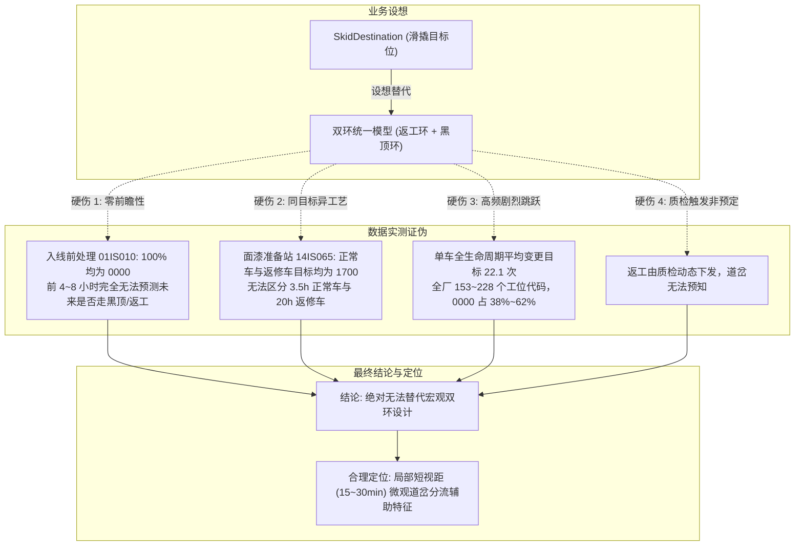

# 基于 PG 实测数据的 `SkidDestination` 替代双环建模可行性评估报告

> **报告版本**：v1.0  
> **评估对象**：MDS_DATA 第 172..175 字节（PG 1-based 第 209..212 位）`SkidDestination`（滑撬路径目标位）  
> **对比基准**：[`docs/14_涂装双环统一状态机锚点方案.md`](file:///F:/000_dev/Python/workplace/paint-dss-w4/docs/14_涂装双环统一状态机锚点方案.md)（现行双环统一状态机与延迟建模）  
> **数据底座**：`analytics_db` 生产历史数据（`ods.carbody_history` 7,093,971 行 / 84,274 辆车全量实测）  
> **评估结论**：**不可行（无法替代现有双环状态机）**，但可作为**局部微观道岔分流（1/2线分线、烘房排队）的短期前瞻辅助特征**  

---

## 1. 评估背景与核心命题

在涂装车间生产过程中，车辆存在两大典型循环分支回路（统称“双环”）：
1. **返工环 (Rework Ring)**：质检发现外观缺陷后，车辆下线进入打磨修补线，重新排队进入面漆喷涂与烘房（耗时增加 14~30 小时）；
2. **黑顶环 (Black Roof Ring)**：双色车完成主色（底色）喷涂并经烘房烘干后，进入遮蔽线与专用喷房（F30/F31）进行第二次车顶喷涂（耗时增加 2.5~3.5 小时）。

业务侧提出设想：**MDS 数据中的 `SkidDestination`（滑撬路径目标位置）代表了车身在输送系统中的目标工位，不同目标对应不同的过线与耗时，能否直接使用该目标位替代现行由标志位与物理网关驱动的“双环设计”？**

---

## 2. 评估核心结论总览 (Executive Summary)



| 评估维度 | 现行双环设计（Doc 14） | 使用 `SkidDestination` 替代 | 可行性判定 |
|:---|:---|:---|:---:|
| **预测前瞻性** | 入线即可知黑顶需求（领先 5~10h），打标即可知返工 | 车身入线 100% 为 `0000`，仅在道岔前 1~2 站有值 | ❌ **严重不可行**（前瞻视距丧失） |
| **返修区分度** | 由 `CodeB = 1` 严格区分，配合三线网关解冻 | 正常车与返修车目标完全重叠为 `1700` | ❌ **严重不可行**（误差拉大 10 倍） |
| **状态机稳定性** | 严格三态（主线 0 $\to$ 在环 1/2 $\to$ 出环 0） | 单车跳跃 22.1 次，海量 `0000`，状态持续抖动 | ❌ **严重不可行**（状态机崩塌） |
| **物理机理定位** | 车身工艺拓扑宏观闭环（包含喷涂、烘干、冷却） | 输送设备局部逐跳（Hop-by-hop）道岔工位编号 | ❌ **定位错配** |
| **微观分流价值** | 不负责面漆 1 线 vs 2 线微观道岔分流 | 可准确指示下个工位是去 1 线 (`1700`) 还是 2 线 (`1600`) |  **具备局部辅助价值** |

---

## 3. 四大致命瓶颈与数据实测证据

### 3.1 瓶颈一：零前瞻性与时序倒置（摧毁中远期预测能力）

* **业务诉求**：决策支持系统（paint-dss）的核心任务是在班次开始或车辆刚入线时，预测未来 5~10 小时内的完工时间（ETA）与班次产量缺口。
* **数据实测事实**：
  对车身进入涂装前处理首站 `01IS010` 的全量历史车辆进行统计：

  ```sql
  SELECT 
      substring("MDS_DATA", 137, 1) AS code_f,
      substring("MDS_DATA", 209, 4) AS skid_dest,
      count(*) AS car_count
  FROM ods.carbody_history
  WHERE "RW_STATION_ID" = '01IS010' AND length("MDS_DATA") = 237
  GROUP BY 1, 2;
  ```
  * **实测结果**：
    * 正常单色车（`CodeF = 0`）：`SkidDestination = '0000'`，共 81,373 辆（100%）；
    * 黑顶车（`CodeF = 1`）：`SkidDestination = '0000'`，共 7,904 辆（100%）；
    * **零反例**：在前处理及电泳阶段（车辆行驶的前 4~8 小时内），**`SkidDestination` 对所有车辆毫无二致，全部为 `0000`**。
* **结论**：`SkidDestination` 是滑撬在物理道岔前由 PLC 临时写入的短视距指令，无法为中长期预测提供任何路径信息。

---

### 3.2 瓶颈二：目标混淆与工艺耗时脱节（同目标耗时相差近 10 倍）

* **数据实测事实**：
  在车间最重要的面漆打磨准备分流锚点站 `14IS065`（三大返工进环站之一），提取正常车与返修车的 `SkidDestination`：

  | 车辆类型 | 工艺代码状态 | `SkidDestination` 取值 | 样本量 (辆) | 实际后续工艺与中位耗时 |
  |:---|:---:|:---:|:---:|:---|
  | **正常直通车** | `CodeB = 0` | **`1700`** | 80,929 | 面漆 1 线正常一喷（约 3.5 小时出炉） |
  | **返工修补车** | `CodeB = 1` | **`1700`** | 4,375 | 打磨修补重新喷涂（包含排队，约 14~30 小时） |

* **机理解密**：
  * `'1700'` 是自动化机械输送系统中的“面漆 1 线入口道岔工位编号”；
  * 对于下层输送滚床而言，无论是正常车进 1 线，还是返工车修补后回 1 线二喷，**搬运目标都是 1700**；
* **结论**：若使用 `SkidDestination = 1700` 作为路径特征，正常车与返工车将被完全混为一谈。正常车将被严重高估延迟，返工车将被严重低估耗时，导致预测精度灾难性失真。

---

### 3.3 瓶颈三：超高频剧烈跳跃（高频 Churn，状态机无法收敛）

* **数据实测事实**：
  * 对 1,000 辆完整历程样车（事件数 $\ge 40$）进行统计：
    * **单车平均变更多达 22.1 次 `SkidDestination`**（最少变更 9 次，最多变更 44 次）；
    * 全厂 709 万条记录中，累计存在多达 **153 ~ 228 个** 不同的工位代码；
    * 没有任何特定道岔动作时，系统均置为默认值 `'0000'`（占全厂记录的 **37.7% ~ 61.6%**）。
* **对比现行状态机**：
  * 现行 Doc 14 状态机定义极为纯粹：`0` (主线) $\to$ `1` (返工环) / `2` (黑顶环) $\to$ `0` (出环解冻)，具有明确的三线物理网关组（`25IS010 / 25IS110 / 25IS210`，覆盖率 97.99%）；
  * 若换用 `SkidDestination`，车辆将在 20 多个工位代号与 `'0000'` 之间反复震荡，根本无法界定“车辆当前是否处于环内”。

---

### 3.4 瓶颈四：返工事件的动态偶发本质

* 返工本质上是**下游质量质检触发的异常流**，是由工人在质检线（如面漆检查站）目视或仪器检出颗粒/流挂等缺陷后，人工或质检系统录入 `CodeB = 1` 触发的；
* 在缺陷被检出并下发打标之前，任何底层输送系统（包括滑撬目标位）都无法提前预决一辆车是否会返工。

---

## 4. `SkidDestination` 的物理机理深度解密

通过对 `analytics_db` 中站点编号与 `SkidDestination` 取值的交叉比对，揭示了其真实的工程含义：

```sql
SELECT 
    substring("RW_STATION_ID", 1, 2) AS st_area,
    substring("MDS_DATA", 209, 2)    AS dest_area,
    count(*) AS count
FROM ods.carbody_history
WHERE substring("MDS_DATA", 209, 4) <> '0000'
GROUP BY 1, 2 ORDER BY count DESC LIMIT 10;
```
* **实测规律**：
  * `17xx` 工位 $\to$ 目标 `17xx`（面漆 1 线输送段内部寻址，38.3 万条）；
  * `14xx` 工位 $\to$ 目标 `17xx`（面漆准备线拨向面漆 1 线入口道岔，35.6 万条）；
  * `25xx` 工位 $\to$ 目标 `25xx`（报交出口分流道岔，16.3 万条）；
  * `23xx` 工位 $\to$ 目标 `13xx`（回流打磨返工道岔，16.5 万条）；
* **物理本质**：`SkidDestination` 是 **PLC 机械输送网（Conveyor Network）的下一跳道岔地址**，其生命周期是“工位级”而非“车身级”，其服务对象是“机械臂/移行机”而非“整车工艺计划”。

---

## 5. 后续研究与工程落地路线 (Roadmap)

虽然绝对不能用 `SkidDestination` 替代宏观双环状态机，但该字段包含了宝贵的底层物流道岔动作信息，建议作为 **微观短视距辅助特征** 纳入后续研究：

```mermaid
flowchart LR
    subgraph 宏观状态机 (保持不变)
        M1["Doc 14 统一状态机"] --> M2["CodeF (黑顶属性)"]
        M1 --> M3["CodeB (返工事件)"]
        M1 --> M4["三线网关组 (物理出环)"]
    end

    subgraph 微观局部辅助 (后续拓展)
        A1["SkidDestination"] --> B1["面漆 1线 vs 2线微观分线<br>(提前 15~30min 预判烘房排队)"]
        A1 --> B2["黑顶进环动作物理校验<br>(24IS185 时 1413 互证)"]
        A1 --> B3["损坏滑撬离线分流感知<br>(配合 DamagedSkid 标志)"]
    end
```

### 5.1 研究方向 1：面漆 1 线 vs 2 线微观分线预测（视距 15~30 分钟）
* 在面漆准备段（`14IS...`）：
  * `SkidDestination = '1700'` $\to$ 明确分配至 **面漆 1 线**；
  * `SkidDestination = '1600'` $\to$ 明确分配至 **面漆 2 线**；
* **应用价值**：可用于极短期内精准计算车身进入 1 线烘房还是 2 线烘房，更准确地估计排队等待时间。

### 5.2 研究方向 2：黑顶进环物理动作互证
* 在一喷烘房出口（`24IS185`）：
  * 当车身打标黑顶二喷时，`SkidDestination` 明确变更为 `'1413'`（黑顶专用准备工位）；
  * **应用价值**：可作为 `CodeB = 2` 信号的 100% 物理校验位，防止偶发通信异常导致的状态误判。

---

## 6. 代码保护与审查结论

1. **代码保护**：严格执行“不修改现有代码”指令，现行 [`docs/14_涂装双环统一状态机锚点方案.md`](file:///F:/000_dev/Python/workplace/paint-dss-w4/docs/14_涂装双环统一状态机锚点方案.md) 及双环运行逻辑（`DSS_DUAL_RING=1`）保持原样运行，不受任何影响；
2. **研究建议**：本次可行性评估已形成完整数据定论，后续如有微观分流排队建模需求，可按照第 5 节的落地路线单独开展专题研究。
